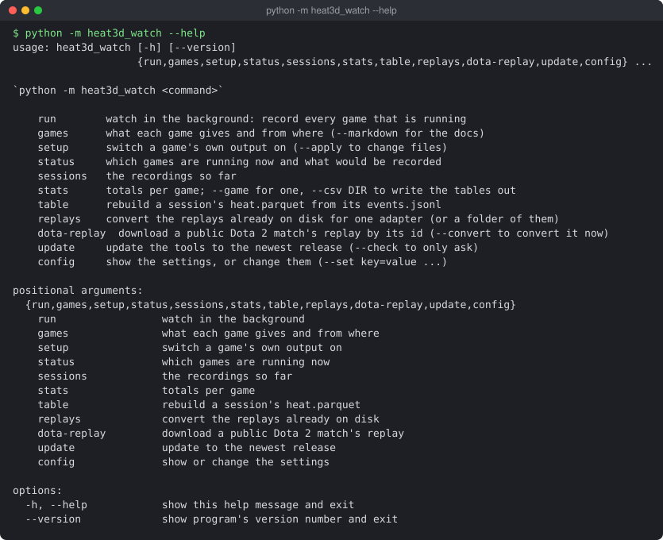
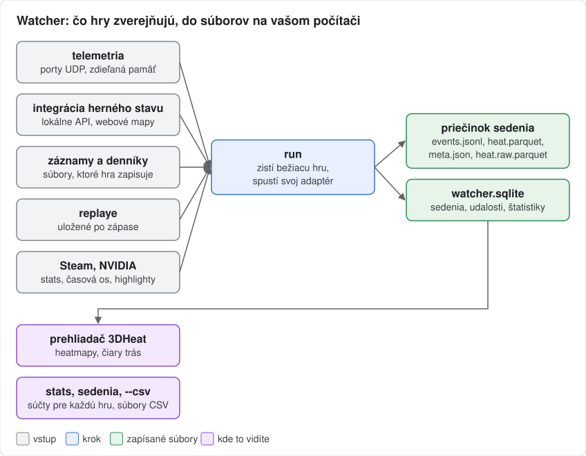
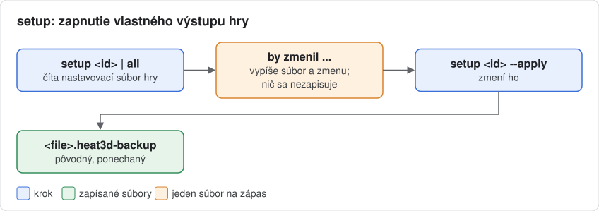
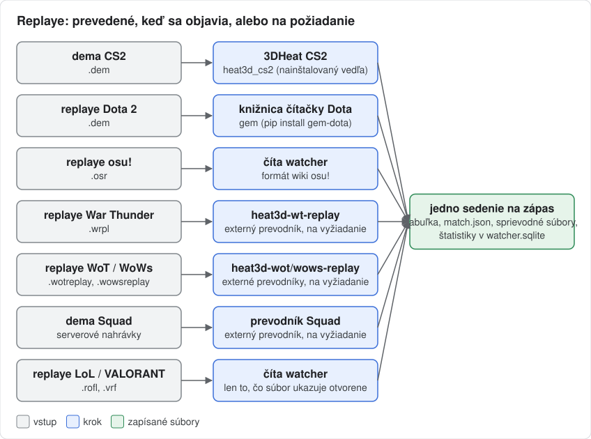
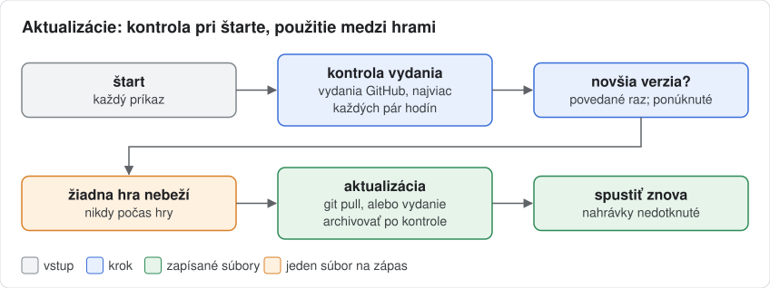

# Príkazy {#commands}

Ešte nepracujete s príkazovým riadkom? Najprv si prečítajte [Ako začať](before-you-start.md). Každý príkaz sa píše
v termináli otvorenom v priečinku, do ktorého ste rozbalili alebo naklonovali program (v Prieskumníkovi napíšte
`powershell` do adresného riadka), takto:

```bash
python -m heat3d_watch <command> [options]
```



| Príkaz | Čo robí |
|---|---|
| [`run`](#run) | sleduje na pozadí a zaznamenáva každú hru, ktorá beží |
| [`games`](#games) | čo každá hra poskytuje a odkiaľ |
| [`setup`](#setup) | zapne vlastný výstup hry |
| [`status`](#status) | ktoré hry bežia teraz a ktoré adaptéry by sa spustili |
| [`sessions`](#sessions) | doterajšie záznamy |
| [`stats`](#stats) | súčty podľa hry, alebo tabuľky ako CSV |
| [`table`](#table) | znova vytvorí `heat.parquet` relácie zo súboru `events.jsonl` |
| [`replays`](#replays) | prevedie replaye, ktoré už sú na disku |
| [`dota-replay`](#dota-replay) | stiahne replay verejného zápasu Dota 2 podľa jeho id |
| [`dota-map`](#dota-map) | mapa Dota 2 z vašej inštalácie ako 3D úroveň pre 3DHeat |
| [`update`](#update) | aktualizuje na najnovšie vydanie |
| [`config`](#config) | zobrazí alebo zmení nastavenia |

Možnosti pre každý príkaz: `-h` / `--help` vypíše nápovedu a `python -m heat3d_watch --version`
vypíše verziu (súbor `VERSION`).

Obrázky na tejto stránke sú spustenia na syntetických ukážkových reláciách (`Example Racer`, `Example Arena`),
nie na skutočných záznamoch.

Každý príkaz okrem `update` najprv hľadá novšie vydanie (najviac raz za šesť hodín; preskočí sa, ak je nastavené
`HEAT3D_NO_UPDATE=1`, pozrite [Aktualizácie](updates.md)). `run` iba vypíše oznámenie. Ostatné príkazy sa pri spustení
v termináli pýtajú `Update now? [Y/n]`, inak vypíše, ako sa aktualizovať. Výstup je v kódovaní UTF-8, takže názvy hier
v akomkoľvek písme sa vypíšu v akejkoľvek konzole.

## run {#run}

```bash
python -m heat3d_watch run [--once] [-v]
```



Sleduje, kým ho nezastavíte (Ctrl+C): každých `scan_seconds` prečíta zoznam procesov a pre každú nájdenú hru
spustí adaptér, plus adaptéry, ktoré bežia stále. Pred prvou kontrolou dokončí relácie, ktoré predchádzajúce
spustenie nechalo otvorené. Kým nebeží žiadna hra, môže sa sám aktualizovať (ak je zapnuté `auto_update`).
Podrobnosti sú v [Inštalácia a spustenie](installing-and-running.md#running).

| Možnosť | Účinok |
|---|---|
| `--once` | jedna kontrola bežiacich hier, potom skončí. Spustia sa adaptéry pre hry, ktoré práve bežia (a adaptéry, ktoré bežia stále); každý sa raz dotáže (čaká najviac 10 sekúnd) a potom sa všetky zastavia tak, ako keď hra skončí: ich relácie sa uzavrú, zapíšu a započítajú. Slúži na kontrolu, či sa hra deteguje, nie na nahrávanie. |
| `-v`, `--verbose` | ladiace riadky v `watcher.log` a v konzole |

`run` zapíše `<data>\watcher.lock` a odmietne sa spustiť druhýkrát pre ten istý dátový priečinok (kód ukončenia 1);
pozrite [Zámkový súbor](installing-and-running.md#the-lock-file).

## games {#games}

```bash
python -m heat3d_watch games [--markdown]
```


Vypíše každý adaptér zoradený podľa hry: jeho názov, id a druh, odkiaľ číta, čo zaznamenáva a ako ho zapnúť.
Adaptér, ktorý na tomto počítači nemôže bežať, je označený `[unavailable: <why>]` – SimConnect.dll sa nenašlo,
chýba priečinok Minecraftu, 3DHeat CS2 nie je nainštalované, Steam alebo NVIDIA App sa nenašli. Modul adaptéra,
ktorý sa nepodarilo načítať, je na konci uvedený aj s chybou.

```text
EA SPORTS F1 25  (f1-25, telemetry)
    from: UDP telemetry 127.0.0.1:20777 (Documents\My Games\F1 25\hardwaresettings\hardware_settings_config.xml)
    - every car's position (world XYZ, m) at 10 Hz, by driver name, team, own car marked, ...
    switch on: In the game: Settings > Telemetry Settings > UDP Telemetry On, IP 127.0.0.1, port 20777 - ...
```

`--markdown` vypíše to isté ako jednu Markdown tabuľku (hra, čo sa zaznamenáva, odkiaľ, ako to zapnúť, hra online,
overené). Tabuľka v [Všetky hry v jednej tabuľke](watcher.md) je tento výstup. Bunky sú upravené pre Markdown: text
v spätných apostrofoch zostane kódom, a mimo nich sa `<`, `>`, `&`, `*`, `|` a spätná lomka pred interpunkciou sa zapíšu
tak, aby sa zobrazili presne tak, ako sú napísané (inak by sa `<CS2>` v kramdown stratilo ako HTML značka). Jediný HTML
prvok je `<br>` medzi položkami stĺpca „Čo sa zaznamenáva“.

## setup {#setup}

```bash
python -m heat3d_watch setup <adapter id | all> [--apply]
```




Zapne vlastný výstup hry tam, kde hra potrebuje zmeniť nejaký súbor. Bez `--apply` sa nič nemení: každý riadok hovorí,
čo by sa zmenilo, a ak je čo zmeniť, posledný riadok hovorí `Nothing was changed. Run again with --apply to make these changes.`
Ak nie je čo zmeniť, vypíše `<id>: nothing to change` (`Nothing to change.` pri `all`). S `--apply` sa zmeny urobia
a pred prvou zmenou súboru sa jeho originál uloží ako `<file>.heat3d-backup`. Existujúca záloha sa nikdy neprepíše,
takže vždy obsahuje súbor v podobe, v akej bol pred prvým zásahom watchera.

```text
f1-25: would change: hardware_settings_config.xml <udp>: enabled="false" -> "true"
Nothing was changed. Run again with --apply to make these changes.
```

`all` spustí nastavenie každého adaptéra, ktoré ho má. Adaptér bez nastavenia, uvedený samostatne, vypíše
`<id>: nothing for setup to change; ` a potom, ako sa hra zapína (jeho text `enable`, alebo že nepotrebuje nič).
Neznáme id vypíše `no adapter '<id>'; games lists them` a skončí s kódom 2. Adaptéry, ktoré majú čo nastavovať:

| Adaptér | Čo mení `--apply` |
|---|---|
| `beamng` | nainštaluje protokolový mod `heat3d` do priečinka `mods` používateľa BeamNG (len ak tam ešte nie je); potom v hre zapnite Options > Other > Protocols > "others" |
| `cs2-gsi` | zapíše `<CS2>\game\csgo\cfg\gamestate_integration_heat3d.cfg`: posielať stav hry na `http://127.0.0.1:3311/` s náhodným tokenom, ktorý watcher potom vyžaduje (token, ktorý už v súbore je, sa zachová); CS2 ho načíta pri štarte |
| `dota2-gsi` | to isté pre Dota 2: `<Dota>\game\dota\cfg\gamestate_integration\gamestate_integration_heat3d.cfg`, port 3312 |
| `dcs` | pridá `Scripts\Hooks\heat3d-watch.lua` do každého priečinka `%USERPROFILE%\Saved Games\DCS*`. Jeho vlastná staršia kópia sa aktualizuje; súbor s týmto názvom, ktorý watcher nenapísal, sa nechá na pokoji. Reštartujte DCS. |
| `dirt-rally-2` | `hardware_settings_config.xml`: `<udp enabled="true" extradata="3" ip="127.0.0.1" port="20777">`; hru najprv raz spustite, aby súbor existoval |
| `ea-wrc` | `Documents\My Games\WRC\telemetry\config.json`: zapne paket `session_update` štruktúry `wrc`, pre tento počítač |
| `f1-23`, `f1-24`, `f1-25` | `hardware_settings_config.xml`: `<udp enabled="true" ip="127.0.0.1" port="20777">`; hra musí byť zatvorená |
| `hearthstone` | pridá sekciu `[Power]` (`LogLevel=1`, `FilePrinting=true`) do `%LOCALAPPDATA%\Blizzard\Hearthstone\log.config`; reštartujte hru |
| `il2` | `<game>\data\startup.cfg`, `[KEY = telemetrydevice]`: jeden ďalší cieľ `addrN = "127.0.0.1:41995"` a `enable = true` (sekcia sa pridá, ak chýba, s frekvenciou 10 Hz); reštartujte IL-2 |
| `il2-tacview` | `<game>\data\startup.cfg`, `[KEY = track_record]`: `tacviewrecord = 1` |
| `rocketleague-stats` | `TAStatsAPI.ini` (alebo `DefaultStatsAPI.ini`, ak ten neexistuje) v `<RL>\TAGame\Config`: `PacketSendRate=30`, keď je API vypnuté, a `Port`, keď nie je nastavený; číta sa pri spustení Rocket League |

`richard-burns-rally` nemá nastavenie: jeho telemetria patrí pluginu RSF/NGP, ktorý sa zapína ručne v súbore
`RichardBurnsRally.ini` (pozrite [jeho stránku](game-richard-burns-rally.md)); `setup richard-burns-rally` to povie.
Každá iná hra buď nepotrebuje nič, alebo sa zapína v samotnej hre; stránka každej hry hovorí, ako.

## status {#status}

```bash
python -m heat3d_watch status
```

```text
3DHeat Watcher 1.0.2; data in C:\Users\...\AppData\Local\3DHeat\Watcher
Games running: EA SPORTS F1 25 (f1-25)
Always on: il2-tacview, steam-stats, steam-timeline, nvidia-highlights, cs2-demos, osu-replays, lol-replays, valorant-replays
```

Povie, ktoré adaptéry by `run` teraz spustil, podľa tých istých pravidiel: beží proces hry, adaptér nie je v
`disabled`, nechýba nič, čo potrebuje, replay adaptéry len so zapnutým `replays`, pamäťové adaptéry len so zapnutým
`memory` a po každej kontrole pamäte. Nič nespúšťa.

## sessions {#sessions}

```bash
python -m heat3d_watch sessions [--game NAME] [--limit N]
```


Najnovšie relácie z `watcher.sqlite`, po jednom riadku: začiatok (miestny čas), hra, minúty, udalosti, pozície, priečinok.

| Možnosť | Účinok |
|---|---|
| `--game NAME` | len táto hra, podľa presného názvu zo zoznamu (`"EA SPORTS F1 25"`) |
| `--limit N` | najviac N relácií (predvolene 40) |

## stats {#stats}

```bash
python -m heat3d_watch stats [--game NAME] [--csv DIR]
```


Bez možností: tabuľka každej hry (relácie, hodiny, udalosti, pozície, naposledy hraná), najčastejšie hrané ako prvé,
a potom pre každú hru jej 25 najčastejších udalostí a každá číselná štatistika s počtom relácií, ktoré ju majú,
súčtom, najlepšou hodnotou (`best`) a priemerom. `best` vie, ktorý smer je lepší: najnižšiu hodnotu pri časoch
uložených ako najlepšie (`best_lap`, `best_stage` a každý ďalší kľúč začínajúci na `best_`) a pri umiestneniach
(`race_position`, `grid_position`, každý kľúč končiaci na `_position`), najvyššiu pri všetkom ostatnom (zabitia,
vzdialenosť, najvyššia rýchlosť, počítadlá samotnej hry).

| Možnosť | Účinok |
|---|---|
| `--game NAME` | len udalosti a štatistiky tejto hry, bez prehľadu |
| `--csv DIR` | zapíše `sessions.csv`, `events.csv` a `stats.csv` (každý riadok z troch tabuliek) do `DIR` namiesto výpisu; `--game` ho nezúži |

## table {#table}

```bash
python -m heat3d_watch table <session folder>
```


Znova vytvorí `heat.parquet` v priečinku relácie z jej `events.jsonl`, s osami z jej `meta.json`. Vypíše cestu
k tabuľke, alebo `no positions in this session`. Použite to pri relácii nahratej, keď chýbal `pyarrow`, alebo
po tom, ako ste `events.jsonl` upravili ručne.

## replays {#replays}

```bash
python -m heat3d_watch replays <adapter id> [folder] [-v]
```



Prevedie replaye, ktoré už sú na disku, hneď, jeden za druhým, a každý uloží do relácie rovnako, ako by ju zachytil
watch. Keď watcher prvýkrát uvidí priečinok s replaymi, iba si poznačí, čo je v ňom (pozrite
[Inštalácia a spustenie](installing-and-running.md#replays-already-on-disk)); týmto príkazom sa tieto replaye
prevedú na požiadanie. Bez `folder` sa čítajú priečinky adaptéra (hry, plus `replay_folders`); s ním sa čítajú
replaye v tom jednom priečinku. Každý prevedený replay sa označí ako videný, takže spustený watcher ho znova
neprevedie. Replay, ktorý sa nepodarilo previesť, sa zapíše do záznamu a preskočí sa.

| Adaptér | Replaye |
|---|---|
| `cs2-demos` | dema Counter-Strike 2 (`*.dem`), cez 3DHeat CS2 |
| `lol-replays` | replaye League of Legends (`*.rofl`) |
| `osu-replays` | replaye osu! (`*.osr`) |
| `valorant-replays` | replaye VALORANT (`*.vrf`) |
| `warthunder-replays` | replaye War Thunder (`*.wrpl`), cez externý konvertor `heat3d-wt-replay` (exporters/ext/warthunder-replay) |
| `wot-replays` | replaye World of Tanks (`*.wotreplay`), cez externý konvertor `heat3d-wot-replay` (exporters/ext/wot-replay) |
| `wows-replays` | replaye World of Warships (`*.wowsreplay`), cez externý konvertor `heat3d-wows-replay` (exporters/ext/wows-replay) |
| `dota-replays` | replaye Dota 2 (`*.dem`), cez gem (`pip install gem-dota`) |

```text
osu-replays: converted 12 replay(s); `sessions --game` lists them
```

Id, ktoré nie je jedným z týchto, vypíše `no replay adapter '<id>'` so zoznamom a skončí s kódom 2; rovnako
`folder`, ktorý neexistuje. Adaptér, ktorý tu nemôže bežať (3DHeat CS2 nie je nainštalované), vypíše dôvod a skončí
s kódom 1. Stopy Tacview z hry IL-2 v zozname nie sú: tento adaptér prevedie každú dokončenú stopu, ktorú nájde, sám.

## dota-replay {#dota-replay}

```bash
python -m heat3d_watch dota-replay <match id> [<match id> ...] [-o FOLDER] [--convert] [-v]
```

Stiahne replay verejného zápasu Dota 2 zo serverov replayov Valve. Potrebuje internet. ID zápasu je číslo na stránke
zápasu v klientovi Dota (podrobnosti zápasu) alebo na webe OpenDota. Valve uchováva replay niekoľko týždňov, potom
sťahovanie zlyhá. Server a soľ replayu sa berú zo záznamu zápasu v OpenDota (`api.opendota.com/api/matches/<id>`,
kľúč nie je potrebný), súbor z `replay<cluster>.valve.net/570/<id>_<salt>.dem.bz2`. Rozbaľuje sa, ako prichádza
(Valve pod týmto názvom posiela bzip2 aj Zstandard), a uloží sa ako `<match id>.dem`. Bez `-o` sa uloží do priečinka
replayov Dota 2, ak je Dota 2 nainštalovaná – tam ho spustený watcher prevedie – inak do `<data>/replays/dota`.
Súbor, ktorý tam už je, sa zachová. `--convert` prevedie stiahnuté replaye hneď, tak ako `replays dota-replays`,
a označí ich ako videné.

```text
match 9000000000: C:\Program Files (x86)\Steam\steamapps\common\dota 2 beta\game\dota\replays\9000000000.dem
```

Valve uchováva replaye niekoľko týždňov; starší zápas vypíše `Valve no longer has the replay of match <id>` a skončí
s kódom 1. Zápas, ktorý OpenDota ešte nevidela, nemá soľ: správa vám povie, aby ste si ju od OpenDota vyžiadali
(`curl -X POST https://api.opendota.com/api/request/<id>`), a aby ste to skúsili o pár minút. Súkromné lobby
a zápasy so skrytým profilom na serveroch replayov vôbec nie sú.

## dota-map {#dota-map}

```bash
python -m heat3d_watch dota-map [<map>] -o <file.glb> [--game FOLDER] [--source2viewer EXE] [--detail UNITS]
```

Zapíše mapu Dota 2 – terén, útesy, vodu, stromy a budovy – ako úroveň `.glb` v súradnicovej sústave, v akej sa kreslia
tabuľky replayov Dota, z vašej vlastnej inštalácie Dota 2. Číta ju príkazový riadok Source2Viewer. Nič sa nesťahuje.
`<map>` je predvolene `dota`; `--game` je priečinok Dota 2, ak nie je v knižnici Steam; `--source2viewer` cesta k CLI,
ak nie je ani v `HEAT3D_SOURCE2VIEWER`, ani v `PATH`; `--detail` veľkosť bunky zlučovania vrcholov pre budovy v herných
jednotkách (predvolene 8, 0 zachová každý trojuholník). Skončí s kódom 1 a `dota-map: <why>`, keď sa nenájde Dota 2,
mapa alebo Source2Viewer. Každý krok, časti súboru a to, ako sa overil: [Mapa Dota 2](dota-map.md).

## update {#update}

```bash
python -m heat3d_watch update [--check]
```



Opýta sa GitHubu na najnovšie vydanie, ignoruje uloženú odpoveď a ak je novšie, aktualizuje túto kópiu (pozrite
[Aktualizácie](updates.md)). `--check` iba povie, či je vonku novšie vydanie. Tento príkaz beží aj vtedy, keď je
nastavené `HEAT3D_NO_UPDATE`: keďže ho žiadate, je to vaše rozhodnutie. `python -m heat3d_update [--check]` robí
to isté.

## config {#config}

```bash
python -m heat3d_watch config [--set KEY=VALUE ...]
```


Vypíše každé nastavenie ako `key = value`. S `--set` najprv zmení uvedené nastavenia a uloží `settings.json`
(`saved <path>`). Hodnoty sa čítajú podľa typu nastavenia:

- nastavenia áno/nie (pravda/nepravda): `1`, `true`, `yes`, `on` alebo `ja` je pravda; `0`, `false`, `no`, `off`,
  `nein` alebo nič je nepravda;
- čísla: desatinné číslo (`scan_seconds=5`);
- zoznamy: oddelené čiarkou alebo ako zoznam JSON (`disabled=steam-stats,steam-timeline`; prázdna hodnota zoznam vymaže);
- slovníky (`replay_folders`, `player_names`): celý slovník ako JSON, alebo jedna položka ako `KEY.ID=VALUE` –
  `replay_folders.cs2-demos=D:\Demos,E:\More Demos` nastaví priečinky tohto adaptéra (oddelené čiarkou),
  `player_names.warthunder-webmap=Name` meno tohto adaptéra; prázdna hodnota položku odstráni;
- text: tak, ako je zadaný (`data=D:\Heat`, `riot_id=Name#TAG`).

```bash
python -m heat3d_watch config --set memory=true scan_seconds=5
python -m heat3d_watch config --set riot_id=Name#TAG riot_platform=EUW1
python -m heat3d_watch config --set replay_folders.cs2-demos=D:\Demos player_names.rocketleague-stats=Name
```

Neznámy kľúč vypíše `no setting '<key>'`, a hodnota, ktorá nie je typu nastavenia (`memory=perhaps`,
`scan_seconds=often`, slovník, ktorý nie je JSON), vypíše `not saved: ...`. Obe skončia s kódom 2 bez uloženia čohokoľvek.
Ručne upravený `settings.json` sa číta rovnako: hodnota zadaná ako text tam, kde je nastavenie číslo, pravda/nepravda
alebo slovník, sa prečíta tak, ako je napísaná, a ak sa nedá prečítať, ostane na predvolenej hodnote. Každé nastavenie
je popísané v [Inštalácia a spustenie](installing-and-running.md#settings).
