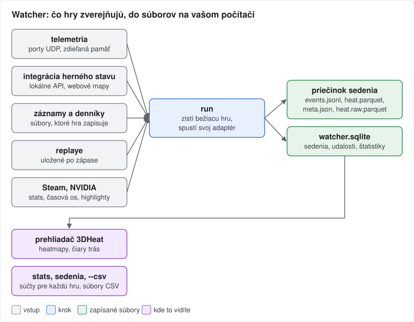

# 3DHeat Watcher {#dheat-watcher}

**Čo to je?** Hráte hru. Tento program potichu zapisuje, kde ste boli a čo sa stalo.
Neskôr to môžete pozrieť ako farebnú mapu v prehliadači 3DHeat.

**Prečo by som ho použil?** Aby ste si uchovali vlastný záznam každého sedenia – kde ste jazdili, lietali alebo bojovali,
vaše súčty pre každú hru – bez akejkoľvek webovej stránky a bez zmeny hry.

**Príklad:** jazdíte kolo v pretekárskej hre, kým beží watcher; potom súbor v
`sessions\<game>\` obsahuje čiaru, ktorou ste išli, a prehliadač ju nakreslí.

Podrobnejšie: 3DHeat Watcher je program bežiaci na pozadí, ktorý zaznamenáva, čo hry zverejňujú o vašej hre – kde ste
boli, čo sa kde stalo a čísla za tým – do súborov na vašom vlastnom počítači. Súbory slúžia
na vaše vlastné štatistiky a na heatmapy a čiary trás prehliadača 3DHeat.

Beží potichu, zistí, ktorú hru ste spustili, a číta výstupy tejto hry: telemetrický port
alebo zdieľanú pamäť, ktorú hra zverejňuje pre dashboardy, integráciu herného stavu, denník alebo záznam, ktorý hra
zapisuje, replay, ktorý uloží po zápase, štatistiky, ktoré vedie Steam, klipy, ktoré ukladá
NVIDIA App. Nahrávky zostávajú na vašom počítači. Program kontaktuje len dve vonkajšie služby, a to len
v týchto prípadoch: GitHub, kvôli hľadaniu novšieho vydania (pozri [Aktualizácie](../updates.md)), a Riot Match-V5 API,
a to len vtedy, ak zadáte svoj vlastný kľúč API Riot (pozri [Replaye League of Legends](../game-lol-replays.md)).



## Čo zaznamenáva {#what-it-records}

- **Polohy**: auto, lietadlo, hrdina alebo hráč, niekoľkokrát za sekundu tam, kde ich hra zverejňuje,
  s rýchlosťou, smerom a čímkoľvek ďalším, čo hra posiela spolu s nimi.
- **Udalosti**: vznik, smrti, zabitia, kolá, etapy, kolá zápasu, góly, úlohy, vzlety a pristátia, zmeny zóny,
  úspechy, najlepšie momenty. Každá udalosť sa ukladá s časom a s miestom, keď ho hra uvedie.
- **Štatistiky pre každé sedenie**: zabitia, smrti, kolá, najlepšie kolo, vzdialenosť, najvyššia rýchlosť, čas hrania a
  vlastné štatistiky hry, kde ich vedie.

Čo každá hra dáva a odkiaľ, je na jej vlastnej stránke v časti [Hry](../games.md). Jeden zdroj nedokáže
zaznamenať všetko: hry pre viacerých hráčov sa zaznamenávajú len cez to, čo zverejňujú, a
watcher nikdy nečíta ich pamäť (pozri [Zdroje a pravidlá](../sources-and-rules.md)).

## Inštalácia {#install}

Nikdy ste nepracovali s príkazovým riadkom? Najprv si prečítajte [Ako začať](before-you-start.md).

Watcher je program v Pythone pre Windows (Python 3.10 alebo novší). Mnohé jeho zdroje existujú len vo Windowse: zdieľaná
pamäť, register, oznámenia Windows.

```bash
git clone https://github.com/Holdi601/3DHeat-Watcher.git
cd 3DHeat-Watcher
pip install -r requirements.txt
```

Stiahnutý archív vydania funguje rovnako: rozbaľte ho a potom spustite `pip install -r requirements.txt`
vnútri priečinka. Podrobnosti a doplnky, ktoré niektoré hry potrebujú, sú v
[Inštalácia a spúšťanie](../installing-and-running.md).

## Rýchly štart {#quick-start}

```bash
python -m heat3d_watch games            # čo každá hra dáva a odkiaľ
python -m heat3d_watch setup all        # čo by sa muselo zapnúť (nič sa nemení)
python -m heat3d_watch setup f1-25 --apply   # zapne výstup jednej hry (pôvodný súbor sa zálohuje)
python -m heat3d_watch run              # sleduj; nechaj bežať, kým hráte
python -m heat3d_watch stats            # súčty pre každú hru
python -m heat3d_watch stats --csv out  # sedenia, udalosti a štatistiky ako súbory CSV
```

Mali by ste vidieť: po `games` tabuľku s jedným riadkom na hru; `run` beží ďalej, kým nestlačíte
Ctrl+C alebo nezavriete okno.

Všetko sa zapisuje do `%LOCALAPPDATA%\3DHeat\Watcher`. Ak chcete iný priečinok, nastavte
premennú prostredia `HEAT3D_WATCH_HOME` alebo spustite `python -m heat3d_watch config --set data=D:\somewhere`.

- `sessions\<game>\<date>_<adapter>\` – jeden priečinok na sedenie, s `events.jsonl` (každá udalosť
  v čase, keď nastane), `heat.parquet` (riadky s polohou, pripravené pre prehliadač 3DHeat) a
  `meta.json` (hra, zdroj, osi, počty, štatistiky)
- `watcher.sqlite` – štatistiky každého sedenia v troch jednoduchých tabuľkách
- `watcher.log` – čo watcher robil

Prehliadač otvorí `heat.parquet` sedenia priamo, bez akéhokoľvek nastavenia (jeho osi a jednotky sú v
súbore). Prevedené replaye sa zapisujú ako tabuľky a dokumenty zápasov vedľa neho; vlastný
formát prehliadača jeden súbor na zápas je opísaný na jeho stránke
[`.3dheat` kontajner](https://holdi601.github.io/3DHeat/container.html) a stĺpce každej tabuľky na stránke
[Dáta](../the-data.md).

## Dokumentácia {#the-documentation}

| Stránka | Čo obsahuje |
|---|---|
| [Ako začať](before-you-start.md) | Python, terminál, zástupné znaky, ako vyzerá úspech a bežné chyby |
| [Inštalácia a spúšťanie](../installing-and-running.md) | požiadavky, beh na pozadí, spustenie so systémom Windows, zámkový súbor, záznam, každé nastavenie a premenná prostredia |
| [Hry](../games.md) | jedna stránka pre každú hru: čo sa zaznamenáva, odkiaľ, ako ju zapnúť, ako funguje, osi, štatistiky, čo bolo overené |
| [Dáta](../the-data.md) | priečinky sedení, `events.jsonl`, `heat.parquet` a jeho pätička, `meta.json`, `watcher.sqlite`, obnova po páde, export CSV, otvorenie sedenia v prehliadači 3DHeat |
| [Príkazy](../commands.md) | každý príkaz a možnosť `python -m heat3d_watch` |
| [Zdroje a pravidlá](../sources-and-rules.md) | šesť druhov zdrojov, pravidlá pre hry pre viacerých hráčov, ktoré hry sú vynechané a prečo |
| [NVIDIA Highlights](../nvidia-highlights.md) | čo NVIDIA Highlights dokáže a nedokáže dodať a ako highlight dostane polohu |
| [Serverové nahrávacie mody](../server-mods.md) | mody serverov Arma 3 a Arma Reforger, ktoré nahrávajú celé misie pre prehliadač |
| [Čítanie pamäte](../memory-reading.md) | profily pamäte pre jedného hráča: formát, kontroly, ako napísať a overiť jeden |
| [Aktualizácie](../updates.md) | ako watcher hľadá nové vydania a ako sa sám aktualizuje |
| [Vývoj](../development.md) | písanie adaptéra: API, testy, poctivý `verified`, regenerovanie stránok hier |
| [Všetky hry v jednej tabuľke](../watcher.md) | každá hra v jednej tabuľke, tak ako ju vypisuje `games --markdown`, plus hry preskúmané, ale zatiaľ nezostavené |
| [Referencia príkazov](../cli-reference.md) | `--help` každého príkazu, generované z kódu |
| [Údržba](../maintaining.md) | kontrolný zoznam vydania pre tieto stránky |

## Súčasť 3DHeat {#part-of-3dheat}

3DHeat Watcher je jeden z bezplatných nástrojov okolo prehliadača 3DHeat (watcher používa 3DHeat CS2
na prevod dem CS2). Každý je vlastný projekt s vlastnými vydaniami a licenciou:

| Nástroj | Čo robí | Dokumentácia |
|---|---|---|
| [3DHeat](https://github.com/Holdi601/3DHeat) | prehliadač: heatmapy, analýza pretekov a prehľad zápasov v 3D | [stránka](https://holdi601.github.io/3DHeat/) |
| [GameFiles](https://github.com/Holdi601/3DHeat-GameFiles) | trate a úrovne zo súborov, ktoré hry dodávajú, ako 3D modely | [stránka](https://holdi601.github.io/3DHeat-GameFiles/) |
| [GameCapture](https://github.com/Holdi601/3DHeat-GameCapture) | telemetria kôl z pretekárskych hier; úrovne zrekonštruované z videa hry | [stránka](https://holdi601.github.io/3DHeat-GameCapture/) |
| [Unreal Exporter](https://github.com/Holdi601/3DHeat-UnrealExporter) | plugin pre Unreal Editor, ktorý exportuje úroveň ako jeden 3D model | [stránka](https://holdi601.github.io/3DHeat-UnrealExporter/) |
| [CS2](https://github.com/Holdi601/3DHeat-CS2) | dema Counter-Strike 2 do tabuliek a dokumentov zápasov; mapy do 3D modelov | [stránka](https://holdi601.github.io/3DHeat-CS2/) |
| [Watcher](https://github.com/Holdi601/3DHeat-Watcher) | zaznamenáva vašu hru na pozadí z toho, čo hry zverejňujú | [stránka](https://holdi601.github.io/3DHeat-Watcher/) |
| [Ext-WarThunder](https://github.com/Holdi601/3DHeat-Ext-WarThunder) | replaye War Thunder do tabuliek a dokumentov zápasov | [stránka](https://holdi601.github.io/3DHeat-Ext-WarThunder/) |
| [Ext-WoT](https://github.com/Holdi601/3DHeat-Ext-WoT) | replaye World of Tanks do tabuliek a dokumentov zápasov | [stránka](https://holdi601.github.io/3DHeat-Ext-WoT/) |
| [Ext-WoWs](https://github.com/Holdi601/3DHeat-Ext-WoWs) | replaye World of Warships do tabuliek a dokumentov zápasov | [stránka](https://holdi601.github.io/3DHeat-Ext-WoWs/) |
| [Ext-Squad](https://github.com/Holdi601/3DHeat-Ext-Squad) | dema zo serverov Squad do tabuliek a dokumentov zápasov | [stránka](https://holdi601.github.io/3DHeat-Ext-Squad/) |
| [Ext-DCS](https://github.com/Holdi601/3DHeat-Ext-DCS) | mapy DCS World do 3D modelov | [stránka](https://holdi601.github.io/3DHeat-Ext-DCS/) |
| [Ext-IL2](https://github.com/Holdi601/3DHeat-Ext-IL2) | mapy IL-2 Sturmovik do 3D modelov | [stránka](https://holdi601.github.io/3DHeat-Ext-IL2/) |

Licencia: MIT ([LICENSE](https://github.com/Holdi601/3DHeat-Watcher/blob/main/LICENSE)). Licencie
balíkov tretích strán, ktoré používa, a to, čo vyžadujú hry, ktoré číta, sú uvedené v
[LICENSES.md](https://github.com/Holdi601/3DHeat-Watcher/blob/main/LICENSES.md).
