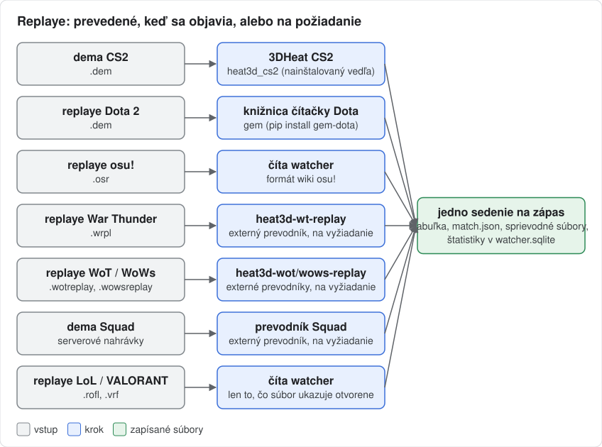

# Inštalácia a spustenie {#installing-and-running}

## Požiadavky {#requirements}

- **Windows.** Watcher je napísaný pre Windows a väčšina jeho zdrojov existuje len tam: zdieľaná pamäť, ktorú hry
  vytvárajú (mapovania `Local\...`), register (kde je Steam), upozornenia Windows, zoznam procesov s cestami
  k spustiteľným súborom. Na inom systéme sa program spustí, ale tieto zdroje nič nenájdu, upozornenia sa iba zapíšu
  do záznamu a čítanie pamäte odmietne („only implemented on Windows“).
- **Python 3.10 alebo novší**, z <https://www.python.org/downloads/>: v inštalátore zaškrtnite **Add python.exe to PATH**
  a potom overte v novom termináli príkazom `python --version`. Ste v tom noví? Najprv si prečítajte
  [Ako začať](before-you-start.md).
- **Balíky** (`requirements.txt`): `psutil>=6.0` (ktoré hry bežia, ktorý program drží port, spojenia hry; staršia verzia
  psutil funguje tiež, cez svoj starší názov pre spojenia procesu), `pyarrow>=15` (zápis `heat.parquet`),
  `numpy>=1.24` a `pytest>=8.0` pre testy. `requirements-optional.txt` momentálne neuvádza žiadne balíky.

Bez `pyarrow` sa relácie stále zaznamenávajú: `events.jsonl` je záznam a tabuľku možno vytvoriť neskôr príkazom
[`table`](commands.md#table).

### Doplnky, ktoré niektoré hry potrebujú {#extras-some-games-need}

| Hra | Čo potrebuje |
|---|---|
| Counter-Strike 2 dema | [3DHeat CS2](https://github.com/Holdi601/3DHeat-CS2) a jeho požiadavky (`demoparser2`). Watcher ho hľadá v `HEAT3D_CS2`, potom v priečinku `3DHeat-CS2` alebo `cs2` vedľa priečinka watchera, potom kdekoľvek, odkiaľ Python dokáže importovať `heat3d_cs2`. Bez neho `games` uvedie adaptér ako nedostupný. |
| Microsoft Flight Simulator 2020 / 2024 | `SimConnect.dll` – nie je priložené. MSFS 2020 ho má vo svojom inštalačnom priečinku; pre MSFS 2024 nainštalujte SDK MSFS 2024. `MSFS_SDK` / `MSFS2024_SDK` ukazujú na priečinok SDK. |
| Euro Truck Simulator 2, American Truck Simulator | plugin RenCloud `scs-telemetry.dll` (revízia 12) v `<game>\bin\win_x64\plugins` |
| BeamNG.drive | protokolový mod `heat3d`, nainštaluje ho `python -m heat3d_watch setup beamng --apply` |
| League of Legends (živé) | voliteľné: koreňový certifikát Riotu ako `<data>\riotgames.pem`, aby sa lokálne spojenie overovalo |
| Minecraft | priečinok `%APPDATA%\.minecraft` (Java Edition) |

Stránka každej hry pod [Hry](games.md) hovorí, čo sa musí zapnúť v samotnej hre.
`python -m heat3d_watch games` označí adaptér `[unavailable: ...]`, keď na tomto počítači chýba niečo, čo potrebuje.

## Inštalácia {#installing}

Ste v príkazovom riadku noví? Najprv si prečítajte [Ako začať](before-you-start.md). Ak sa `pip` nenájde, použite
namiesto neho `python -m pip install -r requirements.txt`.

Z klonu:

```bash
git clone https://github.com/Holdi601/3DHeat-Watcher.git
cd 3DHeat-Watcher
pip install -r requirements.txt
```

Z vydania: stiahnite archív zo stránky vydaní repozitára, rozbaľte ho a v priečinku spustite
`pip install -r requirements.txt`. Obe kópie sa aktualizujú samy (pozrite [Aktualizácie](updates.md)).

Každý príkaz spúšťajte z priečinka repozitára: `python -m heat3d_watch` importuje balík odtiaľ a aktualizátor
(`heat3d_update`) je vedľa neho.

## Spustenie {#running}

```bash
python -m heat3d_watch run        # watch until stopped
python -m heat3d_watch run -v     # the same, with debug lines in the log
python -m heat3d_watch run --once # one look at the games running now, then stop and exit
```

Pri štarte `run`:

1. zapíše [zámkový súbor](#the-lock-file);
2. dokončí relácie, ktoré nechal otvorené predchádzajúci beh, napríklad po páde
   (pozrite [Obnova](the-data.md#recovery-after-a-crash));
3. každých `scan_seconds` (2 s) prečíta zoznam procesov (len názvy a cesty, žiadny proces sa neotvára)
   a pre každú nájdenú hru spustí adaptér vo vlastnom vlákne. Keď proces hry zmizne, jeho adaptér sa zastaví
   a relácie, ktoré mal otvorené, sa uzavrú, čím sa zapíše ich tabuľka a ich riadok v štatistikách. Adaptéry, ktoré
   nečakajú na hru (štatistiky Steamu, Steam Timeline, NVIDIA highlights, priečinky replayov), bežia stále;
4. kým nebeží žiadna hra, hľadá novšie vydanie najviac raz za hodinu (samotná odpoveď sa ukladá na šesť hodín),
   a ak je zapnuté `auto_update`, nainštaluje ho a spustí sa znova (pozrite [Aktualizácie](updates.md)).

Adaptér, ktorý zlyhá, sa zapíše do záznamu a neovplyvní ostatné. Ak dotaz adaptéra zlyhá 20-krát za sebou, alebo
zlyhá jeho štart, adaptér sa zastaví a nespustí sa znova, kým sa hra nespustí znova (nové id procesu).

Watcher zastavíte cez Ctrl+C. Adaptéry pred ukončením uzavrú svoje relácie. Ak sa watcher zabije inak (Správca úloh,
pád, výpadok prúdu), nestratí sa nič, čo už bolo zapísané: ďalší `run` tie relácie dokončí.

`--once` urobí jednu kontrolu: spustí adaptéry pre hry, ktoré v tom momente bežia (a adaptéry, ktoré bežia stále),
nechá každý raz dotiahnuť (čaká na to najviac 10 sekúnd) a potom ich zastaví tak, ako by ich zastavil koniec hry,
takže relácie, ktoré otvorili, sa uzavrú, ich tabuľky sa zapíšu a ich riadky sa započítajú do štatistík, až potom
program skončí. Použite to na kontrolu, či sa hra deteguje, nie na nahrávanie.

### Replaye, ktoré sú už na disku {#replays-already-on-disk}



Keď replay adaptér prvýkrát uvidí jeden zo svojich priečinkov, iba si poznačí replaye, ktoré sú v ňom. Hráč s rokmi
uložených dem by inak watcher zamestnal na deň prevádzaním. Odvtedy sa každý nový replay prevedie raz, keď hra dopíše jeho
zápis. Staré sa prevedú na požiadanie príkazom [`replays`](commands.md#replays):

```bash
python -m heat3d_watch replays cs2-demos              # every demo in CS2's folders and replay_folders
python -m heat3d_watch replays osu-replays D:\Old     # the replays in one folder
```

### Beh na pozadí {#running-in-the-background}

Watcher nemá vlastné okno; je to konzolový program, ktorý beží, kým sa nezastaví. Všetko zapisuje do `watcher.log`,
takže nepotrebuje viditeľnú konzolu. Spôsoby, ako ho mať mimo cesty:

- spustite ho v konzole a konzolu minimalizujte: `start "" /min python -m heat3d_watch run` z `cmd`, v priečinku
  repozitára;
- spustite ho bez konzoly: `pythonw -m heat3d_watch run`. Výstup do konzoly sa stratí, ale `watcher.log` sa stále
  zapisuje. Na zastavenie ukončite proces `pythonw.exe`; ďalší štart potom dokončí relácie, ktoré nechal otvorené.
  Projekt tento spôsob spúšťania netestoval.

### Spustenie spolu so systémom Windows (nápad) {#starting-with-windows-an-idea}

Watcher sa do Windows neinštaluje, aby sa spúšťal sám. Ak ho chcete spúšťať automaticky:

- **Plánovač úloh**: vytvorte úlohu so spúšťačom *At log on* a akciou *Start a program*, program `pythonw.exe`
  (alebo `python.exe`), argumenty `-m heat3d_watch run`, *Start in* nastavené na priečinok repozitára;
- **priečinok Po spustení**: dajte odkaz do `shell:startup` s rovnakým programom, argumentmi a priečinkom *Start in*.

Nič z toho nie je súčasťou watchera ani ním netestované. [Zámkový súbor](#the-lock-file) zabezpečí, že druhá kópia,
spustená omylom, hneď skončí.

## Zámkový súbor {#the-lock-file}

`<data>\watcher.lock` obsahuje id procesu bežiaceho watchera. Keď sa `run` spustí a zámkový súbor uvádza proces, ktorý
ešte existuje a ktorého názov obsahuje `python`, vypíše

```text
A watcher is already running (process 12345) for C:\Users\...\3DHeat\Watcher.
```

a skončí s kódom 1. Dva watchery nad jedným dátovým priečinkom by zaznamenávali každú hru dvakrát a druhý by považoval
otvorené relácie prvého za pozostatky po páde. Zámkový súbor, ktorého proces už neexistuje, alebo patrí inému programu,
sa prepíše. Keď `run` skončí, zámkový súbor odstráni, ak stále uvádza jeho vlastný proces.

## Log {#the-log}

`<data>\watcher.log` zapisuje iba `run`; ostatné príkazy vypisujú do konzoly. Každý riadok má čas, úroveň a správu:

```text
2026-05-01 20:15:01,123 INFO watching; data in C:\Users\...\AppData\Local\3DHeat\Watcher
2026-05-01 20:15:03,456 INFO f1-25: starting (EA SPORTS F1 25)
2026-05-01 21:02:11,789 INFO f1-25: stopping
```

Adaptéry zapisujú, čo nemôžu urobiť a prečo: „UDP 20777 is in use by ...; not taking it from that program“,
„not reading memory: the game is played online“, „could not start“, „poll failed (3)“ s výpisom chyby. `run -v` pridá
ladiace riadky. Súbor sa pripisuje a watcher ho nikdy nerotuje ani nevyprázdňuje; zmažte ho, kedykoľvek chcete.
Tie isté riadky idú aj do konzoly.

## Kde je všetko {#where-everything-is}

Domovský priečinok je `%LOCALAPPDATA%\3DHeat\Watcher`, alebo `HEAT3D_WATCH_HOME`, ak je nastavené (bez `LOCALAPPDATA`,
napríklad na inom systéme, `~/.local/share/3DHeat/Watcher`). `settings.json` je vždy v domovskom priečinku. Všetko
ostatné ide do dátového priečinka, ktorým je domovský priečinok, pokiaľ nastavenie `data` neuvádza iný:

| Cesta | Čo je |
|---|---|
| `<home>\settings.json` | nastavenia |
| `<data>\sessions\` | záznamy, jeden priečinok na sedenie ([Údaje](the-data.md)) |
| `<data>\watcher.sqlite` | databáza štatistík |
| `<data>\watcher.log` | log príkazu `run` |
| `<data>\watcher.lock` | zámkový súbor, kým beží `run` |
| `<data>\state\` | čo už videli adaptéry, ktoré bežia stále, a replay adaptéry (`steam-stats.json`, `replays-cs2-demos.json`, ...), aby reštart nezaznamenal nič dvakrát |
| `<data>\profiles\*.json` | profily pamäte, ktoré ste napísali ([Čítanie pamäte](memory-reading.md)) |
| `<data>\riotgames.pem` | voliteľné, koreňový certifikát Riotu pre adaptér živej League of Legends |
| `%LOCALAPPDATA%\3DHeat\update-check-3DHeat-Watcher.json` | uložená odpoveď poslednej kontroly vydania |

Watcher nič v týchto priečinkoch nemaže, okrem priečinka relácie, v ktorom sa nič nezaznamenalo (hra zostala v menu).

## Nastavenia {#settings}

`python -m heat3d_watch config` zobrazí nastavenia; `config --set key=value ...` ich zmení a uloží `settings.json`
(pozrite [config](commands.md#config)). Súbor je obyčajný JSON a dá sa upravovať ručne, keď watcher nebeží. Neznáme kľúče
v ňom sa ignorujú. Nastavenia sa čítajú pri štarte príkazu, takže po zmene reštartujte `run`.

| Nastavenie | Predvolené | Čo robí |
|---|---|---|
| `data` | `""` | Dátový priečinok. Prázdne: domovský priečinok. |
| `disabled` | `[]` | Id adaptérov, ktoré nikdy nebežia, napríklad `config --set disabled=steam-stats,nvidia-highlights`. Každý iný adaptér beží, keď nájde svoju hru. |
| `auto_update` | `true` | Keď nebeží žiadna hra, nainštaluje novšie vydanie a reštartuje sa (pozrite [Aktualizácie](updates.md)). `false`: iba upozornenie v logu. |
| `scan_seconds` | `2.0` | Sekundy medzi kontrolami zoznamu procesov. |
| `memory` | `false` | Povolí, aby bežali pamäťové adaptéry (hry pre jedného hráča s profilom, ktorý ste napísali). Predvolene vypnuté; pozrite [Čítanie pamäte](memory-reading.md). |
| `replays` | `true` | Spustí replay adaptéry: všetky (pozrite `python -m heat3d_watch replays` a [Hry](games.md)) – dema CS2, Dota 2, osu!, War Thunder, World of Tanks, World of Warships, Squad, replaye League of Legends a VALORANT, záznamy Tacview z IL-2. |
| `replay_folders` | `{}` | Ďalšie priečinky podľa id adaptéra, napríklad `{"cs2-demos": ["D:\\Demos"]}`. Replay adaptéry sledujú aj ich, popri vlastných priečinkoch hry; `il2-tacview` prijíma aj inštalačné priečinky (potom hľadá v ich `data\Tracks`); pre `elite` prvý priečinok nahrádza priečinok žurnálu. Priečinky jedného adaptéra nastavte `config --set replay_folders.cs2-demos=D:\Demos,E:\More`, alebo celý slovník ako JSON. |
| `riot_id` | `""` | Váš Riot ID (`Name#TAG`), aby sa váš vlastný riadok v replaji League of Legends stal vašou štatistikou. Prázdne: každý riadok hráča sa zachová, nik nie je označený ako váš. |
| `riot_api_key` | `""` | Váš vlastný vývojársky kľúč API Riotu, na stiahnutie oficiálnej časovej osi každého prehraného zápasu League (pozície každú minútu, zabitia tam, kde sa stali). Prázdne: nič sa nesťahuje. |
| `riot_platform` | `"EUW1"` | Id platformy vášho servera League (`EUW1`, `EUN1`, `NA1`, `KR`, ...), použité na nájdenie regionálneho hostiteľa Match-V5. |
| `player_names` | `{}` | Vaše meno v hrách, ktorých rozhranie pomenúva každého hráča, ale nehovorí, ktorý ste vy, podľa id adaptéra: `warthunder-webmap` (riadky zoznamu zabití o vás sa stanú vašimi zabitiami a smrťami) a `rocketleague-stats` (vaše riadky sa stanú `me`; bez toho hráč, za ktorým kamera hry sleduje). Nastavte príkazom `config --set player_names.warthunder-webmap=Name`. |

`settings.json` so všetkými predvolenými hodnotami:

```json
{
  "data": "",
  "disabled": [],
  "auto_update": true,
  "scan_seconds": 2.0,
  "memory": false,
  "replays": true,
  "replay_folders": {},
  "riot_id": "",
  "riot_api_key": "",
  "riot_platform": "EUW1",
  "player_names": {}
}
```

## Premenné prostredia {#environment-variables}

| Premenná | Účinok |
|---|---|
| `HEAT3D_WATCH_HOME` | domovský priečinok (nastavenia a dáta, pokiaľ `data` nehovorí inak) |
| `HEAT3D_NO_UPDATE` | akákoľvek hodnota okrem prázdnej, `0`, `false` alebo `no` vypne kontrolu vydaní a automatickú aktualizáciu |
| `HEAT3D_NO_TOAST` | akákoľvek neprázdna hodnota: žiadne upozornenia Windows, iba riadky logu |
| `HEAT3D_CS2` | priečinok 3DHeat CS2, pre dema CS2 |
| `HEAT3D_CS2_GSI_PORT` | port stavu hry CS2 (predvolene 3311); súbor cfg, ktorý zapisuje `setup`, ho používa |
| `HEAT3D_DOTA_GSI_PORT` | port stavu hry Dota 2 (predvolene 3312) |
| `MSFS_SDK`, `MSFS2024_SDK` | priečinky SDK MSFS, kde sa hľadá `SimConnect SDK\lib\SimConnect.dll` |

Upozornenia Windows sa používajú len pri aktualizáciách: „Updating to 1.2.0“, alebo „1.2.0 is out; not updated: ...“,
keď sa aktualizácia nedala použiť. Zobrazujú sa cez vlastné API upozornení PowerShellu, takže sa nič nemusí inštalovať.
Názov a text sa PowerShellu odovzdajú ako premenné prostredia, nikdy ako súčasť skriptu.
