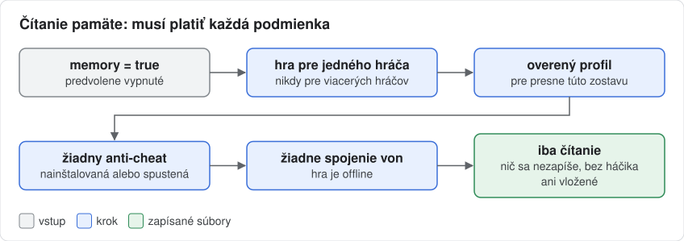

# Čítanie pamäte {#reading-memory}

Niektoré hry pre jedného hráča nič nehovoria iným programom. Pre tie môže watcher – ak to zapnete a sami napíšete profil –
vyhľadať, kde ste v pamäti hry, iba na čítanie.

Pre hry pre jedného hráča, ktoré nič nepublikujú, môže watcher čítať pozície a hodnoty z pamäte hry cez **profil**, ktorý
napíšete pre vlastný build hry. Zo všetkých zdrojov je to jediný, ktorý hra nevydala sama, preto je oplotený viac než
ostatné:

- je **štandardne vypnutý** (`python -m heat3d_watch config --set memory=true` ho zapne);
- číta a nemá žiadnu možnosť zapisovať;
- **s nástrojmi sa nedodávajú žiadne profily.**

Profily sa nedodávajú, lebo offset platí len pre build, na ktorom bol nájdený. Po patchi profil, ktorý bol predtým správny,
číta odpadové hodnoty, a odpad vyzerá presne ako čísla. Profil musí skontrolovať na builde, ktorý má hráč, a to hráč sám.

## Kontroly v poradí {#the-checks-in-order}


Každá kontrola nižšie musí prejsť. Prvé štyri sa robia **pred** otvorením hry, lebo otvorenie chránenej hry na čítanie
je samo o sebe to, čo anti-cheat zachytí, a odmietnutie až potom by prišlo príliš neskoro.

1. **Nastavenie**: `memory` je pravda. Inak pamäťové adaptéry sa nikdy nespustia.
2. **Profil pre hru**, ktorého `exe` pomenúva bežiaci proces. Profil uvádza, či sa hra dá vôbec hrať online (`"online"`);
   ten, ktorý to vynecháva, sa odmietne.
3. **Žiadny anti-cheat v blízkosti**:
   - žiadny súbor anti-cheatu v priečinku hry ani až tri priečinky nad ním (zastaví sa pri priečinku `common` knižnice
     Steam alebo pri priečinku, ktorý obsahuje `steamapps`, lebo nad ním sú iné hry): `EasyAntiCheat`,
     `EasyAntiCheat_EOS_Setup.exe`, `start_protected_game.exe`, `BattlEye`, `BEClient_x64.dll`, `BEService_x64.exe`,
     `EAAntiCheat.GameServiceLauncher.exe`, `AntiCheatExpert`, `SGuard64.exe`, `GameGuard`, `GameMon.des`, `XIGNCODE`,
     `xhunter1.sys`, `Vanguard`, `FACEIT` (porovnáva sa malými písmenami, aj ako začiatok názvu). Ak priečinok hry nie je
     známy, hra sa odmietne;
   - na počítači nebeží žiadny ovládač ani služba anti-cheatu, ako ich vypíše
     `sc query type= driver state= active` a `sc query type= service state= active`: EasyAntiCheat, EasyAntiCheat_EOS,
     BEService, BEDaisy, vgk, vgc, ACE-BASE, ACE-GAME, xhunter1, FACEIT, FACEITService, EAAntiCheatService,
     Denuvo Anti-Cheat, npggsvc, Ricochet. Jadrový anti-cheat nainštalovaný pre inú hru sleduje každý proces. Ak sa služby
     nedajú vypísať, hra sa odmietne;
4. **Nie online**: hra, ktorej profil uvádza `"online": true`, sa číta len vtedy, keď nemá spojenie s ničím iným než
   s týmto počítačom (akákoľvek vzdialená adresa okrem `127.x`, `::1`). Ak sa jej spojenia nedajú prečítať, odmietne sa.
5. Potom, ako sa adaptér spúšťa:
   - **presný build**: veľkosť spustiteľného súboru alebo jeho SHA-256 sa musí zhodovať s verziou, ktorú profil uvádza.
     Neznámy build sa nečíta;
   - **moduly ešte raz**: načítané moduly hry sa vypíšu (snímka Toolhelp, ktorá nevyžaduje vlastné prístupové práva)
     a kontrolujú sa na klienta anti-cheatu (`BEClient_x64.dll`, `BEClient.dll`, `EasyAntiCheat_x64.dll`,
     `EasyAntiCheat.dll`, `EOSAntiCheat...`). Chránený proces snímku odmietne, a to je tiež odmietnutie;
   - až potom sa proces otvorí, s `PROCESS_VM_READ | PROCESS_QUERY_LIMITED_INFORMATION` a bez čohokoľvek iného.

Kontroly 1 až 4 sa opakujú pri každej kontrole (každé 2 s), kým hra beží. Ak niektorá začne zlyhávať (hra sa pripojí
na server, spustí sa služba anti-cheatu), adaptér sa zastaví pri najbližšej kontrole. Odmietnutie sa zapíše do logu ako
`mem-<id>: not reading memory: <reason>`. Zlyhanie pri štarte (neznámy build, modul anti-cheatu, vzor nenájdený) sa zapíše
ako `mem-<id>: could not start` a adaptér sa neskúsi znova, kým sa hra nespustí znova.

Nezapisuje sa nič, nealokuje sa nič v druhom procese, nespúšťa sa v ňom žiadne vlákno, nenačítava sa doň žiadna knižnica,
nie je tu žiadne právo ladenia ani zvýšenie oprávnení. Test (`test_memory_reading_cannot_write` v `tests/test_core.py`)
zlyhá, ak sa kdekoľvek v balíku objaví akékoľvek volanie, ktoré zapisuje do iného procesu, v ňom alokuje alebo v ňom
spúšťa kód – `WriteProcessMemory`, `VirtualAllocEx`, `CreateRemoteThread`, `PROCESS_VM_WRITE`, `SeDebugPrivilege`,
`LoadLibrary`, ...

Nečíta sa nikdy, nech profil hovorí čokoľvek: hry hrané online a hry, ktorých režim pre jedného hráča beží pod
anti-cheatom, ako GTA V alebo Elden Ring spustený cez launcher. Kontroly vyššie ich odmietnu aj tak.

## Formát profilu {#the-profile-format}

Profil je súbor JSON v `<data>\profiles\` (`<data>` je dátový priečinok, pozrite
[Inštalácia a spustenie](installing-and-running.md#where-everything-is)), jeden na hru, s ľubovoľným názvom súboru
končiacim na `.json`. Syntetický príklad:

```json
{
  "schema": "heat3d.memprofile/1",
  "id": "mygame",
  "game": "My Game",
  "exe": "MyGame.exe",
  "online": false,
  "versions": [ { "label": "1.06", "size": 123456789 } ],
  "anchors": {
    "World": { "aob": "48 8B 05 ?? ?? ?? ?? 48 85 C0", "rip": [3, 7] }
  },
  "values": {
    "pos": { "type": "vec3f", "base": "World", "chain": ["0x10", "0x68", "0x70"] },
    "hp":  { "type": "i32",   "base": "World", "chain": ["0x10", "0x138"] },
    "map": { "type": "u32",   "base": "World", "chain": ["0x10", "0x1C0"] }
  },
  "events": [
    { "event": "death", "value": "hp",  "when": "to_zero" },
    { "event": "zone",  "value": "map", "when": "change" }
  ],
  "axes": { "up": "y", "units": "metres" },
  "rate": 10,
  "provenance": [ { "source": "https://example.com/my-notes", "verified_on": "1.06" } ]
}
```

| Kľúč | Povinný | Čo je |
|---|---|---|
| `schema` | áno | presne `heat3d.memprofile/1` |
| `id` | áno | krátke a stále; adaptér sa volá `mem-<id>` |
| `game` | áno | názov hry, podľa ktorého sa pomenúva priečinok relácie |
| `exe` | áno | názov spustiteľného súboru, ktorý zároveň hovorí, že hra beží |
| `online` | áno | `true`, ak sa hra vôbec dá hrať online; potom sa číta len vtedy, keď je offline |
| `versions` | áno | buildy, na ktorých sa profil overil: každý s `label` a `size` (veľkosť spustiteľného súboru v bajtoch) a/alebo `sha256`. Keď sú dané obe, musia sa zhodovať obe. Záznam, ktorý nemá ani jedno, nezodpovedá ničomu. |
| `anchors` | áno | pomenované adresy v hlavnom module. `aob`: vzor bajtov, hexadecimálne bajty oddelené medzerami, `?` alebo `??` pre ľubovoľný bajt; musí sa vyskytnúť **presne raz** v obraze modulu (viac výskytov sa počíta ako zlyhanie, rovnako ako žiadny). `rip: [d, n]`: vzor ukazuje na inštrukciu s 32-bitovým posunom relatívnym k RIP na bajte `d` a dĺžke `n`; kotva sa stane adresou, na ktorú tá inštrukcia odkazuje. `offset`: pripočíta sa potom (hex alebo desiatkovo ako text). Namiesto `aob` dáva `module_offset` pevný offset od základu modulu. |
| `values` | áno | čo sa číta pri každom dotaze: `type` (`i32`, `u32`, `i64`, `u64`, `u8`, `f32`, `f64`, `vec3f`, `vec3d`), `base` (meno kotvy), `chain` (offsety ako hex alebo desiatkovo ako text) |
| `events` | nie | pravidlá, ktoré menia zmeny na udalosti: `when` `change` (hodnota sa líši od posledného dotazu) alebo `to_zero` (číslo klesne z hodnoty nad 0 na 0 alebo menej) |
| `axes` | nie | `up` (predvolene `y`), `units` (predvolene `game units`), `scale` (mierka prehliadača, ktorá násobí každú pozíciu; predvolene 1, jednotky samotnej hry) |
| `rate` | nie | dotazy za sekundu, 1 až 60 (predvolene 10) |
| `provenance` | nie | odkiaľ sú offsety a na akom builde ste ich overili; kopíruje sa do `meta.json` každej relácie |

**Ako sa číta hodnota.** Adresa kotvy je začiatok. Ak je `chain` prázdny, hodnota sa prečíta práve tam. Inak sa najprv
prečíta ukazovateľ uložený na kotve. Potom sa pre každý offset okrem posledného prečíta ukazovateľ na `address + offset`.
Posledný offset sa pripočíta, čím vznikne adresa hodnoty. Nulový ukazovateľ po ceste (hra je medzi úrovňami alebo v menu)
nechá hodnotu pri tomto dotaze prázdnu.

**Čo sa zaznamenáva.** Hodnota s menom `pos` (`vec3f` alebo `vec3d`) sa stane riadkom `position` hráča `me` pri každom
dotaze. Každé pravidlo udalosti zapíše svoj riadok `event` s novou hodnotou a, ak je známa `pos`, aj pozíciou, a pripočíta
1 k štatistike s rovnakým menom. Obraz modulu sa pri štarte prečíta raz, aby sa našli kotvy, po blokoch 64 KiB; bloky,
ktoré sa nedajú prečítať, sa počítajú ako nuly. `meta.json` relácie uvádza profil, označenie buildu a provenience.

Profil, ktorý sa nedá použiť (zlý JSON, zlá `schema`, chýbajúci povinný kľúč), sa preskočí a zapíše do logu ako
`profile <file> not used: <reason>`. Profily sa načítavajú pri štarte watchera, takže po pridaní alebo zmene jedného
reštartujte `run`.

## Písanie a overovanie profilu {#writing-and-verifying-a-profile}

1. **Len pre hru pre jedného hráča bez anti-cheatu.** Ak hra anti-cheat má alebo ju hráte online, zastavte sa tu:
   watcher ju odmietne, a má to tak robiť.
2. **Nájdite hodnoty na svojom builde.** Pracujte offline. Použite vlastné ladiace nástroje alebo publikované poznámky
   o hre, aby ste našli pozíciu hráča a hodnoty, ktoré vás zaujímajú, a reťazec ukazovateľov k nim od statického miesta
   v spustiteľnom súbore. Uprednostnite vzor bajtov (`aob`) pred pevným `module_offset`: vzor nájde svoje miesto aj vtedy,
   keď sa kód trochu posunie.
3. **Urobte vzor jedinečným.** Musí sa zhodovať presne raz v module. Bajty, ktoré sa menia (adresy, posuny), nahraďte
   zástupnými znakmi a okolo nich nechajte dosť pevných bajtov.
4. **Pripnite build.** Do `versions` dajte presnú veľkosť spustiteľného súboru; PowerShell
   `(Get-Item .\MyGame.exe).Length` ju vypíše a `Get-FileHash .\MyGame.exe -Algorithm SHA256` vypíše hash. Po patchi
   sa profil jednoducho prestane používať, kým ho znova nekontrolujete a nepridáte nový build.
5. **Uveďte, či hra ide online** (`online`), čestne.
6. **Vyskúšajte to**: zapnite čítanie (`config --set memory=true`), dajte súbor do `<data>\profiles\` a skontrolujte, že
   `python -m heat3d_watch games` uvádza `mem-<id>`. Spustite hru a `python -m heat3d_watch run -v`. V `watcher.log`
   hľadajte `mem-<id>: starting`, alebo dôvod, prečo bol adaptér odmietnutý alebo sa nespustil.
7. **Porovnajte čísla s hrou.** Choďte na známe miesto a pozrite sa na riadky `position` v `events.jsonl` relácie. Hýbu
   sa, keď sa hýbete, o správnu vzdialenosť, pozdĺž správnych osí? Otvorte `heat.parquet` v prehliadači a skontrolujte, že
   trasa sedí s tým, kam ste išli. Spustite každú udalosť (stratiť všetko zdravie, zmeniť zónu) a skontrolujte, že sa objaví
   raz. Odpad vyzerá ako čísla a iba toto porovnanie ich dokáže odlíšiť.
8. **Zapíšte, čo ste overili** do `provenance`: zdroj offsetov a build, na ktorom ste ich overili.

Text `verified` adaptéra pamäte, ako ho vypíše `games`, je vždy „by the profile's author, for the builds it lists“.
Watcher nemôže vedieť viac.
