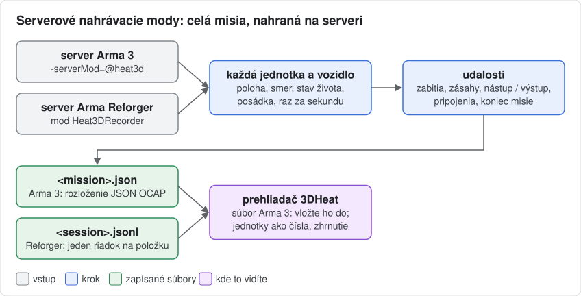

# Mody nahrávača na serveri (Arma 3, Arma Reforger) {#server-recorder-mods-arma-3-arma-reforger}

Väčšinu hier nahráva watcher na počítači hráča. Arma je iná: server dokáže nahrať
celú misiu - každú jednotku a vozidlo, nie len vaše - s modom, ktorý beží na serveri.
Hráči nič nenastavujú: mod pre Arma 3 je len na serveri a Reforger si mody servera
stiahne sám, keď sa hráči pripoja (mod na ich počítačoch nerobí nič). Repozitár
obsahuje dva takéto mody, v
[`mods/arma3`](https://github.com/Holdi601/3DHeat-Watcher/tree/main/mods/arma3)
a [`mods/reforger`](https://github.com/Holdi601/3DHeat-Watcher/tree/main/mods/reforger).
Ich README sú úplná dokumentácia; táto stránka je prehľad.

**Stav: ani jeden zatiaľ nebol testovaný v hre.** Rozšírenie pre Arma 3 bolo zostavené
a riadené tak, ako ho Arma volá, a jeho výstup načítal 3DHeat; jeho skripty SQF ešte
nebežali v Arme 3. Mod Reforger bol napísaný podľa publikovaného skriptovacieho API
od Bohemia a ešte nikdy nebol skompilovaný. Ani jeden nedávajte na verejný server pred
testovacími krokmi v jeho README.

## Arma 3 {#arma-3}

1. Raz na platformu zostavte rozšírenie (`mods/arma3/extension`). Na to treba C kompilátor:
   Visual Studio Build Tools na Windowse, gcc na Linuxe; ak ste nikdy nič nekompilovali,
   opýtajte sa svojho hostiteľa servera.
   - Windows, v "x64 Native Tools Command Prompt for VS":
     `cl /nologo /O2 /LD heat3d.c /Fe:heat3d_x64.dll`
   - Linux: `gcc -O2 -shared -fPIC -o heat3d_x64.so heat3d.c -ldl`
2. Zostavte mod: `python mods/arma3/build.py` zapíše `mods/arma3/@heat3d/`
   (nepotrebujete Arma 3 Tools).
3. Skopírujte `@heat3d` do priečinka servera a spustite server s
   `-serverMod=@heat3d`.
4. Log `.rpt` servera hovorí `Heat3D recorder 0.1.0: recording <file> every 1 s`.

| Nastavenie | Predvolená hodnota | Čo robí |
|---|---|---|
| `captureDelay` | 1 | sekundy medzi snímkami |
| `recordHits` | 1 | 0 vypne udalosti zásahov |
| `recordShots` | 1 | 0 vypne počítanie výstrelov |
| `minPlayers` | 0 | nahrávať, až keď je pripojený taký počet hráčov |

Misia prepíše jedno nastavenie vo svojom `init.sqf` (`heat3d_captureDelay = 0.5;`).
Nahrávky idú do `recordings/` vnútri `@heat3d`, alebo do `HEAT3D_DIR`.

**Výstup:** jeden súbor na misiu v rozložení JSON od OCAP (formát nahrávača OCAP2),
pomenovaný `<date>__<time>_<mission>.json`. Počas misie je to denník
(`.heat3d.part`), zapisovaný pri každom zápise; denník zlyhanej misie sa dokončí, keď
sa spustí ďalšia misia.

## Arma Reforger {#arma-reforger}

Mod (`Heat3DRecorder.gproj`) sa otvorí a zostaví vo Workbench od Bohemia (Arma Reforger
Tools), otestuje na lokálnom dedikovanom serveri, publikuje z Workbench (neverejne počas
testovania) a pridá do zoznamu `mods` v `config.json` servera - krok za krokom v jeho
README. Každú sekundu zapisuje pozíciu, smer, stav života, vozidlo a id hráča každej
postavy a pozíciu, smer, stav a posádku každého vozidla; a zabitia (zabijak, zbraň,
vzdialenosť), zásahy, nastupovanie a vystupovanie, pripojenie a odchod hráčov a koniec
misie.

**Výstup:** jeden objekt JSON na riadok, `$profile:heat3d/<UTC date>_<UTC time>_<world>.jsonl`:
riadok `header` (formát `heat3d-reforger`, osi x na východ, y nahor, z na sever), potom
riadky `entity`, `frame` a `event` podľa toho, ako nastávajú, a riadok `end`. Riadky
jednotiek sú `[id, x, y, z, dir, alive, vehicleId, playerId]`, riadky vozidiel
`[id, x, y, z, dir, alive, [crew ids]]`; udalosti nasledujú rozloženie udalostí OCAP2.

## Vo vieweri {#in-the-viewer}

Pretiahnite nahrávku Arma 3 na [viewer 3DHeat](https://holdi601.github.io/3DHeat/):
jedna misia je jedna relácia, jednotky sa stanú vojakmi, vozidlá svojím typom a zabitia
a zásahy idú do zoznamu debrífingu. Webový prehrávač OCAP2 ju prehrá tiež. Súbor
Reforger je vlastný riadkový formát modu s rozložením udalostí OCAP2.
