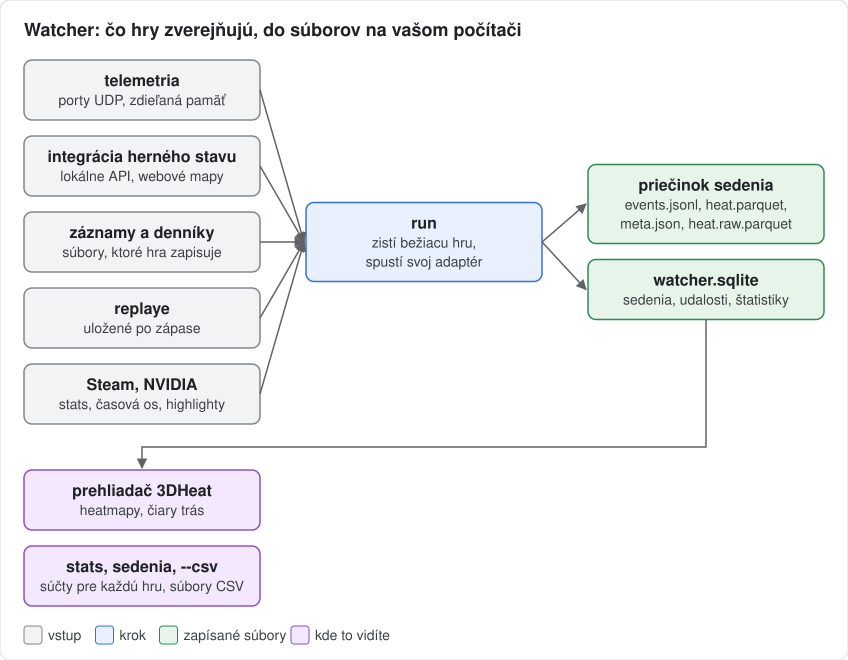

# Zdroje a pravidlá {#sources-and-rules}

Watcher zaznamenáva len to, čo hry a platformy poskytujú hráčovi. Táto stránka vysvetľuje, ktoré zdroje to sú, čo s každým smie watcher robiť a ktoré hry alebo ich časti z úmyslu vynecháva.

## Šesť druhov zdrojov {#the-six-kinds-of-source}

Každý adaptér má `kind` (druh) a druh rozhoduje, čo adaptér smie:

| Druh | Čo to je | Viachráčové hry |
|---|---|---|
| `telemetry` | UDP port alebo zdieľaná pamäť, ktorú hra zverejňuje pre palubné dosky, pohybové platformy a volantá (Forza Data Out, F1 UDP, zdieľaná pamäť Kunos a iRacing, SimConnect, UDP rozhranie X-Plane, plugin SCS SDK) | áno – je to vlastný výstup hry |
| `gsi` | game-state integration alebo lokálne webové API, ktoré hra poskytuje na počítač samotného hráča (Valve GSI, Live Client Data API League, Stats API Rocket League, webová mapa War Thunder) | áno, v rámci toho, čo API ukazuje hráčovi |
| `log` | súbory, ktoré hra zapisuje počas behu: denníky, logy, štatistiky, uloženia (Elite Dangerous, Minecraft, Path of Exile, Hearthstone, Star Citizen, EVE Online) | áno |
| `replay` | dema a replaye, ktoré hra ukladá pre svojich hráčov a prevádza po zápase (CS2, Dota 2, osu!, War Thunder, World of Tanks, World of Warships, Squad, League of Legends, VALORANT, IL-2 Tacview) | áno, pokiaľ nie sú zašifrované, a len časti, ktoré sú otvorené |
| `platform` | to, čo ukladá Steam a grafický ovládač: štatistiky, úspechy, časové osi, klipy a highlighty | áno |
| `memory` | pamäť hry, len na čítanie, podľa profilu, ktorý ste napísali | **nikdy** – len pre jedného hráča |

Len `memory` otvára iný proces, a to len na čítanie. Ostatných päť druhov číta to, čo hra, Steam alebo aplikácia NVIDIA App už zapísala alebo posiela.

## Ako sa zdroje čítajú {#how-the-sources-are-read}

- **Nič sa nevkladá, nezachytáva ani nemení v hre.** Do hry sa nenačítava žiadny kód, nezachytávajú sa okná ani vstup, žiadny herný súbor sa neopravuje. Jediné súbory, ktoré watcher zapisuje mimo svojho dátového priečinka, sú tie, ktoré zapíše [`setup --apply`](commands.md#setup), keď o to požiadate: herný nastavovací súbor (pôvodný sa uloží ako `<file>.heat3d-backup`), cfg súbor game-state, skript hooku DCS, protokolový mod BeamNG.
- **Zdieľaná pamäť sa otvára len na čítanie a nikdy sa nevytvára.** Bežný spôsob v Pythone, ako otvoriť pomenované mapovanie, ho vytvorí, keď ešte neexistuje. Hra spustená neskôr by potom našla prázdne mapovanie watchera len na čítanie, namiesto toho aby si vytvorila vlastné, a jej telemetria by bola mŕtva. Watcher otvára mapovania len cez `OpenFileMappingW` (ktorý nájde len existujúce), mapuje ich s `FILE_MAP_READ` a neskôr skúsi znovu, ak ich hra ešte nevytvorila.
- **Porty sa len požičiavajú, nikdy sa neprevezmú.** UDP port, na ktorom už počúva iný program (FH Companion, SimHub, aplikácia palubnej dosky), zostane tomu programu. Ak iný program začne počúvať na porte, ktorý drží watcher, watcher ho do pár sekúnd pustí. Adaptéry Forza čakajú 15 s po spustení hry, kým zoberú port 5300, a každý paket preposielajú nezmenený na 127.0.0.1:5301, takže druhá aplikácia Data Out stále môže zaznamenávať.
- **Len lokálne.** Herné servery game-state, ktoré watcher prevádzkuje (CS2, Dota 2), počúvajú na 127.0.0.1 a nikde inde. Keď cfg súbor hry obsahuje token (ten, ktorý zapíše `setup`), každý post ho musí niesť; posty bez neho sa započítajú ako `bad_auth` a zahodia. Bez cfg súboru s tokenom sa prijme akýkoľvek lokálny post a log to uvedie. Lokálne API, ktoré watcher volá (League na porte 2999, War Thunder na 8111, Rocket League na 49123, X-Plane na 49000), sú na 127.0.0.1.
- **Súbory logov sú zdieľané, nikdy zamknuté.** Každé čítanie otvorí súbor so všetkými zdieľacími príznakmi, aké má Windows, a znovu ho zatvorí, takže hra môže ďalej zapisovať, premenovať alebo nahradiť svoj log.
- **Dve externé služby, a len v týchto prípadoch.** Kontrola vydania sa pýta GitHub (`api.github.com`) najviac raz za šesť hodín a dá sa vypnúť (pozrite [Aktualizácie](updates.md)). Adaptér replayov League sa pýta Riot Match-V5 API len vtedy, keď ste zadali vlastný `riot_api_key`. Nič iné sa nikam neposiela.
- **Zapnutie zdroja je vaše rozhodnutie.** `setup` bez `--apply` len povie, čo by zmenil.

## Pravidlá pre viachráčové hry {#multiplayer-rules}

- Hra hraná online sa zaznamenáva len cez to, čo zverejňuje: telemetriu, game-state API, logy, replaye, súbory platformy. V nich watcher zaznamenáva to, čo hra ukazuje hráčovi, a nič vypočítané nad to:
  - **game-state integration CS2** posiela hráča, ktorého sledujete (seba, kým žijete, spoluhráča po smrti). Pozície ostatných hráčov (`allplayers_*`) sa posielajú len divákom a GOTV, takže ich watcher nežiada.
  - **Live Client Data API League of Legends** nemá pozície. Pravidlá Riot dovoľujú nástrojom ukazovať to, čo hráč vie z hry samotnej, a nič vypočítané nad to (žiadne časovače nepriateľov). Watcher zaznamenáva kill feed a tabuľku výsledkov, ktoré hráč vidí, a vlastné čísla hráča.
  - **Stats API Rocket League** nemá pozície áut (stav auta sa posiela len divákom). Miesto má loptu: kde bola zasiahnutá, zapísaná alebo zasiahla priečku.
  - **Webová mapa War Thunder** ukazuje to, čo ukazuje minimapa, bez mien a id.
  - **F1 23/24/25** dávajú pozíciu každého auta do svojho paketu Motion, aj online. Hra ich vydáva sama a zadržiava len údaje hráčov, ktorých „Your Telemetry“ je obmedzená.
  - **DCS World**: viachráčový server môže zakázať export dát vlastného lietadla; relácia potom má udalosti, ale nie pozície, a to hovorí.
- **Pamäť sa nikdy nečíta vo viachráčovej hre.** Adaptér pamäte pre hru označenú ako hranú online sa odmietne a profil musí uvádzať, či sa jeho hra dá hrať online vôbec. Jednohráčová hra, ktorá má aj online režim, sa číta len vtedy, keď nemá spojenie s ničím iným než s týmto počítačom. Hry, ktorých jednohráčový režim beží pod anti-cheatom, sa tiež nikdy nečítajú. Pozrite [Čítanie pamäte](memory-reading.md).
- Príznak `multiplayer` na adaptéri (v `games --markdown` zobrazený ako „Online play“) rozhoduje len o čítaní pamäte. Nezastavuje ostatné druhy v zázname online hry.

## Čo sa odmieta a prečo {#what-is-declined-and-why}

Niektoré hry a niektoré časti hier sa nezaznamenávajú, lebo jediný spôsob, ako ich získať, by porušil ochranu alebo podmienky hry:

| Hra | Čo sa vynecháva | Prečo |
|---|---|---|
| VALORANT | pozície, mená, skóre v replayoch; koncové body lockfile klienta | Herný tok replaye je zaobfuskovaný hodnotami zo spustiteľného súboru každej verzie. Ich získanie by znamenalo reverzné inžinierstvo hry, čo zakazujú Podmienky služby Riot (oddiely 3.1 a 7.1), a hra beží pod Vanguard. Koncové body lockfile klienta Riot nie sú zverejneným API. **Číta sa:** to, čo replay nesie otvorene – mapa, id zápasu, agenti, časová os kôl a zabití podľa servera. |
| League of Legends | pohybová časť súborov `.rofl`; koncové body lockfile klienta | Zaobfuskované proti podvádzaniu, inak pri každom patchi; dekódovanie znamená rozobrať hru, čo zakazujú podmienky Riot. **Číta sa:** súhrnný box skóre na konci, ktorý má každý replay ako prostý JSON, Live Client Data API počas zápasu a – s vlastným kľúčom vývojára – oficiálna časová os Match-V5 (pozície raz za minútu, zabitia tam, kde sa stali). |
| Fortnite | replaye | Zašifrované a pravidlá Epic zakazujú ich reverzné inžinierstvo. |
| World of Tanks, World of Warships | replaye, vo watcheri | Šifrované, s kľúčom, ktorý hra nesie a komunitné nástroje ho zverejnili pred rokmi. Watcher ich nečíta; oddelené konvertory mimo neho áno (`exporters/ext/wot-replay`, `exporters/ext/wows-replay`), takže problém s podmienkami Wargaming – jeho licencia zakazuje reverzné inžinierstvo (5.3 b) a neautorizovaný softvér, ktorý sa spája s jeho produktmi (12.1 k) – sa dotkne len tých. **Číta sa, s nainštalovaným konvertorom:** pozícia každého vozidla alebo lode, pokiaľ ich nahrávací klient poznal, a zabitia. |
| Gran Turismo 7 | telemetria | Len konzola a jej telemetria je zašifrovaná kľúčom získaným z hry. |
| Apex Legends | všetko | Jeho LiveAPI posiela úplné udalosti len v súkromných a vlastných lobby; inak nie je nič dostupné lokálne. |
| Overwatch 2, Call of Duty, Battlefield 6, Hunt: Showdown 1896 | živé dáta | Žiadny lokálny replay, log ani výstup game-state na čítanie. Ich štatistiky prichádzajú tam, kde ich drží Steam ([Steam štatistiky](game-steam-stats.md), [Steam Timeline](game-steam-timeline.md)), a ich klipy ako [NVIDIA highlights](nvidia-highlights.md). |
| Star Citizen | všetko okrem `Game.log` | Beží s Easy Anti-Cheat; watcher číta len súbor logu, ktorý hra zapisuje, a nikdy sa nedotkne jej procesu. |
| osu!lazer | replaye | Uložené vo vlastnom úložisku hry; čítajú sa len súbory `.osr` osu! (stable). |
| Ľubovoľná viachráčová hra | pamäť | Nikdy. Jednohráčové hry, ktorých režim beží pod anti-cheatom (GTA V, Elden Ring cez spúšťač), sa tiež nečítajú. |

Zašifrované replaye sa neotvárajú: čítačka VALORANT skontroluje príznak šifrovania v replaye a zašifrovaný súbor odmietne („this replay is encrypted; it is not read“).

Hry preskúmané, ale zatiaľ nepostavené (replaye Deadlock, súbory `.replay` Rocket League, StarCraft II, Team Fortress 2, Rainbow Six Siege, Beat Saber, Trackmania, niekoľko závodných simulátorov) sú uvedené so svojimi zdrojmi v [Všetky hry v jednej tabuľke](watcher.md#researched-not-yet-built). Každá z nich potrebuje vzorové súbory, aby sa dala overiť pred vydaním.
