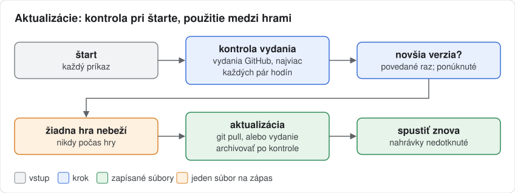

# Aktualizácie {#updates}

Watcher sa udržiava aktuálny podľa vydaní
[Holdi601/3DHeat-Watcher](https://github.com/Holdi601/3DHeat-Watcher/releases). Aktualizátor je
balík `heat3d_update` vedľa `heat3d_watch` v repozitári.

## Kontrola {#the-check}

- **Kedy**: každý príkaz okrem `update` kontroluje pri štarte. `run` kontroluje aj počas behu,
  najviac raz za hodinu a len vtedy, keď nebeží žiadna hra.
- **Ako**: jeden HTTPS požiadavok na `https://api.github.com/repos/Holdi601/3DHeat-Watcher/releases/latest`
  s časovým limitom 5 sekúnd. Odpoveď sa šesť hodín ukladá do vyrovnávacej pamäte
  `%LOCALAPPDATA%\3DHeat\update-check-3DHeat-Watcher.json`, takže väčšina štartov sa nepýta.
  "Zatiaľ žiadne vydanie" (HTTP 404) sa ukladá ako odpoveď. Ak ste offline, na limite požiadaviek
  alebo za proxy, kontrola potichu zlyhá a príkaz pokračuje s verziou, ktorú máte.
- **Verzie**: nainštalovaná verzia je súbor `VERSION` v priečinku repozitára.
  Značka vydania (`v1.2.0` alebo `1.2.0`) sa porovnáva ako čísla, časť po časti; všetko
  za `-` alebo `+` sa ignoruje.
- **Vypnutie**: `HEAT3D_NO_UPDATE=1` (ľubovoľná hodnota okrem prázdnej, `0`, `false` alebo `no`)
  vypne kontrolu aj automatickú aktualizáciu. Každý nástroj 3DHeat má vlastný súbor vyrovnávacej
  pamäte, takže odpoveď jedného nástroja nikdy nenahrádza odpoveď iného.

## Čo sa stane, keď je vydané novšie vydanie {#what-happens-when-a-newer-release-is-out}

- **`run`** pri štarte vypíše upozornenie a beží ďalej:
  `[heat3d_watch] 3DHeat Watcher 1.2.0 is out (this is 1.0.2). <release page>`. Počas behu, pri
  zapnutom `auto_update` (predvolene) a keď nebeží žiadna hra, sa potom aktualizuje sám: riadok
  logu `3DHeat Watcher 1.2.0 is out (this is 1.0.2); updating`, Windows oznámenie "Updating to 1.2.0",
  aktualizácia, zastavenie každého adaptéra a zatvorenie jeho relácií a ten istý príkaz spustený
  znova na novom kóde. Watcher sa nikdy neaktualizuje uprostred hry. Ak sa aktualizáciu nepodarí
  použiť, oznámenie to povie ("1.2.0 is out; not updated: ...") a watcher ďalej beží so starou
  verziou. Pri vypnutom `auto_update` je len upozornenie.
- **Ostatné príkazy** sa pri spustení v termináli pýtajú `Update now? [Y/n]`. Enter, `y`, `yes`, `j`
  alebo `ja` aktualizuje a potom spustí ten istý príkaz znova na novej verzii. Bez terminálu
  (naplánovaný beh, rúra) vypíše, ako aktualizovať, a pokračuje.
- **Na požiadanie**: `python -m heat3d_watch update` (alebo `python -m heat3d_update`) sa opýta GitHubu
  bez vyrovnávacej pamäte a aktualizuje. `--check` len povie, či je vydané novšie vydanie. Funguje
  aj s nastaveným `HEAT3D_NO_UPDATE`.

## Ako sa aktualizácia použije {#how-an-update-is-applied}

Závisí to od toho, ako bola kópia nainštalovaná:

- **Klon gitu** (priečinok má `.git` a `git` je v PATH): `git pull --ff-only`. Odmietne sa, kým
  klon obsahuje zmeny v sledovaných súboroch (`git status --porcelain --untracked-files=no` nie je
  prázdny): tie zmeny sú niekoho práca a aktualizácia nerozhoduje, čo sa s nimi stane. Zapíšte ich
  (commit) alebo ich odložte (stash), potom urobte pull.
- **Stiahnutá kópia**: archív zdrojov vydania sa stiahne a rozbalí do dočasného priečinka. Položky,
  ktoré by skončili mimo neho, sa preskočia. `VERSION` archívu musí byť verzia, ktorú vydanie uvádza,
  inak sa nekopíruje nič. Potom sa jeho súbory skopírujú cez priečinok repozitára. Súbory, ktoré nie
  sú súčasťou vydania - nahrávky, nastavenia, virtuálne prostredia, exporty, čokoľvek, čo ste vytvorili -
  sa nedotknú. Modul Pythonu, ktorý mal starší výdaj a nový ho vynechal, sa odstráni z balíkov vydania
  (`heat3d_watch`, `heat3d_update`), takže po aktualizácii sa nenačíta žiadny zastaraný modul
  adaptéra; mimo týchto balíkov sa nič neodstraňuje.

Nahrávky a nastavenia sú aj tak zvyčajne mimo priečinka repozitára
(`%LOCALAPPDATA%\3DHeat\Watcher`), takže sa aktualizácia k nim nikdy nedostane.

Po aktualizácii sa ten istý príkaz spustí znova. Vo Windowse watcher spustí nový proces,
počká na neho a odovzdá jeho návratový kód, takže konzola sa správa, akoby prvý proces urobil
prácu sám.
