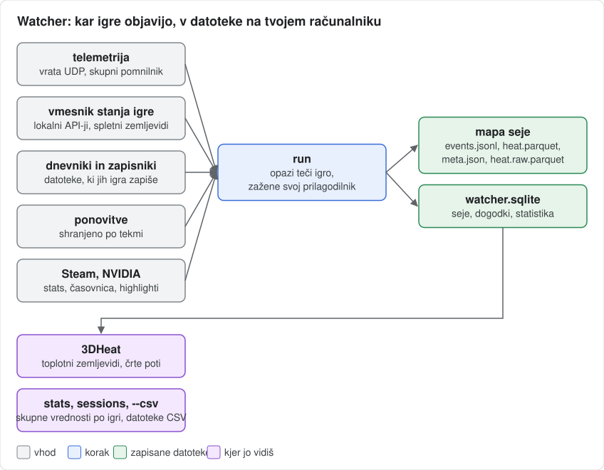
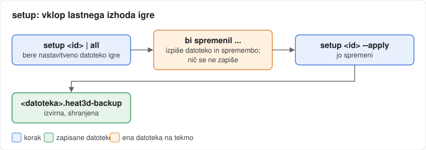
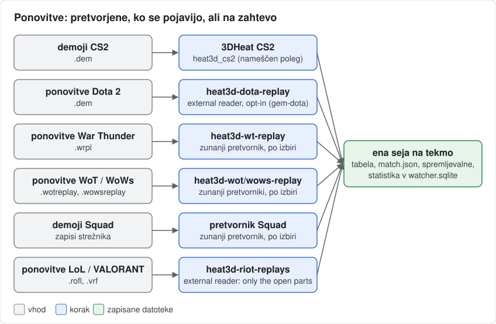
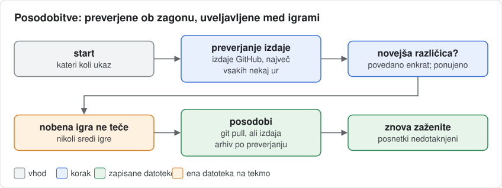

# Ukazi {#commands}

Ste novi v ukazni vrstici? Najprej preberite [Preden začnete](before-you-start.md). Vsak ukaz vtipkajte
v terminalu, odprtem v mapi, ki ste jo razpakirali ali klonirali (v Raziskovalcu v naslovno vrstico
vpišite `powershell`), takole:

```bash
python -m heat3d_watch <command> [options]
```


| Ukaz | Kaj naredi |
|---|---|
| [`run`](#run) | v ozadju spremlja in zapiše vsako igro, ki teče |
| [`games`](#games) | kaj da vsaka igra in od kod |
| [`setup`](#setup) | vklopi lastni izhod igre |
| [`status`](#status) | katere igre tečejo zdaj in kateri vmesniki bi se zagnali |
| [`sessions`](#sessions) | doslej narejeni posnetki |
| [`stats`](#stats) | skupno po igri ali tabele kot CSV |
| [`table`](#table) | znova sestavi `heat.parquet` seje iz njenega `events.jsonl` |
| [`replays`](#replays) | pretvori ponovitve, ki so že na disku |
| [`dota-replay`](#dota-replay) | prenese ponovitev javne tekme Dota 2 po njenem id-ju |
| [`dota-map`](#dota-map) | zemljevid Dota 2 iz vaše namestitve kot 3D nivo za pregledovalnik |
| [`update`](#update) | posodobi na najnovejšo izdajo |
| [`config`](#config) | pokaže ali spremeni nastavitve |

Možnosti za vsak ukaz: `-h` / `--help` izpiše pomoč, `python -m heat3d_watch --version` pa izpiše
različico (datoteka `VERSION`).

Slike na tej strani so zagoni na izmišljenih primerih sej (`Example Racer`, `Example Arena`), ne na
pravih posnetkih.

Vsak ukaz razen `update` najprej preveri, ali je na voljo novejša izdaja (največ enkrat na šest ur;
preskoči se z `HEAT3D_NO_UPDATE=1`, glejte [Posodobitve](updates.md)). `run` samo izpiše obvestilo.
Drugi ukazi, kadar tečejo v terminalu, vprašajo `Update now? [Y/n]`, kadar pa ne, izpišejo, kako se
posodobi. Izhod je v UTF-8, zato se imena iger v katerikoli pisavi izpišejo v vsaki konzoli.

## run {#run}

```bash
python -m heat3d_watch run [--once] [-v]
```



Spremlja, dokler ga ne ustavite (Ctrl+C): vsakih `scan_seconds` prebere seznam procesov in za vsako
najdeno igro zažene vmesnik, poleg vmesnikov, ki delujejo vedno. Preden prvič pogleda, dokonča seje,
ki jih je pustil odprte prejšnji zagon. Dokler nobena igra ne teče, se lahko posodobi sam (ob vklopljeni
možnosti `auto_update`). Podrobnosti so v [Namestitev in zagon](installing-and-running.md#running).

| Možnost | Učinek |
|---|---|
| `--once` | en pregled igr, ki tečejo, nato izhod. Zaženejo se vmesniki za igre, ki zdaj tečejo (in tisti, ki delujejo vedno), vsak se anketira enkrat (čaka se največ 10 sekund), nato se vsi ustavijo tako, kot se ustavijo ob koncu igre: njihove seje se zaprejo, zapišejo in preštejejo. Za preverjanje zaznavanja, ne za snemanje. |
| `-v`, `--verbose` | podrobne vrstice v `watcher.log` in na konzoli |

`run` zapiše `<data>\watcher.lock` in ne zažene se drugič za isto podatkovno mapo (izhodna koda 1);
glejte [Datoteka zaklepa](installing-and-running.md#the-lock-file).

## games {#games}

```bash
python -m heat3d_watch games [--markdown]
```


Izpiše vsak vmesnik, razvrščen po igri: ime, id in vrsto, od kod bere, kaj zapiše in kako ga vklopiti.
Vmesnik, ki na tem računalniku ne more teči, je označen z `[unavailable: <why>]` - ni najdena
datoteka SimConnect.dll, ni mape Minecraft, 3DHeat CS2 ni nameščen, Steam ali aplikacija NVIDIA ni
najdena. Modul vmesnika, ki se ni uspel naložiti, je na koncu imenovan z napako.

```text
EA SPORTS F1 25  (f1-25, telemetry)
    from: UDP telemetry 127.0.0.1:20777 (Documents\My Games\F1 25\hardwaresettings\hardware_settings_config.xml)
    - every car's position (world XYZ, m) at 10 Hz, by driver name, team, own car marked, ...
    switch on: In the game: Settings > Telemetry Settings > UDP Telemetry On, IP 127.0.0.1, port 20777 - ...
```

`--markdown` izpiše isto kot eno tabelo Markdown (igra, kaj se zapiše, od kod, kako se vklopi, spletna
igra, preverjeno). Tabela v [Vse igre v eni tabeli](watcher.md) je ta izpis. Celice so pripravljene za
Markdown: besedilo v nazajnih narekovajih ostane kodni odsek, zunaj njih pa so `<`, `>`, `&`, `*`, `|`
in obratna poševnica pred ločilom zapisani tako, da se prikažejo, kot so bili vtipkani (`<CS2>` bi
sicer v kramdownu izginil kot oznaka HTML). Edina oznaka HTML je `<br>` med postavkami v stolpcu "What is
recorded".

## setup {#setup}

```bash
python -m heat3d_watch setup <adapter id | all> [--apply]
```




Vklopi lastni izhod igre, kadar mora igra za to spremeniti datoteko. Brez `--apply` se nič ne spremeni:
vsaka vrstica pove, kaj bi se spremenilo, in če je kaj za spremeniti, zadnja vrstica pove
`Nothing was changed. Run again with --apply to make these changes.` Če ni ničesar za spremeniti, izpiše
`<id>: nothing to change` (`Nothing to change.` za `all`). Z `--apply` se spremembe naredijo, pri čemer
se pred prvo spremembo datoteke njen original shrani kot `<file>.heat3d-backup`. Obstoječa varnostna
kopija se nikoli ne prepiše, zato vedno vsebuje datoteko, kakršna je bila, preden se ga je watcher prvič
dotaknil.

```text
f1-25: would change: hardware_settings_config.xml <udp>: enabled="false" -> "true"
Nothing was changed. Run again with --apply to make these changes.
```

`all` zažene nastavitev vsakega vmesnika, ki jo ima. Vmesnik brez nje, imenovan posebej, izpiše
`<id>: nothing for setup to change; ` in za tem, kako se igra vklopi (njegovo besedilo `enable` ali da
ne potrebuje ničesar). Neznan id izpiše `no adapter '<id>'; games lists them` in izide s kodo 2. Vmesniki,
ki imajo kaj za nastaviti:

| Vmesnik | Kaj naredi `--apply` |
|---|---|
| `beamng` | namesti protokolno modifikacijo `heat3d` v mapo `mods` uporabnika BeamNG (samo če je še ni); nato v igri vklopite Options > Other > Protocols > "others" |
| `cs2-gsi` | zapiše `<CS2>\game\csgo\cfg\gamestate_integration_heat3d.cfg`: stanje igre pošilja na `http://127.0.0.1:3311/` z naključnim žetonom, ki ga watcher nato zahteva (žeton, ki je že v datoteki, ostane); CS2 jo prebere ob zagonu |
| `dota2-gsi` | enako za Dota 2: `<Dota>\game\dota\cfg\gamestate_integration\gamestate_integration_heat3d.cfg`, vrata 3312 |
| `dcs` | doda `Scripts\Hooks\heat3d-watch.lua` v vsako mapo `%USERPROFILE%\Saved Games\DCS*`. Njegova starejša kopija se posodobi; datoteka s tem imenom, ki je ni napisal watcher, ostane nedotaknjena. Ponovno zaženite DCS. |
| `dirt-rally-2` | `hardware_settings_config.xml`: `<udp enabled="true" extradata="3" ip="127.0.0.1" port="20777">`; igro najprej enkrat zaženite, da datoteka obstaja |
| `ea-wrc` | `Documents\My Games\WRC\telemetry\config.json`: paket `session_update` strukture `wrc` vklopljen za ta računalnik |
| `f1-23`, `f1-24`, `f1-25` | `hardware_settings_config.xml`: `<udp enabled="true" ip="127.0.0.1" port="20777">`; igra mora biti zaprta |
| `hearthstone` | v `%LOCALAPPDATA%\Blizzard\Hearthstone\log.config` doda oddelek `[Power]` (`LogLevel=1`, `FilePrinting=true`); ponovno zaženite igro |
| `il2` | `<game>\data\startup.cfg`, `[KEY = telemetrydevice]`: en cilj več `addrN = "127.0.0.1:41995"` in `enable = true` (oddelek se doda, s 10 Hz, kadar ga ni); ponovno zaženite IL-2 |
| `il2-tacview` | `<game>\data\startup.cfg`, `[KEY = track_record]`: `tacviewrecord = 1` |
| `rocketleague-stats` | `TAStatsAPI.ini` (ali `DefaultStatsAPI.ini`, če prvega ni) v `<RL>\TAGame\Config`: `PacketSendRate=30`, kadar je API izklopljen, in `Port`, kadar ni nastavljen; prebere se ob zagonu Rocket League |

`richard-burns-rally` nima nastavitve: njegova telemetrija pripada vtičniku RSF/NGP, ki ga vklopite ročno
v `RichardBurnsRally.ini` (glejte [njegovo stran](game-richard-burns-rally.md)); `setup richard-burns-rally`
to pove. Vsaka druga igra ali ne potrebuje ničesar ali se vklopi v igri; stran vsake igre pove, kako.

## status {#status}

```bash
python -m heat3d_watch status
```

```text
3DHeat Watcher 1.0.2; data in C:\Users\...\AppData\Local\3DHeat\Watcher
Games running: EA SPORTS F1 25 (f1-25)
Always on: il2-tacview, steam-stats, steam-timeline, nvidia-highlights, cs2-demos, osu-replays, lol-replays, valorant-replays
```

Pove, kateri vmesniki bi `run` zdaj zagnal, po istih pravilih: proces igre teče, vmesnik ni na seznamu
`disabled`, ničesar, kar potrebuje, ne manjka, vmesniki ponovitev samo ob vklopljenem `replays`,
vmesniki pomnilnika samo ob vklopljenem `memory` in če so prešla vsa preverjanja pomnilnika. Ničesar ne
zažene.

## sessions {#sessions}

```bash
python -m heat3d_watch sessions [--game NAME] [--limit N]
```


Najnovejše seje iz `watcher.sqlite`, po ena vrstica: začetek (lokalni čas), igra, minute, dogodki,
položaji, mapa.

| Možnost | Učinek |
|---|---|
| `--game NAME` | samo ta igra, po točnem imenu kot na seznamu (`"EA SPORTS F1 25"`) |
| `--limit N` | največ N sej (privzeto 40) |

## stats {#stats}

```bash
python -m heat3d_watch stats [--game NAME] [--csv DIR]
```


Brez možnosti: tabela vsake igre (seje, ure, dogodki, položaji, nazadnje igrano), najbolj igrane na
vrhu; nato za vsako igro njenih 25 najpogostejših dogodkov in vsaka številska statistika s številom sej,
ki jo imajo, skupno, najboljšo vrednost (`best`) in povprečje. `best` ve, katera smer je boljša: najnižjo
vrednost za čase, ki se hranijo kot najboljši (`best_lap`, `best_stage` in vsak drugi ključ, ki se začne
z `best_`), in za mesta (`race_position`, `grid_position`, vsak ključ, ki se konča z `_position`), najvišjo
za vse drugo (kills, distance, top speed, števci igre).

| Možnost | Učinek |
|---|---|
| `--game NAME` | samo dogodki in statistike te igre, brez pregleda |
| `--csv DIR` | namesto tega zapiše `sessions.csv`, `events.csv` in `stats.csv` (vsako vrstico treh tabel) v `DIR`; `--game` tega ne zoži |

## table {#table}

```bash
python -m heat3d_watch table <session folder>
```


Znova sestavi `heat.parquet` v mapi seje iz njenega `events.jsonl`, z osmi iz njenega `meta.json`. Izpiše
pot tabele ali `no positions in this session`. Uporabite, kadar je bila seja posneta, ko `pyarrow` ni
bil nameščen, ali po ročnem urejanju `events.jsonl`.

## replays {#replays}

```bash
python -m heat3d_watch replays <adapter id> [folder] [-v]
```



Pretvori ponovitve, ki so že na disku, zdaj, eno za drugo, vsako v sejo, kot bi jo naredil watch mape. Prvič,
ko watcher vidi mapo ponovitev, samo zabeleži, kaj je v njej (glejte
[Namestitev in zagon](installing-and-running.md#replays-already-on-disk)); tako se te pretvorijo na zahtevo.
Brez `folder` se preberejo mape vmesnika (igrine, plus `replay_folders`); z njim pa ponovitve v tej mapi.
Vsaka pretvorjena ponovitev se zabeleži kot videna, da je tekoči watcher ne pretvori znova. Ponovitev, ki
se ne pretvori, se zapiše v dnevnik in preskoči.

| Vmesnik | Ponovitve |
|---|---|
| `cs2-demos` | demo posnetki Counter-Strike 2 (`*.dem`), prek 3DHeat CS2 |
| `lol-replays` | ponovitve League of Legends (`*.rofl`) |
| `osu-replays` | ponovitve osu! (`*.osr`) |
| `valorant-replays` | ponovitve VALORANT (`*.vrf`) |
| `warthunder-replays` | ponovitve War Thunder (`*.wrpl`), prek zunanjega pretvornika `heat3d-wt-replay` (exporters/ext/warthunder-replay) |
| `wot-replays` | ponovitve World of Tanks (`*.wotreplay`), prek zunanjega pretvornika `heat3d-wot-replay` (exporters/ext/wot-replay) |
| `wows-replays` | ponovitve World of Warships (`*.wowsreplay`), prek zunanjega pretvornika `heat3d-wows-replay` (exporters/ext/wows-replay) |
| `dota-replays` | ponovitve Dota 2 (`*.dem`), prek programa gem (`pip install gem-dota`) |

```text
osu-replays: converted 12 replay(s); `sessions --game` lists them
```

Id, ki ni eden od teh, izpiše `no replay adapter '<id>'` s seznamom in izide s kodo 2; tako tudi `folder`,
ki ne obstaja. Vmesnik, ki tu ne more teči (3DHeat CS2 ni nameščen), pove, zakaj, in izide s kodo 1.
Posnetki Tacview za IL-2 niso na seznamu: ta vmesnik sam pretvori vsak končan posnetek, ki ga najde.

## dota-replay {#dota-replay}

```bash
python -m heat3d_watch dota-replay <match id> [<match id> ...] [-o FOLDER] [--convert] [-v]
```

Prenese ponovitev javne tekme Dota 2 s Valvovih strežnikov ponovitev. Potrebuje internet. Id tekme je
številka na strani tekme v odjemalcu Dota (podrobnosti tekme) ali na spletni strani OpenDota; Valve hrani
ponovitev nekaj tednov, nato prenos ne uspe. Strežnik in sol ponovitve sta iz zapisa tekme pri OpenDota
(`api.opendota.com/api/matches/<id>`, ključ ni potreben), datoteka pa iz
`replay<cluster>.valve.net/570/<id>_<salt>.dem.bz2`; razpakira se med prenosom (Valve pod tem imenom
pošilja tako bzip2 kot Zstandard) in shrani kot `<match id>.dem`. Brez `-o` gre v Dotino mapo ponovitev,
kadar je Dota 2 nameščena - kjer tekoči watcher jo pretvori - sicer pa v `<data>/replays/dota`. Datoteka,
ki je že tam, ostane. `--convert` pretvori prenesene ponovitve takoj, kot bi jih `replays dota-replays`,
in jih zabeleži kot videne.

```text
match 9000000000: C:\Program Files (x86)\Steam\steamapps\common\dota 2 beta\game\dota\replays\9000000000.dem
```

Valve hrani ponovitve nekaj tednov; starejša tekma izpiše `Valve no longer has the replay of match
<id>` in izide s kodo 1. Tekma, ki je OpenDota še ni videla, nima soli: sporočilo pove, naj jo za to
zaprosite pri OpenDota (`curl -X POST https://api.opendota.com/api/request/<id>`), in poskusite čez nekaj
minut. Zasebne sobe in tekme s skritim profilom na strežnikih ponovitev sploh niso.

## dota-map {#dota-map}

```bash
python -m heat3d_watch dota-map [<map>] -o <file.glb> [--game FOLDER] [--source2pregledovalnik EXE] [--detail UNITS]
```

Zapiše zemljevid Dota 2 - tla, pečine, vodo, drevesa in stavbe - kot nivo `.glb` v koordinatnem sistemu,
v katerem so narisane tabele ponovitev Dota, iz vaše namestitve Dota 2, prebran z ukazno vrstico
Source2Viewer. Nič se ne prenese. `<map>` je privzeto `dota`; `--game` je mapa Dota 2, kadar ni v knjižnici
Steam; `--source2pregledovalnik` pot do CLI, kadar ni ne v `HEAT3D_SOURCE2VIEWER` ne v `PATH`; `--detail` velikost
celice združevanja oglišč za stavbe v enotah igre (privzeto 8, 0 ohrani vsak trikotnik). Izide s kodo 1 in
`dota-map: <why>`, kadar Dota 2, zemljevid ali Source2Viewer ni najden. Vsak korak, dele datoteke in kako
je bila preverjena: [Zemljevid Dota 2](dota-map.md).

## update {#update}

```bash
python -m heat3d_watch update [--check]
```



Vpraša GitHub za najnovejšo izdajo, pri tem prezre shranjen odgovor, in posodobi ta izvod, če je novejša
(glejte [Posodobitve](updates.md)). `--check` samo pove, ali je novejša izdaja na voljo. Ta ukaz teče tudi
z nastavljenim `HEAT3D_NO_UPDATE`: če ga zahtevate, je to vaša odločitev. `python -m heat3d_update [--check]`
naredi isto.

## config {#config}

```bash
python -m heat3d_watch config [--set KEY=VALUE ...]
```


Izpiše vsako nastavitev kot `key = value`. Z `--set` najprej spremeni podane in shrani `settings.json`
(`saved <path>`). Vrednosti se preberejo glede na vrsto nastavitve:

- nastavitve da/ne: `1`, `true`, `yes`, `on` ali `ja` je true; `0`, `false`, `no`, `off`, `nein` ali nič je
  false;
- številke: decimalno število (`scan_seconds=5`);
- seznami: z vejicami ali kot seznam JSON (`disabled=steam-stats,steam-timeline`; prazna vrednost seznam
  izprazni);
- slovarji (`replay_folders`, `player_names`): ves slovar kot JSON ali en vnos kot `KEY.ID=VALUE` -
  `replay_folders.cs2-demos=D:\Demos,E:\More Demos` nastavi mape tega vmesnika (ločene z vejico),
  `player_names.warthunder-webmap=Name` ime tega vmesnika; prazna vrednost vnos odstrani;
- besedilo: kot je podano (`data=D:\Heat`, `riot_id=Name#TAG`).

```bash
python -m heat3d_watch config --set memory=true scan_seconds=5
python -m heat3d_watch config --set riot_id=Name#TAG riot_platform=EUW1
python -m heat3d_watch config --set replay_folders.cs2-demos=D:\Demos player_names.rocketleague-stats=Name
```

Neznan ključ izpiše `no setting '<key>'`, vrednost, ki ni tipa nastavitve (`memory=perhaps`,
`scan_seconds=often`, slovar, ki ni JSON), pa `not saved: ...`; oba izideta s kodo 2 in ničesar ne shranita.
`settings.json`, urejen ročno, se bere enako: vrednost, podana kot besedilo tam, kjer je nastavitev
številka, da/ne ali slovar, se prebere, kot je napisana, in tista, ki je ni mogoče prebrati, ostane na
privzeti vrednosti. Vsaka nastavitev je opisana v [Namestitev in zagon](installing-and-running.md#settings).
