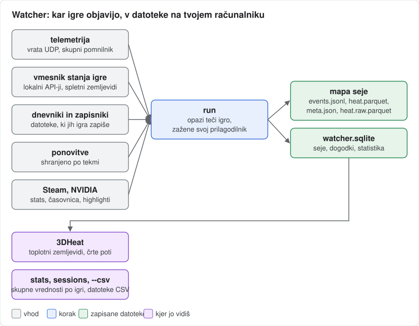

# 3DHeat Watcher {#dheat-watcher}

**Kaj je to?** Igrate igro. Ta program tiho zapisuje, kje ste bili in kaj se je dogajalo.
Kasneje to lahko pogledate kot barvni zemljevid v pregledovalniku 3DHeat.

**Zakaj bi ga uporabili?** Da hranite lastno evidenco vsake seje - kje ste vozili, leteli ali se borili, svoje skupne
vrednosti po igri - brez kakršnekoli spletne strani in brez spreminjanja igre.

**Primer:** vozite krog v dirkalni igri, medtem ko teče watcher; nato datoteka v
`sessions\<igra>\` hrani črto, po kateri ste vozili, in pregledovalnik jo nariše.

Podrobneje: 3DHeat Watcher je program v ozadju, ki v datotekah na vašem računalniku zapisuje, kaj igre objavijo o
vaši igri - kje ste bili, kaj se je dogajalo kje, in številke za tem. Datoteke so za vašo lastno statistiko ter za
toplotne zemljevide in poti pregledovalnika 3DHeat.

Teče tiho, opazi, katero igro ste zagnali, in bere izhode te igre: telemetrijska vrata ali skupni pomnilnik, ki jih igra
objavi za nadzorne plošče, vmesnik stanja igre, dnevnik ali zapis, ki ga igra piše, ponovitev, ki jo shrani po tekmi,
statistiko, ki jo hrani Steam, posnetke, ki jih shrani NVIDIA App. Posnetki ostanejo na vašem računalniku. Program se
poveže z zunanjima storitvama samo v teh primerih: GitHub, da poišče novejšo izdajo (glej [Posodobitve](updates.md)),
in Riotov Match-V5 API, samo če vneseš svoj ključ API Riot (glej [Ponovitve League of Legends](game-lol-replays.md)).



## Kaj zapisuje {#what-it-records}

- **Položaji**: avto, letalo, junak ali igralec, večkrat na sekundo, kjer igra to objavi, s hitrostjo, smerjo
  in čimer še igra pošlje ob tem.
- **Dogodki**: pojavitve, smrti, ubijanja, krogi, etape, runde, goli, opravila, vzleti in pristanki, spremembe
  območij, dosežki, izpostavitve. Vsak dogodek se shrani s svojim časom in s svojim mestom, kadar ga igra da.
- **Statistika po seji**: ubijanja, smrti, krogi, najboljši krog, razdalja, najvišja hitrost, čas igranja in
  statistika igre, kjer jo igra hrani.

Kaj da vsaka igra in od kod, je na svoji strani pod [Igre](games.md). En vir ne more zapisati vsega: večigralske
igre se zapisujejo samo prek tega, kar objavijo, watcher pa njihovega pomnilnika nikoli ne bere (glej
[Viri in pravila](sources-and-rules.md)).

## Namestitev {#install}

Še niste vajeni ukazne vrstice? Najprej preberite [Preden začneš](before-you-start.md).

Watcher je program v Pythonu za Windows (Python 3.10 ali novejši). Mnogi njegovi viri obstajajo samo v Windowsih:
skupni pomnilnik, register, obvestila Windows.

```bash
git clone https://github.com/Holdi601/3DHeat-Watcher.git
cd 3DHeat-Watcher
pip install -r requirements.txt
```

Prenesena izdaja se obnaša enako: razpakirajte jo in v mapi zaženite `pip install -r requirements.txt`. Podrobnosti in
dodatki, ki jih nekatere igre potrebujejo, so v [Namestitev in zagon](installing-and-running.md).

## Hitri začetek {#quick-start}

```bash
python -m heat3d_watch games            # kaj da vsaka igra in od kod
python -m heat3d_watch setup all        # kaj bi moralo biti vklopljeno (nič se ne spremeni)
python -m heat3d_watch setup f1-25 --apply   # vklopi izhod ene igre (prvotna datoteka se shrani v rezervo)
python -m heat3d_watch run              # zapisuj; pusti teči, medtem ko igrate
python -m heat3d_watch stats            # skupne vrednosti po igri
python -m heat3d_watch stats --csv out  # seje, dogodki in statistika kot datoteke CSV
```

**Videti bi morali:** po `games` tabelo z eno vrstico na igro; `run` teče, dokler ne pritisneš Ctrl+C ali ne
zapreš okna.

Vse se zapisuje v `%LOCALAPPDATA%\3DHeat\Watcher`. Za drugo mapo nastavi spremenljivko okolja `HEAT3D_WATCH_HOME`
ali zaženite `python -m heat3d_watch config --set data=D:\nekje`.

- `sessions\<igra>\<datum>_<adapter>\` - ena mapa na sejo, ki hrani `events.jsonl` (vsak dogodek, ko se zgodi),
  `heat.parquet` (vrstice s položajem, pripravljene za pregledovalnik 3DHeat) in `meta.json` (igra, vir, osi,
  števila, statistika)
- `watcher.sqlite` - statistika vsake seje v treh preprostih tabelah
- `watcher.log` - kaj je watcher naredil

Pregledovalnik odpre `heat.parquet` seje neposredno, brez kakršnekoli nastavitve (njegove osi in enote so v datoteki).
Pretvorjene ponovitve se zapišejo kot tabele in dokumenti tekem poleg njega; lastni format pregledovalnika za eno
datoteko na tekmo je opisan na strani [`.3dheat` vsebnik](https://holdi601.github.io/3DHeat/container.html), vsi
stolpci vsake tabele pa v [Podatki](the-data.md).

## Dokumentacija {#the-documentation}

| Stran | Kaj obravnava |
|---|---|
| [Preden začneš](before-you-start.md) | Python, terminal, nadomestila, kako izgledata uspeh in pogoste napake |
| [Namestitev in zagon](installing-and-running.md) | zahteve, zagon v ozadju, zagon ob Windowsih, datoteka zaklepa, dnevnik, vsaka nastavitev in spremenljivka okolja |
| [Igre](games.md) | ena stran na igro: kaj se zapisuje, od kod, kako vklopiti, kako deluje, osi, statistika, kaj je preverjeno |
| [Podatki](the-data.md) | mape sej, `events.jsonl`, `heat.parquet` in njegova noga, `meta.json`, `watcher.sqlite`, obnova po zrušitvi, izvoz CSV, odpiranje seje v pregledovalniku 3DHeat |
| [Ukazi](commands.md) | vsak ukaz in možnost `python -m heat3d_watch` |
| [Viri in pravila](sources-and-rules.md) | šest vrst virov, pravila za večigralske igre, katere igre so izpuščene in zakaj |
| [NVIDIA Highlights](nvidia-highlights.md) | kaj NVIDIA Highlights lahko in česa ne dostavi ter kako highlight dobi položaj |
| [Strežniški zapisovalni dodatki](server-mods.md) | dodatka za strežnike Arma 3 in Arma Reforger, ki zapisujeta cele misije za pregledovalnik |
| [Branje pomnilnika](memory-reading.md) | profili pomnilnika za enoigralske igre: format, preverjanja, kako napisati in preveriti enega |
| [Posodobitve](updates.md) | kako watcher išče nove izdaje in se sam posodablja |
| [Razvoj](development.md) | pisanje prilagodilnika: API, testi, pošten `verified`, ponovna ustvaritev strani o igrah |
| [Vse igre v eni tabeli](watcher.md) | vsaka igra v eni tabeli, kot jo izpiše `games --markdown`, plus igre, raziskane, a še ne narejene |
| [Priročnik ukazov](../cli-reference.md) | `--help` vsakega ukaza, ustvarjen iz kode |
| [Vzdrževanje](maintaining.md) | kontrolni seznam izdaje za te strani |

## Del 3DHeat {#part-of-3dheat}

3DHeat Watcher je eno od brezplačnih orodij okoli pregledovalnika 3DHeat (watcher uporablja 3DHeat CS2 za pretvorbo
demojev CS2). Vsako je svoj projekt, z lastnimi izdajami in licenco:

| Orodje | Kaj počne | Dokumentacija |
|---|---|---|
| [3DHeat](https://github.com/Holdi601/3DHeat) | pregledovalnik: toplotni zemljevidi, analiza dirk in pregled tekem v 3D | [spletno mesto](https://holdi601.github.io/3DHeat/) |
| [GameFiles](https://github.com/Holdi601/3DHeat-GameFiles) | proge in ravni iz datotek, ki jih igre prinašajo, kot 3D modeli | [spletno mesto](https://holdi601.github.io/3DHeat-GameFiles/) |
| [GameCapture](https://github.com/Holdi601/3DHeat-GameCapture) | telemetrija krogov iz dirkalnih iger; ravni, obnovljene iz videoposnetka igre | [spletno mesto](https://holdi601.github.io/3DHeat-GameCapture/) |
| [Unreal Exporter](https://github.com/Holdi601/3DHeat-UnrealExporter) | vtičnik za urejevalnik Unreal, ki izvozi nivo kot en 3D model | [spletno mesto](https://holdi601.github.io/3DHeat-UnrealExporter/) |
| [CS2](https://github.com/Holdi601/3DHeat-CS2) | demoji Counter-Strike 2 v tabele in dokumente tekem; karte v 3D modele | [spletno mesto](https://holdi601.github.io/3DHeat-CS2/) |
| [Watcher](https://github.com/Holdi601/3DHeat-Watcher) | zapisuje, kar igre objavijo o vaši igri, v ozadju | [spletno mesto](https://holdi601.github.io/3DHeat-Watcher/) |
| [Ext-WarThunder](https://github.com/Holdi601/3DHeat-Ext-WarThunder) | posnetki War Thunder v tabele in dokumente tekem | [spletno mesto](https://holdi601.github.io/3DHeat-Ext-WarThunder/) |
| [Ext-WoT](https://github.com/Holdi601/3DHeat-Ext-WoT) | posnetki World of Tanks v tabele in dokumente tekem | [spletno mesto](https://holdi601.github.io/3DHeat-Ext-WoT/) |
| [Ext-WoWs](https://github.com/Holdi601/3DHeat-Ext-WoWs) | posnetki World of Warships v tabele in dokumente tekem | [spletno mesto](https://holdi601.github.io/3DHeat-Ext-WoWs/) |
| [Ext-Squad](https://github.com/Holdi601/3DHeat-Ext-Squad) | demoji strežnikov Squad v tabele in dokumente tekem | [spletno mesto](https://holdi601.github.io/3DHeat-Ext-Squad/) |
| [Ext-DCS](https://github.com/Holdi601/3DHeat-Ext-DCS) | karte DCS World v 3D modele | [spletno mesto](https://holdi601.github.io/3DHeat-Ext-DCS/) |
| [Ext-IL2](https://github.com/Holdi601/3DHeat-Ext-IL2) | karte IL-2 Sturmovik v 3D modele | [spletno mesto](https://holdi601.github.io/3DHeat-Ext-IL2/) |

Vsak bralnik iger je samostojen majhen projekt z lastno datoteko licence, izdajami in sledilnikom težav,
zato ga je mogoče namestiti, posodobiti, vzdrževati - ali na zahtevo imetnika pravic umakniti - samostojno,
brez vpliva na pregledovalnik in druga orodja.

Licenca: MIT ([LICENSE](https://github.com/Holdi601/3DHeat-Watcher/blob/main/LICENSE)). Licence tretjih oseb paketov,
ki jih uporablja, in to, kar zahtevajo igre, ki jih bere, so navedene v
[LICENSES.md](https://github.com/Holdi601/3DHeat-Watcher/blob/main/LICENSES.md).
