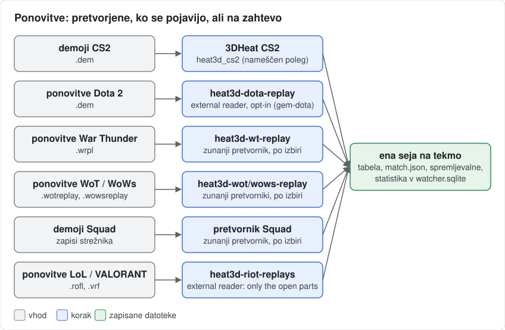

# Namestitev in zagon {#installing-and-running}

## Zahteve {#requirements}

- **Windows.** Watcher je napisan za Windows, večina njegovih virov pa obstaja samo tam: skupni pomnilnik, ki
  ga igre ustvarijo (preslikave `Local\...`), register (kjer je Steam), obvestila Windows, seznam procesov s potmi
  izvršljivih datotek. Na drugem sistemu se program zažene, a ti viri ne najdejo ničesar, obvestila se samo
  zabeležijo, branje pomnilnika pa zavrne ("only implemented on Windows").
- **Python 3.10 ali novejši**, z <https://www.python.org/downloads/>: v namestitvenem programu obkljukajte
  **Add python.exe to PATH**, nato preverite z `python --version` v novem terminalu. Ste novi na tem področju?
  Najprej preberite [Preden začnete](before-you-start.md).
- **Paketi** (`requirements.txt`): `psutil>=6.0` (katere igre tečejo, kateri program drži vrata, povezave igre;
  starejši psutil še deluje, prek svojega starejšega imena za povezave procesa), `pyarrow>=15` (pisanje
  `heat.parquet`), `numpy>=1.24` in `pytest>=8.0` za teste. `requirements-optional.txt` zdaj ne našteva nobenega
  paketa.

Brez `pyarrow` se seje še vedno beležijo: `events.jsonl` je zapis, tabelo pa je mogoče zgraditi pozneje z
[`table`](commands.md#table).

### Dodatki, ki jih nekatere igre potrebujejo {#extras-some-games-need}

| Igra | Kaj potrebuje |
|---|---|
| Counter-Strike 2 demo posnetki | [3DHeat CS2](https://github.com/Holdi601/3DHeat-CS2) in njegove zahteve (`demoparser2`). Watcher ga išče v `HEAT3D_CS2`, nato v mapi `3DHeat-CS2` ali `cs2` poleg mape watcherja, nato kjer koli, od koder Python lahko uvozi `heat3d_cs2`. Brez njega `games` vmesnik označi kot nedosegljiv. |
| Microsoft Flight Simulator 2020 / 2024 | `SimConnect.dll` - ni priložen. MSFS 2020 ga ima v svoji mapi namestitve; za MSFS 2024 namestite SDK za MSFS 2024. `MSFS_SDK` / `MSFS2024_SDK` kažeta na mapo SDK. |
| Euro Truck Simulator 2, American Truck Simulator | vtičnik RenCloud `scs-telemetry.dll` (revizija 12) v `<game>\bin\win_x64\plugins` |
| BeamNG.drive | protokolna modifikacija `heat3d`, nameščena z `python -m heat3d_watch setup beamng --apply` |
| League of Legends (v živo) | neobvezno: korenski certifikat Riot kot `<data>\riotgames.pem`, da se lokalna povezava preveri |
| Minecraft | mapa `%APPDATA%\.minecraft` (Java Edition) |

Vsaka stran igre pod [Igre](games.md) pove, kaj je treba vklopiti v sami igri.
`python -m heat3d_watch games` označi vmesnik z `[unavailable: ...]`, kadar na tem računalniku manjka nekaj,
kar potrebuje.

## Namestitev {#installing}

Ste novi v ukazni vrstici? Najprej preberite [Preden začnete](before-you-start.md). Če `pip` ni najden,
uporabite raje `python -m pip install -r requirements.txt`.

Iz kloniranega repozitorija:

```bash
git clone https://github.com/Holdi601/3DHeat-Watcher.git
cd 3DHeat-Watcher
pip install -r requirements.txt
```

Iz izdaje: prenesite arhiv z izdaj repozitorija, ga razpakirajte, nato v mapi zaženite
`pip install -r requirements.txt`. Oba tipa kopij se posodabljata sama (glejte [Posodobitve](updates.md)).

Vsak ukaz zaganjajte iz mape repozitorija: `python -m heat3d_watch` uvozi paket od tam, posodabljalnik
(`heat3d_update`) pa je poleg njega.

## Zagon {#running}

```bash
python -m heat3d_watch run        # watch until stopped
python -m heat3d_watch run -v     # the same, with debug lines in the log
python -m heat3d_watch run --once # one look at the games running now, then stop and exit
```

Ob zagonu `run`:

1. zapiše [datoteko zaklepa](#the-lock-file);
2. dokonča seje, ki jih je pustil prejšnji zagon, na primer po zrušitvi (glejte [Obnovitev](the-data.md#recovery-after-a-crash));
3. vsakih `scan_seconds` (2 s) prebere seznam procesov (samo imena in poti, noben proces se ne odpre) in za vsako
   najdeno igro zažene vmesnik v lastni niti. Ko proces igre izgine, se njen vmesnik ustavi, seje, ki so bile
   odprte, pa se zaprejo, s čimer se zapišeta njihova tabela in vrstica v statistiki. Vmesniki, ki ne čakajo na igro
   (statistike Steama, Steam Timeline, NVIDIA highlights, mape ponovitev), tečejo ves čas;
4. medtem ko nobena igra ne teče, poišče novejšo izdajo največ enkrat na uro (sam odgovor je shranjen za šest ur)
   in, ob vklopljenem `auto_update`, jo namesti in se sam znova zažene (glejte [Posodobitve](updates.md)).

Vmesnik, ki se ne uspe, se zapiše v dnevnik in ne ustavi drugih. Če se anketiranje vmesnika ponesreči 20-krat
zaporedoma ali pa zagon ne uspe, se vmesnik ustavi in ne zažene znova, dokler igra ni znova zagnana (nov id procesa).

Watcher ustavite s Ctrl+C. Vmesniki pred izhodom zaprejo svoje seje. Če se watcher ubije drugače (upravitelj opravil,
zrušitev, izpad napajanja), se nič, kar je bilo že zapisano, ne izgubi: naslednji `run` dokonča te seje.

`--once` naredi en pregled: zažene vmesnike za igre, ki tečejo v tistem trenutku (in tiste, ki delujejo vedno), vsak
se enkrat anketira - čaka največ 10 sekund - nato pa se ustavijo tako, kot bi se ob koncu igre, tako da se seje, ki so jih
odprli, zaprejo, njihove tabele zapišejo in vrstice preštejejo v statistiki, preden se program konča. Uporabite ga za
preverjanje, ali je igra zaznana, ne za snemanje.

### Ponovitve, ki so že na disku {#replays-already-on-disk}



Prvič, ko vmesnik ponovitev vidi eno od svojih map, samo zabeleži ponovitve, ki so že v njej; sicer bi igralec z
leti demo posnetkov opazil, da je watcher zaposlen s pretvorbo cel dan. Od takrat naprej se vsaka nova
ponovitev pretvori, ko igra konča z zapisovanjem. Stare se pretvorijo na zahtevo z [`replays`](commands.md#replays):

```bash
python -m heat3d_watch replays cs2-demos              # every demo in CS2's folders and replay_folders
python -m heat3d_watch replays osu-replays D:\Old     # the replays in one folder
```

### Zagon v ozadju {#running-in-the-background}

Watcher nima lastnega okna; je konzolni program, ki teče, dokler ga ne ustavite. Vse piše v `watcher.log`, zato
mu vidna konzola ni potrebna. Načini, kako ga držati stran:

- zaženite ga v konzoli in konzolo zmanjšajte: `start "" /min python -m heat3d_watch run` iz `cmd`, v mapi repozitorija;
- zaženite ga brez konzole: `pythonw -m heat3d_watch run`. Izpis konzole se izgubi, `watcher.log` pa se še vedno piše.
  Za ustavitev končajte proces `pythonw.exe`; naslednji zagon nato dokonča seje, ki jih je pustil odprte. Projekt tega
  načina zagona ni preizkusil.

### Zagon ob vklopu Windows (zamisel) {#starting-with-windows-an-idea}

Watcher se ne namesti sam, da bi se zagnal z Windows. Za samodejni zagon:

- **Task Scheduler**: ustvarite opravilo s sprožilcem *At log on* in dejanjem *Start a program*, program
  `pythonw.exe` (ali `python.exe`), argumenti `-m heat3d_watch run`, *Start in* nastavljen na mapo repozitorija;
- **mapa Startup**: postavite bližnjico v `shell:startup` z istim programom, argumenti in mapo *Start in*.

Nobeden od teh načinov ni del watcherja niti ga watcher ne preizkuša. [Datoteka zaklepa](#the-lock-file) poskrbi,
da se druga kopija, zagnana pomotoma, takoj konča.

## Datoteka zaklepa {#the-lock-file}

`<data>\watcher.lock` hrani id procesa tekočega watcherja. Ko se `run` zažene in datoteka zaklepa navaja proces, ki
še obstaja in čigar ime vsebuje `python`, izpiše

```text
A watcher is already running (process 12345) for C:\Users\...\3DHeat\Watcher.
```

in izide s kodo 1. Dva watcherja nad isto mapo podatkov bi vsako igro zapisala dvakrat, drugi pa bi odprte seje prvega
imel za ostanke po zrušitvi. Datoteka zaklepa, katere proces ne obstaja več ali pripada drugemu programu, se prepiše.
Ko se `run` konča, datoteko odstrani, če še navaja njegov proces.

## Dnevnik {#the-log}

`<data>\watcher.log` piše samo `run`; drugi ukazi izpisujejo na konzolo. Vsaka vrstica ima čas, raven in sporočilo:

```text
2026-05-01 20:15:01,123 INFO watching; data in C:\Users\...\AppData\Local\3DHeat\Watcher
2026-05-01 20:15:03,456 INFO f1-25: starting (EA SPORTS F1 25)
2026-05-01 21:02:11,789 INFO f1-25: stopping
```

Vmesniki zapišejo, kaj ne morejo narediti in zakaj: »UDP 20777 is in use by ...; not taking it from that program«,
»not reading memory: the game is played online«, »could not start«, »poll failed (3)« s sledjo izjeme. `run -v`
doda podrobne vrstice. Datoteko watcher dopolnjuje in je nikoli ne zavrti ali izprazni; izbrišite jo, kadarkoli
želite. Iste vrstice gredo tudi na konzolo.

## Kje je vse {#where-everything-is}

Domača mapa je `%LOCALAPPDATA%\3DHeat\Watcher`, ali `HEAT3D_WATCH_HOME`, če je ta nastavljen (brez `LOCALAPPDATA`, na
primer na drugem sistemu, `~/.local/share/3DHeat/Watcher`). `settings.json` je vedno v domači mapi. Vse drugo gre v mapo
podatkov, ki je domača mapa, razen če nastavitev `data` navaja drugo:

| Pot | Kaj je |
|---|---|
| `<home>\settings.json` | nastavitve |
| `<data>\sessions\` | posnetki, po ena mapa za vsak sedež ([Podatki](the-data.md)) |
| `<data>\watcher.sqlite` | baza statistik |
| `<data>\watcher.log` | dnevnik `run` |
| `<data>\watcher.lock` | datoteka zaklepa, dokler teče `run` |
| `<data>\state\` | kaj so vmesniki, ki delujejo vedno in vmesniki ponovitev, že videli (`steam-stats.json`, `replays-cs2-demos.json`, ...), da se ob ponovnem zagonu nič ne zapiše dvakrat |
| `<data>\profiles\*.json` | profili pomnilnika, ki ste jih napisali ([Branje pomnilnika](memory-reading.md)) |
| `<data>\riotgames.pem` | neobvezno, korenski certifikat Riot za vmesnik League of Legends v živo |
| `%LOCALAPPDATA%\3DHeat\update-check-3DHeat-Watcher.json` | shranjen odgovor zadnjega preverjanja izdaje |

Watcher v teh mapah ničesar ne briše, razen mape seje, v kateri ni bilo ničesar zapisanega (igra, ki je ostala v svojih menijih).

## Nastavitve {#settings}


`python -m heat3d_watch config` pokaže nastavitve; `config --set key=value ...` jih spremeni in shrani `settings.json`
(glejte [config](commands.md#config)). Datoteka je navaden JSON in jo je mogoče urejati tudi ročno, medtem ko watcher ne
teče. Neznani ključi v njej se prezrejo. Nastavitve se preberejo, ko se ukaz zažene, zato po spremembi znova zaženite `run`.

| Nastavitev | Privzeto | Kaj naredi |
|---|---|---|
| `data` | `""` | Mapa podatkov. Prazno: domača mapa. |
| `disabled` | `[]` | Id-ji vmesnikov, ki nikoli ne tečejo, na primer `config --set disabled=steam-stats,nvidia-highlights`. Vsak drug vmesnik teče, ko najde svojo igro. |
| `auto_update` | `true` | Medtem ko nobena igra ne teče, namesti novejšo izdajo in se zažene znova (glejte [Posodobitve](updates.md)). `false`: samo obvestilo v dnevniku. |
| `scan_seconds` | `2.0` | Sekunde med pogledi na seznam procesov. |
| `memory` | `false` | Dovoli vmesnike pomnilnika (enoigralske igre s profilom, ki ste ga napisali), da tečejo. Privzeto izklopljeno; glejte [Branje pomnilnika](memory-reading.md). |
| `replays` | `true` | Zaženi vmesnike `replay`: vse od njih (glejte `python -m heat3d_watch replays` in [Igre](games.md)) - demo posnetki CS2, Dota 2, osu!, War Thunder, World of Tanks, World of Warships, Squad, ponovitve League of Legends in VALORANT, posnetki Tacview za IL-2. |
| `replay_folders` | `{}` | Dodatne mape po id-ju vmesnika, na primer `{"cs2-demos": ["D:\\Demos"]}`. Vmesniki ponovitev jih nadzorujejo poleg lastnih map igre; `il2-tacview` sprejema tudi mape namestitve (nato išče v njihovem `data\Tracks`); pri `elite` prva mapa nadomesti mapo dnevnika. Mape enega vmesnika nastavite z `config --set replay_folders.cs2-demos=D:\Demos,E:\More` ali pa celoten slovar kot JSON. |
| `riot_id` | `""` | Vaš Riot ID (`Name#TAG`), da vaša vrstica v ponovitvi League of Legends postane vaša statistika. Prazno: vsaka vrstica igralca se ohrani, nobena ni označena kot vaša. |
| `riot_api_key` | `""` | Vaš lastni razvijalski ključ API Riot, da se za vsako ponovljeno tekmo League pridobi uradna časovnica (položaji vsako minuto, kills tam, kjer so se zgodili). Prazno: ne pridobi se nič. |
| `riot_platform` | `"EUW1"` | Id platforme vašega strežnika League (`EUW1`, `EUN1`, `NA1`, `KR`, ...), uporabljen za iskanje regionalnega gostitelja Match-V5. |
| `player_names` | `{}` | Vaše ime v igrah, katerih vmesnik imenuje vsakega igralca, vendar ne pove, kateri ste vi, po id-ju vmesnika: `warthunder-webmap` (vrstice o vas v feedu ubijanj postanejo vaša ubijanja in smrti) in `rocketleague-stats` (vaše vrstice postanejo `me`; brez tega igralec, za katerim sledi kamera igre). Nastavite z `config --set player_names.warthunder-webmap=Name`. |

`settings.json` z vsemi privzetimi vrednostmi:

```json
{
  "data": "",
  "disabled": [],
  "auto_update": true,
  "scan_seconds": 2.0,
  "memory": false,
  "replays": true,
  "replay_folders": {},
  "riot_id": "",
  "riot_api_key": "",
  "riot_platform": "EUW1",
  "player_names": {}
}
```

## Spremenljivke okolja {#environment-variables}

| Spremenljivka | Učinek |
|---|---|
| `HEAT3D_WATCH_HOME` | domača mapa (nastavitve in podatki, razen če `data` pravi drugače) |
| `HEAT3D_NO_UPDATE` | katera koli vrednost razen prazne, `0`, `false` ali `no` izklopi preverjanje izdaje in samodejno posodobitev |
| `HEAT3D_NO_TOAST` | katera koli neprazna vrednost: brez obvestil Windows, samo vrstice v dnevniku |
| `HEAT3D_CS2` | mapa 3DHeat CS2, za demo posnetke CS2 |
| `HEAT3D_CS2_GSI_PORT` | vrata stanja igre CS2 (privzeto 3311); datoteka cfg, ki jo zapiše `setup`, jih uporablja |
| `HEAT3D_DOTA_GSI_PORT` | vrata stanja igre Dota 2 (privzeto 3312) |
| `MSFS_SDK`, `MSFS2024_SDK` | mapi SDK MSFS, kjer se išče `SimConnect SDK\lib\SimConnect.dll` |

Obvestila Windows se uporabljajo samo za posodobitve: »Updating to 1.2.0« ali »1.2.0 is out; not updated: ...«,
kadar posodobitve ni bilo mogoče uporabiti. Prikažejo se prek lastnega API-ja za obvestila PowerShell, zato ni treba
ničesar namestiti. Naslov in besedilo se PowerShellu predata kot spremenljivki okolja, nikoli kot del skripta.
