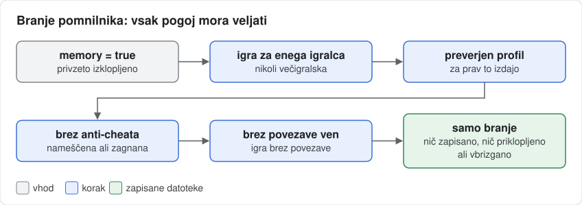

# Branje pomnilnika {#reading-memory}

Nekatere enoigralske igre ne povedo ničesar drugim programom. Za te lahko watcher - če ga vklopite in sami napišete
profil - poišče, kje ste v pomnilniku igre, samo za branje.

Za enoigralske igre, ki ne objavljajo ničesar, lahko watcher bere položaje in vrednosti iz pomnilnika igre, prek
**profila**, ki ga napišete za svojo različico igre. Od vseh virov je to edini, ki ga igra ni sama ponudila, zato je bolj
zavarovan kot ostali:

- je **privzeto izklopljeno** (`python -m heat3d_watch config --set memory=true` ga vklopi);
- bere, nima pa poti za pisanje;
- **z orodji ni priloženih nobenih profilov.**

Profili niso priloženi, ker je odmik pravilen samo za različico, na kateri je bil najden. Po popravku profil, ki je bil
prej pravilen, bere smeti, smeti pa so videti točno kot številke. Profil mora preveriti igralec sam, na svoji različici
igre.

## Preverjanja po vrstnem redu {#the-checks-in-order}



Vsako spodnje preverjanje mora uspeti. Prva štiri se naredijo **preden** se igra odpre, ker je odpiranje zaščitene igre
za branje samo po sebi tisto, kar zazna anti-cheat, zavrnitev pozneje pa bi bila prepozna.

1. **Nastavitev**: `memory` je true. Sicer se vmesniki pomnilnika sploh ne zaženejo.
2. **Profil za igro**, katerega `exe` imenuje tekoči proces. Profil pove, ali se igra sploh lahko igra prek spleta
   (`"online"`); tistega, ki tega ne navede, se zavrne.
3. **Nobenega anti-cheata v bližini**:
   - nobene datoteke anti-cheata v mapi igre ali do treh map više od nje (ustavi se pri mapi `common` knjižnice Steam ali
     pri mapi, ki vsebuje `steamapps`, ker so tam višje druge igre): `EasyAntiCheat`, `EasyAntiCheat_EOS_Setup.exe`,
     `start_protected_game.exe`, `BattlEye`, `BEClient_x64.dll`, `BEService_x64.exe`, `EAAntiCheat.GameServiceLauncher.exe`,
     `AntiCheatExpert`, `SGuard64.exe`, `GameGuard`, `GameMon.des`, `XIGNCODE`, `xhunter1.sys`, `Vanguard`, `FACEIT`
     (primerjano z malimi črkami, tudi kot začetek imena). Če je mapa igre neznana, se igra zavrne;
   - na računalniku ne teče noben gonilnik ali storitev anti-cheata, kot jih izpiše
     `sc query type= driver state= active` in `sc query type= service state= active`: EasyAntiCheat, EasyAntiCheat_EOS,
     BEService, BEDaisy, vgk, vgc, ACE-BASE, ACE-GAME, xhunter1, FACEIT, FACEITService, EAAntiCheatService, Denuvo
     Anti-Cheat, npggsvc, Ricochet. Jedrni anti-cheat, nameščen za drugo igro, še vedno spremlja vsak proces. Če
     storitev ni mogoče izpisati, se igra zavrne;
4. **Ni na spletu**: igra, katere profil pravi `"online": true`, se bere samo, dokler nima povezave z ničemer razen s tem
   računalnikom (kateri koli oddaljeni naslov razen `127.x`, `::1`). Če njenih povezav ni mogoče prebrati, se zavrne.
5. Nato, ko se vmesnik zaganja:
   - **natančna različica**: velikost datoteke izvršljivega programa ali njegov SHA-256 se mora ujemati z eno od različic,
     ki jih profil navaja. Neznana različica se ne bere;
   - **moduli še enkrat**: naložene module igre se izpišejo (posnetek Toolhelp, ki ne zahteva nobenih pravic za dostop)
     in preverijo za odjemalca anti-cheata (`BEClient_x64.dll`, `BEClient.dll`, `EasyAntiCheat_x64.dll`,
     `EasyAntiCheat.dll`, `EOSAntiCheat...`). Zaščiten proces zavrne posnetek, kar je prav tako zavrnitev;
   - šele nato se proces odpre, z `PROCESS_VM_READ | PROCESS_QUERY_LIMITED_INFORMATION` in ničemer drugim.

Preverjanja 1 do 4 se ponovijo ob vsakem pregledu (vsaki 2 s), medtem ko igra teče. Če eno začne odpovedovati (igra se
poveže s strežnikom, zažene se storitev anti-cheata), se vmesnik ustavi ob naslednjem pregledu. Zavrnitev se zapiše v dnevnik:
`mem-<id>: not reading memory: <reason>`. Napaka med zagonom (neznana različica, modul anti-cheata, vzorec ni najden) se
zapiše kot `mem-<id>: could not start`, vmesnik pa se ne poskusi znova, dokler igra ni znova zagnana.

Nič se ne piše, v drugem procesu se nič ne dodeli, v njem se ne zažene nit, v njega se ne naloži knjižnica, ni
privilegija za odpravljanje napak ali dviga pravic. Test (`test_memory_reading_cannot_write` v `tests/test_core.py`) pade,
če se kateri koli klic, ki piše v drug proces, mu dodeli pomnilnik ali v njem izvaja kodo - `WriteProcessMemory`,
`VirtualAllocEx`, `CreateRemoteThread`, `PROCESS_VM_WRITE`, `SeDebugPrivilege`, `LoadLibrary`, ... - kjerkoli v paketu.

Nikoli se ne bere, ne glede na to, kaj pravi profil: igre, igrane prek spleta, in igre, katerih enoigralski način teče pod
anti-cheatom, kot GTA V ali Elden Ring, zagnan prek svojega zaganjalnika. Zgornja preverjanja jih zavrnejo tako ali tako.

## Oblika profila {#the-profile-format}

Profil je datoteka JSON v `<data>\profiles\` (`<data>` je mapa podatkov, glejte
[Namestitev in zagon](installing-and-running.md#where-everything-is)), en na igro, z imenom datoteke, ki se konča z `.json`.
Izmišljen primer:

```json
{
  "schema": "heat3d.memprofile/1",
  "id": "mygame",
  "game": "My Game",
  "exe": "MyGame.exe",
  "online": false,
  "versions": [ { "label": "1.06", "size": 123456789 } ],
  "anchors": {
    "World": { "aob": "48 8B 05 ?? ?? ?? ?? 48 85 C0", "rip": [3, 7] }
  },
  "values": {
    "pos": { "type": "vec3f", "base": "World", "chain": ["0x10", "0x68", "0x70"] },
    "hp":  { "type": "i32",   "base": "World", "chain": ["0x10", "0x138"] },
    "map": { "type": "u32",   "base": "World", "chain": ["0x10", "0x1C0"] }
  },
  "events": [
    { "event": "death", "value": "hp",  "when": "to_zero" },
    { "event": "zone",  "value": "map", "when": "change" }
  ],
  "axes": { "up": "y", "units": "metres" },
  "rate": 10,
  "provenance": [ { "source": "https://example.com/my-notes", "verified_on": "1.06" } ]
}
```

| Ključ | Obvezen | Kaj je |
|---|---|---|
| `schema` | da | natančno `heat3d.memprofile/1` |
| `id` | da | kratek in stalen; vmesnik se imenuje `mem-<id>` |
| `game` | da | ime igre, po katerem se poimenuje mapa seje |
| `exe` | da | ime datoteke izvršljivega programa, ki pove tudi, da igra teče |
| `online` | da | `true`, če se igra sploh lahko igra prek spleta; tedaj se bere samo, dokler je brez povezave |
| `versions` | da | različice, na katerih je bil profil preverjen: vsaka z `label` in z `size` (velikost izvršljive datoteke v bajtih) in/ali `sha256`. Kadar sta podana oba, se morata ujemati. Vnos brez obojega se ne ujema z ničemer. |
| `anchors` | da | poimenovani naslovi v glavnem modulu. `aob`: vzorec bajtov, šestnajstiški bajti, ločeni s presledki, `?` ali `??` za poljuben bajt; mora se pojaviti **natanko enkrat** v sliki modula (več ujemanj se šteje za napako, kot da jih ni). `rip: [d, n]`: vzorec kaže na ukaz s 32-bitnim zamikom RIP-relative na bajtu `d` in dolžine `n`; sidro postane naslov, na katerega ukaz kaže. `offset`: dodan kasneje (besedilo v šestnajstiškem ali decimalnem zapisu). Namesto `aob` `module_offset` da fiksen zamik od osnove modula. |
| `values` | da | kaj se bere ob vsakem anketiranju: `type` (`i32`, `u32`, `i64`, `u64`, `u8`, `f32`, `f64`, `vec3f`, `vec3d`), `base` (ime sidra), `chain` (zamiki v šestnajstiškem ali decimalnem besedilu) |
| `events` | ne | pravila, ki spremembe pretvorijo v dogodke: `when` `change` (vrednost se razlikuje od zadnjega anketiranja) ali `to_zero` (število pade z nad 0 na 0 ali manj) |
| `axes` | ne | `up` (privzeto `y`), `units` (privzeto `game units`), `scale` (merilo enot pregledovalnika, ki pomnoži vsak položaj; privzeto 1, enote same igre) |
| `rate` | ne | anketiranja na sekundo, od 1 do 60 (privzeto 10) |
| `provenance` | ne | od kod so zamiki in na kateri različici ste jih preverili; kopira se v `meta.json` vsake seje |

**Kako se vrednost prebere.** Naslov sidra je začetek. Če je `chain` prazen, se vrednost prebere kar tam. Sicer se najprej
prebere kazalec, shranjen na sidru. Nato se za vsak zamik razen zadnjega prebere kazalec na `naslov + zamik`. Zadnji zamik
se prišteje, da dobimo naslov vrednosti. Ničelni kazalec na poti (igra je med ravnmi ali v meniju) pusti vrednost za to
anketiranje prazno.

**Kaj se zapiše.** Vrednost z imenom `pos` (`vec3f` ali `vec3d`) postane vrstica `position` igralca `me` ob vsakem
anketiranju. Vsako pravilo dogodka zapiše svojo vrstico `event` z novo vrednostjo in, kjer je znan `pos`, položajem, ter
prišteje 1 statistiki z istim imenom. Slika modula se prebere enkrat ob zagonu, da se najdejo sidra, v blokih po 64 KiB;
bloki, ki jih ni mogoče prebrati, štejejo kot ničle. `meta.json` seje navaja profil, oznako različice in poreklo.

Profil, ki ga ni mogoče uporabiti (neveljaven JSON, napačen `schema`, manjka obvezen ključ), se preskoči in zapiše v dnevnik
kot `profile <file> not used: <reason>`. Profili se naložijo, ko se watcher zažene, zato po dodajanju ali spremembi enega
znova zaženite `run`.

## Pisanje in preverjanje profila {#writing-and-verifying-a-profile}

1. **Samo za enoigralsko igro brez anti-cheata.** Če igra ima anti-cheat ali jo igrate prek spleta, se tu ustavite:
   watcher jo bo zavrnil, in prav je tako.
2. **Poiščite vrednosti na svoji različici.** Delajte brez povezave. Uporabite lastna orodja za odpravljanje napak ali
   objavljene zapiske o igri, da najdete položaj igralca in vrednosti, ki vas zanimajo, ter pot kazalcev do vsake od statičnega
   mesta v izvršljivem programu. Raje vzorec bajtov (`aob`) kot fiksen `module_offset`: vzorec najde svoje mesto tudi, če se
   koda malo premakne.
3. **Naredite vzorec enoličen.** Mora se ujemati natanko enkrat v modulu. Bajte, ki se spreminjajo (naslove, zamike), zamenjajte
   z maskami in ohranite dovolj nespremenjenih bajtov okoli njih.
4. **Pripnite različico.** V `versions` vpišite natančno velikost izvršljive datoteke; PowerShell `(Get-Item .\MyGame.exe).Length`
   jo da, `Get-FileHash .\MyGame.exe -Algorithm SHA256` pa zgoščino. Po popravku profil preprosto neha delovati, dokler ga ne
   preverite znova in ne dodate nove različice.
5. **Povejte, ali igra gre na splet** (`online`), iskreno.
6. **Preizkusite**: vklopite branje (`config --set memory=true`), datoteko postavite v `<data>\profiles\` in preverite, da
   `python -m heat3d_watch games` navaja `mem-<id>`. Zaženite igro in `python -m heat3d_watch run -v`. V `watcher.log` poiščite
   `mem-<id>: starting` ali razlog, zakaj je bil zavrnjen ali se ni mogel zagnati.
7. **Preverite številke z igro.** Pojdite na znano mesto in poglejte vrstice `position` v `events.jsonl` seje. Se premikajo, ko
   se premikate, za pravo razdaljo, po pravih oseh? Odprite `heat.parquet` v pregledovalniku in preverite, ali se pot ujema s tem,
   kam ste šli. Sprožite vsak dogodek (izgubite vse zdravje, spremenite območje) in preverite, da se pojavi enkrat. Smeti so videti
   kot številke, in šele ta primerjava ju loči.
8. **Zapišite, kaj ste preverili** v `provenance`: od kod so zamiki in na kateri različici ste jih preverili.

Besedilo `verified` vmesnika pomnilnika, kot ga izpiše `games`, je vedno »by the profile's author, for the builds it lists«.
Watcher ne more vedeti nič več kot to.
