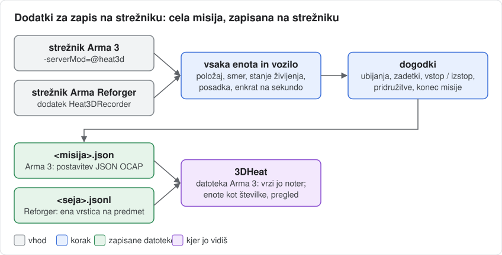

# Snemalni modi za strežnike (Arma 3, Arma Reforger) {#server-recorder-mods-arma-3-arma-reforger}

Večino iger watcher snema na igralčevem lastnem računalniku. Arma je drugačna: strežnik lahko posname celotno misijo - vsako enoto in vozilo, ne samo vaše - z modom, ki teče na strežniku. Igralci ne nastavljajo ničesar: mod za Arma 3 deluje samo na strežniku, Reforger pa sam prenese strežnikove mode igralcem, ko se pridružijo (mod na njihovih računalnikih ne naredi ničesar). Repozitorij vsebuje dva takšna moda, v [`mods/arma3`](https://github.com/Holdi601/3DHeat-Watcher/tree/main/mods/arma3) in [`mods/reforger`](https://github.com/Holdi601/3DHeat-Watcher/tree/main/mods/reforger). Njuni README-ji so celotna dokumentacija; ta stran je pregled.

**Stanje: oba še nista preizkušena v igri.** Razširitev za Arma 3 je bila zgrajena in pognana tako, kot Arma kliče razširitve, njen izpis pa je prebral 3DHeat; njeni skripti SQF še niso tekli v Arma 3. Mod za Reforger je bil napisan po Bohemijinem objavljenem API-ju skript in še nikoli ni bil preveden. Ne dajte nobenega od njiju na javni strežnik, preden opravita preizkusne korake iz svojega README.

## Arma 3 {#arma-3}

1. Razširitev zgradite enkrat na platformo (`mods/arma3/extension`). To potrebuje C prevajalnik: Visual Studio Build Tools v Windowsu, gcc v Linuxu; če še nikoli niste nič prevajali, vprašajte gostitelja strežnika.
   - Windows, v "x64 Native Tools Command Prompt for VS":
     `cl /nologo /O2 /LD heat3d.c /Fe:heat3d_x64.dll`
   - Linux: `gcc -O2 -shared -fPIC -o heat3d_x64.so heat3d.c -ldl`
2. Zgradite mod: `python mods/arma3/build.py` zapiše `mods/arma3/@heat3d/` (Arma 3 Tools ni potrebno).
3. Kopirajte `@heat3d` v mapo strežnika in zaženite strežnik z `-serverMod=@heat3d`.
4. Dnevnik `.rpt` na strežniku pove `Heat3D recorder 0.1.0: recording <file> every 1 s`.

| Nastavitev | Privzeto | Kaj naredi |
|---|---|---|
| `captureDelay` | 1 | sekunde med sličicami |
| `recordHits` | 1 | 0 izklopi dogodke zadetkov |
| `recordShots` | 1 | 0 izklopi štetje strelov |
| `minPlayers` | 0 | snemaj samo, ko je toliko igralcev na strežniku |

Misija eno od teh nastavitev prepiše v svoji `init.sqf` (`heat3d_captureDelay = 0.5;`). Posnetki gredo v `recordings/` znotraj `@heat3d` ali v `HEAT3D_DIR`.

**Izpis:** ena datoteka na misijo v postavitvi JSON po OCAP (formatu snemalnika OCAP2), imenovana `<date>__<time>_<mission>.json`. Med misijo je to dnevnik (`.heat3d.part`), izpraznjen ob vsakem zapisu; dnevnik zrušene misije se dokonča, ko se začne naslednja.

## Arma Reforger {#arma-reforger}

Mod (`Heat3DRecorder.gproj`) se odpre in zgradi v Bohemijinem Workbenchu (Arma Reforger Tools), preizkusi na lokalnem namenskem strežniku, objavi iz Workbencha (neobjavljen med preizkušanjem) in doda na seznam `mods` v `config.json` strežnika - po korakih v njegovem README. Vsako sekundo zapiše položaj, smer, stanje življenja, vozilo in id igralca vsakega lika ter položaj, smer, stanje in posadko vsakega vozila; ter ubojstva (ubijalec, orožje, razdalja), zadetke, vstope in izstope iz vozil, igralce, ki se pridružijo ali odidejo, in konec misije.

**Izpis:** en JSON objekt na vrstico, `$profile:heat3d/<UTC date>_<UTC time>_<world>.jsonl`: vrstica `header` (format `heat3d-reforger`, osi x vzhod, y navzgor, z sever), nato vrstice `entity`, `frame` in `event` sproti, in vrstica `end`. Vrstice enot so `[id, x, y, z, dir, alive, vehicleId, playerId]`, vrstice vozil `[id, x, y, z, dir, alive, [crew ids]]`; dogodki sledijo postavitvi dogodkov OCAP2.

## V pregledovalniku {#in-the-pregledovalnik}

Posnetek Arma 3 povlecite na [pregledovalnik 3DHeat](https://holdi601.github.io/3DHeat/): ena misija je ena seja, enote postanejo vojaki, vozila svojega tipa, zadetki in poškodbe pa gredo na seznam povzetka. Spletni predvajalnik OCAP2 ga predvaja tudi. Datoteka Reforgerja je vrstični format samega moda, z postavitvijo dogodkov OCAP2.
