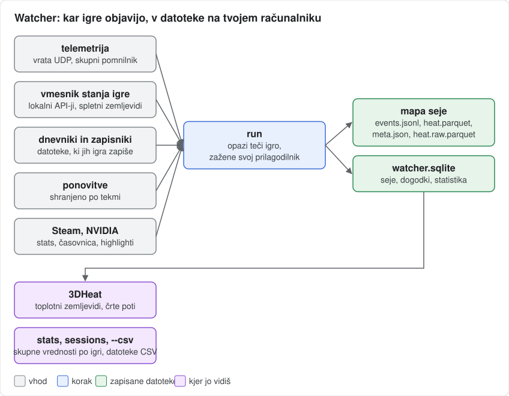

# Viri in pravila {#sources-and-rules}

Watcher zapisuje samo to, kar igre in platforme dajejo igralcu. Ta stran pojasni, katere vire to zajema, kaj sme watcher storiti z vsakim od njih in katere igre ali dele iger namenoma izpušča.

## Šest vrst virov {#the-six-kinds-of-source}

Vsak adapter ima `kind` (vrsto), ta pa določa, kaj sme adapter storiti:

| Vrsta | Kaj je | Igre z več igralci |
|---|---|---|
| `telemetry` | UDP vrata ali deljeni pomnilnik, ki ga igra objavlja za nadzorne plošče, gibalne naprave in volane (Forza Data Out, F1 UDP, deljeni pomnilnik Kunos in iRacing, SimConnect, vmesnik UDP X-Plane, vtičnik SCS SDK) | da - to je lastni izhod igre |
| `gsi` | game-state integration ali lokalni spletni API, ki ga igra streže igralčevemu računalniku (Valve GSI, Live Client Data API League, Stats API Rocket League, spletni zemljevid War Thunder) | da, v okviru tega, kar API prikazuje igralcu |
| `log` | datoteke, ki jih igra piše med delovanjem: dnevniki, zapisniki, statistike, shranjene igre (Elite Dangerous, Minecraft, Path of Exile, Hearthstone, Star Citizen, EVE Online) | da |
| `replay` | demo in replay posnetki, ki jih igra shrani za igralce, pretvorjeni po tekmi (CS2, Dota 2, osu!, War Thunder, World of Tanks, World of Warships, Squad, League of Legends, VALORANT, IL-2 Tacview) | da, razen če so zakriti, in samo deli, ki so odprti |
| `platform` | kar hranita Steam in grafični gonilnik: statistike, dosežki, časovnice, posnetki in izpostavljeni deli | da |
| `memory` | pomnilnik igre, samo za branje, po profilu, ki ga napišete | **nikoli** - samo za enoigralske igre |

Samo `memory` odpre drug proces, in to samo za branje. Ostalih pet vrst bere samo to, kar igra, Steam ali aplikacija NVIDIA App že zapiše ali pošlje.

## Kako se viri berejo {#how-the-sources-are-read}

- **V igro se ničesar ne vstavi, ne prestreže in ne spremeni.** V nobeno igro se ne naloži koda, nobeno okno ali vnos se ne prestreže, nobena datoteka igre se ne popravi. Edine datoteke, ki jih watcher zapiše zunaj svoje podatkovne mape, so tiste, ki jih zapiše [`setup --apply`](commands.md#setup), kadar to zahtevate: nastavitvena datoteka igre (z izvirnikom, ohranjenim kot `<file>.heat3d-backup`), cfg datoteka game-state, skript hooka DCS, protokolni mod BeamNG.
- **Deljeni pomnilnik se odpre samo za branje in se nikoli ne ustvari.** Običajen način odpiranja poimenovane preslikave v Pythonu jo ustvari, če še ne obstaja. Igra, zagnana pozneje, bi tako našla watcherjevo prazno preslikavo, namesto da bi ustvarila svojo, in njena telemetrija bi bila mrtva. Watcher odpira preslikave samo z `OpenFileMappingW` (ta najde le obstoječo), jih preslika s `FILE_MAP_READ` in poskusi znova pozneje, če jih igra še ni ustvarila.
- **Vrata se samo posodijo, nikoli ne prevzamejo.** UDP telemetrijska vrata, na katerih že posluša drug program (FH Companion, SimHub, aplikacija z nadzorno ploščo), ostanejo temu programu. Če drug program začne poslušati na vratih, ki jih drži watcher, jih watcher v nekaj sekundah izpusti. Adapterji Forza počakajo 15 s po zagonu igre, preden zasedejo vrata 5300, in vsak paket nespremenjen posredujejo na 127.0.0.1:5301, zato lahko drugi program Data Out še vedno snema.
- **Samo lokalno.** Strežniki game-state, ki jih watcher poganja (CS2, Dota 2), poslušajo samo na 127.0.0.1 in nikjer drugje. Kadar cfg datoteka igre vsebuje žeton (tisto, ki ga zapiše `setup`), mora vsaka objava nositi ta žeton; objave brez njega se štejejo kot `bad_auth` in se zavržejo. Brez cfg datoteke z žetonom sprejme vsako lokalno objavo, dnevnik pa to pove. Lokalna API-ja, ki ju zahteva watcher (League na vratih 2999, War Thunder na 8111, Rocket League na 49123, X-Plane na 49000), sta prav tako na 127.0.0.1.
- **Dnevniške datoteke so deljene, nikoli zaklenjene.** Vsako branje odpre datoteko z vsemi zastavicami za deljenje, ki jih ima Windows, in jo spet zapre, tako da igra lahko še naprej piše, preimenuje ali zamenja svoj dnevnik.
- **Dve zunanji storitvi, samo v teh primerih.** Preverjanje izdaje se obrne na GitHub (`api.github.com`) največ enkrat na šest ur in se lahko izklopi (glej [Posodobitve](updates.md)). Adapter replayev League zahteva Riotov Match-V5 API samo, kadar ste vnesli svoj `riot_api_key`. Nič drugega se nikamor ne pošilja.
- **Vklop vira je vaša odločitev.** `setup` brez `--apply` samo pove, kaj bi spremenil.

## Pravila za več igralcev {#multiplayer-rules}

- Igra, igrana na spletu, se zapisuje samo prek tega, kar objavi: telemetrije, API-jev stanja igre, dnevnikov, replayev, platformskih datotek. Znotraj tega watcher zapisuje to, kar igra prikaže igralcu, in nič, kar je izračunano preko tega:
  - **CS2 game-state integration** pošlje opazovanega igralca (sebe, dokler ste živi, soigralca po smrti). Pozicije drugih igralcev (`allplayers_*`) se pošiljajo samo gledalcem in GOTV, zato jih watcher ne zahteva.
  - **Live Client Data API igre League of Legends** nima položajev. Pravilnik Riot dovoljuje orodjem prikazati to, kar lahko igralec ve iz same igre, in nič, kar je izračunano preko tega (brez sovražnikovih časovnikov). Watcher zapisuje napise o pobitjih in tabelo rezultatov, ki jo vidi igralec, ter igralčeva lastna števila.
  - **Stats API Rocket League** nima položajev avtomobilov (stanje avtomobila se pošilja samo gledalcem). Kar ima mesto, je žoga: kje je bila zadeta, zadeta v gol ali v prečko.
  - **Spletni zemljevid War Thunder** prikazuje to, kar prikazuje mini zemljevid, brez imen ali ID-jev.
  - **F1 23/24/25** v svojem paketu Motion pošiljajo položaj vsakega avtomobila, tudi na spletu. Igra to sama izroči, zadrži pa samo podatke igralcev, katerih "Your Telemetry" je omejena.
  - **DCS World**: strežnik z več igralci lahko prepove izvoz podatkov lastnega letala; seja nato ima dogodke, ne pa položajev, in to pove.
- **Pomnilnik se v igri z več igralci nikoli ne bere.** Adapter pomnilnika za igro, označeno kot igrano na spletu, se zavrne, profil pa mora povedati, ali je igro sploh mogoče igrati na spletu. Enoigralska igra, ki ima tudi spletni način, se bere samo, dokler nima povezave z ničemer razen s tem računalnikom. Igre, katerih enoigralski način teče pod zaščito proti goljufanju, se prav tako nikoli ne berejo. Glej [Branje pomnilnika](memory-reading.md).
- Zastavica `multiplayer` na adapterju (v `games --markdown` prikazana kot "Online play") odloča samo o branju pomnilnika. Ne ustavi drugih vrst, da bi snemale igro na spletu.

## Kaj je izločeno in zakaj {#what-is-declined-and-why}

Nekatere igre in nekateri deli iger se ne snemajo: njihovi podatki so zaščiteni, niso objavljeni ali jih na igralčevem računalniku sploh ni:

| Igra | Kaj je izpuščeno | Zakaj |
|---|---|---|
| VALORANT | položaji, imena, rezultati v replayih; končne točke zaklepne datoteke odjemalca | Igralni tok replaya je zakrit z vrednostmi, vzetimi iz izvršljive datoteke vsake različice. Igra teče pod Vanguardom. Končne točke zaklepne datoteke odjemalca Riot niso javno dokumentiran API. **Prebrano:** kar replay v odprti obliki vsebuje - zemljevid, ID tekme, agente, časovnico strežnika o pobitjih in krogih. |
| League of Legends | trenutni del datotek `.rofl` replay; končne točke zaklepne datoteke odjemalca | Zakrito proti goljufanju, vsako zaplato drugače, in se ne dekodira. **Prebrano:** tabelo rezultatov ob koncu, ki jo vsak replay vsebuje kot navaden JSON, Live Client Data API med tekmo in - z lastnim razvijalskim ključem - uradno časovnico Match-V5 (položaji enkrat na minuto, pobitja tam, kjer so se zgodila). |
| Fortnite | replayi | Šifrirano. |
| World of Tanks, World of Warships | replayi, v watcherju | Šifrirano. Watcher jih ne bere; ločeni pretvorniki zunaj njega (`exporters/ext/wot-replay`, `exporters/ext/wows-replay`) pa jih; vsak je samostojen projekt. **Prebrano, z nameščenim pretvornikom:** položaj vsakega vozila ali ladje, dokler ga je snemalni odjemalec poznal, in pobitja. |
| Gran Turismo 7 | telemetrija | Samo za konzole, njena telemetrija je šifrirana s ključem, ki je bil pridobljen iz igre. |
| Apex Legends | vse | Njen LiveAPI pošilja polne dogodke samo v zasebnih in po meri narejenih avlah; drugače lokalno ni na voljo ničesar. |
| Overwatch 2, Call of Duty, Battlefield 6, Hunt: Showdown 1896 | podatki v živo | Ni lokalnega replaya, dnevnika ali izhoda game-state, ki bi ga lahko prebrali. Njihove statistike pridejo tja, kjer jih hrani Steam ([Steam statistike](game-steam-stats.md), [Steam Timeline](game-steam-timeline.md)), njihovi posnetki pa kot [NVIDIA highlights](nvidia-highlights.md). |
| Star Citizen | vse onstran `Game.log` | Teče pod Easy Anti-Cheat; watcher bere samo dnevniško datoteko, ki jo igra zapiše, in se nikoli ne približa procesu igre. |
| osu!lazer | replayi | Hranjeni so v lastni shrambi igre; bere se samo datoteke `.osr` osu! (stabilne različice). |
| Vsaka igra z več igralci | pomnilnik | Nikoli. Enoigralske igre, katerih način teče pod zaščito proti goljufanju (GTA V, Elden Ring prek zaganjalnika), se prav tako ne berejo. |

Šifrirani replayi se ne odpirajo: bralnik VALORANT preveri zastavico šifriranja replaya in zavrne šifrirano datoteko ("this replay is encrypted; it is not read").

Igre, ki so bile raziskane, a še niso zgrajene (replayi Deadlock, datoteke `.replay` Rocket League, StarCraft II, Team Fortress 2, Rainbow Six Siege, Beat Saber, Trackmania, nekateri dirkalni simulatorji), so navedene z njihovimi viri v [Vse igre v eni tabeli](watcher.md#researched-not-yet-built). Vsaka od njih potrebuje vzorčne datoteke, na katerih se preveri, preden gre v izdajo.
