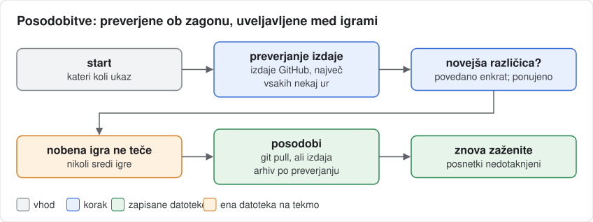

# Posodobitve {#updates}

Watcher se sam posodablja iz izdaj [Holdi601/3DHeat-Watcher](https://github.com/Holdi601/3DHeat-Watcher/releases). Posodabljalnik je paket `heat3d_update` poleg `heat3d_watch` v repozitoriju.

## Preverjanje {#the-check}

- **Kdaj**: vsak ukaz razen `update` preveri ob zagonu. `run` preverja tudi med delovanjem, največ enkrat na uro in samo, kadar ni zagnana nobena igra.
- **Kako**: ena zahteva HTTPS na `https://api.github.com/repos/Holdi601/3DHeat-Watcher/releases/latest` z zakasnitvijo 5 sekund. Odgovor se šest ur hrani v `%LOCALAPPDATA%\3DHeat\update-check-3DHeat-Watcher.json`, zato večina zagonov ne sprašuje ničesar. "Še ni izdaje" (HTTP 404) se shrani kot odgovor. Brez povezave, pri omejitvi zahtevkov ali za posrednikom preverjanje tiho ne uspe, ukaz pa teče naprej z različico, ki jo ima.
- **Različice**: nameščena različica je datoteka `VERSION` v mapi repozitorija. Oznaka izdaje (`v1.2.0` ali `1.2.0`) se primerja kot števila, del za delom; vse za `-` ali `+` se ignorira.
- **Izklop**: `HEAT3D_NO_UPDATE=1` (katerakoli vrednost razen prazne, `0`, `false` ali `no`) izklopi tako preverjanje kot samodejno posodobitev. Vsako orodje 3DHeat ima svojo datoteko predpomnilnika, zato odgovor enega orodja nikoli ne nadomesti odgovora drugega.

## Kaj se zgodi, ko je izdana novejša različica {#what-happens-when-a-newer-release-is-out}

- **`run`** ob zagonu izpiše obvestilo in teče naprej: `[heat3d_watch] 3DHeat Watcher 1.2.0 is out (this is 1.0.2). <release page>`. Medtem ko teče, se pri vklopljenem `auto_update` (privzeto) in brez igre posodobi sam: vrstica v dnevniku `3DHeat Watcher 1.2.0 is out (this is 1.0.2); updating`, Windows obvestilo "Updating to 1.2.0", posodobitev, ustavitev vseh adapterjev in zaprtje njihovih sej, in isti ukaz se zažene znova na novi kodi. Watcher se nikoli ne posodobi sredi igre. Če posodobitve ni mogoče uveljaviti, obvestilo to pove ("1.2.0 is out; not updated: ..."), watcher pa teče naprej na stari različici. Z izklopljenim `auto_update` ostane samo obvestilo.
- **Drugi ukazi** vprašajo `Update now? [Y/n]`, kadar tečejo v terminalu. Enter, `y`, `yes`, `j` ali `ja` posodobi in nato znova zažene isti ukaz na novi različici. Brez terminala (načrtovan zagon, cev) izpišejo, kako posodobiti, in nadaljujejo.
- **Na zahtevo**: `python -m heat3d_watch update` (ali `python -m heat3d_update`) vpraša GitHub brez predpomnilnika in posodobi. `--check` samo pove, ali je izdana novejša različica. To deluje tudi z nastavljenim `HEAT3D_NO_UPDATE`.

## Kako se posodobitev uveljavi {#how-an-update-is-applied}

Odvisno od tega, kako je bila kopija nameščena:

- **Klon git** (mapa ima `.git` in je `git` na PATH): `git pull --ff-only`. To je zavrnjeno, dokler ima klon spremembe v sledenih datotekah (`git status --porcelain --untracked-files=no` ni prazno): to so nečije delo, posodobitev pa ne odloča, kaj se z njimi zgodi. Spremembe shranite (commit) ali odložite (stash), nato naredite pull.
- **Prenesena kopija**: izvorni arhiv izdaje se prenese in razpakira v začasno mapo. Vnosi, ki bi pristali zunaj nje, se preskočijo. `VERSION` arhiva mora biti različica, ki jo izdaja trdi, sicer se nič ne kopira. Nato se njegove datoteke prekopirajo čez mapo repozitorija. Datotek, ki niso del izdaje - posnetki, nastavitve, virtualna okolja, izvozi, vse, kar ste naredili - se ne dotakne. Modul Python, ki ga je imela starejša izdaja, nova pa ne, se odstrani iz paketov izdaje (`heat3d_watch`, `heat3d_update`), da po posodobitvi ne naloži zastarelega modula adapterja; nič zunaj teh paketov se ne odstrani.

Posnetki in nastavitve so običajno tako ali tako zunaj mape repozitorija (`%LOCALAPPDATA%\3DHeat\Watcher`), zato se posodobitve nikoli ne dotaknejo.

Po posodobitvi se isti ukaz zažene znova. V Windowsu watcher zažene nov proces, počaka nanj in posreduje njegovo izhodno kodo, tako da se konzola obnaša, kot da je prvi proces opravil delo.
