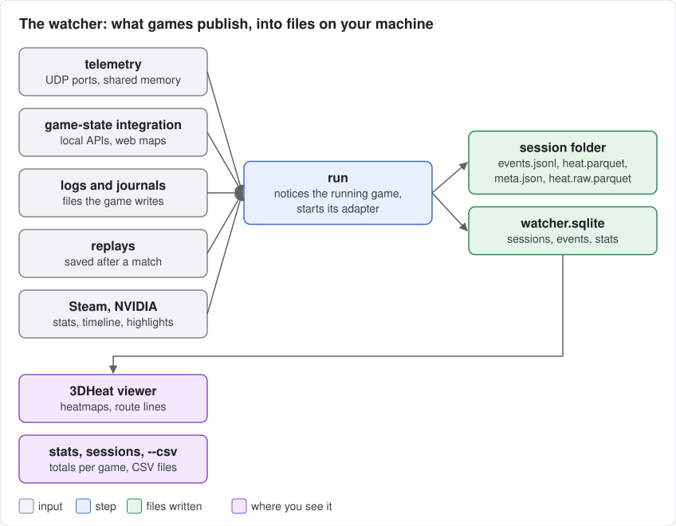

# Sources and rules

The watcher records only what games and platforms hand out to the player. This page explains which
sources that covers, what the watcher may do with each, and which games or parts of games it leaves
out on purpose.

## The six kinds of source

Every adapter has a `kind`, and the kind decides what the adapter may do:

| Kind | What it is | Multiplayer games |
|---|---|---|
| `telemetry` | a UDP port or shared memory the game publishes for dashboards, motion rigs and wheel bases (Forza Data Out, F1 UDP, Kunos and iRacing shared memory, SimConnect, X-Plane's UDP interface, the SCS SDK plugin) | yes - it is the game's own output |
| `gsi` | a game-state integration or local web API the game serves to the player's own machine (Valve GSI, League's Live Client Data API, Rocket League's Stats API, War Thunder's web map) | yes, within what the API shows the player |
| `log` | files the game writes while it runs: journals, logs, statistics, saves (Elite Dangerous, Minecraft, Path of Exile, Hearthstone, Star Citizen, EVE Online) | yes |
| `replay` | demos and replays the game saves for its players, converted after the match (CS2, Dota 2, War Thunder, World of Tanks, World of Warships, Squad, League of Legends, VALORANT, IL-2 Tacview) | yes, unless encrypted, and only the parts in the open |
| `platform` | what Steam and the graphics driver keep: statistics, achievements, timelines, clips and highlights | yes |
| `memory` | the game's memory, read only, by a profile you wrote | **never** - single-player only |

Only `memory` opens another process, and only for reading. The other five kinds read what the game,
Steam or the NVIDIA App has already written out or sends.

## How the sources are read

- **Nothing is injected, hooked or changed in a game by the watcher.** The watcher loads no code into a
  game, hooks no window or input, patches no game file. The only files it writes outside its data folder
  are the ones [`setup --apply`](commands.md#setup) writes when you ask it to: a game's own settings
  file (with the original kept as `<file>.heat3d-backup`), a game-state cfg file, the DCS hook script,
  the BeamNG protocol mod, and the [Gunner, HEAT, PC! recorder](ghpc-recorder.md).
- **The one mod that runs inside a game is your choice, for a single-player game.** Gunner, HEAT, PC!
  keeps no replays and sends no telemetry, so its recorder is a mod you install into the game's own mod
  loader (MelonLoader). It reads the game and changes nothing in play: its hooks only look at the
  game's rounds as they fly and never alter or skip what the game does, and a test fails the build if
  the mod's code sets anything in the game.
- **Shared memory is opened read-only and never created.** The usual Python way to open a named
  mapping creates one when it does not exist yet. A game started after that would find the watcher's
  empty, read-only mapping instead of making its own, and its telemetry would be dead. The watcher
  opens mappings only with `OpenFileMappingW` (which only finds an existing one), maps them with
  `FILE_MAP_READ`, and tries again later if the game has not made them yet.
- **Ports are borrowed, never taken over.** A UDP telemetry port another program already listens on
  (FH Companion, SimHub, a dashboard app) is left to that program. If another program starts
  listening on a port the watcher holds, the watcher lets go of it within a few seconds. Forza
  adapters wait 15 s after the game starts before taking port 5300, and pass every packet on unchanged
  to 127.0.0.1:5301, so a second Data Out app can still record.
- **Local only.** The game-state servers the watcher runs (CS2, Dota 2) listen on 127.0.0.1 and nowhere
  else. When the game's cfg file holds a token (the one `setup` writes does), every post must carry
  it; posts without it are counted as `bad_auth` and dropped. Without a cfg file with a token, any
  local post is accepted, and the log says so. The local APIs it asks (League on port 2999, War Thunder on
  8111, Rocket League on 49123, X-Plane on 49000) are on 127.0.0.1.
- **Log files are shared, never locked.** Each read opens the file with every share flag Windows has
  and closes it again, so the game can keep writing, rename or replace its log.
- **Two outside services, and only in these cases.** The release check asks GitHub
  (`api.github.com`) at most every six hours and can be switched off (see [Updates](updates.md)). The
  League replay adapter asks Riot's Match-V5 API only when you entered your own `riot_api_key`.
  Nothing else is sent anywhere.
- **Switching a source on is your decision.** `setup` without `--apply` only says what it would
  change.

## Multiplayer rules

- A game played online is recorded only through what it publishes: telemetry, game-state APIs, logs,
  replays, platform files. Within those, the watcher records what the game shows the player, and
  nothing computed beyond it:
  - **CS2 game-state integration** sends the player being watched (yourself while alive, a teammate
    after death). Other players' positions (`allplayers_*`) are sent only to spectators and GOTV, so
    the watcher does not ask for them.
  - **League of Legends' Live Client Data API** has no positions. Riot's policy allows tools to show
    what the player could know from the game itself, and nothing computed beyond it (no enemy timers).
    The watcher records the kill feed and scoreboard the player sees, and the player's own numbers.
  - **Rocket League's Stats API** has no car positions (car state is sent only to spectators). What has
    a place is the ball, where it was hit, scored or hit the crossbar.
  - **War Thunder's web map** shows what the minimap shows, without names or ids.
  - **F1 23/24/25** put every car's position in their Motion packet, online too. The game hands those
    out itself, and holds back only the data of players whose "Your Telemetry" is restricted.
  - **DCS World**: a multiplayer server can forbid the export of the own aircraft's data; the session
    then has events but no positions, and says so.
- **Memory is never read in a multiplayer game.** A memory adapter for a game marked as played online
  is refused, and a profile must state whether its game can be played online at all. A single-player
  game that also has an online mode is read only while it has no connection to anything but this
  machine. Games whose single-player mode runs under an anti-cheat are never read either. See
  [Reading memory](memory-reading.md).
- The `multiplayer` flag on an adapter (shown as "Online play" by `games --markdown`) only decides
  memory reading. It does not stop the other kinds from recording online play.

## What is declined and why

Some games, and some parts of games, are not recorded: their data is protected, not published, or not
on the player's machine at all:

| Game | What is left out | Why |
|---|---|---|
| VALORANT | positions, names, scores in replays; the client's lockfile endpoints | The replay's game stream is obfuscated with values taken from each build's executable. The game runs under Vanguard. The lockfile endpoints of the Riot client are not a published API. **Read:** what the replay carries in the open - map, match id, agents, the server's kill and round timeline. |
| League of Legends | the moment-to-moment part of `.rofl` replays; the client's lockfile endpoints | Obfuscated against cheating, differently every patch, and not decoded. **Read:** the end-of-game box score every replay carries as plain JSON, the Live Client Data API during a match, and - with your own developer key - the official Match-V5 timeline (positions once a minute, kills where they happened). |
| Fortnite | replays | Encrypted. |
| World of Tanks, World of Warships | replays, in the watcher | Enciphered. The watcher does not read them; separate converters outside it do (`exporters/ext/wot-replay`, `exporters/ext/wows-replay`), each a project of its own. **Read, with a converter installed:** every vehicle's or ship's position while the recording client knew of it, and the kills. |
| Gran Turismo 7 | telemetry | Console only, and its telemetry is encrypted with a key recovered from the game. |
| Apex Legends | everything | Its LiveAPI sends full events only in private and custom lobbies; nothing is available locally otherwise. |
| Overwatch 2, Call of Duty, Battlefield 6, Hunt: Showdown 1896 | live data | No local replay, log or game-state output to read. Their statistics come in where Steam keeps them ([Steam statistics](game-steam-stats.md), [Steam Timeline](game-steam-timeline.md)), and their clips as [NVIDIA highlights](nvidia-highlights.md). |
| Star Citizen | anything beyond `Game.log` | Runs Easy Anti-Cheat; the watcher reads only the log file the game writes and never goes near the game's process. |
| osu! | replays | Out of scope: a 2D game, with nothing to place on a map. |
| Any multiplayer game | memory | Never. Single-player games whose mode runs under an anti-cheat (GTA V, Elden Ring through its launcher) are not read either. |

Encrypted replays are not opened: the VALORANT reader checks the replay's encryption flag and
declines an encrypted file ("this replay is encrypted; it is not read").

Games researched but not built yet (Deadlock replays, Rocket League `.replay` files,
StarCraft II, Team Fortress 2, Rainbow Six Siege, Beat Saber, Trackmania, several racing sims) are
listed with their sources in [All games in one table](watcher.md#researched-not-yet-built). Each one
needs sample files to be checked against before it is shipped.
