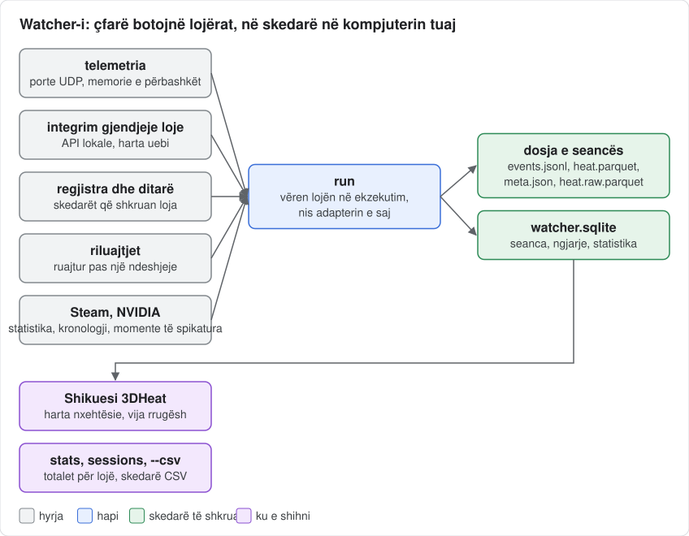
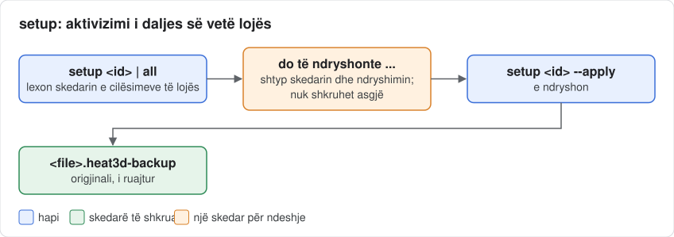
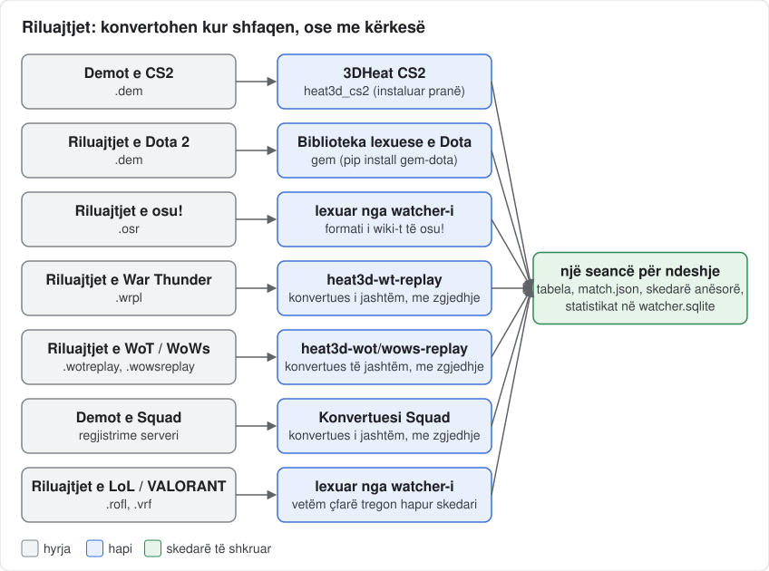
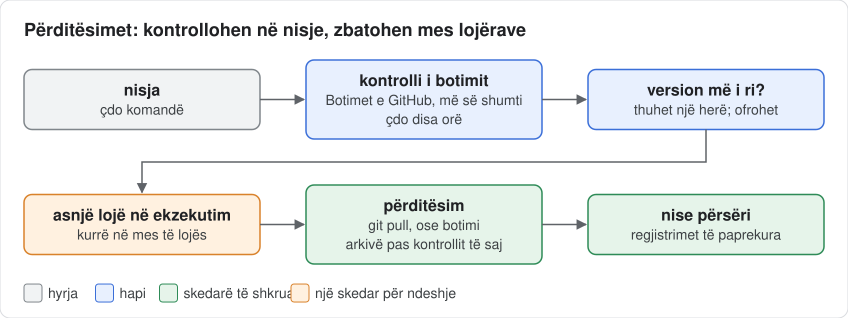

# Komandat {#commands}

Je i ri me rreshtin e komandave? Lexo së pari [Para se të fillosh](before-you-start.md). Çdo komandë shkruhet
në një terminal të hapur në dosjen që shpakete ose klonove (në File Explorer, shkruaj `powershell` te
shiriti i adresës), si

```bash
python -m heat3d_watch <command> [options]
```


| Komanda | Çfarë bën |
|---|---|
| [`run`](#run) | vëzhgon në sfond dhe regjistron çdo lojë që ekzekutohet |
| [`games`](#games) | çfarë jep secila lojë dhe nga ku |
| [`setup`](#setup) | aktivizon daljen e vetë lojës |
| [`status`](#status) | cilat lojëra ekzekutohen tani, dhe cilët adaptera do të niseshin |
| [`sessions`](#sessions) | regjistrimet deri tani |
| [`stats`](#stats) | totalet për lojë, ose tabelat si CSV |
| [`table`](#table) | rindërton `heat.parquet` të një seance nga `events.jsonl` i saj |
| [`replays`](#replays) | konverton riluajtjet që janë tashmë në disk |
| [`dota-replay`](#dota-replay) | shkarkon riluajtjen e një ndeshjeje publike të Dota 2 sipas id-së së saj |
| [`dota-map`](#dota-map) | harta e Dota 2 nga instalimi yt si nivel 3D, nga mjeti i veçantë 3DHeat Dota |
| [`update`](#update) | përditëson te botimi më i ri |
| [`config`](#config) | tregon ose ndryshon cilësimet |

Opsione për çdo komandë: `-h` / `--help` printon ndihmën, dhe `python -m heat3d_watch --version`
printon versionin (skedari `VERSION`).

Fotot në këtë faqe janë ekzekutime në seanca shembull sintetike (`Example Racer`, `Example Arena`),
jo regjistrime të vërteta.

Çdo komandë përveç `update` fillimisht kërkon një botim më të ri (më së shumti çdo gjashtë orë; kapërcehet me
`HEAT3D_NO_UPDATE=1`, shih [Përditësimet](updates.md)). `run` vetëm printon një njoftim. Komandat e tjera pyesin
`Update now? [Y/n]` kur ekzekutohen në një terminal, dhe printojnë si të përditësosh kur nuk ekzekutohen. Dalja është
UTF-8, ndaj emrat e lojërave në çdo shkrim printohen në çdo konsolë.

## run {#run}

```bash
python -m heat3d_watch run [--once] [-v]
```



Vëzhgon derisa të ndalohet (Ctrl+C): çdo `scan_seconds` lexon listën e proceseve dhe ekzekuton një adapter për
çdo lojë që gjen, plus adapterat gjithmonë të aktivë. Para shikimit të parë përfundon seancat që një
ekzekutim i mëparshëm i la të hapura. Ndërsa asnjë lojë nuk ekzekutohet, mund të përditësohet vetë (me `auto_update` të aktivizuar). Detajet
janë te [Instalimi dhe ekzekutimi](installing-and-running.md#running).

| Opsioni | Efekti |
|---|---|
| `--once` | një shikim i lojërave që ekzekutohen, pastaj del. Adapterat për lojërat që ekzekutohen tani (dhe ata gjithmonë të aktivë) niset, secili pyet një herë (për këtë pritet më së shumti 10 sekonda), dhe pastaj të gjithë ndalohen ashtu siç i ndalon mbarimi i një loje: seancat e tyre mbyllen, shkruhen dhe numërohen. Për të kontrolluar zbulimin, jo për regjistrim. |
| `-v`, `--verbose` | rreshta debug te `watcher.log` dhe në konsolë |

`run` shkruan `<data>\watcher.lock` dhe refuzon të niset për herë të dytë për të njëjtën dosje të dhënash (kodi i daljes
1); shih [Skedari i kyçjes](installing-and-running.md#the-lock-file).

## games {#games}

```bash
python -m heat3d_watch games [--markdown]
```


Liston çdo adapter të renditur sipas lojës: emrin, id-në dhe llojin e tij, nga ku lexon, çfarë regjistron, dhe
si aktivizohet. Një adapter që nuk mund të ekzekutohet në këtë kompjuter shënohet
`[unavailable: <why>]` - SimConnect.dll nuk u gjet, nuk ka dosje Minecraft, 3DHeat CS2 nuk është i instaluar,
Steam ose aplikacioni NVIDIA nuk u gjet. Një modul adapteri që dështoi të importohej emërtohet në fund me
gabimin.

```text
EA SPORTS F1 25  (f1-25, telemetry)
    from: UDP telemetry 127.0.0.1:20777 (Documents\My Games\F1 25\hardwaresettings\hardware_settings_config.xml)
    - every car's position (world XYZ, m) at 10 Hz, by driver name, team, own car marked, ...
    switch on: In the game: Settings > Telemetry Settings > UDP Telemetry On, IP 127.0.0.1, port 20777 - ...
```

`--markdown` printon të njëjtën gjë si një tabelë Markdown (loja, çfarë regjistrohet, nga ku, për ta aktivizuar,
loja online, kontrolluar). Tabela te [Të gjitha lojërat në një tabelë](watcher.md) është kjo dalje. Qelizat
shpëtohen për Markdown: teksti në backtick mbetet një pjesë kodi, dhe jashtë tyre `<`, `>`, `&`, `*`, `|`
dhe një pjerrësi e prapme (backslash) para pikësimit shkruhen që të shfaqen siç janë shkruar (`<CS2>` përndryshe do të zhdukej si
një etiketë HTML në kramdown). Pjesa e vetme e HTML-së është `<br>` mes elementeve të "What is recorded".

## setup {#setup}

```bash
python -m heat3d_watch setup <adapter id | all> [--apply]
```




Aktivizon daljen e vetë lojës, aty ku loja ka nevojë që t'i ndryshohet një skedar për këtë. Pa `--apply`
nuk ndryshohet asgjë: çdo rresht thotë çfarë do të ndryshonte, dhe kur ka çfarë të ndryshohet rreshti i fundit
thotë `Nothing was changed. Run again with --apply to make these changes.` Kur nuk ka çfarë të
ndryshohet thotë `<id>: nothing to change` (`Nothing to change.` për `all`). Me `--apply` ndryshimet
bëhen, dhe para se një skedar të ndryshohet për herë të parë, origjinali i tij ruhet si
`<file>.heat3d-backup`. Një kopje rezervë që ekziston tashmë nuk mbishkruhet kurrë, ndaj ajo mban gjithmonë
skedarin siç ishte para se watcher-i ta prekte për herë të parë.

```text
f1-25: would change: hardware_settings_config.xml <udp>: enabled="false" -> "true"
Nothing was changed. Run again with --apply to make these changes.
```

`all` ekzekuton setup-in e çdo adapteri që ka një. Një adapter pa të, i emërtuar vetëm, printon
`<id>: nothing for setup to change; ` e ndjekur nga mënyra si aktivizohet loja (teksti i tij `enable`, ose
që nuk ka nevojë për asgjë). Një id e panjohur printon `no adapter '<id>'; games lists them` dhe del me kodin
2. Adapterat që kanë diçka për t'u vendosur:

| Adapteri | Çfarë ndryshon `--apply` |
|---|---|
| `beamng` | instalon modin e protokollit `heat3d` në dosjen `mods` të përdoruesit të BeamNG (vetëm kur nuk është aty); pastaj aktivizo në lojë Options > Other > Protocols > "others" |
| `cs2-gsi` | shkruan `<CS2>\game\csgo\cfg\gamestate_integration_heat3d.cfg`: dërgo gjendjen e lojës te `http://127.0.0.1:3311/` me një token të rastësishëm që watcher-i e kërkon pastaj (një token që është tashmë në skedar mbahet); CS2 e lexon kur niset |
| `dota2-gsi` | njësoj për Dota 2: `<Dota>\game\dota\cfg\gamestate_integration\gamestate_integration_heat3d.cfg`, porti 3312 |
| `dcs` | shton `Scripts\Hooks\heat3d-watch.lua` te çdo dosje `%USERPROFILE%\Saved Games\DCS*`. Kopja e vet më e vjetër përditësohet; një skedar me atë emër që watcher-i nuk e shkroi lihet i paprekur. Rinis DCS. |
| `dirt-rally-2` | `hardware_settings_config.xml`: `<udp enabled="true" extradata="3" ip="127.0.0.1" port="20777">`; nise lojën një herë më parë që skedari të ekzistojë |
| `ea-wrc` | `Documents\My Games\WRC\telemetry\config.json`: paketa `session_update` e strukturës `wrc` aktive, drejt këtij kompjuteri |
| `f1-23`, `f1-24`, `f1-25` | `hardware_settings_config.xml`: `<udp enabled="true" ip="127.0.0.1" port="20777">`; loja duhet të jetë e mbyllur |
| `hearthstone` | shton një seksion `[Power]` (`LogLevel=1`, `FilePrinting=true`) te `%LOCALAPPDATA%\Blizzard\Hearthstone\log.config`; rinis lojën |
| `il2` | `<game>\data\startup.cfg`, `[KEY = telemetrydevice]`: një objektiv më shumë `addrN = "127.0.0.1:41995"` dhe `enable = true` (seksioni shtohet, me 10 Hz, kur nuk ka asnjë); rinis IL-2 |
| `il2-tacview` | `<game>\data\startup.cfg`, `[KEY = track_record]`: `tacviewrecord = 1` |
| `rocketleague-stats` | `TAStatsAPI.ini` (ose `DefaultStatsAPI.ini` kur ai nuk ekziston) te `<RL>\TAGame\Config`: `PacketSendRate=30` kur API është joaktive, dhe `Port` kur nuk është vendosur asnjë; lexohet kur niset Rocket League |

`richard-burns-rally` nuk ka setup: telemetria e tij është ajo e shtojcës RSF/NGP, e aktivizuar me dorë te
`RichardBurnsRally.ini` (shih [faqen e tij](game-richard-burns-rally.md)); `setup richard-burns-rally` e
thotë këtë. Çdo lojë tjetër ose nuk ka nevojë për asgjë ose aktivizohet në lojë; faqja e secilës lojë thotë si.

## status {#status}

```bash
python -m heat3d_watch status
```

```text
3DHeat Watcher 1.0.2; data in C:\Users\...\AppData\Local\3DHeat\Watcher
Games running: EA SPORTS F1 25 (f1-25)
Always on: il2-tacview, steam-stats, steam-timeline, nvidia-highlights, cs2-demos, lol-replays, valorant-replays
```

Tregon cilët adaptera do të niste tani një `run`, sipas të njëjtave rregulla: procesi i lojës ekzekutohet, adapteri
nuk është te `disabled`, nuk mungon asgjë që i duhet, adapterat e riluajtjeve vetëm me `replays` aktiv, adapterat e memories
vetëm me `memory` aktiv dhe çdo kontroll memorieje të kaluar. Nuk niset asgjë.

## sessions {#sessions}

```bash
python -m heat3d_watch sessions [--game NAME] [--limit N]
```


Seancat më të reja nga `watcher.sqlite`, një rresht secila: fillimi (ora lokale), loja, minutat, ngjarjet,
pozicionet, dosja.

| Opsioni | Efekti |
|---|---|
| `--game NAME` | vetëm kjo lojë, me emrin e saj të saktë si në listë (`"EA SPORTS F1 25"`) |
| `--limit N` | më së shumti N seanca (parazgjedhja 40) |

## stats {#stats}

```bash
python -m heat3d_watch stats [--game NAME] [--csv DIR]
```


Pa opsione: një tabelë me çdo lojë (seanca, orë, ngjarje, pozicione, e fundit e luajtur), më e luajtura
e para, pastaj për çdo lojë 25 ngjarjet e saj më të shpeshta dhe çdo statistikë numerike me numrin e
seancave që e kanë, totalin, vlerën më të mirë (`best`) dhe mesataren. `best` e di cila anë është
më e mirë: vlera më e ulët për kohët e mbajtura si më e mira (`best_lap`, `best_stage` dhe çdo çelës tjetër që
fillon me `best_`) dhe për vendet (`race_position`, `grid_position`, çdo çelës që mbaron me `_position`),
më e larta për gjithçka tjetër (vrasje, largësi, shpejtësi maksimale, numëruesit e vetë lojës).

| Opsioni | Efekti |
|---|---|
| `--game NAME` | vetëm ngjarjet dhe statistikat e kësaj loje, pa pasqyrën |
| `--csv DIR` | shkruan `sessions.csv`, `events.csv` dhe `stats.csv` (çdo rresht i tri tabelave) te `DIR` në vend të kësaj; `--game` nuk e ngushton |

## table {#table}

```bash
python -m heat3d_watch table <session folder>
```


Rindërton `heat.parquet` në një dosje seance nga `events.jsonl` i saj, me boshtet nga `meta.json` i saj.
Printon rrugën e tabelës, ose `no positions in this session`. Përdore për një seancë të regjistruar
ndërsa `pyarrow` mungonte, ose pasi ke ndryshuar `events.jsonl` me dorë.

## replays {#replays}

```bash
python -m heat3d_watch replays <adapter id> [folder] [-v]
```



Konverton riluajtjet që janë tashmë në disk, tani, një pas një, secilën në një seancë ashtu si do ta bënte
vëzhgimi i dosjes. Herën e parë që watcher-i sheh një dosje riluajtjesh, vetëm shënon çfarë ka brenda (shih
[Instalimi dhe ekzekutimi](installing-and-running.md#replays-already-on-disk)); kështu konvertohen ato sipas
kërkesës. Pa `folder` lexohen dosjet e vetë adapterit (ato të lojës, plus `replay_folders`); me
të, riluajtjet në atë dosje. Çdo e konvertuar shënohet si e parë, ndaj watcher-i që ekzekutohet nuk e
konverton përsëri. Një riluajtje që dështon të konvertohet regjistrohet në log dhe kapërcehet.

| Adapteri | Riluajtjet |
|---|---|
| `cs2-demos` | demot e Counter-Strike 2 (`*.dem`), përmes 3DHeat CS2 |
| `lol-replays` | riluajtjet e League of Legends (`*.rofl`), përmes lexuesit të jashtëm `heat3d-riot-replays` (3DHeat-Ext-Riot) |
| `valorant-replays` | riluajtjet e VALORANT (`*.vrf`), përmes lexuesit të jashtëm `heat3d-riot-replays` (3DHeat-Ext-Riot) |
| `warthunder-replays` | riluajtjet e War Thunder (`*.wrpl`), përmes konvertuesit të jashtëm `heat3d-wt-replay` (exporters/ext/warthunder-replay) |
| `wot-replays` | riluajtjet e World of Tanks (`*.wotreplay`), përmes konvertuesit të jashtëm `heat3d-wot-replay` (exporters/ext/wot-replay) |
| `wows-replays` | riluajtjet e World of Warships (`*.wowsreplay`), përmes konvertuesit të jashtëm `heat3d-wows-replay` (exporters/ext/wows-replay) |
| `dota-replays` | riluajtjet e Dota 2 (`*.dem`), përmes lexuesit të jashtëm `heat3d-dota-replay` (3DHeat-Ext-DotaReplay) |

```text
lol-replays: converted 12 replay(s); `sessions --game` lists them
```

Një id që nuk është një nga këto printon `no replay adapter '<id>'` me listën dhe del me kodin 2;
po kështu një `folder` që nuk ekziston. Një adapter që nuk mund të ekzekutohet këtu (3DHeat CS2 ose lexuesi i lojës
nuk është i instaluar) printon pse - ku ta marrësh lexuesin dhe si ta instalosh - dhe del me
kodin 1. Gjurmët Tacview të IL-2 nuk janë në listë: ai adapter konverton vetë çdo gjurmë
të përfunduar që gjen.

## dota-replay {#dota-replay}

```bash
python -m heat3d_watch dota-replay <match id> [<match id> ...] [-o FOLDER] [--convert] [-v]
```

Shkarkon riluajtjen e një ndeshjeje publike të Dota 2 nga serverat e riluajtjeve të Valve. Duhet internet. Id-ja
e ndeshjes është numri në faqen e ndeshjes në klientin e Dota (detajet e ndeshjes) ose në
faqen e OpenDota; Valve e mban një riluajtje për disa javë, pas të cilave shkarkimi dështon. Serveri dhe kripa e
riluajtjes vijnë nga regjistrimi i OpenDota për ndeshjen (`api.opendota.com/api/matches/<id>`, nuk duhet çelës), skedari
nga `replay<cluster>.valve.net/570/<id>_<salt>.dem.bz2`; zhpaketohet ndërsa vjen (Valve
shërben si bzip2 ashtu edhe Zstandard nën atë emër) dhe ruhet si `<match id>.dem`. Pa `-o` shkon
te dosja e vetë riluajtjeve të Dota kur Dota 2 është i instaluar - ku një watcher që ekzekutohet e konverton - dhe te
`<data>/replays/dota` përndryshe. Një skedar që është tashmë aty mbahet. `--convert` konverton riluajtjet e shkarkuara
menjëherë, siç do ta bënte `replays dota-replays`, dhe i shënon si të parë; i duhet lexuesi i riluajtjeve të Dota 2
([3DHeat-Ext-DotaReplay](https://github.com/Holdi601/3DHeat-Ext-DotaReplay), `heat3d-dota-replay`)
dhe, pa të, thotë ku ta marrësh dhe del me kodin 1 para se të shkarkojë ndonjë gjë. Vetë shkarkimi
ka nevojë vetëm për watcher-in.

```text
match 9000000000: C:\Program Files (x86)\Steam\steamapps\common\dota 2 beta\game\dota\replays\9000000000.dem
```

Valve i mban riluajtjet për disa javë; një ndeshje më e vjetër printon `Valve no longer has the replay of match
<id>` dhe del me kodin 1. Një ndeshje që OpenDota nuk e ka parë ende nuk ka kripë: mesazhi thotë ta pyesësh
OpenDota për të (`curl -X POST https://api.opendota.com/api/request/<id>`) dhe të provosh përsëri pas disa
minutash. Lobi privatë dhe ndeshjet me profil të fshehur nuk janë fare në serverat e riluajtjeve.

## dota-map {#dota-map}

```bash
python -m heat3d_watch dota-map [<map>] -o <file.glb> [--game FOLDER] [--source2viewer EXE] [--detail UNITS]
```

Shkruan hartën e Dota 2 - tokë, shkëmbinj, ujë, pemë dhe ndërtesa - si nivel `.glb` në kuadrin
në të cilin vizatohen tabelat e riluajtjeve të Dota, nga instalimi yt i Dota 2. Watcher-i nuk i lexon vetë skedarët e
lojës: ekzekuton mjetin e veçantë **3DHeat Dota** (`heat3d-dota-maps level`,
[3DHeat-Ext-Dota](https://github.com/Holdi601/3DHeat-Ext-Dota)) me këto opsione dhe e kalon daljen
dhe kodin e daljes. `<map>` është `dota` si parazgjedhje; `--game` është dosja e Dota 2 kur nuk është në një
bibliotekë Steam; `--source2viewer` rruga e CLI-së të Source2Viewer, që i duhet atij mjeti; `--detail` qeliza
e grumbullimit të kulmeve për ndërtesat në njësi loje (parazgjedhja 8, 0 mban çdo trekëndësh). Kur mjeti
nuk është i instaluar printon `dota-map: the Dota 2 map converter is not installed: ...` me ku ta marrësh
dhe del me kodin 2. Detajet: [Harta e Dota 2](dota-map.md).

## update {#update}

```bash
python -m heat3d_watch update [--check]
```



Pyet GitHub për botimin më të ri, duke injoruar përgjigjen e ruajtur, dhe përditëson këtë kopje kur është më e re
(shih [Përditësimet](updates.md)). `--check` vetëm thotë nëse ka dalë një botim më i ri. Kjo komandë ekzekutohet edhe
me `HEAT3D_NO_UPDATE` të vendosur: kërkesa për të është vendimi. `python -m heat3d_update [--check]` bën
të njëjtën gjë.

## config {#config}

```bash
python -m heat3d_watch config [--set KEY=VALUE ...]
```


Printon çdo cilësim si `key = value`. Me `--set`, ndryshon fillimisht ato që jepen dhe ruan
`settings.json` (`saved <path>`). Vlerat lexohen sipas llojit të cilësimit:

- cilësimet e/jo: `1`, `true`, `yes`, `on` ose `ja` është e vërtetë; `0`, `false`, `no`, `off`, `nein` ose
  asgjë është e gabuar;
- numrat: një numër dhjetor (`scan_seconds=5`);
- listat: të ndara me presje ose një listë JSON (`disabled=steam-stats,steam-timeline`; një vlerë e zbrazët e pastron
  listën);
- fjalorët (`replay_folders`, `player_names`): i gjithë fjalori si JSON, ose një hyrje si
  `KEY.ID=VALUE` - `replay_folders.cs2-demos=D:\Demos,E:\More Demos` vendos dosjet e atij adapteri
  (të ndara me presje), `player_names.warthunder-webmap=Name` emrin e atij adapteri; një vlerë e zbrazët heq
  hyrjen;
- teksti: siç jepet (`data=D:\Heat`, `riot_id=Name#TAG`).

```bash
python -m heat3d_watch config --set memory=true scan_seconds=5
python -m heat3d_watch config --set riot_id=Name#TAG riot_platform=EUW1
python -m heat3d_watch config --set replay_folders.cs2-demos=D:\Demos player_names.rocketleague-stats=Name
```

Një çelës i panjohur printon `no setting '<key>'`, dhe një vlerë që nuk është e llojit të cilësimit (`memory=perhaps`,
`scan_seconds=often`, një fjalor që nuk është JSON) printon `not saved: ...`; të dyja dalin me kodin 2
pa ruajtur asgjë. Një `settings.json` i ndryshuar me dorë lexohet njësoj: një vlerë e dhënë si tekst
aty ku cilësimi është numër, e/jo ose fjalor lexohet siç është shkruar, dhe ajo që nuk mund të
lexohet lihet në parazgjedhjen e saj. Çdo cilësim përshkruhet te
[Instalimi dhe ekzekutimi](installing-and-running.md#settings).
