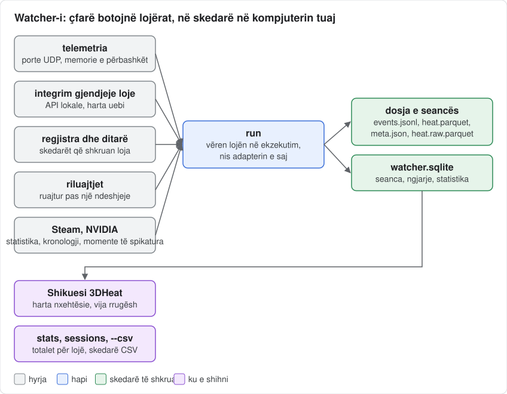

# 3DHeat Watcher {#dheat-watcher}

**Çfarë është?** Ju luaj një lojë. Ky program shënon në heshtje ku shkove dhe çfarë ndodhi.
Më vonë mund ta shih si një hartë të ngjyrosur në shikuesin 3DHeat.

**Pse ta përdor?** Për të mbajtur regjistrin tënd për çdo seancë - ku vozite, fluturove ose luftove,
totalet e tua për lojë - pa asnjë faqe interneti dhe pa e ndryshuar lojën.

**Shembull:** vozit një xhiro në një lojë garash me watcher-in të ekzekutuar; pas kësaj një skedar në
`sessions\<game>\` mban vijën që ndoqe, dhe shikuesi e vizaton.

Më në detaje: 3DHeat Watcher është një program në sfond që regjistron çfarë botojnë lojërat për lojën tënde - ku
shkove, çfarë ndodhi ku, dhe numrat pas tyre - në skedarë në kompjuterin tënd. Skedarët janë
për statistikat e tua dhe për hartat e nxehtësisë dhe vijat e rrugëve të shikuesit 3DHeat.

Ekzekutohet në heshtje, vëren cilën lojë nise, dhe lexon daljet e vetë asaj loje: një port telemetrie
ose memorie të përbashkët që loja e boton për dashboard-e, një integrim gjendjeje loje, ditarin ose regjistrin që
shkruan loja, riluajtjen që ruan pas një ndeshjeje, statistikat që mban Steam, klipet që ruan
aplikacioni NVIDIA. Regjistrimet mbeten në kompjuterin tënd. Programi kontakton vetëm dy shërbime të jashtme, dhe vetëm në
këto raste: GitHub, për të kërkuar një botim më të ri (shih [Përditësimet](../updates.md)), dhe API-n Match-V5 të Riot,
dhe vetëm nëse jep çelësin tënd API të Riot (shih [Riluajtjet e League of Legends](../game-lol-replays.md)).



## Çfarë regjistron {#what-it-records}

- **Pozicionet**: makina, avioni, heroi ose lojtari, disa herë në sekondë aty ku loja i boton,
  me shpejtësinë, drejtimin dhe çdo gjë tjetër që dërgon loja bashkë me to.
- **Ngjarjet**: shfaqje, vdekje, vrasje, xhiro, etapa, raunde, gola, punë, ngritje dhe uljet, ndryshime
  zonash, arritje, momente të spikatura. Çdo ngjarje ruhet me kohën e saj, dhe me vendin e saj kur
  loja jep një.
- **Statistikat për seancë**: vrasje, vdekje, xhiro, xhiroja më e mirë, largësia, shpejtësia maksimale, koha e luajtur, dhe
  statistikat e vetë lojës aty ku i mban.

Çfarë jep secila lojë, dhe nga ku, është në faqen e saj nën [Lojërat](../games.md). Një burim nuk mund të
regjistrojë gjithçka: lojërat me shumë lojtarë regjistrohen vetëm përmes asaj që botojnë, dhe watcher-i
nuk lexon kurrë memorien e tyre (shih [Burimet dhe rregullat](../sources-and-rules.md)).

## Instalimi {#install}

Je i ri me vijën e komandës? Lexo së pari [Para se të fillosh](before-you-start.md).

Watcher-i është një program Python për Windows (Python 3.10 ose më i ri). Shumë nga burimet e tij ekzistojnë vetëm në Windows: memoria e
përbashkët, regjistri, njoftimet e Windows.

```bash
git clone https://github.com/Holdi601/3DHeat-Watcher.git
cd 3DHeat-Watcher
pip install -r requirements.txt
```

Një arkiv botimi i shkarkuar funksionon njësoj: çzipoje, pastaj ekzekuto `pip install -r requirements.txt`
brenda dosjes. Detajet, dhe shtesat që i duhen disa lojërave, janë te
[Instalimi dhe ekzekutimi](../installing-and-running.md).

## Fillim i shpejtë {#quick-start}

```bash
python -m heat3d_watch games            # what each game gives, and from where
python -m heat3d_watch setup all        # what would have to be switched on (nothing is changed)
python -m heat3d_watch setup f1-25 --apply   # switch one game's output on (the original file is backed up)
python -m heat3d_watch run              # watch; leave it running while you play
python -m heat3d_watch stats            # totals per game
python -m heat3d_watch stats --csv out  # sessions, events and stats as CSV files
```

Duhet të shohësh: pas `games`, një tabelë me një rresht për lojë; `run` vazhdon derisa të shtypësh
Ctrl+C ose të mbyllësh dritaren.

Gjithçka shkruhet te `%LOCALAPPDATA%\3DHeat\Watcher`. Për të përdorur një dosje tjetër, vendos
ndryshoren e mjedisit `HEAT3D_WATCH_HOME` ose ekzekuto `python -m heat3d_watch config --set data=D:\somewhere`.

- `sessions\<game>\<date>_<adapter>\` - një dosje për seancë, që mban `events.jsonl` (çdo ngjarje
  ashtu si ndodh), `heat.parquet` (rreshtat me pozicion, gati për shikuesin 3DHeat) dhe
  `meta.json` (loja, burimi, boshtet, numërimet, statistikat)
- `watcher.sqlite` - statistikat e çdo seance, në tri tabela të thjeshta
- `watcher.log` - çfarë bëri watcher-i

Shikuesi e hap drejtpërdrejt `heat.parquet` të një seance, pa asgjë për t'u vendosur (boshtet dhe njësitë e tij janë në
skedar). Riluajtjet e konvertuara shkruhen si tabela dhe dokumente ndeshjesh pranë tij; formati i shikuesit
një-skedar-për-ndeshje përshkruhet në faqen e tij [kontejneri `.3dheat`](https://holdi601.github.io/3DHeat/container.html),
dhe kolonat e çdo tabele te [Të dhënat](../the-data.md).

## Dokumentacioni {#the-documentation}

| Faqja | Çfarë mbulon |
|---|---|
| [Para se të fillosh](before-you-start.md) | Python, një terminal, vendmbajtësit, si duken suksesi dhe gabimet e zakonshme |
| [Instalimi dhe ekzekutimi](../installing-and-running.md) | kërkesat, ekzekutimi në sfond, nisja me Windows, skedari i kyçjes, regjistri, çdo cilësim dhe ndryshore mjedisi |
| [Lojërat](../games.md) | një faqe për lojë: çfarë regjistrohet, nga ku, si aktivizohet, si funksionon, boshtet, statistikat, çfarë u verifikua |
| [Të dhënat](../the-data.md) | dosjet e seancave, `events.jsonl`, `heat.parquet` dhe fundi i tij, `meta.json`, `watcher.sqlite`, rikuperimi pas një prishjeje, eksporti CSV, hapja e një seance në shikuesin 3DHeat |
| [Komandat](../commands.md) | çdo komandë dhe opsion i `python -m heat3d_watch` |
| [Burimet dhe rregullat](../sources-and-rules.md) | gjashtë llojet e burimeve, rregullat për lojërat me shumë lojtarë, cilat lojëra lihen jashtë dhe pse |
| [NVIDIA Highlights](../nvidia-highlights.md) | çfarë mund dhe çfarë nuk mund të japë NVIDIA Highlights, dhe si merr një moment i spikatur një pozicion |
| [Modet regjistruese të serverit](../server-mods.md) | modet e serverit të Arma 3 dhe Arma Reforger që regjistrojnë misione të plota për shikuesin |
| [Leximi i memories](../memory-reading.md) | profile memorieje për lojëra me një lojtar: formati, kontrollet, si shkruhet dhe verifikohet një |
| [Përditësimet](../updates.md) | si kërkon watcher-i botime të reja dhe si përditësohet vetë |
| [Zhvillimi](../development.md) | shkrimi i një adapteri: API, testet, një `verified` i ndershëm, rigjenerimi i faqeve të lojërave |
| [Të gjitha lojërat në një tabelë](../watcher.md) | çdo lojë në një tabelë, siç e shtyp `games --markdown`, plus lojërat e kërkuara por ende të pandërtuara |
| [Referenca e komandave](../cli-reference.md) | `--help` i çdo komande, e gjeneruar nga kodi |
| [Mirëmbajtja](../maintaining.md) | lista e kontrollit të botimit për këto faqe |

## Pjesë e 3DHeat {#part-of-3dheat}

3DHeat Watcher është një nga mjetet falas përreth shikuesit 3DHeat (watcher-i përdor 3DHeat CS2
për të konvertuar demot e CS2). Secili është projekt më vete, me botimet dhe licencën e vet:

| Mjeti | Çfarë bën | Dokumentet |
|---|---|---|
| [3DHeat](https://github.com/Holdi601/3DHeat) | shikuesi: harta nxehtësie, analizë gare dhe rishikim ndeshjesh në 3D | [faqja](https://holdi601.github.io/3DHeat/) |
| [GameFiles](https://github.com/Holdi601/3DHeat-GameFiles) | piste dhe nivele nga skedarët që dërgojnë lojërat, si modele 3D | [faqja](https://holdi601.github.io/3DHeat-GameFiles/) |
| [GameCapture](https://github.com/Holdi601/3DHeat-GameCapture) | telemetri xhirosh nga lojëra garash; nivele të rindërtuara nga video loje | [faqja](https://holdi601.github.io/3DHeat-GameCapture/) |
| [Unreal Exporter](https://github.com/Holdi601/3DHeat-UnrealExporter) | një shtojcë e Unreal Editor që eksporton një nivel si një model 3D | [faqja](https://holdi601.github.io/3DHeat-UnrealExporter/) |
| [CS2](https://github.com/Holdi601/3DHeat-CS2) | demo të Counter-Strike 2 në tabela dhe dokumente ndeshjesh; harta në modele 3D | [faqja](https://holdi601.github.io/3DHeat-CS2/) |
| [Watcher](https://github.com/Holdi601/3DHeat-Watcher) | regjistron në sfond çfarë botojnë lojërat për lojën tënde | [faqja](https://holdi601.github.io/3DHeat-Watcher/) |
| [Ext-WarThunder](https://github.com/Holdi601/3DHeat-Ext-WarThunder) | riluajtje të War Thunder në tabela dhe dokumente ndeshjesh | [faqja](https://holdi601.github.io/3DHeat-Ext-WarThunder/) |
| [Ext-WoT](https://github.com/Holdi601/3DHeat-Ext-WoT) | riluajtje të World of Tanks në tabela dhe dokumente ndeshjesh | [faqja](https://holdi601.github.io/3DHeat-Ext-WoT/) |
| [Ext-WoWs](https://github.com/Holdi601/3DHeat-Ext-WoWs) | riluajtje të World of Warships në tabela dhe dokumente ndeshjesh | [faqja](https://holdi601.github.io/3DHeat-Ext-WoWs/) |
| [Ext-Squad](https://github.com/Holdi601/3DHeat-Ext-Squad) | demo serveri të Squad në tabela dhe dokumente ndeshjesh | [faqja](https://holdi601.github.io/3DHeat-Ext-Squad/) |
| [Ext-DCS](https://github.com/Holdi601/3DHeat-Ext-DCS) | harta të DCS World në modele 3D | [faqja](https://holdi601.github.io/3DHeat-Ext-DCS/) |
| [Ext-IL2](https://github.com/Holdi601/3DHeat-Ext-IL2) | harta të IL-2 Sturmovik në modele 3D | [faqja](https://holdi601.github.io/3DHeat-Ext-IL2/) |

Licenca: MIT ([LICENSE](https://github.com/Holdi601/3DHeat-Watcher/blob/main/LICENSE)). Licencat
e paketave të palëve të treta që përdor, dhe çfarë kërkojnë lojërat që lexon, listohen te
[LICENSES.md](https://github.com/Holdi601/3DHeat-Watcher/blob/main/LICENSES.md).
