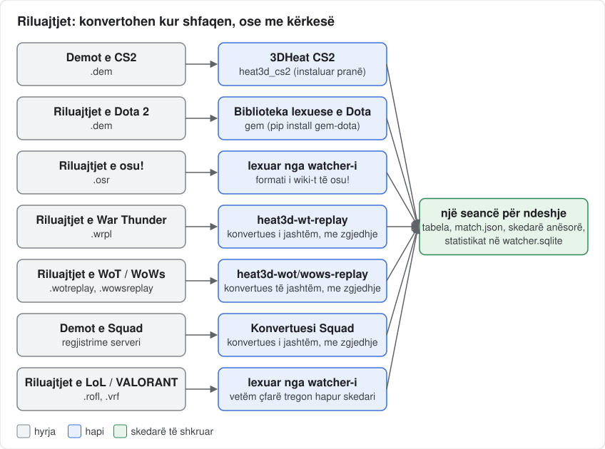

# Instalimi dhe ekzekutimi {#installing-and-running}

## Kërkesat {#requirements}

- **Windows.** Watcher-i është shkruar për Windows, dhe shumica e burimeve të tij ekzistojnë vetëm aty: memoria
  e përbashkët që krijojnë lojërat (lidhjet `Local\...`), regjistri (ku është Steam), njoftimet
  e Windows, lista e proceseve me rrugët e ekzekutueshme. Në një sistem tjetër programi niset, por
  ato burime nuk gjejnë asgjë, njoftimet vetëm regjistrohen në log, dhe leximi i memories refuzon ("only
  implemented on Windows").
- **Python 3.10 ose më i ri**, nga <https://www.python.org/downloads/>: shëno **Add python.exe to PATH**
  në instalues, pastaj kontrollo me `python --version` në një terminal të ri. Je i ri me këtë? Lexo së pari
  [Para se të fillosh](before-you-start.md).
- **Paketat** (`requirements.txt`): `psutil>=6.0` (cilat lojëra ekzekutohen, cili program mban një
  port, lidhjet e një loje; një psutil më i vjetër funksionon prapë, përmes emrit të vjetër për lidhjet e një procesi),
  `pyarrow>=15` (shkruan `heat.parquet`), `numpy>=1.24`, dhe
  `pytest>=8.0` për testet. `requirements-optional.txt` tani nuk liston asnjë paketë.

Pa `pyarrow`, seancat regjistrohen prapë: `events.jsonl` është regjistri, dhe tabela mund të
ndërtohet më vonë me [`table`](commands.md#table).

### Shtesat që i duhen disa lojërave {#extras-some-games-need}

| Loja | Çfarë i duhet |
|---|---|
| Demot e Counter-Strike 2 | [3DHeat CS2](https://github.com/Holdi601/3DHeat-CS2) dhe kërkesat e tij (`demoparser2`). Watcher-i e kërkon te `HEAT3D_CS2`, pastaj në një dosje `3DHeat-CS2` ose `cs2` pranë dosjes së vetë watcher-it, pastaj kudo ku Python mund të importojë `heat3d_cs2`. Pa të, `games` e liston adapterin si të padisponueshëm. |
| Microsoft Flight Simulator 2020 / 2024 | `SimConnect.dll` - nuk jepet. MSFS 2020 ka një në dosjen e instalimit; për MSFS 2024, instalo SDK-në e MSFS 2024. `MSFS_SDK` / `MSFS2024_SDK` tregojnë dosjen e SDK-së. |
| Euro Truck Simulator 2, American Truck Simulator | shtojca RenCloud `scs-telemetry.dll` (rishikimi 12) te `<game>\bin\win_x64\plugins` |
| BeamNG.drive | moda e protokollit `heat3d`, e instaluar nga `python -m heat3d_watch setup beamng --apply` |
| League of Legends (live) | opsionale: certifikata rrënjë e Riot si `<data>\riotgames.pem`, që lidhja lokale të verifikohet |
| Minecraft | një dosje `%APPDATA%\.minecraft` (Java Edition) |

Faqja e secilës lojë nën [Lojërat](games.md) thotë çfarë duhet aktivizuar në vetë lojën.
`python -m heat3d_watch games` e shënon një adapter `[unavailable: ...]` kur diçka që i duhet mungon
në këtë kompjuter.

## Instalimi {#installing}

Je i ri me rreshtin e komandave? Lexo së pari [Para se të fillosh](before-you-start.md). Nëse `pip` nuk gjendet,
përdor në vend të tij `python -m pip install -r requirements.txt`.

Nga një klon:

```bash
git clone https://github.com/Holdi601/3DHeat-Watcher.git
cd 3DHeat-Watcher
pip install -r requirements.txt
```

Nga një botim: shkarko arkivin nga botimet e depos, shpaketoje, pastaj ekzekuto
`pip install -r requirements.txt` brenda dosjes. Të dyja llojet e kopjes përditësohen vetë
(shih [Përditësimet](updates.md)).

Çdo komandë ekzekutoje nga dosja e depos: `python -m heat3d_watch` e importon paketën që andej,
dhe përditësuesi (`heat3d_update`) ndodhet pranë saj.

## Ekzekutimi {#running}

```bash
python -m heat3d_watch run        # watch until stopped
python -m heat3d_watch run -v     # the same, with debug lines in the log
python -m heat3d_watch run --once # one look at the games running now, then stop and exit
```

Kur niset, `run`:

1. shkruan [skedarin e kyçjes](#the-lock-file);
2. përfundon çdo seancë që një ekzekutim i mëparshëm e la të hapur, për shembull pas një prishjeje
   (shih [Rikuperimi](the-data.md#recovery-after-a-crash));
3. çdo `scan_seconds` (2 s), lexon listën e proceseve (vetëm emrat dhe rrugët, asnjë proces nuk hapet)
   dhe niset një adapter, në një thread të vetin, për çdo lojë që gjen. Kur procesi i një loje
   mbaron, adapteri i saj ndalohet dhe seancat që kishte të hapura mbyllen, gjë që shkruan tabelën e tyre dhe
   rreshtin e tyre në statistika. Adapterat që nuk presin një lojë (statistikat e Steam, Steam
   Timeline, NVIDIA highlights, dosjet e riluajtjeve) ekzekutohen gjatë gjithë kohës;
4. ndërsa asnjë lojë nuk ekzekutohet, kërkon një botim më të ri më së shumti një herë në orë (vetë përgjigjja ruhet për gjashtë orë) dhe, me `auto_update`
   aktiv, e instalon dhe niset përsëri vetë (shih [Përditësimet](updates.md)).

Një adapter që dështon regjistrohet në log dhe nuk i ndalon të tjerët. Nëse pyetja e një adapteri dështon 20 herë
radhazi, ose nisja e tij dështon, adapteri ndalohet dhe nuk riniset derisa loja të niset përsëri (një
id e re procesi).

Ndale watcher-in me Ctrl+C. Adapterat i mbyllin seancat e tyre para se të dalë. Nëse watcher-i
vritet në vend (Task Manager, një prishje, një ndërprerje rryme), asgjë që ishte shkruar tashmë nuk humbet: `run`
tjetër i përfundon ato seanca.

`--once` bën një shikim të vetëm: niset adapterat për lojërat që ekzekutohen në atë çast (dhe ata
gjithmonë të aktivë), lë secilin të pyesë një herë - duke pritur më së shumti 10 sekonda për këtë - dhe pastaj i ndalon
ashtu siç do t'i ndalonte mbarimi i një loje, ndaj seancat që hapën mbyllen, tabelat e tyre shkruhen dhe rreshtat e tyre
numërohen në statistika para se të dalë. Përdore për të kontrolluar që një lojë zbulohet, jo për të regjistruar.

### Riluajtjet që janë tashmë në disk {#replays-already-on-disk}



Herën e parë që një adapter riluajtjesh sheh një nga dosjet e tij, vetëm shënon riluajtjet që janë tashmë aty: një
lojtar me vite demosh përndryshe do ta gjente watcher-in të zënë me konvertim për një ditë. Që nga ajo kohë
çdo riluajtje e re konvertohet sapo loja ka mbaruar së shkruari. Të vjetrat konvertohen sipas
kërkesës me [`replays`](commands.md#replays):

```bash
python -m heat3d_watch replays cs2-demos              # every demo in CS2's folders and replay_folders
python -m heat3d_watch replays lol-replays D:\Old     # the replays in one folder
```

### Ekzekutimi në sfond {#running-in-the-background}

Watcher-i nuk ka dritare të vetën; është një program konsolë që ekzekutohet derisa të ndalohet. Ai
shkruan gjithçka te `watcher.log`, ndaj nuk i duhet një konsolë e dukshme. Mënyra për ta mbajtur jashtë
rrugës:

- nise në një konsolë dhe minimizo konsolën: `start "" /min python -m heat3d_watch run` nga
  `cmd`, në dosjen e depos;
- nise pa konsolë: `pythonw -m heat3d_watch run`. Dalja e konsolës humbet, por `watcher.log`
  shkruhet prapë. Për ta ndalur, mbyll procesin `pythonw.exe`; nisja tjetër i përfundon pastaj
  seancat që la të hapura. Projekti nuk e ka provuar këtë mënyrë ekzekutimi.

### Nisja me Windows (një ide) {#starting-with-windows-an-idea}

Watcher-i nuk instalohet vetë që të niset me Windows. Për ta nisur automatikisht:

- **Task Scheduler**: krijo një detyrë me nxitësin *At log on* dhe veprimin *Start a program*,
  programi `pythonw.exe` (ose `python.exe`), argumentet `-m heat3d_watch run`, *Start in* vendosur te
  dosja e depos;
- **Dosja Startup**: vendos një shkurtore te `shell:startup` me të njëjtin program, argumente dhe dosjen
  *Start in*.

Asnjëra nuk është pjesë e watcher-it dhe as e provuar prej tij. [Skedari i kyçjes](#the-lock-file) siguron që një kopje e dytë
e nisur gabimisht del menjëherë.

## Skedari i kyçjes {#the-lock-file}

`<data>\watcher.lock` mban id-në e procesit të watcher-it që ekzekutohet. Kur `run` niset dhe skedari i kyçjes
emërton një proces që ekziston ende dhe emri i të cilit përmban `python`, printon

```text
A watcher is already running (process 12345) for C:\Users\...\3DHeat\Watcher.
```

dhe del me kodin 1. Dy watcher-a në një dosje të dhënash do ta regjistronin çdo lojë dy herë, dhe i dyti
do t'i trajtonte seancat e hapura të të parit si të mbetura nga një prishje. Një skedar kyçjeje procesi i të cilit
ka mbaruar, ose i përket një programi tjetër, mbishkruhet. Kur `run` mbaron, e heq skedarin e kyçjes nëse
skedari emërton ende procesin e tij.

## Regjistri (log) {#the-log}

`<data>\watcher.log` shkruhet vetëm nga `run`; komandat e tjera printojnë në konsolë. Çdo rresht ka
kohën, nivelin dhe një mesazh:

```text
2026-05-01 20:15:01,123 INFO watching; data in C:\Users\...\AppData\Local\3DHeat\Watcher
2026-05-01 20:15:03,456 INFO f1-25: starting (EA SPORTS F1 25)
2026-05-01 21:02:11,789 INFO f1-25: stopping
```

Adapterat regjistrojnë çfarë nuk mund të bëjnë dhe pse: "UDP 20777 is in use by ...; not taking it from that program",
"not reading memory: the game is played online", "could not start", "poll failed (3)" me
gjurmën e plotë. `run -v` shton rreshta debug. Skedarit i shtohet në fund dhe watcher-i nuk e rrotullon e nuk e zbraz kurrë;
fshije kur të duash. Të njëjtët rreshta shkojnë edhe në konsolë.

## Ku është çdo gjë {#where-everything-is}

Dosja home është `%LOCALAPPDATA%\3DHeat\Watcher`, ose `HEAT3D_WATCH_HOME` kur ajo është vendosur (pa
`LOCALAPPDATA`, për shembull në një sistem tjetër, `~/.local/share/3DHeat/Watcher`). `settings.json` është
gjithmonë në dosjen home. Gjithçka tjetër shkon te dosja e të dhënave, që është dosja home përveç nëse
cilësimi `data` emërton një tjetër:

| Rruga | Çfarë është |
|---|---|
| `<home>\settings.json` | cilësimet |
| `<data>\sessions\` | regjistrimet, një dosje për çdo ulje ([Të dhënat](the-data.md)) |
| `<data>\watcher.sqlite` | baza e të dhënave të statistikave |
| `<data>\watcher.log` | regjistri i `run` |
| `<data>\watcher.lock` | skedari i kyçjes, ndërsa `run` ekzekutohet |
| `<data>\state\` | çfarë kanë parë tashmë adapterat gjithmonë të aktivë dhe ata të riluajtjeve (`steam-stats.json`, `replays-cs2-demos.json`, ...), ndaj një rinisje nuk regjistron asgjë dy herë |
| `<data>\profiles\*.json` | profilet e memories që ke shkruar ([Leximi i memories](memory-reading.md)) |
| `<data>\riotgames.pem` | opsionale, certifikata rrënjë e Riot për adapterin live të League of Legends |
| `%LOCALAPPDATA%\3DHeat\update-check-3DHeat-Watcher.json` | përgjigjja e ruajtur e kontrollit të fundit të botimit |

Watcher-i nuk fshin asgjë në këto dosje, përveç një dosjeje seance në të cilën nuk u regjistrua asgjë
(një lojë e lënë në menutë e saj).

## Cilësimet {#settings}


`python -m heat3d_watch config` tregon cilësimet; `config --set key=value ...` i ndryshon dhe ruan
`settings.json` (shih [config](commands.md#config)). Skedari është JSON i thjeshtë dhe mund të redaktohet edhe me
dorë ndërsa watcher-i nuk ekzekutohet. Çelësat e panjohur në të injorohen. Cilësimet lexohen kur një komandë
niset, ndaj rinis `run` pasi t'i ndryshosh.

| Cilësimi | Parazgjedhja | Çfarë bën |
|---|---|---|
| `data` | `""` | Dosja e të dhënave. E zbrazët: dosja home. |
| `disabled` | `[]` | Id-të e adapterave që nuk ekzekutohen kurrë, për shembull `config --set disabled=steam-stats,nvidia-highlights`. Çdo adapter tjetër ekzekutohet kur gjen lojën e vet. |
| `auto_update` | `true` | Ndërsa asnjë lojë nuk ekzekutohet, instalo një botim më të ri dhe rinis (shih [Përditësimet](updates.md)). `false`: vetëm një njoftim në log. |
| `scan_seconds` | `2.0` | Sekondat mes shikimeve të listës së proceseve. |
| `memory` | `false` | Lejo adapterat e memories (lojëra me një lojtar me një profil që ke shkruar) të ekzekutohen. Joaktive si parazgjedhje; shih [Leximi i memories](memory-reading.md). |
| `replays` | `true` | Ekzekuto adapterat `replay`: të gjithë (shih `python -m heat3d_watch replays` dhe [Lojërat](games.md)) - demot e CS2, riluajtjet e Dota 2, War Thunder, World of Tanks, World of Warships, Squad, League of Legends dhe VALORANT, regjistrimet Tacview të IL-2. |
| `replay_folders` | `{}` | Dosje shtesë sipas id-së së adapterit, për shembull `{"cs2-demos": ["D:\\Demos"]}`. Adapterat e riluajtjeve i vëzhgojnë ato përveç dosjeve të vetë lojës; `il2-tacview` pranon edhe dosje instalimi (atëherë kërkon te `data\Tracks` i tyre); për `elite`, dosja e parë zëvendëson dosjen e ditarit. Vendos dosjet e një adapteri me `config --set replay_folders.cs2-demos=D:\Demos,E:\More`, ose gjithë fjalorin si JSON. |
| `riot_id` | `""` | Riot ID yt (`Name#TAG`), që rreshti yt në një riluajtje të League of Legends të bëhet statistikat e tua. E zbrazët: mbahet rreshti i çdo lojtari, asnjë nuk shënohet si yti. |
| `riot_api_key` | `""` | Çelësi yt i zhvilluesit të Riot API, për të marrë afatkohën zyrtare të çdo ndeshjeje League të riluajtur (pozicionet çdo minutë, vrasjet aty ku ndodhën). E zbrazët: nuk merret asgjë. |
| `riot_platform` | `"EUW1"` | Id-ja e platformës së serverit tënd League (`EUW1`, `EUN1`, `NA1`, `KR`, ...), përdorur për të gjetur hostin rajonal Match-V5. |
| `player_names` | `{}` | Emri yt në lojërat ndërfaqja e të cilave emërton çdo lojtar por nuk thotë cili je ti, sipas id-së së adapterit: `warthunder-webmap` (rreshtat e kill feed për ty bëhen vrasjet dhe vdekjet e tua) dhe `rocketleague-stats` (rreshtat e tu bëhen `me`; pa të, lojtari që ndjek kamera e lojës). Vendos me `config --set player_names.warthunder-webmap=Name`. |

Një `settings.json` me çdo parazgjedhje:

```json
{
  "data": "",
  "disabled": [],
  "auto_update": true,
  "scan_seconds": 2.0,
  "memory": false,
  "replays": true,
  "replay_folders": {},
  "riot_id": "",
  "riot_api_key": "",
  "riot_platform": "EUW1",
  "player_names": {}
}
```

## Ndryshoret e mjedisit {#environment-variables}

| Ndryshorja | Efekti |
|---|---|
| `HEAT3D_WATCH_HOME` | dosja home (cilësimet, dhe të dhënat përveç nëse `data` thotë ndryshe) |
| `HEAT3D_NO_UPDATE` | çdo vlerë përveç të zbrazëtës, `0`, `false` ose `no` çaktivizon kontrollin e botimit dhe përditësimin automatik |
| `HEAT3D_NO_TOAST` | çdo vlerë jo e zbrazët: pa njoftime Windows, vetëm rreshta log |
| `HEAT3D_CS2` | dosja e 3DHeat CS2, për demot e CS2 |
| `HEAT3D_CS2_GSI_PORT` | porti i gjendjes së lojës CS2 (parazgjedhja 3311); skedari cfg që shkruan `setup` e përdor |
| `HEAT3D_DOTA_GSI_PORT` | porti i gjendjes së lojës Dota 2 (parazgjedhja 3312) |
| `MSFS_SDK`, `MSFS2024_SDK` | dosjet e SDK-së së MSFS, ku kërkohet `SimConnect SDK\lib\SimConnect.dll` |

Njoftimet e Windows përdoren vetëm për përditësimet: "Updating to 1.2.0", ose "1.2.0 is out; not updated:
..." kur përditësimi nuk mundi të zbatohej. Shfaqen përmes API-t të vetë njoftimeve të PowerShell,
ndaj nuk duhet instaluar asgjë. Titulli dhe teksti i kalohen PowerShell si ndryshore mjedisi,
kurrë si pjesë e skriptit.
