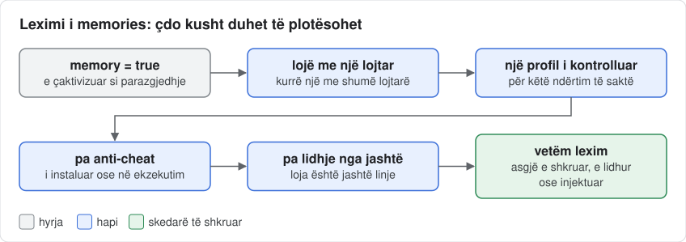

# Leximi i memories {#reading-memory}

Disa lojëra me një lojtar nuk i tregojnë asgjë programeve të tjera. Për to, watcher-i mundet - nëse e aktivizon dhe
shkruan vetë një profil - të kërkojë ku je në memorien e lojës, vetëm për lexim.

Për lojërat me një lojtar që nuk botojnë asgjë, watcher-i mund të lexojë pozicione dhe vlera nga
memoria e lojës, përmes një **profili** që shkruan për versionin tënd të lojës. Nga të gjitha burimet
ky është i vetmi që loja nuk e ka dhënë vetë, ndaj është kufizuar më shumë se të tjerët:

- është **joaktiv si parazgjedhje** (`python -m heat3d_watch config --set memory=true` e aktivizon);
- lexon, dhe nuk ka asnjë mënyrë për të shkruar;
- **asnjë profil nuk jepet me mjetet.**

Profilet nuk jepen sepse një offset është i saktë vetëm për versionin ku u gjet. Pas një përditësimi,
një profil që ishte i saktë më parë lexon mbeturina, dhe mbeturinat duken si numra. Një profil duhet
kontrolluar në versionin që ka lojtari, nga ai lojtar.

## Kontrollet, me radhë {#the-checks-in-order}



Çdo kontroll më poshtë duhet të kalojë. Katër të parët bëhen **para** se loja të hapet, sepse hapja e një
loje të mbrojtur për lexim është pikërisht ajo që një anti-cheat e vëren, dhe refuzimi më pas do të ishte tepër vonë.

1. **Cilësimi**: `memory` është true. Përndryshe adapterat e memories nuk nisen kurrë.
2. **Një profil për lojën**, `exe` i të cilit emërton procesin që ekzekutohet. Një profil thotë nëse
   loja mund të luhet fare online (`"online"`); ai që e le jashtë këtë refuzohet.
3. **Asnjë anti-cheat afër saj**:
   - asnjë skedar anti-cheat në dosjen e lojës ose deri në tri dosje mbi të (duke u ndalur te dosja `common` e një
     biblioteke Steam, ose te një dosje me `steamapps` brenda, pasi lojëra të tjera ndodhen mbi
     atë): `EasyAntiCheat`, `EasyAntiCheat_EOS_Setup.exe`, `start_protected_game.exe`, `BattlEye`,
     `BEClient_x64.dll`, `BEService_x64.exe`, `EAAntiCheat.GameServiceLauncher.exe`, `AntiCheatExpert`,
     `SGuard64.exe`, `GameGuard`, `GameMon.des`, `XIGNCODE`, `xhunter1.sys`, `Vanguard`, `FACEIT`
     (krahasohen me shkronja të vogla, edhe si fillim emri). Nëse dosja e lojës nuk dihet, loja
     refuzohet;
   - asnjë driver ose shërbim anti-cheat që ekzekutohet fare në kompjuter, siç listohen nga
     `sc query type= driver state= active` dhe `sc query type= service state= active`: EasyAntiCheat,
     EasyAntiCheat_EOS, BEService, BEDaisy, vgk, vgc, ACE-BASE, ACE-GAME, xhunter1, FACEIT,
     FACEITService, EAAntiCheatService, Denuvo Anti-Cheat, npggsvc, Ricochet. Një anti-cheat kernel
     i instaluar për një lojë tjetër prapë vëzhgon çdo proces. Nëse shërbimet nuk mund të listohen,
     loja refuzohet.
4. **Jo online**: një lojë profili i së cilës thotë `"online": true` lexohet vetëm ndërsa nuk ka lidhje
   me asgjë përveç këtij kompjuteri (çdo adresë e largët përveç `127.x`, `::1`). Nëse lidhjet e saj
   nuk mund të lexohen, refuzohet.
5. Pastaj, ndërsa adapteri niset:
   - **versioni i saktë**: madhësia e skedarit të ekzekutueshëm, ose SHA-256 i tij, duhet të përputhet me një version që
     liston profili. Një version i panjohur nuk lexohet;
   - **modulet edhe një herë**: modulet e ngarkuara të lojës listohen (një pamje Toolhelp, që nuk kërkon
     të drejta aksesi të veta) dhe kontrollohen për një klient anti-cheat (`BEClient_x64.dll`,
     `BEClient.dll`, `EasyAntiCheat_x64.dll`, `EasyAntiCheat.dll`, `EOSAntiCheat...`). Një proces
     i mbrojtur e refuzon pamjen, gjë që është gjithashtu refuzim;
   - vetëm atëherë procesi hapet, me `PROCESS_VM_READ | PROCESS_QUERY_LIMITED_INFORMATION` dhe
     asgjë tjetër.

Kontrollet 1 deri 4 përsëriten në çdo skanim (çdo 2 s) ndërsa loja ekzekutohet. Nëse njëri fillon të dështojë (loja
lidhet me një server, niset një shërbim anti-cheat), adapteri ndalohet në skanimin tjetër. Një
refuzim regjistrohet: `mem-<id>: not reading memory: <reason>`. Një dështim gjatë nisjes (version i panjohur,
një modul anti-cheat, një model që nuk u gjet) regjistrohet si `mem-<id>: could not start`, dhe adapteri
nuk provohet përsëri derisa loja të niset përsëri.

Nuk ka shkrim, nuk ka alokim në procesin tjetër, nuk niset asnjë thread në të, nuk ngarkohet asnjë bibliotekë në të,
nuk ka privilegj debug dhe nuk ka ngritje të të drejtave. Një test (`test_memory_reading_cannot_write` te
`tests/test_core.py`) dështon nëse çdo thirrje që shkruan në, alokon në ose ekzekuton kod në një proces tjetër -
`WriteProcessMemory`, `VirtualAllocEx`, `CreateRemoteThread`, `PROCESS_VM_WRITE`, `SeDebugPrivilege`,
`LoadLibrary`, ... - shfaqet kudo në paketë.

Nuk lexohen kurrë, çfarëdo që thotë një profil: lojërat e luajtura online, dhe lojërat që mënyra e tyre me një lojtar ekzekutohet
nën një anti-cheat, si GTA V, ose Elden Ring i nisur përmes nisësit të tij. Kontrollet e mësipërme i refuzojnë
ato gjithsesi.

## Formati i profilit {#the-profile-format}

Një profil është një skedar JSON te `<data>\profiles\` (`<data>` është dosja e të dhënave, shih
[Instalimi dhe ekzekutimi](installing-and-running.md#where-everything-is)), një për lojë, çdo emër skedari
që mbaron me `.json`. Një shembull sintetik:

```json
{
  "schema": "heat3d.memprofile/1",
  "id": "mygame",
  "game": "My Game",
  "exe": "MyGame.exe",
  "online": false,
  "versions": [ { "label": "1.06", "size": 123456789 } ],
  "anchors": {
    "World": { "aob": "48 8B 05 ?? ?? ?? ?? 48 85 C0", "rip": [3, 7] }
  },
  "values": {
    "pos": { "type": "vec3f", "base": "World", "chain": ["0x10", "0x68", "0x70"] },
    "hp":  { "type": "i32",   "base": "World", "chain": ["0x10", "0x138"] },
    "map": { "type": "u32",   "base": "World", "chain": ["0x10", "0x1C0"] }
  },
  "events": [
    { "event": "death", "value": "hp",  "when": "to_zero" },
    { "event": "zone",  "value": "map", "when": "change" }
  ],
  "axes": { "up": "y", "units": "metres" },
  "rate": 10,
  "provenance": [ { "source": "https://example.com/my-notes", "verified_on": "1.06" } ]
}
```

| Çelësi | I detyrueshëm | Çfarë është |
|---|---|---|
| `schema` | po | saktësisht `heat3d.memprofile/1` |
| `id` | po | i shkurtër dhe i qëndrueshëm; adapteri quhet `mem-<id>` |
| `game` | po | emri i lojës, sipas të cilit emërtohet dosja e seancës |
| `exe` | po | emri i skedarit të ekzekutueshëm, që thotë edhe se loja ekzekutohet |
| `online` | po | `true` nëse loja mund të luhet fare online; atëherë lexohet vetëm kur je offline |
| `versions` | po | versionet ku u kontrollua profili: secili me një `label`, dhe një `size` (madhësia e ekzekutueshmes në bajte) dhe/ose një `sha256`. Kur jepen të dy, duhet të përputhen të dy. Një hyrje pa asnjërin nuk përputhet me asgjë. |
| `anchors` | po | adresa të emërtuara në modulin kryesor. `aob`: një model bajtesh, bajte hex të ndarë me hapësira, `?` ose `??` për çdo bajt; duhet të shfaqet **saktësisht një herë** në imazhin e modulit (disa përputhje llogariten dështim, si asnjë). `rip: [d, n]`: modeli tregon një instruksion me zhvendosje 32-bit relative me RIP në bajtin `d` dhe gjatësi `n`; ankora bëhet adresa që ai instruksion referon. `offset`: shtohet pas kësaj (tekst hex ose dhjetor). Në vend të `aob`, `module_offset` jep një zhvendosje fikse nga baza e modulit. |
| `values` | po | çfarë lexohet në çdo pyetje: `type` (`i32`, `u32`, `i64`, `u64`, `u8`, `f32`, `f64`, `vec3f`, `vec3d`), `base` (emri i një ankore), `chain` (zhvendosjet si tekst hex ose dhjetor) |
| `events` | jo | rregulla që i kthejnë ndryshimet në ngjarje: `when` `change` (vlera ndryshon nga pyetja e fundit) ose `to_zero` (një numër bie nga mbi 0 në 0 ose më poshtë) |
| `axes` | jo | `up` (parazgjedhja `y`), `units` (parazgjedhja `game units`), `scale` (shkalla e njësisë së shikuesit, që shumëzon çdo pozicion; parazgjedhja 1, njësitë e vetë lojës) |
| `rate` | jo | pyetje në sekondë, 1 deri 60 (parazgjedhja 10) |
| `provenance` | jo | nga vijnë offset-et dhe në cilin version i verifikove; kopjohet te `meta.json` i çdo seance |

**Si lexohet një vlerë.** Adresa e ankorës është fillimi. Nëse `chain` është e zbrazët, vlera lexohet
pikërisht aty. Përndryshe lexohet fillimisht treguesi i ruajtur te ankora. Pastaj, për çdo zhvendosje përveç
të fundit, lexohet treguesi te `address + offset`. Zhvendosja e fundit shtohet për të dhënë adresën e vlerës.
Një tregues null gjatë rrugës (loja është mes niveleve ose në një meny) e lë vlerën bosh për atë
pyetje.

**Çfarë regjistrohet.** Një vlerë e quajtur `pos` (një `vec3f` ose `vec3d`) bëhet një rresht `position` i lojtarit
`me` në çdo pyetje. Çdo rregull ngjarjeje shkruan rreshtin e vet `event`, me vlerën e re dhe, kur `pos` është
e njohur, pozicionin, dhe i shton 1 një statistike me të njëjtin emër. Imazhi i modulit lexohet një herë në fillim
për të gjetur ankorat, në blloqe 64 KiB; blloqet që nuk mund të lexohen llogariten si zero. `meta.json` i
seancës emërton profilin, etiketën e versionit dhe provenancën.

Një profil që nuk mund të përdoret (JSON i keq, `schema` e gabuar, një çelës i detyrueshëm që mungon) kapërcehet dhe
regjistrohet si `profile <file> not used: <reason>`. Profilet ngarkohen kur niset watcher-i, ndaj rinis
`run` pasi të shtosh ose ndryshosh një.

## Shkrimi dhe verifikimi i një profili {#writing-and-verifying-a-profile}

1. **Vetëm për një lojë me një lojtar pa anti-cheat.** Nëse loja ka anti-cheat, ose e luan
   online, ndalo këtu: watcher-i do ta refuzojë, dhe duhet.
2. **Gjej vlerat në versionin tënd.** Punoje offline. Përdor mjetet e tua të debug-ut, ose shënime të botuara
   për lojën, për të gjetur pozicionin e lojtarit dhe vlerat që të interesojnë, dhe një rrugë treguesish drejt
   secilës nga një vend statik në ekzekutueshme. Parapëlqe një model bajtesh (`aob`) mbi një
   `module_offset` fiks: një model e gjen vendin e vet edhe kur kodi lëviz pak.
3. **Bëje modelin unik.** Duhet të përputhet saktësisht një herë në modul. Vendos wildcard te bajtet që
   ndryshojnë (adresat, zhvendosjet) dhe mbaj sa duhet bajte fikse përreth tyre.
4. **Ngjit versionin.** Vendos madhësinë e saktë të ekzekutueshmes te `versions`; PowerShell
   `(Get-Item .\MyGame.exe).Length` e jep, dhe `Get-FileHash .\MyGame.exe -Algorithm SHA256` jep
   hash-in. Pas një përditësimi, profili thjesht nuk përdoret më derisa ta kontrollosh përsëri dhe të shtosh
   versionin e ri.
5. **Thuaj nëse loja shkon online** (`online`), me ndershmëri.
6. **Provoje**: aktivizo leximin (`config --set memory=true`), vendos skedarin te `<data>\profiles\`, dhe
   kontrollo që `python -m heat3d_watch games` liston `mem-<id>`. Nise lojën dhe ekzekuto
   `python -m heat3d_watch run -v`. Te `watcher.log`, kërko `mem-<id>: starting`, ose arsyen pse
   u refuzua ose nuk mundi të niset.
7. **Kontrolloi numrat me lojën.** Ec në një vend të njohur dhe shiko rreshtat `position` te
   `events.jsonl` i seancës. Lëvizin ashtu si lëviz ti, me sasinë e duhur, sipas boshteve të duhura? Hap
   `heat.parquet` në shikues dhe kontrollo që rruga përputhet me vendin ku shkove. Shkakto çdo ngjarje
   (humb gjithë jetën, ndrysho zonë) dhe kontrollo që shfaqet një herë. Mbeturinat duken si numra, dhe vetëm
   ky krahasim i dallon të dyja.
8. **Shkruaj çfarë verifikove** te `provenance`: burimin e offset-eve dhe versionin ku i
   kontrollove.

Teksti `verified` i një adapteri memorieje, siç e printon `games`, është gjithmonë "nga autori i profilit, për
versionet që liston". Watcher-i nuk mund të dijë më shumë se kaq.
