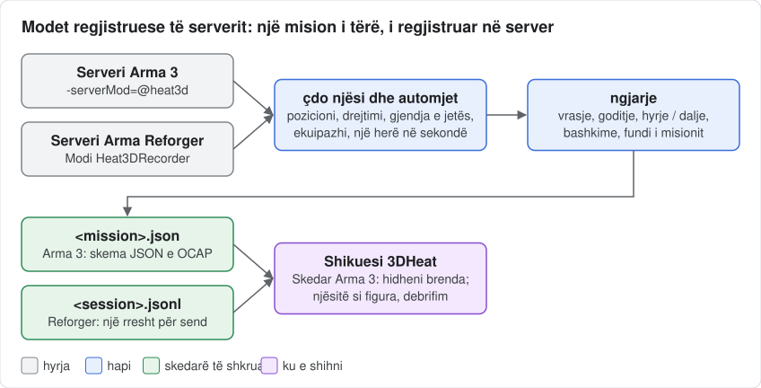

# Modet regjistruese të serverit (Arma 3, Arma Reforger) {#server-recorder-mods-arma-3-arma-reforger}

Shumicën e lojërave watcher-i i regjistron në kompjuterin e vetë lojtarit. Arma është
ndryshe: një server mund të regjistrojë një mision të tërë - çdo njësi dhe mjet, jo
vetëm të tuat - me një mod që punon në server. Lojtarët nuk vendosin asgjë:
moda e Arma 3 është vetëm për server, dhe Reforger i shkarkon vetë modet e një serveri te
lojtarët kur hyjnë (moda nuk bën asgjë në kompjuterët e tyre). Depoja ka dy mode të tilla, në
[`mods/arma3`](https://github.com/Holdi601/3DHeat-Watcher/tree/main/mods/arma3)
dhe [`mods/reforger`](https://github.com/Holdi601/3DHeat-Watcher/tree/main/mods/reforger).
README-të e tyre janë dokumentacioni i plotë; kjo faqe është përmbledhja.

**Gjendja: të dyja janë të patestuara në lojë.** Zgjatimi i Arma 3 u ndërtua dhe u
drejtua ashtu siç i thërret Arma zgjatimet, dhe dalja e tij u lexua nga 3DHeat; skriptet e tij
SQF nuk kanë punuar ende në Arma 3. Moda e Reforger u shkrua nga API-ja e skripteve e publikuar nga
Bohemia dhe nuk është kompiluar kurrë. Mos e vendos asnjërën
në një server publik para se hapat e testimit në README të saj të kalojnë.

## Arma 3 {#arma-3}

1. Ndërto zgjatimin një herë për çdo platformë (`mods/arma3/extension`). Kjo kërkon një kompilues C: Visual
   Studio Build Tools në Windows, gcc në Linux; nëse nuk ke kompiluar kurrë asgjë, pyet
   ofruesin e serverit.
   - Windows, në një "x64 Native Tools Command Prompt for VS":
     `cl /nologo /O2 /LD heat3d.c /Fe:heat3d_x64.dll`
   - Linux: `gcc -O2 -shared -fPIC -o heat3d_x64.so heat3d.c -ldl`
2. Ndërto modën: `python mods/arma3/build.py` shkruan `mods/arma3/@heat3d/`
   (nuk duhen Arma 3 Tools).
3. Kopjo `@heat3d` në dosjen e serverit dhe nise serverin me
   `-serverMod=@heat3d`.
4. Regjistri `.rpt` i serverit thotë `Heat3D recorder 0.1.0: recording <file> every 1 s`.

| Cilësimi | Parazgjedhja | Çfarë bën |
|---|---|---|
| `captureDelay` | 1 | sekonda midis kuadrove |
| `recordHits` | 1 | 0 fik ngjarjet e goditjeve |
| `recordShots` | 1 | 0 fik numërimin e të shtënave |
| `minPlayers` | 0 | regjistro vetëm kur janë futur kaq lojtarë |

Një mision e mbivendos një prej tyre te `init.sqf` i tij (`heat3d_captureDelay = 0.5;`).
Regjistrimet shkojnë te `recordings/` brenda `@heat3d`, ose te `HEAT3D_DIR`.

**Dalja:** një skedar për çdo mision në strukturën JSON të OCAP (formati i regjistruesit
OCAP2), me emrin `<date>__<time>_<mission>.json`. Gjatë misionit është një
ditar (`.heat3d.part`), që shkruhet në disk me çdo shkrim; ditari i një misioni të
përplasur përfundohet herën tjetër kur nis një mision.

## Arma Reforger {#arma-reforger}

Moda (`Heat3DRecorder.gproj`) hapet dhe ndërtohet në Workbench të Bohemia
(Arma Reforger Tools), testohet në një server lokal të dedikuar, publikohet nga
Workbench (e padukshme në listë gjatë testimit) dhe shtohet te lista `mods` e `config.json`
të serverit - hap pas hapi në README të saj. Çdo sekondë shkruan pozicionin, drejtimin,
gjendjen e jetës, mjetin dhe id-në e lojtarit të çdo personazhi, dhe pozicionin, drejtimin,
gjendjen dhe ekuipazhin e çdo mjeti; si dhe vrasjet (vrasësi, arma, distanca), goditjet, hipjen dhe
zbritjen, lojtarët që hyjnë e dalin, dhe fundin e misionit.

**Dalja:** një objekt JSON për rresht, `$profile:heat3d/<UTC date>_<UTC time>_<world>.jsonl`:
një rresht `header` (formati `heat3d-reforger`, boshtet x lindje, y lart, z veri), pastaj
rreshta `entity`, `frame` dhe `event` ndërsa ndodhin, dhe një rresht `end`. Rreshtat e
njësive janë `[id, x, y, z, dir, alive, vehicleId, playerId]`, rreshtat e mjeteve
`[id, x, y, z, dir, alive, [crew ids]]`; ngjarjet ndjekin strukturën e ngjarjeve të OCAP2.

## Në shikues {#in-the-viewer}

Hidhe një regjistrim Arma 3 mbi [shikuesin 3DHeat](https://holdi601.github.io/3DHeat/):
një mision është një sesion, njësitë bëhen ushtarë, mjetet lloji i tyre, dhe
vrasjet e goditjet hyjnë në listën e debrief-it. Edhe luajtësi në ueb i OCAP2 e luan. Skedari
i Reforger është formati i vetë modës me rreshta, me strukturën e ngjarjeve të OCAP2.
