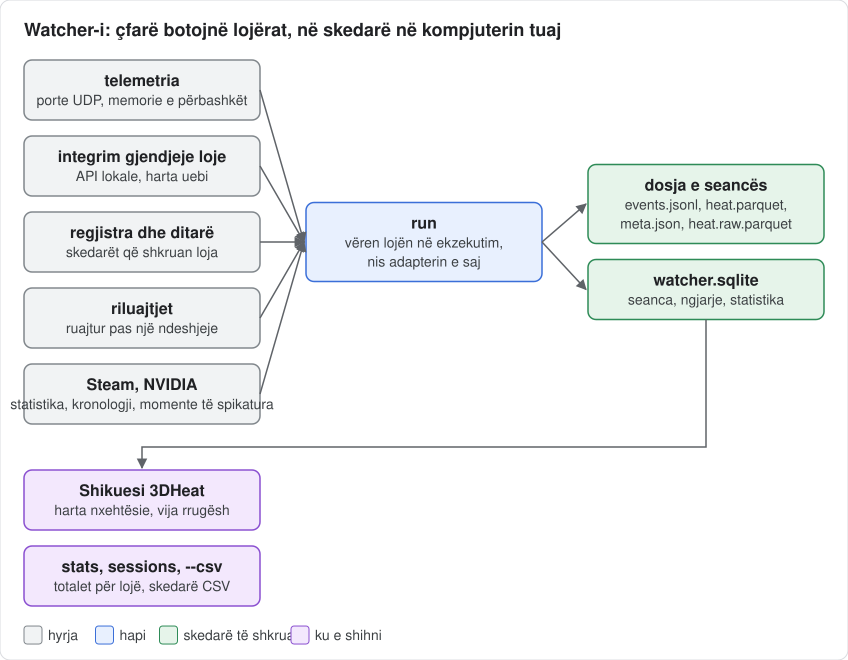

# Burimet dhe rregullat {#sources-and-rules}

Watcher-i regjistron vetëm çfarë u japin lojërat dhe platformat lojtarit. Kjo faqe shpjegon cilat
burime mbulon kjo, çfarë lejohet të bëjë watcher-i me secilin, dhe cilat lojëra ose pjesë lojërash i
le jashtë me qëllim.

## Gjashtë llojet e burimeve {#the-six-kinds-of-source}

Çdo adapter ka një `kind`, dhe lloji vendos çfarë lejohet të bëjë adapteri:

| Lloji | Çfarë është | Lojërat me shumë lojtarë |
|---|---|---|
| `telemetry` | një port UDP ose memorie e përbashkët që loja e boton për dashboard-e, platforma lëvizjeje dhe baza timoni (Forza Data Out, F1 UDP, memoria e përbashkët e Kunos dhe iRacing, SimConnect, ndërfaqja UDP e X-Plane, shtesa SCS SDK) | po - është dalja e vetë lojës |
| `gsi` | një integrim i gjendjes së lojës ose API web lokale që loja ia shërben kompjuterit të vetë lojtarit (Valve GSI, Live Client Data API e League, Stats API e Rocket League, harta web e War Thunder) | po, brenda asaj që API ia tregon lojtarit |
| `log` | skedarë që loja shkruan ndërsa ekzekutohet: ditarë, logje, statistika, ruajtje (Elite Dangerous, Minecraft, Path of Exile, Hearthstone, Star Citizen, EVE Online) | po |
| `replay` | demo dhe riluajtje që loja i ruan për lojtarët e saj, të konvertuara pas ndeshjes (CS2, Dota 2, War Thunder, World of Tanks, World of Warships, Squad, League of Legends, VALORANT, IL-2 Tacview) | po, përveç kur janë të enkriptuara, dhe vetëm pjesët e hapura |
| `platform` | çfarë mbajnë Steam dhe drejtuesi grafik: statistika, arritje, afatkohë, klipe dhe momente të spikatura | po |
| `memory` | memoria e lojës, vetëm për lexim, nga një profil që e shkrove ti | **kurrë** - vetëm lojëra me një lojtar |

Vetëm `memory` hap një proces tjetër, dhe vetëm për lexim. Pesë llojet e tjera lexojnë çfarë kanë shkruar tashmë
ose dërgojnë loja, Steam ose NVIDIA App.

## Si lexohen burimet {#how-the-sources-are-read}

- **Asgjë nuk injektohet, nuk lidhet me hook dhe nuk ndryshohet në një lojë.** Asnjë kod nuk ngarkohet në një lojë, asnjë dritare ose
  hyrje nuk lidhet me hook, asnjë skedar loje nuk patchohet. Të vetmit skedarë që watcher-i shkruan jashtë dosjes së të dhënave të vet
  janë ata që shkruan [`setup --apply`](commands.md#setup) kur ia kërkon: skedari i cilësimeve të vetë lojës
  (me origjinalin të ruajtur si `<file>.heat3d-backup`), një skedar cfg i gjendjes së lojës, skripti hook i DCS,
  moduli i protokollit të BeamNG.
- **Memoria e përbashkët hapet vetëm për lexim dhe nuk krijohet kurrë.** Mënyra e zakonshme Python për të hapur një
  mapping me emër e krijon një kur nuk ekziston ende. Një lojë e nisur pas kësaj do të gjente mapping-un
  bosh, vetëm për lexim, të watcher-it në vend që të bënte të vetin, dhe telemetria e saj do të ishte e vdekur. Watcher-i
  i hap mapping-et vetëm me `OpenFileMappingW` (që gjen vetëm një ekzistues), i mapon me
  `FILE_MAP_READ`, dhe provon përsëri më vonë nëse loja nuk i ka bërë ende.
- **Portat huazohen, nuk merren kurrë.** Një port telemetrie UDP që një program tjetër e dëgjon tashmë
  (FH Companion, SimHub, një aplikacion dashboard) i lihet atij programi. Nëse një program tjetër fillon të
  dëgjojë një portë që mban watcher-i, watcher-i e lëshon brenda disa sekondave. Adapterat Forza
  presin 15 s pasi niset loja para se të marrin portën 5300, dhe e kalojnë çdo paketë të pandryshuar
  te 127.0.0.1:5301, ndaj një aplikacion i dytë Data Out mund të regjistrojë prapë.
- **Vetëm lokalisht.** Serverat e gjendjes së lojës që ekzekuton watcher-i (CS2, Dota 2) dëgjojnë te 127.0.0.1 dhe askund
  tjetër. Kur skedari cfg i lojës mban një token (ai që shkruan `setup` e ka), çdo POST duhet ta bartë;
  POST-et pa të numërohen si `bad_auth` dhe hidhen. Pa një skedar cfg me token, çdo POST lokal pranohet, dhe ditari e thotë këtë. API-të
  lokale që pyet (League në portën 2999, War Thunder në
  8111, Rocket League në 49123, X-Plane në 49000) janë te 127.0.0.1.
- **Skedarët e ditarit ndahen, nuk bllokohen kurrë.** Çdo lexim e hap skedarin me çdo flamur ndarjeje që ka Windows
  dhe e mbyll përsëri, kështu që loja mund të vazhdojë të shkruajë, ta riemërtojë ose ta zëvendësojë ditarin e vet.
- **Dy shërbime të jashtme, dhe vetëm në këto raste.** Kontrolli i release-it pyet GitHub
  (`api.github.com`) më së shumti çdo gjashtë orë dhe mund të çaktivizohet (shih [Përditësimet](updates.md)). Adapteri i
  riluajtjeve të League pyet Match-V5 API të Riot vetëm kur ke futur `riot_api_key` tënden.
  Asgjë tjetër nuk dërgohet askund.
- **Aktivizimi i një burimi është vendimi yt.** `setup` pa `--apply` vetëm thotë çfarë do të
  ndryshonte.

## Rregullat për lojën me shumë lojtarë {#multiplayer-rules}

- Një lojë e luajtur online regjistrohet vetëm përmes asaj që publikon: telemetria, API-të e gjendjes së lojës, ditarët,
  riluajtjet, skedarët e platformës. Brenda tyre, watcher-i regjistron çfarë ia tregon loja lojtarit, dhe
  asgjë të llogaritur përtej saj:
  - **Integrimi i gjendjes së lojës i CS2** dërgon lojtarin që po shikohet (veten ndërsa je gjallë, një shok skuadre
    pas vdekjes). Pozicionet e lojtarëve të tjerë (`allplayers_*`) dërgohen vetëm te spektatorët dhe GOTV, ndaj
    watcher-i nuk i kërkon.
  - **Live Client Data API e League of Legends** nuk ka pozicione. Politika e Riot lejon mjetet të shfaqin
    çfarë mund të dinte lojtari nga vetë loja, dhe asgjë të llogaritur përtej saj (pa kohëmatës të armiqve).
    Watcher-i regjistron kill feed dhe tabelën e pikëve që sheh lojtari, dhe numrat e vetë lojtarit.
  - **Stats API e Rocket League** nuk ka pozicione makinash (gjendja e makinës dërgohet vetëm te spektatorët). Çfarë ka
    vend është topi, ku u godit, u shënua ose goditi traversën.
  - **Harta web e War Thunder** shfaq çfarë shfaq miniharta, pa emra ose id.
  - **F1 23/24/25** e vënë pozicionin e çdo makine në paketën Motion, edhe online. Loja i jep ato
    vetë, dhe mban prapa vetëm të dhënat e lojtarëve që e kanë "Your Telemetry" të kufizuar.
  - **DCS World**: një server me shumë lojtarë mund ta ndalojë eksportin e të dhënave të avionit të vetë lojtarit; seanca
    atëherë ka ngjarje por jo pozicione, dhe e thotë këtë.
- **Memoria nuk lexohet kurrë në një lojë me shumë lojtarë.** Një adapter memorieje për një lojë të shënuar si e luajtur online
  refuzohet, dhe një profil duhet të tregojë nëse loja e tij mund të luhet fare online. Një lojë me një lojtar
  që ka edhe mënyrë online lexohet vetëm sa kohë nuk ka lidhje me asgjë përveç kësaj
  makine. Lojërat që mënyra me një lojtar e tyre punon nën anti-cheat nuk lexohen kurrë gjithashtu. Shih
  [Leximi i memories](memory-reading.md).
- Flamuri `multiplayer` i një adapteri (shfaqur si "Online play" nga `games --markdown`) vendos vetëm
  leximin e memories. Nuk i ndalon llojet e tjera të regjistrojnë lojën online.

## Çfarë refuzohet dhe pse {#what-is-declined-and-why}

Disa lojëra, dhe disa pjesë lojërash, nuk regjistrohen sepse e vetmja mënyrë për t'i marrë do të thyente një
mbrojtje ose kushtet e një loje:

| Loja | Çfarë lihet jashtë | Pse |
|---|---|---|
| VALORANT | pozicionet, emrat, pikët në riluajtje; pikat fundore lockfile të klientit | Rryma e lojës e riluajtjes është e errësuar me vlera të marra nga ekzekutuesja e çdo build-i. Rikuperimi i tyre do të thotë inxhinierim i kundërt i lojës, që Kushtet e Shërbimit të Riot e ndalojnë (seksionet 3.1 dhe 7.1), dhe loja punon nën Vanguard. Pikat fundore lockfile të klientit Riot nuk janë API e publikuar. **Lexohet:** çfarë bart riluajtja e hapur - harta, id-ja e ndeshjes, agjentët, afatkohë e vrasjeve dhe raundeve të serverit. |
| League of Legends | pjesa moment pas momenti e riluajtjeve `.rofl`; pikat fundore lockfile të klientit | Të errësuara kundër mashtrimit, ndryshe në çdo patch; dekodimi do të thotë çmontim i lojës, që kushtet e Riot e ndalojnë. **Lexohet:** tabela e pikëve e fundit të lojës që bart çdo riluajtje si JSON i thjeshtë, Live Client Data API gjatë një ndeshjeje, dhe - me çelësin tënd të zhvilluesit - afatkohëzimi zyrtar Match-V5 (pozicione një herë në minutë, vrasjet aty ku ndodhën). |
| Fortnite | riluajtjet | Të enkriptuara, dhe kushtet e Epic ndalojnë inxhinierimin e kundërt të tyre. |
| World of Tanks, World of Warships | riluajtjet, në watcher | Të shifruara, me një çelës që bart loja dhe që mjetet e komunitetit e kanë publikuar prej vitesh. Watcher-i nuk i lexon; konvertues të veçantë jashtë tij i lexojnë (`exporters/ext/wot-replay`, `exporters/ext/wows-replay`), që një problem me kushtet e Wargaming - licenca e tyre ndalon inxhinierimin e kundërt (5.3 b) dhe softuerin e paautorizuar që ndërvepron me produktet e saj (12.1 k) - të prekë vetëm ata. **Lexohet, me një konvertues të instaluar:** pozicioni i çdo mjeti ose anijeje sa kohë e dinte klienti që regjistronte, dhe vrasjet. |
| Gran Turismo 7 | telemetria | Vetëm konsolë, dhe telemetria e tij është e enkriptuar me një çelës të rikuperuar nga loja. |
| Apex Legends | gjithçka | LiveAPI i tij dërgon ngjarje të plota vetëm në lobi private dhe të personalizuara; përndryshe nuk ka asgjë lokalisht. |
| Overwatch 2, Call of Duty, Battlefield 6, Hunt: Showdown 1896 | të dhënat e drejtpërdrejta | Nuk ka riluajtje lokale, ditar ose dalje të gjendjes së lojës për t'u lexuar. Statistikat e tyre vijnë aty ku i mban Steam ([Statistikat e Steam](game-steam-stats.md), [Steam Timeline](game-steam-timeline.md)), dhe klipet e tyre si [NVIDIA highlights](nvidia-highlights.md). |
| Star Citizen | çdo gjë përtej `Game.log` | Punon me Easy Anti-Cheat; watcher-i lexon vetëm skedarin e ditarit që shkruan loja dhe nuk i afrohet kurrë procesit të lojës. |
| osu! | riluajtjet | Jashtë fushës: lojë 2D, pa asgjë për t'u vendosur në hartë. |
| Çdo lojë me shumë lojtarë | memoria | Kurrë. Lojërat me një lojtar që mënyra e tyre punon nën anti-cheat (GTA V, Elden Ring përmes launcher-it të tij) nuk lexohen gjithashtu. |

Riluajtjet e enkriptuara nuk hapen: lexuesi VALORANT kontrollon flamurin e enkriptimit të riluajtjes dhe
refuzon një skedar të enkriptuar ("this replay is encrypted; it is not read").

Lojërat e hulumtuara por të pandërtuara ende (riluajtjet e Deadlock, skedarët `.replay` të Rocket League,
StarCraft II, Team Fortress 2, Rainbow Six Siege, Beat Saber, Trackmania, disa simulatorë garash) janë
listuar me burimet e tyre te [Të gjitha lojërat në një tabelë](watcher.md#researched-not-yet-built). Secila
ka nevojë për skedarë shembull për t'u kontrolluar para se të shpërndahet.
