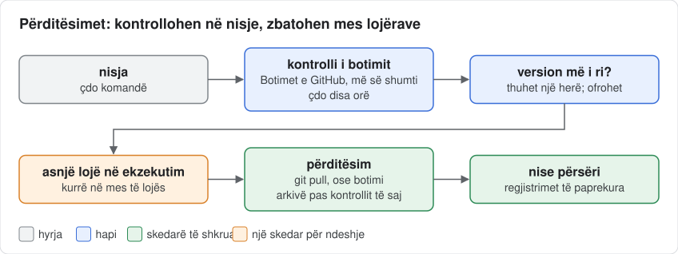

# Përditësimet {#updates}

Watcher-i e mban veten të përditësuar nga versionet e
[Holdi601/3DHeat-Watcher](https://github.com/Holdi601/3DHeat-Watcher/releases). Përditësuesi është
paketa `heat3d_update` pranë `heat3d_watch` në depo.

## Kontrolli {#the-check}

- **Kur**: çdo komandë përveç `update` kontrollon kur nis. `run` kontrollon edhe ndërsa punon,
  më së shumti një herë në orë dhe vetëm kur nuk po punon asnjë lojë.
- **Si**: një kërkesë HTTPS te `https://api.github.com/repos/Holdi601/3DHeat-Watcher/releases/latest`,
  me afat 5 sekonda. Përgjigjja ruhet në cache për gjashtë orë te
  `%LOCALAPPDATA%\3DHeat\update-check-3DHeat-Watcher.json`, ndaj shumica e nisjeve nuk pyesin asgjë. "Ende
  asnjë version" (HTTP 404) ruhet në cache si përgjigje. Pa internet, me kufizim shkalle ose pas një proxy-je, kontrolli dështon
  në heshtje dhe komanda vazhdon me versionin që ka.
- **Versionet**: versioni i instaluar është skedari `VERSION` në dosjen e depos.
  Etiketa e një versioni (`v1.2.0` ose `1.2.0`) krahasohet si numra, pjesë për pjesë; çdo gjë
  pas një `-` ose `+` shpërfillet.
- **Fikur**: `HEAT3D_NO_UPDATE=1` (çdo vlerë përveç bosh, `0`, `false` ose `no`) fik si
  kontrollin ashtu edhe përditësimin automatik. Çdo mjet 3DHeat mban skedarin e vet të cache-it, ndaj përgjigjja e një mjeti nuk
  zëvendëson kurrë atë të një tjetri.

## Çfarë ndodh kur del një version më i ri {#what-happens-when-a-newer-release-is-out}

- **`run`** shfaq një njoftim kur nis dhe vazhdon të punojë:
  `[heat3d_watch] 3DHeat Watcher 1.2.0 is out (this is 1.0.2). <release page>`. Ndërsa punon, me
  `auto_update` të ndezur (parazgjedhja) dhe pa asnjë lojë në punë, përditësohet vetë: rreshti i regjistrit
  `3DHeat Watcher 1.2.0 is out (this is 1.0.2); updating`, një njoftim i Windows "Updating to 1.2.0",
  përditësimi, çdo adapter ndalet dhe sesionet e tij mbyllen, dhe e njëjta komandë nis sërish mbi
  kodin e ri. Watcher-i nuk përditësohet kurrë në mes të një loje. Nëse përditësimi
  nuk mund të zbatohet, njoftimi e thotë ("1.2.0 is out; not updated: ...") dhe watcher-i vazhdon
  të punojë me versionin e vjetër. Me `auto_update` të fikur ka vetëm njoftimin.
- **Komandat e tjera** pyesin `Update now? [Y/n]` kur ekzekutohen në një terminal. Enter, `y`, `yes`, `j` ose
  `ja` përditëson dhe pastaj ekzekuton sërish të njëjtën komandë me versionin e ri. Pa terminal (një ekzekutim
  i planifikuar, një pipe), shfaqin si të përditësosh dhe vazhdojnë.
- **Sipas kërkesës**: `python -m heat3d_watch update` (ose `python -m heat3d_update`) pyet GitHub pa
  cache dhe përditëson. `--check` thotë vetëm nëse ka dalë një version më i ri. Kjo funksionon edhe me
  `HEAT3D_NO_UPDATE` të vendosur.

## Si zbatohet një përditësim {#how-an-update-is-applied}

Varet nga mënyra si u instalua kopja:

- **Një klon git** (dosja ka `.git` dhe `git` është në PATH): `git pull --ff-only`. Kjo refuzohet
  kur klonimi ka ndryshime në skedarët e ndjekur (`git status --porcelain --untracked-files=no` nuk është
  bosh): ato ndryshime janë puna e dikujt, dhe një përditësim nuk vendos çfarë ndodh me to. Bëj commit
  ose stash, pastaj pull.
- **Një kopje e shkarkuar**: arkivi burimor i versionit shkarkohet dhe çpaketohet në një dosje
  të përkohshme. Hyrjet që do të binin jashtë saj anashkalohen. `VERSION` i arkivit duhet të jetë versioni
  që pretendon versioni, ose nuk kopjohet asgjë. Pastaj skedarët e tij kopjohen mbi dosjen e depos.
  Skedarët që nuk janë pjesë e një versioni - regjistrimet, cilësimet, mjediset virtuale, eksportet, çdo gjë
  që ke bërë ti - nuk preken. Një modul Python që një version i vjetër e kishte dhe i riu e hoqi
  hiqet nga paketat e vetë versionit (`heat3d_watch`, `heat3d_update`), ndaj asnjë modul adapteri
  i vjetër nuk ngarkohet pas përditësimit; nuk hiqet asgjë jashtë atyre paketave.

Regjistrimet dhe cilësimet zakonisht rrinë jashtë dosjes së depos gjithsesi
(`%LOCALAPPDATA%\3DHeat\Watcher`), ndaj një përditësim nuk i afrohet kurrë.

Pas një përditësimi, e njëjta komandë nis sërish. Në Windows, watcher-i nis procesin e ri,
e pret dhe kalon kodin e tij të daljes, ndaj konsola sillet sikur procesi i parë
ta kishte bërë punën.
