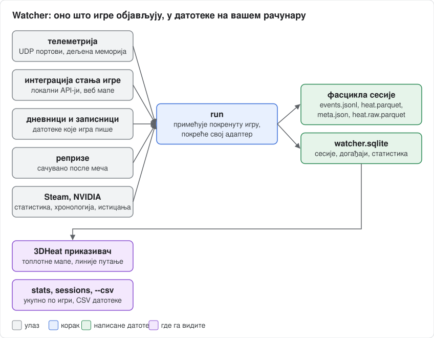
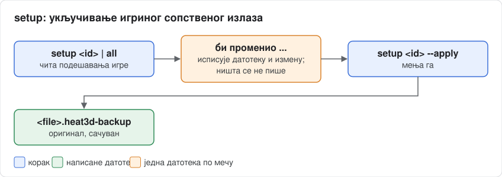
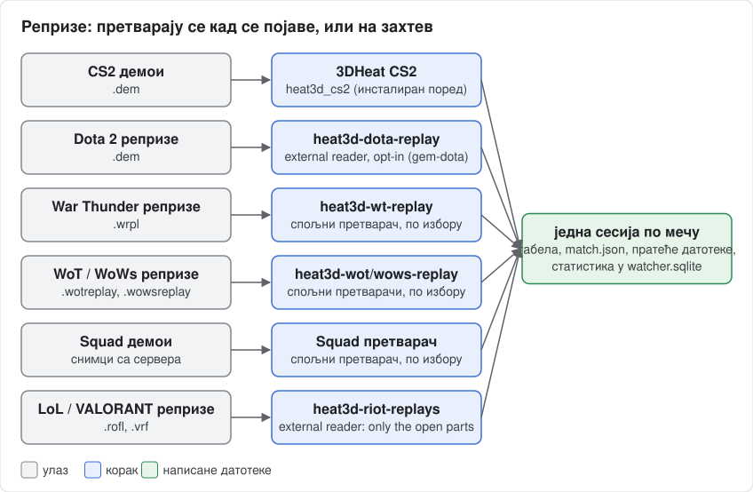
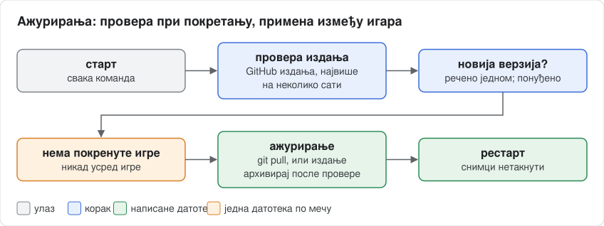

# Команде {#commands}

Нови сте у командној линији? Прво прочитајте [Пре почетка](before-you-start.md). Свака команда се куца
у терминалу отвореном у фолдеру који сте распаковали или клонирали (у Explorer-у укуцајте `powershell`
у адресну траку), овако:

```bash
python -m heat3d_watch <command> [options]
```


| Команда | Шта ради |
|---|---|
| [`run`](#run) | прати у позадини и бележи сваку игру која ради |
| [`games`](#games) | шта свака игра даје и одакле |
| [`setup`](#setup) | укључује сопствени излаз игре |
| [`status`](#status) | које игре раде сада и које адаптере би покренуо |
| [`sessions`](#sessions) | досадашња снимања |
| [`stats`](#stats) | укупно по игри, или табеле као CSV |
| [`table`](#table) | поново прави `heat.parquet` сесије из њеног `events.jsonl` |
| [`replays`](#replays) | претвара реплеје који су већ на диску |
| [`dota-replay`](#dota-replay) | преузима реплеј јавне Dota 2 партије по њеном ид-у |
| [`dota-map`](#dota-map) | мапу Dota 2 из ваше инсталације као 3D ниво за приказивач |
| [`update`](#update) | ажурира на најновије издање |
| [`config`](#config) | приказује или мења подешавања |

Опције за сваку команду: `-h` / `--help` приказује помоћ, а `python -m heat3d_watch --version`
приказује верзију (фајл `VERSION`).

Слике на овој страници су покретања над синтетичким примерима сесија (`Example Racer`, `Example Arena`),
а не над правим снимцима.

Свака команда осим `update` прво проверава да ли постоји новије издање (највише једном у шест сати;
прескаче се са `HEAT3D_NO_UPDATE=1`, видите [Ажурирања](updates.md)). `run` само исписује обавештење.
Остале команде питају `Update now? [Y/n]` када раде у терминалу, а када не раде, исписују како се
ажурира. Излаз је у UTF-8, па имена игара на било ком језику исписују се у било којој конзоли.

## run {#run}

```bash
python -m heat3d_watch run [--once] [-v]
```



Прати док се не заустави (Ctrl+C): на сваких `scan_seconds` чита листу процеса и покреће адаптер за
сваку игру коју нађе, плус адаптере који раде увек. Пре првог прегледа довршава сесије које су остале
отворене у претходном покретању. Док ниједна игра не ради, може да се ажурира сам (уз укључено
`auto_update`). Детаљи су у [Инсталација и покретање](installing-and-running.md#running).

| Опција | Дејство |
|---|---|
| `--once` | један преглед игара које раде, па излаз. Покрећу се адаптери за игре које сада раде (и они који раде увек), сваки проверава једном (чека се највише 10 секунди), па се сви заустављају као када игра заврши: њихове сесије се затварају, уписују и броје. Служи за проверу детекције, не за снимање. |
| `-v`, `--verbose` | линије за отклањање грешака у `watcher.log` и на конзоли |

`run` пише `<data>\watcher.lock` и одбија да се покрене други пут за исту фолдер с подацима (излазни
код 1); видите [Закључана датотека](installing-and-running.md#the-lock-file).

## games {#games}

```bash
python -m heat3d_watch games [--markdown]
```


Исписује сваки адаптер сортиран по игри: његово име, ид и врсту, одакле чита, шта бележи и како се
укључује. Адаптер који не може да ради на овом рачунару означен је са
`[unavailable: <why>]` - није нађен SimConnect.dll, нема фолдера Minecraft-а, није инсталиран 3DHeat CS2,
нису нађени Steam или NVIDIA App. Модул адаптера који није могао да се увезе наводи се на крају са
грешком.

```text
EA SPORTS F1 25  (f1-25, telemetry)
    from: UDP telemetry 127.0.0.1:20777 (Documents\My Games\F1 25\hardwaresettings\hardware_settings_config.xml)
    - every car's position (world XYZ, m) at 10 Hz, by driver name, team, own car marked, ...
    switch on: In the game: Settings > Telemetry Settings > UDP Telemetry On, IP 127.0.0.1, port 20777 - ...
```

`--markdown` исписује исто као једну Markdown табелу (игра, шта се бележи, одакле, како се укључује,
онлајн игра, проверено). Табела у [Све игре у једној табели](watcher.md) је тај излаз. Ћелије су
ескејповане за Markdown: текст у обрнутим апострофима остаје код, а ван њих се `<`, `>`, `&`, `*`, `|`
и обрнута коса црта испред интерпункције пишу тако да се виде као укуцани (`<CS2>` би иначе нестао као
HTML ознака у kramdown-у). Једини HTML је `<br>` између ставки у "What is recorded" (Шта се бележи).

## setup {#setup}

```bash
python -m heat3d_watch setup <adapter id | all> [--apply]
```




Укључује сопствени излаз игре, тамо где игра треба да се нека датотека промени. Без `--apply`
ништа се не мења: свака линија каже шта би се променило, а када има шта да се промени, последња линија
каже `Nothing was changed. Run again with --apply to make these changes.` Када нема шта да се промени,
исписује `<id>: nothing to change` (`Nothing to change.` за `all`). Са `--apply` измене се врше, а пре
него што се датотека први пут промени, њен оригинал се чува као `<file>.heat3d-backup`. Постојећи
резерва се никада не преписује, па она увек садржи датотеку онаква каква је била пре него што ју је
watcher први пут дирнуо.

```text
f1-25: would change: hardware_settings_config.xml <udp>: enabled="false" -> "true"
Nothing was changed. Run again with --apply to make these changes.
```

`all` покреће подешавање сваког адаптера који га има. Адаптер без подешавања, назван сам, исписује
`<id>: nothing for setup to change; ` па како се игра укључује (његов текст `enable`, или да не треба ништа).
Непознат ид исписује `no adapter '<id>'; games lists them` и излази са кодом 2. Адаптери који имају
шта да се подеси:

| Адаптер | Шта `--apply` мења |
|---|---|
| `beamng` | инсталира мод протокола `heat3d` у BeamNG-ов кориснички фолдер `mods` (само ако га нема); затим у игри укључите Options > Other > Protocols > "others" |
| `cs2-gsi` | пише `<CS2>\game\csgo\cfg\gamestate_integration_heat3d.cfg`: шаље стање игре на `http://127.0.0.1:3311/` са насумичним токеном који watcher затим тражи (токен који је већ у фајлу се задржава); CS2 га чита при покретању |
| `dota2-gsi` | исто за Dota 2: `<Dota>\game\dota\cfg\gamestate_integration\gamestate_integration_heat3d.cfg`, порт 3312 |
| `dcs` | додаје `Scripts\Hooks\heat3d-watch.lua` у сваки фолдер `%USERPROFILE%\Saved Games\DCS*`. Његова старија копија се ажурира; фајл тог имена који watcher није написао се не дира. Поново покрените DCS. |
| `dirt-rally-2` | `hardware_settings_config.xml`: `<udp enabled="true" extradata="3" ip="127.0.0.1" port="20777">`; прво покрените игру једном да фајл постоји |
| `ea-wrc` | `Documents\My Games\WRC\telemetry\config.json`: укључује пакет `session_update` структуре `wrc`, за овај рачунар |
| `f1-23`, `f1-24`, `f1-25` | `hardware_settings_config.xml`: `<udp enabled="true" ip="127.0.0.1" port="20777">`; игра мора бити затворена |
| `hearthstone` | додаје одељак `[Power]` (`LogLevel=1`, `FilePrinting=true`) у `%LOCALAPPDATA%\Blizzard\Hearthstone\log.config`; поново покрените игру |
| `il2` | `<game>\data\startup.cfg`, `[KEY = telemetrydevice]`: још један циљ `addrN = "127.0.0.1:41995"` и `enable = true` (одељак се додаје, на 10 Hz, ако га нема); поново покрените IL-2 |
| `il2-tacview` | `<game>\data\startup.cfg`, `[KEY = track_record]`: `tacviewrecord = 1` |
| `rocketleague-stats` | `TAStatsAPI.ini` (или `DefaultStatsAPI.ini` када овај не постоји) у `<RL>\TAGame\Config`: `PacketSendRate=30` када је API искључен, и `Port` када ниједан није постављен; чита се при покретању Rocket League-а |

`richard-burns-rally` nema подешавање: његова телеметрија припада RSF/NGP додатку, а укључује се ручно у
`RichardBurnsRally.ini` (видите [његову страницу](game-richard-burns-rally.md)); `setup richard-burns-rally`
то каже. Свака друга игра или не треба ништа, или се укључује у самој игри; страница сваке игре каже како.

## status {#status}

```bash
python -m heat3d_watch status
```

```text
3DHeat Watcher 1.0.2; data in C:\Users\...\AppData\Local\3DHeat\Watcher
Games running: EA SPORTS F1 25 (f1-25)
Always on: il2-tacview, steam-stats, steam-timeline, nvidia-highlights, cs2-demos, osu-replays, lol-replays, valorant-replays
```

Каже које адаптере би `run` покренуо сада, по истим правилима: процес игре ради, адаптер није у
`disabled`, ништа што му треба не недостаје, адаптери реплеја само ако је `replays` укључено, адаптери
меморије само ако је `memory` укључено и свака провера меморије је прошла. Ништа не покреће.

## sessions {#sessions}

```bash
python -m heat3d_watch sessions [--game NAME] [--limit N]
```


Најновије сесије из `watcher.sqlite`, по једна линија за сваку: почетак (локално време), игра, минути,
догађаји, позиције, фолдер.

| Опција | Дејство |
|---|---|
| `--game NAME` | само ова игра, по тачном имену као у листи (`"EA SPORTS F1 25"`) |
| `--limit N` | највише N сесија (подразумевано 40) |

## stats {#stats}

```bash
python -m heat3d_watch stats [--game NAME] [--csv DIR]
```


Без опција: табела сваке игре (сесије, сати, догађаји, позиције, последње играно), од најигранијих, па за
сваку игру њених 25 најчешћих догађаја и сваку бројчану статистику са бројем сесија које je имају, збиром,
најбољом вредношћу (`best`) и просеком. `best` зна на коју страну је боље: најнижа вредност за времена
која се чувају као најбоља (`best_lap`, `best_stage` и сваки други кључ који почиње са `best_`) и за
место (`race_position`, `grid_position`, сваки кључ који се завршава са `_position`), а највиша за све
остало (убиства, пређени пут, највећа брзина, бројачи саме игре).

| Опција | Дејство |
|---|---|
| `--game NAME` | само догађаји и статистика ове игре, без прегледа |
| `--csv DIR` | уместо тога записује `sessions.csv`, `events.csv` и `stats.csv` (сваки ред све три табеле) у `DIR`; `--game` то не сужава |

## table {#table}

```bash
python -m heat3d_watch table <session folder>
```


Поново прави `heat.parquet` у фолдеру сесије из њеног `events.jsonl`, са осама из њеног `meta.json`.
Исписује путању табеле или `no positions in this session`. Користите га за сесију снимљену док `pyarrow`
није био инсталиран, или после ручне измене `events.jsonl`.

## replays {#replays}

```bash
python -m heat3d_watch replays <adapter id> [folder] [-v]
```



Претвара реплеје који су већ на диску, сада, један за другим, сваки у сесију као што би то урадило
праћење фолдера. Први пут када watcher види фолдер реплеја, само забележи шта је у њему (видите
[Инсталација и покретање](installing-and-running.md#replays-already-on-disk)); овако се они претварају на
захтев. Без `folder` читају се фолдери самог адаптера (игрин, плус `replay_folders`); са њим, реплеји у
том фолдеру. Сваки претворени се бележи као виђен, па покренути watcher не претвара га поново. Реплеј
који не може да се претвори бележи се и прескаче.

| Адаптер | Реплеји |
|---|---|
| `cs2-demos` | демо снимци Counter-Strike 2 (`*.dem`), преко 3DHeat CS2 |
| `lol-replays` | реплеји League of Legends (`*.rofl`) |
| `osu-replays` | реплеји osu! (`*.osr`) |
| `valorant-replays` | реплеји VALORANT (`*.vrf`) |
| `warthunder-replays` | реплеји War Thunder (`*.wrpl`), преко спољног претварача `heat3d-wt-replay` (exporters/ext/warthunder-replay) |
| `wot-replays` | реплеји World of Tanks (`*.wotreplay`), преко спољног претварача `heat3d-wot-replay` (exporters/ext/wot-replay) |
| `wows-replays` | реплеји World of Warships (`*.wowsreplay`), преко спољног претварача `heat3d-wows-replay` (exporters/ext/wows-replay) |
| `dota-replays` | реплеји Dota 2 (`*.dem`), преко gem (`pip install gem-dota`) |

```text
osu-replays: converted 12 replay(s); `sessions --game` lists them
```

Ид који није један од ових исписује `no replay adapter '<id>'` са листом и излази са кодом 2; тако
и `folder` који не постоји. Адаптер који не може да ради овде (није инсталиран 3DHeat CS2) исписује
зашто и излази са кодом 1. Путање Tacview снимака IL-2 нису на листи: тај адаптер сам претвара сваку
завршену путању коју нађе.

## dota-replay {#dota-replay}

```bash
python -m heat3d_watch dota-replay <match id> [<match id> ...] [-o FOLDER] [--convert] [-v]
```

Преузима реплеј јавне Dota 2 партије са Valve-ових сервера за реплеје. Потребан је интернет. Ид партије
је број на страници партије у Dota клијенту (детаљи партије) или на OpenDota-иној страници; Valve чува
реплеј неколико недеља, после чега преузимање не успева. Сервер и со (salt) реплеја узимају се из
OpenDota-иног записа о партији (`api.opendota.com/api/matches/<id>`, без кључа), фајл са
`replay<cluster>.valve.net/570/<id>_<salt>.dem.bz2`; распакује се док стиже (Valve служи и bzip2 и
Zstandard под тим именом) и чува се као `<match id>.dem`. Без `-o` иде у Dota-ин фолдер реплеја кад је
Dota 2 инсталиран - где га покренути watcher претвара - а иначе у `<data>/replays/dota`. Фајл који је
већ тамо се задржава. `--convert` одмах претвара преузете реплеје, као `replays dota-replays`, и бележи их
као виђене.

```text
match 9000000000: C:\Program Files (x86)\Steam\steamapps\common\dota 2 beta\game\dota\replays\9000000000.dem
```

Valve чува реплеје неколико недеља; старија партија исписује `Valve no longer has the replay of match
<id>` и излази са кодом 1. Партија коју OpenDota још није видела нема со: порука каже да од OpenDota-е
затражите (`curl -X POST https://api.opendota.com/api/request/<id>`) и покушате неколико минута касније.
Приватне лобије и партије са скривеним профилом уопште нису на серверима за реплеје.

## dota-map {#dota-map}

```bash
python -m heat3d_watch dota-map [<map>] -o <file.glb> [--game FOLDER] [--source2viewer EXE] [--detail UNITS]
```

Записује мапу Dota 2 - тло, литице, воду, дрвеће и зграде - као `.glb` ниво у оквиру у коме се црта
Dota-ина табела реплеја, из ваше инсталације Dota 2, читано командном линијом Source2Viewer-а. Ништа се не
преузима. `<map>` је по подразумеваној вредности `dota`; `--game` је фолдер Dota 2 када он није у Steam
библиотеци; `--source2viewer` путања до CLI-ја када није ни у `HEAT3D_SOURCE2VIEWER` ни у `PATH`-у;
`--detail` ћелија спајања темена за зграде у јединицама игре (подразумевано 8, 0 задржава сваки троугао).
Излази са кодом 1 и `dota-map: <why>` када Dota 2, мапа или Source2Viewer није нађен. Сваки корак, делови
фајла и како је проверен: [Мапа Dota 2](dota-map.md).

## update {#update}

```bash
python -m heat3d_watch update [--check]
```



Пита GitHub за најновије издање, занемарујући сачувани одговор, и ажурира овај примерак ако је новији
(видите [Ажурирања](updates.md)). `--check` само каже да ли је новије издање изашло. Ова команда ради
и кад је постављено `HEAT3D_NO_UPDATE`: што је тражите, то је одлука. `python -m heat3d_update [--check]`
ради исто.

## config {#config}

```bash
python -m heat3d_watch config [--set KEY=VALUE ...]
```


Исписује свако подешавање као `key = value`. Са `--set`, прво мења наведена и снима `settings.json`
(`saved <path>`). Вредности се читају према врсти подешавања:

- подешавања да/не: `1`, `true`, `yes`, `on` или `ja` је тачно; `0`, `false`, `no`, `off`, `nein` или
  ништа је нетачно;
- бројеви: децимални број (`scan_seconds=5`);
- листе: раздвојене зарезом или JSON листа (`disabled=steam-stats,steam-timeline`; празна вредност брише
  листу);
- речници (`replay_folders`, `player_names`): цео речник као JSON, или један унос као
  `KEY.ID=VALUE` - `replay_folders.cs2-demos=D:\Demos,E:\More Demos` поставља те адаптерове фолдере
  (раздвојене зарезом), `player_names.warthunder-webmap=Name` име тог адаптера; празна вредност уклања унос;
- текст: како је дат (`data=D:\Heat`, `riot_id=Name#TAG`).

```bash
python -m heat3d_watch config --set memory=true scan_seconds=5
python -m heat3d_watch config --set riot_id=Name#TAG riot_platform=EUW1
python -m heat3d_watch config --set replay_folders.cs2-demos=D:\Demos player_names.rocketleague-stats=Name
```

Непознат кључ исписује `no setting '<key>'`, а вредност која није врсте тог подешавања (`memory=perhaps`,
`scan_seconds=often`, речник који није JSON) исписује `not saved: ...`; обоје излазе са кодом 2 без
снимања. `settings.json` уређен ручно чита се на исти начин: вредност дата као текст тамо где је подешавање
број, да/не или речник чита се онако како је написана, а ону која се не може прочитати задржава подразумевана.
Свако подешавање је описано у [Инсталација и покретање](installing-and-running.md#settings).
