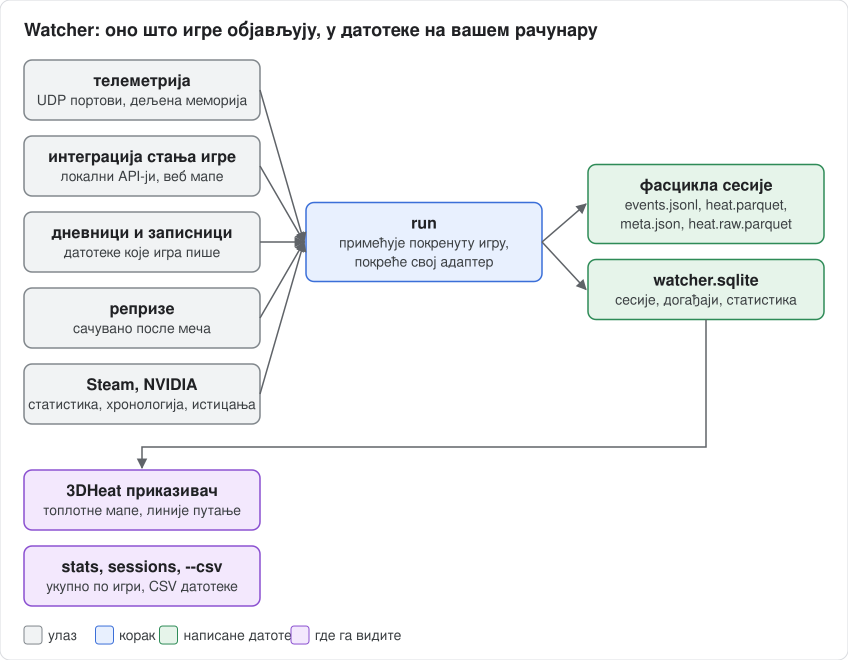

# 3DHeat Watcher {#dheat-watcher}

**Шта је то?** Ви играте игру. Овај програм тихо бележи где сте ишли и шта се десило.
Касније то можете да погледате као обојену мапу у 3DHeat приказивачу.

**Зашто бих га користио?** Да водите свој запис о свакој сесији - где сте возили, летели или се борили,
ваше укупне резултате по игри - без икаквог сајта и без мењања игре.

**Пример:** возите круг у тркачкој игри са покренутим Watcher-ом; после тога датотека у
`sessions\<game>\` чува линију којом сте ишли, а приказивач је црта.

Детаљније: 3DHeat Watcher је програм у позадини који бележи оно што игре објављују о вашој игри - где сте
био, шта се где десило, и бројке иза тога - у датотеке на вашем рачунару. Датотеке служе
за вашу статистику и за топлотне мапе и линије путање 3DHeat приказивача.

Ради тихо, примећује коју игру сте покренули, и чита излазе те игре: телеметријски порт
или дељену меморију коју игра објављује за контролне табле, интеграцију стања игре, дневник
или запис који игра пише, репризу коју сними после меча, статистику коју Steam
чува, исечке које сними NVIDIA App. Снимци остају на вашем рачунару. Програм се јавља само двема
спољним службама, и то само у овим случајевима: GitHub, да потражи новије издање (видите [Ажурирања](../updates.md)), и
Riot-ов Match-V5 API, и то само ако унесете свој Riot API кључ (видите [League of Legends репризе](../game-lol-replays.md)).



## Шта бележи {#what-it-records}

- **Позиције**: аутомобил, летелица, херој или играч, неколико пута у секунди где их игра објављује,
  са брзином, правцем и чиме год игра шаље уз њих.
- **Догађаји**: појављивања, смрти, убиства, кругови, етапе, рунде, голови, послови, полетања и слетања, промене
  зоне, достигнућа, истицања. Сваки догађај се чува са својим временом, и са својим
  местом кад га игра да.
- **Статистика по сесији**: убиства, смрти, кругови, најбољи круг, пређена даљина, највећа брзина, време игре,
  и игрина сопствена статистика где је води.

Шта свака игра даје, и одакле, стоји на својој страници у [Играма](../games.md). Један извор не
може све да бележи: вишеиграчке игре бележе се само кроз оно што објављују, а
watcher никад не чита њихову меморију (видите [Извори и правила](../sources-and-rules.md)).

## Инсталација {#install}

Први пут у командној линији? Прво прочитајте [Пре почетка](before-you-start.md).

Watcher је Python програм за Windows (Python 3.10 или новији). Многи његови извори постоје само на Windows-у: дељена
меморија, регистар, обавештења Windows-а.

```bash
git clone https://github.com/Holdi601/3DHeat-Watcher.git
cd 3DHeat-Watcher
pip install -r requirements.txt
```

Преузети архив издања ради на исти начин: распакујте га, па покрените `pip install -r requirements.txt`
у фасцикли. Детаље, и додатке које неке игре траже, наводи
[Инсталација и покретање](../installing-and-running.md).

## Брзи почетак {#quick-start}

```bash
python -m heat3d_watch games            # шта свака игра даје, и одакле
python -m heat3d_watch setup all        # шта би требало да се укључи (ништа се не мења)
python -m heat3d_watch setup f1-25 --apply   # укључење излаза једне игре (оригинална датотека се чува као резерва)
python -m heat3d_watch run              # бележење; оставите да ради док играте
python -m heat3d_watch stats            # укупно по игри
python -m heat3d_watch stats --csv out  # сесије, догађаји и статистика као CSV датотеке
```

Требало би да видите: после `games`, табелу са по једним редом за сваку игру; `run` наставља док не
притиснете Ctrl+C или не затворите прозор.

Све се пише у `%LOCALAPPDATA%\3DHeat\Watcher`. Да користите другу фасциклу, поставите
променљиву окружења `HEAT3D_WATCH_HOME` или покрените `python -m heat3d_watch config --set data=D:\somewhere`.

- `sessions\<game>\<date>_<adapter>\` - по једна фасцикла за сваку сесију, која држи `events.jsonl` (сваки
  догађај како се дешава), `heat.parquet` (редови са позицијом, спремни за 3DHeat приказивач) и
  `meta.json` (игра, извор, осе, бројеви, статистика)
- `watcher.sqlite` - статистика сваке сесије, у три обичне табеле
- `watcher.log` - шта је watcher радио

Приказивач отвара `heat.parquet` сесије директно, без икаквог подешавања (његове осе и јединице су у
датотеци). Претворене репризе пишу се као табеле и документи о мечу поред ње; приказивачев
формат једна датотека по мечу описан је на његовој страници [`.3dheat` контејнер](https://holdi601.github.io/3DHeat/container.html),
а колоне сваке табеле у [Подаци](../the-data.md).

## Документација {#the-documentation}

| Страница | Шта обухвата |
|---|---|
| [Пре почетка](before-you-start.md) | Python, терминал, места за попуњавање, како изгледају успех и уобичајене грешке |
| [Инсталација и покретање](../installing-and-running.md) | захтеви, покретање у позадини, покретање са Windows-ом, датотека закључавања, дневник, свако подешавање и променљива окружења |
| [Игре](../games.md) | по једна страница за сваку игру: шта се бележи, одакле, како се укључује, како ради, осе, статистика, шта је проверено |
| [Подаци](../the-data.md) | фасцикле сесија, `events.jsonl`, `heat.parquet` и његов завршетак, `meta.json`, `watcher.sqlite`, опоравак после пада, извоз у CSV, отварање сесије у 3DHeat приказивачу |
| [Команде](../commands.md) | свака команда и опција `python -m heat3d_watch` |
| [Извори и правила](../sources-and-rules.md) | шест врста извора, правила за вишеиграче, које игре су изостављене и зашто |
| [NVIDIA Highlights](../nvidia-highlights.md) | шта NVIDIA Highlights може, а шта не може да испоручи, и како исечак добије позицију |
| [Сервер снимачи (модови)](../server-mods.md) | модови за Arma 3 и Arma Reforger сервер који снимају целе мисије за приказивач |
| [Читање меморије](../memory-reading.md) | профили меморије за једног играча: формат, провере, како написати и проверити један |
| [Ажурирања](../updates.md) | како watcher тражи нова издања и сам се ажурира |
| [Развој](../development.md) | писање адаптера: API, тестови, поштено `verified`, поновно прављење страница о играма |
| [Све игре у једној табели](../watcher.md) | свака игра у једној табели, онако како је исписује `games --markdown`, плус игре које су истражене али још нису направљене |
| [Референца команди](../cli-reference.md) | `--help` сваке команде, генерисано из кода |
| [Одржавање](../maintaining.md) | контролна листа издања за ове странице |

## Део 3DHeat-а {#part-of-3dheat}

3DHeat Watcher је један од бесплатних алата око 3DHeat приказивача (watcher користи 3DHeat CS2
за претварање CS2 демоа). Сваки је свој пројекат, са својим издањима и лиценцом:

| Алат | Шта ради | Документација |
|---|---|---|
| [3DHeat](https://github.com/Holdi601/3DHeat) | приказивач: топлотне мапе, анализа трке и преглед мечева у 3D | [сајт](https://holdi601.github.io/3DHeat/) |
| [GameFiles](https://github.com/Holdi601/3DHeat-GameFiles) | стазе и нивои из датотека које игре испоручују, као 3D модели | [сајт](https://holdi601.github.io/3DHeat-GameFiles/) |
| [GameCapture](https://github.com/Holdi601/3DHeat-GameCapture) | телеметрија кругова из тркачких игара; нивои реконструисани из снимка игре | [сајт](https://holdi601.github.io/3DHeat-GameCapture/) |
| [Unreal Exporter](https://github.com/Holdi601/3DHeat-UnrealExporter) | додатак за Unreal Editor који извози ниво као један 3D модел | [сајт](https://holdi601.github.io/3DHeat-UnrealExporter/) |
| [CS2](https://github.com/Holdi601/3DHeat-CS2) | Counter-Strike 2 демои у табеле и документе о мечу; мапе у 3D моделе | [сајт](https://holdi601.github.io/3DHeat-CS2/) |
| [Watcher](https://github.com/Holdi601/3DHeat-Watcher) | бележи оно што игре објављују о вашој игри, у позадини | [сајт](https://holdi601.github.io/3DHeat-Watcher/) |
| [Ext-WarThunder](https://github.com/Holdi601/3DHeat-Ext-WarThunder) | War Thunder репризе у табеле и документе о мечу | [сајт](https://holdi601.github.io/3DHeat-Ext-WarThunder/) |
| [Ext-WoT](https://github.com/Holdi601/3DHeat-Ext-WoT) | World of Tanks репризе у табеле и документе о мечу | [сајт](https://holdi601.github.io/3DHeat-Ext-WoT/) |
| [Ext-WoWs](https://github.com/Holdi601/3DHeat-Ext-WoWs) | World of Warships репризе у табеле и документе о мечу | [сајт](https://holdi601.github.io/3DHeat-Ext-WoWs/) |
| [Ext-Squad](https://github.com/Holdi601/3DHeat-Ext-Squad) | Squad демои са сервера у табеле и документе о мечу | [сајт](https://holdi601.github.io/3DHeat-Ext-Squad/) |
| [Ext-DCS](https://github.com/Holdi601/3DHeat-Ext-DCS) | DCS World мапе у 3D моделе | [сајт](https://holdi601.github.io/3DHeat-Ext-DCS/) |
| [Ext-IL2](https://github.com/Holdi601/3DHeat-Ext-IL2) | мапе IL-2 Sturmovik у 3D моделе | [сајт](https://holdi601.github.io/3DHeat-Ext-IL2/) |

Лиценца: MIT ([LICENSE](https://github.com/Holdi601/3DHeat-Watcher/blob/main/LICENSE)). Лиценце
пакета трећих страна које користите, и оно што игре које чита налажу, наведени су у
[LICENSES.md](https://github.com/Holdi601/3DHeat-Watcher/blob/main/LICENSES.md).
