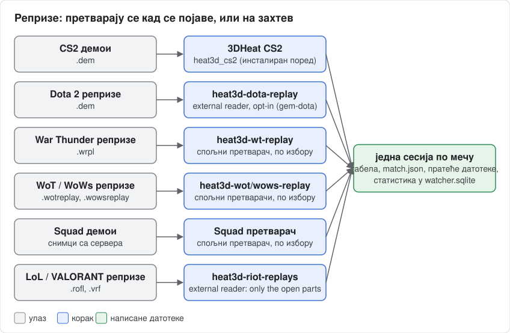

# Инсталација и покретање {#installing-and-running}

## Захтеви {#requirements}

- **Windows.** Watcher је написан за Windows, а већина његових извора постоји само тамо: дељена меморија
  коју игре стварају (мапирања `Local\...`), регистар (где је Steam), обавештења Windows-а, листа процеса
  са путањама извршних фајлова. На другом систему програм се покреће, али ти извори ништа не налазе,
  обавештења се само бележе, а читање меморије одбија ("only implemented on Windows").
- **Python 3.10 или новији**, са <https://www.python.org/downloads/>: у инсталеру означите **Add python.exe to PATH**,
  па проверите са `python --version` у новом терминалу. Нови сте у овоме? Прво прочитајте
  [Пре почетка](before-you-start.md).
- **Пакети** (`requirements.txt`): `psutil>=6.0` (које игре раде, који програм држи порт, везе игре; старији
  psutil још ради, преко свог старијег имена за везе процеса), `pyarrow>=15` (пише `heat.parquet`),
  `numpy>=1.24`, и `pytest>=8.0` за тестове. `requirements-optional.txt` тренутно не наводи ниједан пакет.

Без `pyarrow`, сесије се и даље бележе: `events.jsonl` је запис, а табела се може направити касније
командом [`table`](commands.md#table).

### Додаци које неке игре захтевају {#extras-some-games-need}

| Игра | Шта треба |
|---|---|
| Counter-Strike 2 демои | [3DHeat CS2](https://github.com/Holdi601/3DHeat-CS2) и његови захтеви (`demoparser2`). Watcher га тражи у `HEAT3D_CS2`, затим у фолдеру `3DHeat-CS2` или `cs2` поред сопственог фолдера watcher-а, затим било где где Python може да увезе `heat3d_cs2`. Без њега, `games` наводи адаптер као недоступан. |
| Microsoft Flight Simulator 2020 / 2024 | `SimConnect.dll` - није испоручен. MSFS 2020 га има у свом фолдеру инсталације; за MSFS 2024 инсталирајте MSFS 2024 SDK. `MSFS_SDK` / `MSFS2024_SDK` показују на фолдер SDK-а. |
| Euro Truck Simulator 2, American Truck Simulator | додатак RenCloud `scs-telemetry.dll` (ревизија 12) у `<game>\bin\win_x64\plugins` |
| BeamNG.drive | мод протокола `heat3d`, инсталира га `python -m heat3d_watch setup beamng --apply` |
| League of Legends (уживо) | опционо: корени сертификат Riot-а као `<data>\riotgames.pem`, тако да се локална веза проверава |
| Minecraft | фолдер `%APPDATA%\.minecraft` (Java издање) |

Страница сваке игре под [Игре](games.md) каже шта треба укључити у самој игри.
`python -m heat3d_watch games` означава адаптер са `[unavailable: ...]` кад му нешто што треба недостаје
на овом рачунару.

## Инсталација {#installing}

Нови сте у командној линији? Прво прочитајте [Пре почетка](before-you-start.md). Ако `pip` није нађен,
уместо тога користите `python -m pip install -r requirements.txt`.

Из клона:

```bash
git clone https://github.com/Holdi601/3DHeat-Watcher.git
cd 3DHeat-Watcher
pip install -r requirements.txt
```

Из издања: преузмите архиву са издања репозиторијума, распакујте је, па у фолдеру покрените
`pip install -r requirements.txt`. Обе врсте примерка се ажурирају саме
(видите [Ажурирања](updates.md)).

Покрећите сваку команду из фолдера репозиторијума: `python -m heat3d_watch` увози пакет одатле, а
ажурирач (`heat3d_update`) стоји поред њега.

## Покретање {#running}

```bash
python -m heat3d_watch run        # watch until stopped
python -m heat3d_watch run -v     # the same, with debug lines in the log
python -m heat3d_watch run --once # one look at the games running now, then stop and exit
```

При покретању, `run`:

1. пише [закључану датотеку](#the-lock-file);
2. довршава све сесије које је претходно покретање оставило отворене, на пример после пада
   (видите [Опоравак](the-data.md#recovery-after-a-crash));
3. на сваких `scan_seconds` (2 с) чита листу процеса (само имена и путање, ниједан процес се не отвара)
   и покреће адаптер, у својој нити, за сваку игру коју нађе. Када процес игре нестане, њен адаптер се
   зауставља и сесије које је имао отворене се затварају, што уписује њихову табелу и њихов ред у
   статистику. Адаптери који не чекају игру (статистика Steam-а, Steam Timeline, NVIDIA highlights,
   фолдери реплеја) раде стално;
4. док ниједна игра не ради, тражи новије издање највише једном на сат (сам одговор се чува шест
   сати) и, уз укључено `auto_update`, инсталира га и поново се покреће сам (видите [Ажурирања](updates.md)).

Адаптер који не успе бележи се и не зауставља остале. Ако провера адаптера не успе 20 пута заредом,
или не успе његово покретање, адаптер се зауставља и не покреће се поново док се игра поново не покрене
(нови ид процеса).

Зауставите watcher са Ctrl+C. Адаптери затворе своје сесије пре изласка. Ако се watcher убије уместо тога
(Task Manager, пад, нестанак струје), ништа што је већ записано се не губи: следећи `run` довршава те
сесије.

`--once` прави један преглед: покреће адаптере за игре које тада раде (и оне који раде увек), пушта свакога
да се провери једном - чекајући највише 10 секунди за то - па их зауставља као што би се зауставили кад
игра заврши, тако да се сесије које су отворили затварају, њихове табеле пишу, а редови броје у статистику
пре изласка. Користите га да проверите да се игра детектује, а не за снимање.

### Реплеји који су већ на диску {#replays-already-on-disk}



Први пут када адаптер реплеја види један од својих фолдера, само забележи реплеје који су већ у њему: иначе
би играч са годинама демоа нашао watcher заузет претварањем цео дан. Од тада се сваки нови реплеј претвара
једном, кад игра заврши да га пише. Стари се претварају на захтев командом [`replays`](commands.md#replays):

```bash
python -m heat3d_watch replays cs2-demos              # every demo in CS2's folders and replay_folders
python -m heat3d_watch replays osu-replays D:\Old     # the replays in one folder
```

### Покретање у позадини {#running-in-the-background}

Watcher нема свој прозор; то је конзолни програм који ради док се не заустави. Све уписује у
`watcher.log`, па му није потребна видљива конзола. Начини да га склоните с пута:

- покрените га у конзоли и смањите конзолу: `start "" /min python -m heat3d_watch run` из `cmd`-а, у
  фолдеру репозиторијума;
- покрените га без конзоле: `pythonw -m heat3d_watch run`. Излаз конзоле се губи, али се `watcher.log`
  и даље пише. Да га зауставите, завршите процес `pythonw.exe`; следеће покретање тада довршава сесије које
  је оставио отворене. Пројекат није тестирао овај начин покретања.

### Покретање са Windows-ом (идеја) {#starting-with-windows-an-idea}

Watcher се не инсталира сам да се покреће са Windows-ом. Да би се покренуо аутоматски:

- **Task Scheduler**: направите задатак са окидачем *At log on* и радњом *Start a program*, програм
  `pythonw.exe` (или `python.exe`), аргументи `-m heat3d_watch run`, *Start in* постављен на фолдер
  репозиторијума;
- **фолдер Startup**: ставите пречицу у `shell:startup` са истим програмом, аргументима и фолдером
  *Start in*.

Ниједно није део watcher-а нити га он тестира. [Закључана датотека](#the-lock-file) осигурава да друга
копија, покренута по грешци, одмах изађе.

## Закључана датотека {#the-lock-file}

`<data>\watcher.lock` садржи ид процеса покренутог watcher-а. Када `run` почне и закључана датотека
наводи процес који још постоји и чије име садржи `python`, исписује

```text
A watcher is already running (process 12345) for C:\Users\...\3DHeat\Watcher.
```

и излази са кодом 1. Два watcher-а над истим фолдером с подацима би снимала сваку игру два пута, а други би
сесије првог сматрао остацима пада. Закључана датотека чији процес више не постоји, или припада другом
програму, се преписује. Када `run` заврши, уклања закључану датотеку ако она још наводи његов процес.

## Лог {#the-log}

`<data>\watcher.log` пише само `run`; остале команде исписују на конзолу. Свака линија има време, ниво и
поруку:

```text
2026-05-01 20:15:01,123 INFO watching; data in C:\Users\...\AppData\Local\3DHeat\Watcher
2026-05-01 20:15:03,456 INFO f1-25: starting (EA SPORTS F1 25)
2026-05-01 21:02:11,789 INFO f1-25: stopping
```

Адаптери бележе шта не могу да ураде и зашто: "UDP 20777 is in use by ...; not taking it from that program",
"not reading memory: the game is played online", "could not start", "poll failed (3)" са трагом. `run -v`
додаје линије за отклањање грешака. Фајл се само допуњава и никада га watcher не ротира нити празни;
обришите га кад год хоћете. Исте линије иду и на конзолу.

## Где је све {#where-everything-is}

Почетни фолдер је `%LOCALAPPDATA%\3DHeat\Watcher`, или `HEAT3D_WATCH_HOME` ако је то постављено (без
`LOCALAPPDATA`, на пример на другом систему, `~/.local/share/3DHeat/Watcher`). `settings.json` је увек у
почетном фолдеру. Све остало иде у фолдер с подацима, а то је почетни фолдер осим ако подешавање `data` не
наведе други:

| Путања | Шта је |
|---|---|
| `<home>\settings.json` | подешавања |
| `<data>\sessions\` | снимци, по један фолдер за сваку седницу ([Подаци](the-data.md)) |
| `<data>\watcher.sqlite` | база статистике |
| `<data>\watcher.log` | лог команде `run` |
| `<data>\watcher.lock` | закључана датотека, док `run` ради |
| `<data>\state\` | шта су адаптери који раде увек и адаптери реплеја већ видели (`steam-stats.json`, `replays-cs2-demos.json`, ...), да се поновним покретањем ништа не сними два пута |
| `<data>\profiles\*.json` | профили меморије које сте написали ([Читање меморије](memory-reading.md)) |
| `<data>\riotgames.pem` | опционо, корени сертификат Riot-а за адаптер League of Legends уживо |
| `%LOCALAPPDATA%\3DHeat\update-check-3DHeat-Watcher.json` | сачувани одговор последње провере издања |

Watcher ништа не брише у овим фолдерима, осим фолдера сесије у којем ништа није снимљено (игра која је
стајала у менијима).

## Подешавања {#settings}


`python -m heat3d_watch config` приказује подешавања; `config --set key=value ...` мења их и снима
`settings.json` (видите [config](commands.md#config)). Фајл је обичан JSON и може се уређивати и ручно док
watcher није покренут. Непознати кључеви у њему се занемарују. Подешавања се читају када команда почне,
па поново покрените `run` после промене.

| Подешавање | Подразумевано | Шта ради |
|---|---|---|
| `data` | `""` | Фолдер с подацима. Празно: почетни фолдер. |
| `disabled` | `[]` | Ид адаптера који никада не раде, на пример `config --set disabled=steam-stats,nvidia-highlights`. Сваки други адаптер ради кад нађе своју игру. |
| `auto_update` | `true` | Док ниједна игра не ради, инсталира новије издање и поново покреће се (видите [Ажурирања](updates.md)). `false`: само обавештење у логу. |
| `scan_seconds` | `2.0` | Секунди између прегледа листе процеса. |
| `memory` | `false` | Дозвољава адаптерима меморије (игре за једног играча са профилом који сте написали) да раде. Подразумевано искључено; видите [Читање меморије](memory-reading.md). |
| `replays` | `true` | Покреће адаптере `replay`: све њих (видите `python -m heat3d_watch replays` и [Игре](games.md)) - демое CS2, Dota 2, osu!, War Thunder, World of Tanks, World of Warships, Squad, реплеје League of Legends и VALORANT, снимке Tacview од IL-2. |
| `replay_folders` | `{}` | Додатни фолдери по иду адаптера, на пример `{"cs2-demos": ["D:\\Demos"]}`. Адаптери реплеја прате их уз игрине фолдере; `il2-tacview` прихвата и фолдере инсталације (тада гледа у њихов `data\Tracks`); за `elite`, први фолдер замењује фолдер журнала. Један адаптер постављате са `config --set replay_folders.cs2-demos=D:\Demos,E:\More`, или цео речник као JSON. |
| `riot_id` | `""` | Ваш Riot ID (`Name#TAG`), да ваш сопствени ред у реплеју League of Legends постане ваша статистика. Празно: сваки ред играча се чува, нико није означен као ваш. |
| `riot_api_key` | `""` | Ваш сопствени кључ за Riot програмере, да се за сваку реплејовану партију League-а преузме званична временска линија (позиције сваког минута, убиства где су се десила). Празно: ништа се не преузима. |
| `riot_platform` | `"EUW1"` | Ид платформе вашег сервера League-а (`EUW1`, `EUN1`, `NA1`, `KR`, ...), користи се да се нађе регионални домаћин Match-V5. |
| `player_names` | `{}` | Ваше име у играма чији интерфејс именује сваког играча, али не каже који сте ви, по иду адаптера: `warthunder-webmap` (редови о вама у листи убистава постају ваша убиства и смрти) и `rocketleague-stats` (ваши редови постају `me`; без тога, играч кога камера игре прати). Поставља се са `config --set player_names.warthunder-webmap=Name`. |

`settings.json` са свим подразумеваним вредностима:

```json
{
  "data": "",
  "disabled": [],
  "auto_update": true,
  "scan_seconds": 2.0,
  "memory": false,
  "replays": true,
  "replay_folders": {},
  "riot_id": "",
  "riot_api_key": "",
  "riot_platform": "EUW1",
  "player_names": {}
}
```

## Променљиве окружења {#environment-variables}

| Променљива | Дејство |
|---|---|
| `HEAT3D_WATCH_HOME` | почетни фолдер (подешавања, и подаци осим ако `data` не каже другачије) |
| `HEAT3D_NO_UPDATE` | било која вредност осим празне, `0`, `false` или `no` искључује проверу издања и аутоматско ажурирање |
| `HEAT3D_NO_TOAST` | било која непразна вредност: нема обавештења Windows-а, само линије у логу |
| `HEAT3D_CS2` | фолдер 3DHeat CS2, за демое CS2 |
| `HEAT3D_CS2_GSI_PORT` | порт стања игре CS2 (подразумевано 3311); фајл cfg који `setup` пише га користи |
| `HEAT3D_DOTA_GSI_PORT` | порт стања игре Dota 2 (подразумевано 3312) |
| `MSFS_SDK`, `MSFS2024_SDK` | фолдери MSFS SDK-а, где се тражи `SimConnect SDK\lib\SimConnect.dll` |

Обавештења Windows-а се користе само за ажурирања: "Updating to 1.2.0", или "1.2.0 is out; not updated:
..." када ажурирање није могло да се примени. Приказују се преко API-ја за обавештења PowerShell-а, па
ништа не мора да се инсталира. Наслов и текст се PowerShell-у предају као променљиве окружења, никада као
део скрипте.
