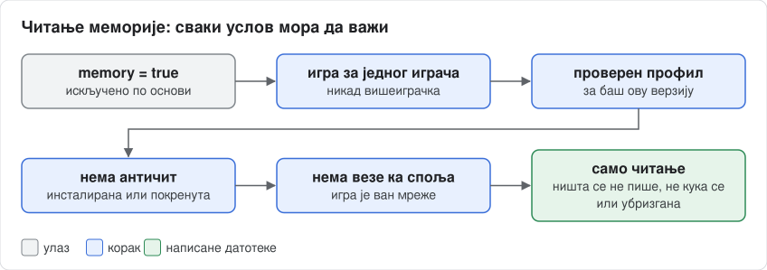

# Читање меморије {#reading-memory}

Неке игре за једног играча ништа не говоре другим програмима. За њих watcher може - ако то укључите и
сами напишете профил - да потражи где сте у меморији игре, само за читање.

За игре за једног играча које ништа не објављују, watcher може да чита положаје и вредности из меморије
игре, преко **профила** који сами напишете за своју верзију игре. Од свих извора ово је једино што игра
није сама дала, па је оград јачи него код осталих:

- **искључено је по подразумеваној вредности** (`python -m heat3d_watch config --set memory=true` га укључује);
- чита, и нема начина да пише;
- **ниједан профил не долази уз алате.**

Профили не долазе зато што је офсет исправан само за издање на којем је нађен. После закрпе, профил који
је пре био исправан чита смеће, а смеће изгледа баш као бројеви. Профил мора да проверава играч, на
издању које он има.

## Провере, редом {#the-checks-in-order}



Свака провера испод мора да прође. Прве четири раде се **пре** отварања игре, јер је отварање заштићене
игре за читање само по себи оно што античит примети, па би одбијање после било прекасно.

1. **Подешавање**: `memory` је тачно. Иначе адаптери меморије се никада не покрећу.
2. **Профил за игру**, чије `exe` наводи покренути процес. Профил мора да каже да ли се игра може играти
   онлајн (`"online"`); онај који то изостави се одбија.
3. **Нема античита у близини**:
   - нема фајла античита у фолдеру игре или до три фолдера изнад њега (стајући на фолдеру `common` Steam
     библиотеке, или на фолдеру у којем је `steamapps`, јер други игре живе изнад тога): `EasyAntiCheat`,
     `EasyAntiCheat_EOS_Setup.exe`, `start_protected_game.exe`, `BattlEye`, `BEClient_x64.dll`,
     `BEService_x64.exe`, `EAAntiCheat.GameServiceLauncher.exe`, `AntiCheatExpert`, `SGuard64.exe`,
     `GameGuard`, `GameMon.des`, `XIGNCODE`, `xhunter1.sys`, `Vanguard`, `FACEIT` (упоређено малим словима,
     и као почетак имена). Ако фолдер игре није познат, игра се одбија;
   - нема драјвера или сервиса античита који раде на рачунару уопште, како их наводи
     `sc query type= driver state= active` и `sc query type= service state= active`: EasyAntiCheat,
     EasyAntiCheat_EOS, BEService, BEDaisy, vgk, vgc, ACE-BASE, ACE-GAME, xhunter1, FACEIT, FACEITService,
     EAAntiCheatService, Denuvo Anti-Cheat, npggsvc, Ricochet. Античит на нивоу кернела инсталиран за другу
     игру и даље гледа сваки процес. Ако се сервиси не могу навести, игра се одбија.
4. **Није онлајн**: игра чији профил каже `"online": true` чита се само док нема везу ни са чим осим са
   овим рачунаром (било која удаљена адреса осим `127.x`, `::1`). Ако њене везе не могу да се прочитају,
   одбија се.
5. Затим, док адаптер почиње:
   - **тачно издање**: величина извршног фајла, или његов SHA-256, мора да се поклапа са издањем које профил
     наводи. Непознато издање се не чита;
   - **модули још једном**: учитани модули игре се наводе (Toolhelp снимак, који не тражи своја права
     приступа) и проверавају за клијент античита (`BEClient_x64.dll`, `BEClient.dll`,
     `EasyAntiCheat_x64.dll`, `EasyAntiCheat.dll`, `EOSAntiCheat...`). Заштићен процес одбија снимак, што је
     такође одбијање;
   - тек тада се процес отвара, са `PROCESS_VM_READ | PROCESS_QUERY_LIMITED_INFORMATION` и ничим другим.

Провере 1 до 4 понављају се при сваком прегледу (на сваке 2 с) док игра ради. Ако једна почне да не
успева (игра се повезује на сервер, покрене се сервис античита), адаптер се зауставља при следећем прегледу.
Одбијање се бележи: `mem-<id>: not reading memory: <reason>`. Грешка при покретању (непознато издање,
модул античита, образац није нађен) бележи се као `mem-<id>: could not start`, и адаптер се не покушава
поново док се игра не покрене поново.

Нема писања, нема алокације у другом процесу, нема нити покренуте у њему, нема библиотеке учитане у њега,
нема привилегије за отклањање грешака и нема подизања привилегија. Тест (`test_memory_reading_cannot_write` у
`tests/test_core.py`) пада ако се у пакету појави било који позив који пише у други процес, алоцира у њему
или извршава код у њему - `WriteProcessMemory`, `VirtualAllocEx`, `CreateRemoteThread`, `PROCESS_VM_WRITE`,
`SeDebugPrivilege`, `LoadLibrary`, ...

Никада се не чита, без обзира на то шта профил каже: игре које се играју онлајн, и игре за једног играча
чији режим ради под античитом, као GTA V, или Elden Ring покренут преко свог покретача. Провере горе их ионако
одбијају.

## Формат профила {#the-profile-format}

Профил је JSON фајл у `<data>\profiles\` (`<data>` је фолдер са подацима, видите
[Инсталација и покретање](installing-and-running.md#where-everything-is)), један по игри, било које име фајла
које се завршава са `.json`. Синтетички пример:

```json
{
  "schema": "heat3d.memprofile/1",
  "id": "mygame",
  "game": "My Game",
  "exe": "MyGame.exe",
  "online": false,
  "versions": [ { "label": "1.06", "size": 123456789 } ],
  "anchors": {
    "World": { "aob": "48 8B 05 ?? ?? ?? ?? 48 85 C0", "rip": [3, 7] }
  },
  "values": {
    "pos": { "type": "vec3f", "base": "World", "chain": ["0x10", "0x68", "0x70"] },
    "hp":  { "type": "i32",   "base": "World", "chain": ["0x10", "0x138"] },
    "map": { "type": "u32",   "base": "World", "chain": ["0x10", "0x1C0"] }
  },
  "events": [
    { "event": "death", "value": "hp",  "when": "to_zero" },
    { "event": "zone",  "value": "map", "when": "change" }
  ],
  "axes": { "up": "y", "units": "metres" },
  "rate": 10,
  "provenance": [ { "source": "https://example.com/my-notes", "verified_on": "1.06" } ]
}
```

| Кључ | Обавезан | Шта је |
|---|---|---|
| `schema` | да | тачно `heat3d.memprofile/1` |
| `id` | да | кратак и стабилан; адаптер се зове `mem-<id>` |
| `game` | да | име игре, по којем се именује фолдер сесије |
| `exe` | да | име извршног фајла, које такође каже да игра ради |
| `online` | да | `true` ако се игра може играти онлајн; тада се чита само док је ван мреже |
| `versions` | да | издања на којима је профил проверен: сваки са `label`, и `size` (величина извршног фајла у бајтовима) и/или `sha256`. Када су дата оба, оба се морају поклапати. Унос без ниједног не поклапа ништа. |
| `anchors` | да | именоване адресе у главном модулу. `aob`: образац бајтова, хексадецимални бајтови раздвојени размацима, `?` или `??` за било који бајт; мора да се појави **тачно једном** у слици модула (више поклапања рачуна се као неуспех, као и ниједно). `rip: [d, n]`: образац показује на инструкцију са 32-битним RIP-релативним помаком на бајту `d` и дужине `n`; сидро постаје адреса на коју та инструкција упућује. `offset`: додаје се после (хексадецимално или децимални текст). Уместо `aob`, `module_offset` даје фиксни офсет од базе модула. |
| `values` | да | шта се чита при сваком прегледу: `type` (`i32`, `u32`, `i64`, `u64`, `u8`, `f32`, `f64`, `vec3f`, `vec3d`), `base` (име сидра), `chain` (офсети као хексадецимални или децимални текст) |
| `events` | не | правила која промене претварају у догађаје: `when` `change` (вредност се разликује од последњег прегледа) или `to_zero` (број падне са изнад 0 на 0 или испод) |
| `axes` | не | `up` (подразумевано `y`), `units` (подразумевано `game units`), `scale` (јединична скала приказивача, која множи сваку позицију; подразумевано 1, јединице саме игре) |
| `rate` | не | провере у секунди, од 1 до 60 (подразумевано 10) |
| `provenance` | не | одакле офсети долазе и на којем издању су проверени; копира се у `meta.json` сваке сесије |

**Како се вредност чита.** Адреса сидра је почетак. Ако је `chain` празан, вредност се чита одмах на том месту.
Иначе се прво чита показивач сачуван на сидру. Затим се, за сваки офсет осим последњег, чита показивач на
`address + offset`. Последњи офсет се додаје да би се добила адреса вредности. Нулти показивач на путу (игра је
између нивоа или у менију) оставља вредност празном за тај преглед.

**Шта се бележи.** Вредност по имену `pos` (`vec3f` или `vec3d`) постаје ред `position` играча `me` при сваком
прегледу. Свако правило догађаја уписује свој ред `event`, са новом вредношћу и, где је `pos` познат, позицијом,
и додаје 1 статистици истог имена. Слика модула се чита једном при покретању да би се нашла сидра, у блоковима
од 64 KiB; блокови који се не могу прочитати броје се као нуле. `meta.json` сесије наводи профил, ознаку
издања и порекло.

Профил који се не може користити (лош JSON, погрешан `schema`, недостаје обавезан кључ) се прескаче и
бележи се као `profile <file> not used: <reason>`. Профили се учитавају при покретању watcher-а, па поново
покрените `run` после додавања или измене.

## Писање и провера профила {#writing-and-verifying-a-profile}

1. **Само за игру за једног играча без античита.** Ако игра има античит, или је играте онлајн, станите овде:
   watcher ће је одбити, и тако треба.
2. **Нађите вредности на свом издању.** Радите ван мреже. Користите своје алате за отклањање грешака, или
   објављене белешке о игри, да нађете положај играча и вредности које вас занимају, и путању показивача до
   сваке од непокретног места у извршном фајлу. Радије узмите образац бајтова (`aob`) него фиксни
   `module_offset`: образац још увек налази своје место кад се код мало помери.
3. **Направите образац јединственим.** Мора се поклопити тачно једном у модулу. Бајтове који се мењају
   (адресе, помаци) замените џокером, и задржите довољно непроменљивих бајтова око њих.
4. **Закључајте издање.** Ставите тачну величину извршног фајла у `versions`; PowerShell
   `(Get-Item .\MyGame.exe).Length` је даје, а `Get-FileHash .\MyGame.exe -Algorithm SHA256` даје хеш. После
   закрпе профил се једноставно престаје користити док га поново не проверите и не додате ново издање.
5. **Наведите да ли игра иде онлајн** (`online`), поштено.
6. **Пробајте**: укључите читање (`config --set memory=true`), ставите фајл у `<data>\profiles\`, и проверите да
   `python -m heat3d_watch games` наводи `mem-<id>`. Покрените игру и `python -m heat3d_watch run -v`. У
   `watcher.log` тражите `mem-<id>: starting`, или разлог зашто је одбијен или није могао да почне.
7. **Проверите бројеве према игри.** Идите на познато место и погледајте редове `position` у `events.jsonl`
   сесије. Да ли се померају кад се ви померате, за право растојање, по правим осама? Отворите `heat.parquet` у
   приказивачу и проверите да се путања поклапа са тим где сте били. Изазовите сваки догађај (изгубите све живот,
   промените зону) и проверите да се појави једном. Смеће изгледа као бројеви, и само ово поређење их разликује.
8. **Запишите шта сте проверили** у `provenance`: извор офсета и издање на којем сте их проверили.

Текст `verified` адаптера меморије, како га исписује `games`, увек гласи: „од аутора профила, за издања која наводи“.
Watcher не може да зна више од тога.
