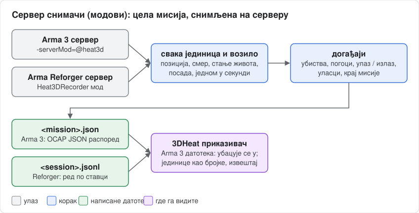

# Модови за снимање на серверу (Arma 3, Arma Reforger) {#server-recorder-mods-arma-3-arma-reforger}

Већину игара посматрач снима на играчевом сопственом рачунару. Arma је другачија: сервер може да сними целу мисију – сваку јединицу и свако возило, не само ваше – помоћу мода који ради на серверу. Играчи ништа не подешавају: Arma 3 мод ради само на серверу, а Reforger сам преузима серверове модове играчима кад се придруже (мод на њиховим рачунарима не ради ништа). Репозиторијум садржи два таква мода, у [`mods/arma3`](https://github.com/Holdi601/3DHeat-Watcher/tree/main/mods/arma3) и [`mods/reforger`](https://github.com/Holdi601/3DHeat-Watcher/tree/main/mods/reforger). Њихови README-ји су потпуна документација; ова страница је преглед.

**Статус: оба још нису испробана у игри.** Arma 3 екстензија је направљена и покретана онако како Arma позива екстензије, а њен излаз је 3DHeat прочитао; њене SQF скрипте још нису покретане у Arma 3. Reforger мод је написан према Bohemia-inom објављеном API-ју скрипти и никад није преведен. Немојте ни један стављати на јавни сервер пре корака за испробавање у њиховим README-јима.

## Arma 3 {#arma-3}

1. Направите екстензију једном по платформи (`mods/arma3/extension`). Потребан је C компајлер: Visual Studio Build Tools на Windows-у, gcc на Linux-у; ако никад нисте ништа компајлирали, питајте свог хоста сервера.
   - Windows, у „x64 Native Tools Command Prompt for VS":
     `cl /nologo /O2 /LD heat3d.c /Fe:heat3d_x64.dll`
   - Linux: `gcc -O2 -shared -fPIC -o heat3d_x64.so heat3d.c -ldl`
2. Направите мод: `python mods/arma3/build.py` исписује `mods/arma3/@heat3d/` (не треба Arma 3 Tools).
3. Копирајте `@heat3d` у фасциклу сервера и покрените сервер с `-serverMod=@heat3d`.
4. `.rpt` дневник сервера каже `Heat3D recorder 0.1.0: recording <file> every 1 s`.

| Подешавање | Подразумевано | Шта ради |
|---|---|---|
| `captureDelay` | 1 | секунди између кадрова |
| `recordHits` | 1 | 0 искључује догађаје погодака |
| `recordShots` | 1 | 0 искључује бројање испаљених метака |
| `minPlayers` | 0 | снима тек кад је толико играча на серверу |

Мисија може да га промени у свом `init.sqf` (`heat3d_captureDelay = 0.5;`). Снимци иду у `recordings/` унутар `@heat3d`, или у `HEAT3D_DIR`.

**Излаз:** један фајл по мисији у OCAP-овом JSON распореду (формат OCAP2 снимача), именован `<date>__<time>_<mission>.json`. Током мисије то је дневник (`.heat3d.part`), исправљен при сваком упису; дневник срушене мисије се доврши кад следећа мисија почне.

## Arma Reforger {#arma-reforger}

Мод (`Heat3DRecorder.gproj`) се отвара и прави у Bohemia-ином Workbench-у (Arma Reforger Tools), проверава на локалном наменском серверу, објављује из Workbench-а (неуврштен док се тестира) и додаје у `mods` листу сервера у `config.json`-у – корак по корак у његовом README-у. Сваке секунде записује положај, правац, стање живота, возило и id играча сваког лика, и положај, правац, стање и посаду сваког возила; и убиства (убица, оружје, даљина), погодке, улажење и излажење из возила, придруживање и напуштање играча и крај мисије.

**Излаз:** један JSON објекат по реду, `$profile:heat3d/<UTC date>_<UTC time>_<world>.jsonl`: ред `header` (формат `heat3d-reforger`, осе x исток, y горе, z север), па редови `entity`, `frame` и `event` како се дешавају, и ред `end`. Редови јединица су `[id, x, y, z, dir, alive, vehicleId, playerId]`, редови возила `[id, x, y, z, dir, alive, [crew ids]]`; догађаји следе OCAP2 распоред догађаја.

## У приказивачу {#in-the-viewer}

Превуците Arma 3 снимак на [3DHeat приказивач](https://holdi601.github.io/3DHeat/): једна мисија је једна сесија, јединице постају војници, возила свој тип, а убиства и погоци иду у списак за брифинг. OCAP2-ов веб плејер га такође пушта. Reforger фајл је сопствени линијски формат мода, с OCAP2 распоредом догађаја.
