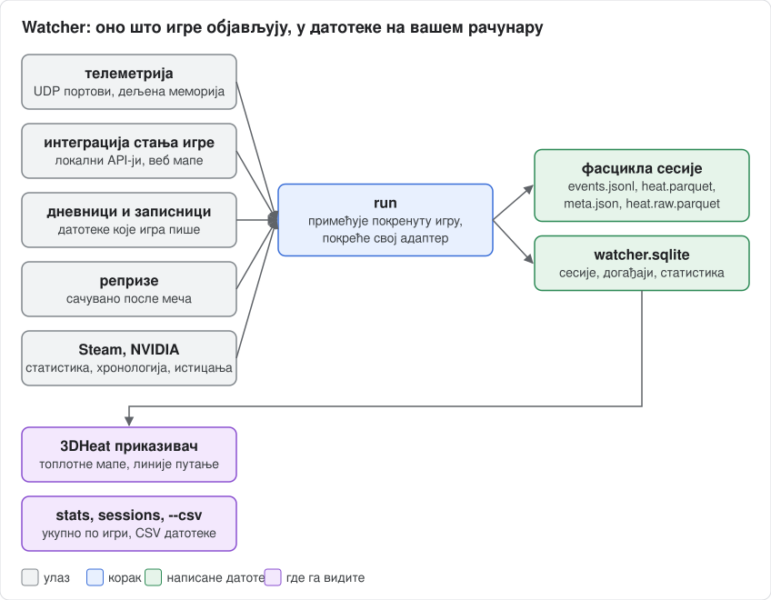

# Извори и правила {#sources-and-rules}

Посматрач снима само оно што игре и платформе дају играчу. Ова страница објашњава који су то извори, шта посматрач сме да ради са сваким, и које игре или делове игара намерно изоставља.

## Шест врста извора {#the-six-kinds-of-source}

Сваки адаптер има `kind` (врсту), а врста одлучује шта адаптер сме да ради:

| Врста | Шта је | Игре за више играча |
|---|---|---|
| `telemetry` | UDP порт или дељена меморија коју игра објављује за табле, покретне платформе и воланске системе (Forza Data Out, F1 UDP, дељена меморија Kunos-а и iRacing-а, SimConnect, X-Plane-ов UDP интерфејс, SCS SDK додатак) | да - то је сопствени излаз игре |
| `gsi` | game-state integration или локални веб API који игра служи играчевом сопственом рачунару (Valve GSI, Live Client Data API League-а, Stats API Rocket League-а, веб мапа War Thunder-а) | да, у оквиру онога што API показује играчу |
| `log` | датотеке које игра пише док ради: дневници, записници, статистика, чувања (Elite Dangerous, Minecraft, Path of Exile, Hearthstone, Star Citizen, EVE Online) | да |
| `replay` | демои и реплеји које игра чува за своје играче, претворени после меча (CS2, Dota 2, osu!, War Thunder, World of Tanks, World of Warships, Squad, League of Legends, VALORANT, IL-2 Tacview) | да, осим ако су шифровани, и само делови који су отворени |
| `platform` | оно што Steam и драјвер графике чувају: статистика, достигнућа, временске линије, клипови и истакнути тренуци | да |
| `memory` | меморија игре, само за читање, по профилу који сте написали | **никад** - само за једног играча |

Само `memory` отвара други процес, и то само за читање. Осталих пет врста читају оно што су игра, Steam или NVIDIA App већ записали или шаљу.

## Како се извори читају {#how-the-sources-are-read}

- **Ништа се не убацује, не хвата и не мења у игри.** Ни један код се не учитава у игру, ни један прозор или унос се не хвата, ни једна датотека игре се не мења. Једине датотеке које посматрач пише ван своје фасцикле са подацима су оне које [`setup --apply`](commands.md#setup) пише кад га замолите: подешавачка датотека саме игре (са оригиналом сачуваним као `<file>.heat3d-backup`), cfg датотека game-state integration-а, скрипта DCS хука, BeamNG протокол мод.
- **Дељена меморија се отвара само за читање и никад се не прави.** Уобичајени Python начин отварања именоване мапе прави је кад још не постоји. Игра покренута после тога би нашла празну, read-only мапу посматрача уместо своје, па би њена телеметрија била мртва. Посматрач отвара мапе само са `OpenFileMappingW` (која налази само постојећу), мапира их са `FILE_MAP_READ`, и покушава касније поново ако их игра још није направила.
- **Портови се позајмљују, никад се не преузимају.** UDP телеметријски порт на коме већ слуша други програм (FH Companion, SimHub, апликација за табле) остаје том програму. Ако други програм почне да слуша порт који посматрач држи, посматрач га пушта у року од неколико секунди. Forza адаптери чекају 15 s после покретања игре пре него што узму порт 5300, и сваки пакет непромењен прослеђују на 127.0.0.1:5301, па и друга Data Out апликација може да снима.
- **Само локално.** Сервери стања игре које посматрач покреће (CS2, Dota 2) слушају на 127.0.0.1 и нигде друго. Кад cfg датотека игре садржи токен (онај који `setup` пише), свака порука мора да га носи; поруке без њега се броје као `bad_auth` и одбацују. Без cfg датотеке са токеном, прихвата се свака локална порука, а дневник то каже. Локални API-ји које посматрач тражи (League на порту 2999, War Thunder на 8111, Rocket League на 49123, X-Plane на 49000) су на 127.0.0.1.
- **Датотеке дневника се деле, никад не закључавају.** Свако читање отвара датотеку са свим дељењима које Windows има и поново је затвара, па игра може да и даље пише, преименује или замени свој дневник.
- **Два спољна сервиса, и само у овим случајевима.** Провера нове верзије пита GitHub (`api.github.com`) највише једном у шест сати и може се искључити (видите [Ажурирања](updates.md)). League адаптер за реплеје пита Riot-ов Match-V5 API само кад сте унели свој `riot_api_key`. Ништа друго се никуда не шаље.
- **Укључивање извора је ваша одлука.** `setup` без `--apply` само каже шта би променио.

## Правила за игре на мрежи {#multiplayer-rules}

- Игра која се игра на мрежи снима се само кроз оно што објављује: телеметрију, API-је стања игре, дневнике, реплеје, платформске датотеке. У оквиру њих, посматрач снима оно што игра приказује играчу, и ништа израчунато преко тога:
  - **CS2 game-state integration** шаље играча кога гледате (вас док сте живи, саиграча после смрти). Положаји осталих играча (`allplayers_*`) шаљу се само посматрачима и GOTV-у, па их посматрач не тражи.
  - **Live Client Data API League of Legends-а** нема положаје. Riot-ова политика дозвољава алатима да приказују оно што играч може да зна из саме игре, и ништа израчунато преко тога (нема непријатељских тајмера). Посматрач снима фид убистава и табелу резултата које играч види, и бројеве самог играча.
  - **Stats API Rocket League-а** нема положаје аутомобила (стање аутомобила се шаље само посматрачима). Оно што има место је лопта, где је ударена, постигнута или погодила пречку.
  - **Веб мапа War Thunder-а** показује оно што показује мини-мапа, без имена и ид-ова.
  - **F1 23/24/25** стављају положај сваког аутомобила у свој Motion пакет, и на мрежи. Игра то сама даје, и задржава само податке играча чији је "Your Telemetry" ограничен.
  - **DCS World**: сервер за више играча може да забрани извоз података сопствене летелице; сесија тада има догађаје али не и положаје, и то каже.
- **Меморија се никад не чита у игри за више играча.** Адаптер меморије за игру означену као игру на мрежи се одбија, а профил мора да каже може ли се његова игра играти на мрежи уопште. Једнокориснички режим игре која има и мрежни режим се чита само док нема везе ни са чим осим са овом машином. Игре чији једнокорисниčki режим ради под античит системом се такође никад не читају. Видите [Читање меморије](memory-reading.md).
- Ознака `multiplayer` на адаптеру (у `games --markdown` приказана као "Online play") одлучује само о читању меморије. Не спречава друге врсте да снимају игру на мрежи.

## Шта се одбија и зашто {#what-is-declined-and-why}

Неке игре, и неки делови игара, се не снимају: њихови подаци су заштићени, нису објављени или их уопште нема на рачунару играча:

| Игра | Шта се изоставља | Зашто |
|---|---|---|
| VALORANT | положаји, називи, резултати у реплејима; крајње тачке lockfile-а клијента | Игрин ток у реплеју је замућен вредностима узетим из извршног програма сваке верзије. Игра ради под Vanguard-ом. Крајње тачке lockfile-а Riot клијента нису објављен API. **Чита се:** оно што реплеј носи у отвореном - мапа, ид меча, агенти, временска линија убистава и кругова сервера. |
| League of Legends | садржај по садржај `.rofl` реплеја; крајње тачке lockfile-а клијента | Замућено против варања, другачије сваке закрпе, и не декодира се. **Чита се:** табела резултата на крају игре коју сваки реплеј носи као обичан JSON, Live Client Data API током меча, и - са вашим развојним кључем - званична Match-V5 временска линија (положаји сваки минут, убиства где су се догодила). |
| Fortnite | реплеји | Шифровани. |
| World of Tanks, World of Warships | реплеји, у посматрачу | Шифровани. Посматрач их не чита; то раде засебни конвертери ван њега (`exporters/ext/wot-replay`, `exporters/ext/wows-replay`), сваки засебан пројекат. **Чита се, уз инсталиран конвертер:** положај сваког возила или брода док га је снимајући клијент знао, и убиства. |
| Gran Turismo 7 | телеметрија | Само за конзоле, а телеметрија је шифрована кључем који је извучен из игре. |
| Apex Legends | све | Његов LiveAPI шаље пуне догађаје само у приватним и прилагођеним лобијима; иначе ништа није доступно локално. |
| Overwatch 2, Call of Duty, Battlefield 6, Hunt: Showdown 1896 | подаци уживо | Нема локалног реплеја, дневника или излаза стања игре за читање. Њихова статистика долази тамо где је Steam чува ([Steam статистика](game-steam-stats.md), [Steam Timeline](game-steam-timeline.md)), а њихови клипови као [NVIDIA highlights](nvidia-highlights.md). |
| Star Citizen | све осим `Game.log` | Покреће Easy Anti-Cheat; посматрач чита само датотеку дневника коју игра пише и никад не прилази процесу игре. |
| osu!lazer | реплеји | Чувају се у сопственом складишту игре; читају се само `.osr` датотеке osu! (стабилне верзије). |
| Свака игра за више играча | меморија | Никад. Једнокорисничке игре чији режим ради под античит системом (GTA V, Elden Ring преко свог покретача) се такође не читају. |

Шифровани реплеји се не отварају: VALORANT читач проверава заставицу шифровања реплеја и одбија шифровану датотеку ("this replay is encrypted; it is not read").

Игре истражене, али још не направљене (Deadlock реплеји, Rocket League `.replay` датотеке, StarCraft II, Team Fortress 2, Rainbow Six Siege, Beat Saber, Trackmania, неколико тркачких симулатора) наведене су са својим изворима у [Све игре у једној табели](watcher.md#researched-not-yet-built). Свакој треба узорци датотека на којима ће се проверити пре испоруке.
