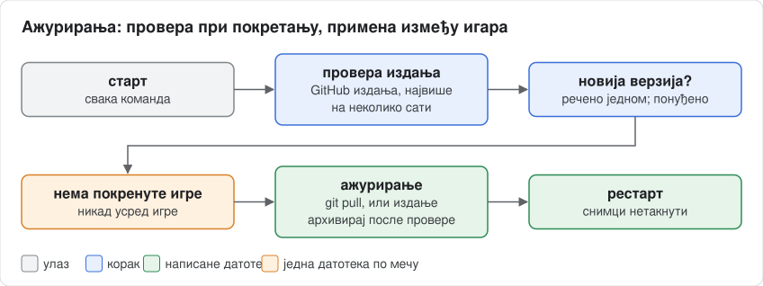

# Ажурирања {#updates}

Посматрач се сам држи актуелним према издањима [Holdi601/3DHeat-Watcher](https://github.com/Holdi601/3DHeat-Watcher/releases). Ажурирач је пакет `heat3d_update`, поред `heat3d_watch` у репозиторијуму.

## Провера {#the-check}

- **Кад**: свака команда осим `update` проверава кад почне. `run` проверава и док ради, највише једном на сат и само док ниједна игра не ради.
- **Како**: један HTTPS захтев ка `https://api.github.com/repos/Holdi601/3DHeat-Watcher/releases/latest`, с временским ограничењем од 5 секунди. Одговор се кешира шест сати у `%LOCALAPPDATA%\3DHeat\update-check-3DHeat-Watcher.json`, па већина покретања ништа не пита. „Још нема издања" (HTTP 404) се кешира као сваки други одговор. Ван мреже, код ограничења броја захтева или иза проксија, провера тихо не успе и команда наставља с верзијом коју има.
- **Верзије**: инсталирана верзија је фајл `VERSION` у фасцикли репозиторијума. Ознака издања (`v1.2.0` или `1.2.0`) пореди се као бројеви, део по део; све после `-` или `+` се занемарује.
- **Искључено**: `HEAT3D_NO_UPDATE=1` (свака вредност осим празне, `0`, `false` или `no`) искључује и проверу и аутоматско ажурирање. Сваки 3DHeat алат има свој кеш фајл, па одговор једног алата никад не важи за други.

## Шта се дешава кад је нови издање изашло {#what-happens-when-a-newer-release-is-out}

- **`run`** при покретању исписује обавештење и наставља да ради: `[heat3d_watch] 3DHeat Watcher 1.2.0 is out (this is 1.0.2). <release page>`. Док ради, с укљученим `auto_update` (подразумевано) и без покренуте игре, ажурира се сам: ред у логу `3DHeat Watcher 1.2.0 is out (this is 1.0.2); updating`, Windows обавештење „Updating to 1.2.0", ажурирање, свака адаптер заустављена и њене сесије затворене, па иста команда поново покренута на новом коду. Посматрач се никад не ажурира усред игре. Ако ажурирање не може да се примени, обавештење то каже („1.2.0 is out; not updated: ..."), а посматрач наставља да ради стару верзију. Са искљученим `auto_update` остаје само обавештење.
- **Остале команде** питају `Update now? [Y/n]` кад раде у терминалу. Enter, `y`, `yes`, `j` или `ja` ажурира и затим покреће исту команду поново на новој верзији. Без терминала (заказано покретање, цев) исписују како се ажурира и настављају.
- **На захтев**: `python -m heat3d_watch update` (или `python -m heat3d_update`) пита GitHub без кеша и ажурира. `--check` само каже да ли је нови издање изашло. Ово ради и кад је `HEAT3D_NO_UPDATE` постављен.

## Како се ажурирање примењује {#how-an-update-is-applied}

Зависи од тога како је копија инсталирана:

- **Git клон** (фасцикла има `.git` и `git` је на PATH-у): `git pull --ff-only`. Ово се одбија док клон има промене у праћеним фајловима (`git status --porcelain --untracked-files=no` није празно): то су туђи радови, а ажурирање не одлучује шта се с њима дешава. Сачувајте их (commit) или сакријте (stash), па повуците.
- **Преузета копија**: архива изворног кода издања се преузме и распакује у привремену фасциклу. Ставке које би изашле ван ње се прескачу. `VERSION` архиве мора бити верзија коју издање тврди, иначе се ништа не копира. Затим се њени фајлови копирају преко фасцикле репозиторијума. Фајлови који нису део издања – снимци, подешавања, виртуелна окружења, извози, све што сте сами направили – се не дирају. Python модул који је старије издање имало, а нови га нема, уклања се из пакета издања (`heat3d_watch`, `heat3d_update`), па ниједан застарели модул адаптера не учитава после ажурирања; ништа ван тих пакета се не уклања.

Снимци и подешавања иначе живе ван фасцикле репозиторијума (`%LOCALAPPDATA%\3DHeat\Watcher`), па ажурирање до њих никад не дође.

После ажурирања иста команда се покреће поново. На Windows-у посматрач покреће нови процес, чека га и предаје његов излазни код даље, па се конзола понаша као да је први процес обавио посао.
