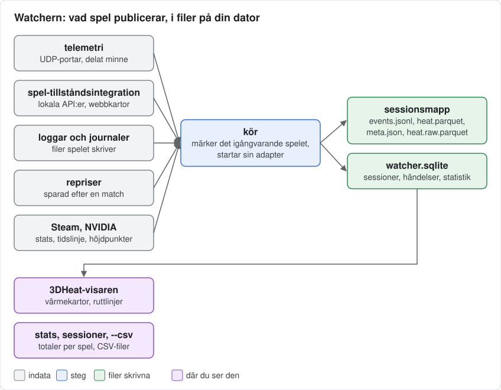
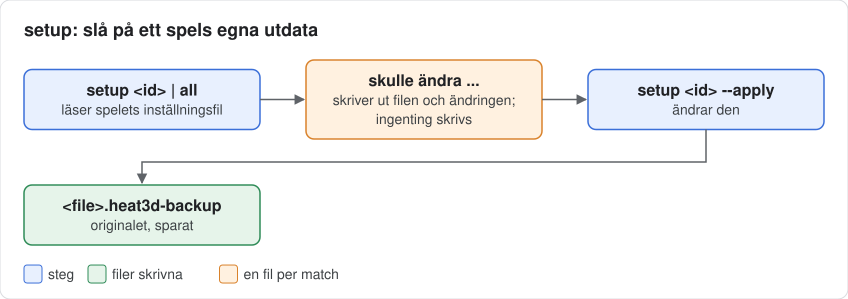
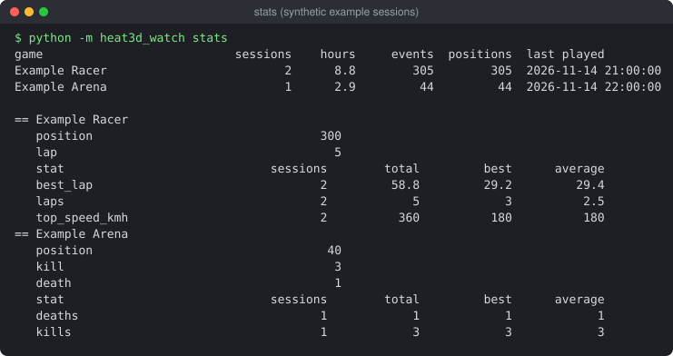
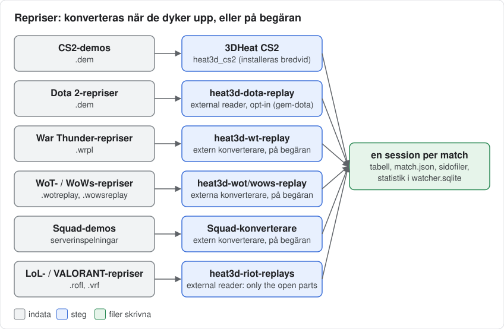
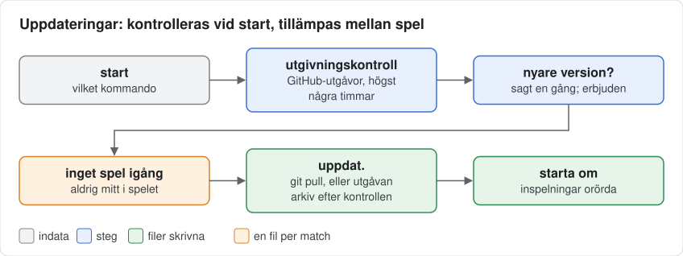

# Kommandon {#commands}

Ny i kommandoraden? Läs [Innan du börjar](before-you-start.md) först. Varje kommando skrivs i en terminal som är öppnad i mappen du packade upp eller klonade (i Utforskaren skriver du `powershell` i adressfältet), så här:

```bash
python -m heat3d_watch <command> [options]
```


| Kommando | Vad det gör |
|---|---|
| [`run`](#run) | bevakar i bakgrunden och spelar in varje spel som körs |
| [`games`](#games) | vad varje spel ger och varifrån |
| [`setup`](#setup) | slår på ett spels egen utdata |
| [`status`](#status) | vilka spel som körs nu, och vilka adaptrar som skulle köras |
| [`sessions`](#sessions) | inspelningarna hittills |
| [`stats`](#stats) | summor per spel, eller tabellerna som CSV |
| [`table`](#table) | bygger om en sessions `heat.parquet` från dess `events.jsonl` |
| [`replays`](#replays) | konverterar replayerna som redan finns på disken |
| [`dota-replay`](#dota-replay) | hämtar en publik Dota 2-matchs replay med dess id |
| [`dota-map`](#dota-map) | Dota 2-kartan från din installation som en 3D-nivå, med det separata verktyget 3DHeat Dota |
| [`update`](#update) | uppdaterar till den senaste utgåvan |
| [`config`](#config) | visar eller ändrar inställningarna |

Alternativ för varje kommando: `-h` / `--help` skriver ut hjälpen, och `python -m heat3d_watch --version` skriver ut versionen (filen `VERSION`).

Bilderna på den här sidan är körningar på syntetiska exempelsessioner (`Example Racer`, `Example Arena`), inte på riktiga inspelningar.

Varje kommando utom `update` letar först efter en nyare utgåva (högst var sjätte timme; hoppas över med `HEAT3D_NO_UPDATE=1`, se [Uppdateringar](updates.md)). `run` skriver bara ut ett meddelande. De andra kommandona frågar `Update now? [Y/n]` när de körs i en terminal, och skriver ut hur man uppdaterar när de inte kan fråga. Utdata är UTF-8, så spelnamn på vilket skriptspråk som helst visas i vilken konsol som helst.

## run {#run}

```bash
python -m heat3d_watch run [--once] [-v]
```



Bevakar tills den stoppas (Ctrl+C): var `scan_seconds` läser den processlistan och kör en adapter för varje spel den hittar, plus de alltid påslagna adaptrarna. Innan första kollen avslutar den de sessioner som en tidigare körning lämnade öppna. Medan inget spel körs kan den uppdatera sig själv (med `auto_update` påslagen). Detaljerna finns i [Installera och köra](installing-and-running.md#running).

| Alternativ | Effekt |
|---|---|
| `--once` | en kontroll av de spel som körs, och sedan avslut. Adaptrarna för spelen som körs nu (och de alltid påslagna) startas, var och en läser en gång (högst 10 sekunder väntas på det), och sedan stoppas alla på samma sätt som när ett spel avslutas: deras sessioner stängs, skrivs och räknas. För att kontrollera upptäckten, inte för inspelning. |
| `-v`, `--verbose` | felsökningsrader i `watcher.log` och på konsolen |

`run` skriver `<data>\watcher.lock` och vägrar starta en andra gång för samma datamapp (avslutskod 1); se [Låsfilen](installing-and-running.md#the-lock-file).

## games {#games}

```bash
python -m heat3d_watch games [--markdown]
```


Listar varje adapter sorterad efter spel: dess namn, id och typ, varifrån den läser, vad den spelar in och hur den slås på. En adapter som inte kan köra på den här datorn markeras med `[unavailable: <why>]`, till exempel SimConnect.dll hittades inte, ingen Minecraft-mapp, 3DHeat CS2 inte installerat, Steam eller NVIDIA-appen hittades inte. En adaptermodul som inte gick att importera nämns sist, med felet.

```text
EA SPORTS F1 25  (f1-25, telemetry)
    from: UDP telemetry 127.0.0.1:20777 (Documents\My Games\F1 25\hardwaresettings\hardware_settings_config.xml)
    - every car's position (world XYZ, m) at 10 Hz, by driver name, team, own car marked, ...
    switch on: In the game: Settings > Telemetry Settings > UDP Telemetry On, IP 127.0.0.1, port 20777 - ...
```

`--markdown` skriver ut samma sak som en Markdown-tabell (spel, vad som spelas in, varifrån, hur det slås på, onlinespel, kontrollerat). Tabellen i [Alla spel i en tabell](watcher.md) är den utdatan. Cellerna är escapade för Markdown: text i backticks förblir en kodsnutt, och utanför dem skrivs `<`, `>`, `&`, `*`, `|` och ett backslash före skiljetecken så att de visas som de skrivs (`<CS2>` skulle annars försvinna som en HTML-tagg i kramdown). Den enda HTML-delen är `<br>` mellan posterna i "What is recorded".

## setup {#setup}

```bash
python -m heat3d_watch setup <adapter id | all> [--apply]
```




Slår på ett spels egen utdata, där spelet behöver att en fil ändras för det. Utan `--apply` ändras ingenting: varje rad säger vad som skulle ändras, och om något skulle ändras säger sista raden `Nothing was changed. Run again with --apply to make these changes.` När inget skulle ändras säger den `<id>: nothing to change` (`Nothing to change.` för `all`). Med `--apply` görs ändringarna, och innan en fil ändras för första gången sparas originalet som `<file>.heat3d-backup`. En backup som redan finns skrivs aldrig över, så den innehåller alltid filen så som den var innan watchern första gången rörde den.

```text
f1-25: would change: hardware_settings_config.xml <udp>: enabled="false" -> "true"
Nothing was changed. Run again with --apply to make these changes.
```

`all` kör setup för varje adapter som har en. En adapter utan setup, nämnd på egen hand, skriver `<id>: nothing for setup to change; ` följt av hur spelet slås på (dess `enable`-text, eller att den inte behöver något). Ett okänt id skriver `no adapter '<id>'; games lists them` och avslutar med kod 2. Adaptrarna som har något att ställa in:

| Adapter | Vad `--apply` ändrar |
|---|---|
| `beamng` | installerar protokollmodden `heat3d` i BeamNGs användarmapp `mods` (bara om den inte finns där); slå sedan på Options > Other > Protocols > "others" i spelet |
| `cs2-gsi` | skriver `<CS2>\game\csgo\cfg\gamestate_integration_heat3d.cfg`: skicka spelstatus till `http://127.0.0.1:3311/` med en slumpad token som watchern sedan kräver (en token som redan finns i filen behålls); CS2 läser den när det startar |
| `dota2-gsi` | samma sak för Dota 2: `<Dota>\game\dota\cfg\gamestate_integration\gamestate_integration_heat3d.cfg`, port 3312 |
| `dcs` | lägger till `Scripts\Hooks\heat3d-watch.lua` i varje mapp `%USERPROFILE%\Saved Games\DCS*`. Dess egen äldre kopia uppdateras; en fil med det namnet som watchern inte skrev lämnas orörd. Starta om DCS. |
| `dirt-rally-2` | `hardware_settings_config.xml`: `<udp enabled="true" extradata="3" ip="127.0.0.1" port="20777">`; starta spelet en gång först så att filen finns |
| `ea-wrc` | `Documents\My Games\WRC\telemetry\config.json`: paketet `session_update` i strukturen `wrc` påslaget, till den här datorn |
| `f1-23`, `f1-24`, `f1-25` | `hardware_settings_config.xml`: `<udp enabled="true" ip="127.0.0.1" port="20777">`; spelet måste vara stängt |
| `hearthstone` | lägger till en sektion `[Power]` (`LogLevel=1`, `FilePrinting=true`) i `%LOCALAPPDATA%\Blizzard\Hearthstone\log.config`; starta om spelet |
| `il2` | `<game>\data\startup.cfg`, `[KEY = telemetrydevice]`: ett mål till `addrN = "127.0.0.1:41995"` och `enable = true` (sektionen läggs till, med 10 Hz, om den saknas); starta om IL-2 |
| `il2-tacview` | `<game>\data\startup.cfg`, `[KEY = track_record]`: `tacviewrecord = 1` |
| `rocketleague-stats` | `TAStatsAPI.ini` (eller `DefaultStatsAPI.ini` när den inte finns) i `<RL>\TAGame\Config`: `PacketSendRate=30` när API:et är av, och `Port` när ingen är satt; läses när Rocket League startar |

`richard-burns-rally` har ingen setup: dess telemetri kommer från RSF/NGP-pluginen, som slås på för hand i `RichardBurnsRally.ini` (se [dess sida](game-richard-burns-rally.md)); `setup richard-burns-rally` säger det. Alla andra spel behöver antingen inget eller slås på i spelet; varje spels sida säger hur.

## status {#status}

```bash
python -m heat3d_watch status
```

```text
3DHeat Watcher 1.0.2; data in C:\Users\...\AppData\Local\3DHeat\Watcher
Games running: EA SPORTS F1 25 (f1-25)
Always on: il2-tacview, steam-stats, steam-timeline, nvidia-highlights, cs2-demos, lol-replays, valorant-replays
```

Säger vilka adaptrar en `run` skulle starta nu, enligt samma regler: spelets process körs, adaptern finns inte i `disabled`, inget den behöver saknas, replayadaptrar bara med `replays` på, minnesadaptrar bara med `memory` på och alla minneskontroller godkända. Den startar inget.

## sessions {#sessions}

```bash
python -m heat3d_watch sessions [--game NAME] [--limit N]
```


De senaste sessionerna från `watcher.sqlite`, en rad var: start (lokal tid), spel, minuter, händelser, positioner, mapp.

| Alternativ | Effekt |
|---|---|
| `--game NAME` | bara det här spelet, med dess exakta namn som i listan (`"EA SPORTS F1 25"`) |
| `--limit N` | högst N sessioner (standard 40) |

## stats {#stats}

```bash
python -m heat3d_watch stats [--game NAME] [--csv DIR]
```



Utan alternativ: en tabell över varje spel (sessioner, timmar, händelser, positioner, senast spelat), mest spelade först, och sedan för varje spel dess 25 vanligaste händelser och varje numerisk statistik med antalet sessioner som har den, summan, det bästa värdet (`best`) och medelvärdet. `best` vet vilket håll som är bättre: lägsta värdet för tider som sparas som bästa (`best_lap`, `best_stage` och alla andra nycklar som börjar med `best_`) och för placeringar (`race_position`, `grid_position`, alla nycklar som slutar med `_position`), högsta för allt annat (kills, distans, högsta hastighet, ett spels egna räknare).

| Alternativ | Effekt |
|---|---|
| `--game NAME` | bara det spelets händelser och statistik, utan översikten |
| `--csv DIR` | skriver `sessions.csv`, `events.csv` och `stats.csv` (varje rad i de tre tabellerna) till `DIR` i stället; `--game` begränsar inte det |

## table {#table}

```bash
python -m heat3d_watch table <session folder>
```


Bygger om `heat.parquet` i en sessionsmapp från dess `events.jsonl`, med axlarna från dess `meta.json`. Skriver tabellens sökväg, eller `no positions in this session`. Använd det för en session som spelades in medan `pyarrow` saknades, eller efter att du redigerat `events.jsonl` för hand.

## replays {#replays}

```bash
python -m heat3d_watch replays <adapter id> [folder] [-v]
```



Konverterar de replayer som redan finns på disken, nu, en efter en, var och en till en session precis som bevakningen i mappen gör. Första gången watchern ser en replaymapp noterar den bara vad som finns i den (se [Installera och köra](installing-and-running.md#replays-already-on-disk)); så konverteras de på begäran. Utan `folder` läses adapterns egna mappar (spelets, plus `replay_folders`); med den läses replayerna i den mappen. Varje konverterad replay noteras som sedd, så den körande watchern konverterar den inte igen. En replay som inte går att konvertera loggas och hoppas över.

| Adapter | Replayer |
|---|---|
| `cs2-demos` | Counter-Strike 2-demon (`*.dem`), via 3DHeat CS2 |
| `lol-replays` | League of Legends-replayer (`*.rofl`), via den externa läsaren `heat3d-riot-replays` (3DHeat-Ext-Riot) |
| `valorant-replays` | VALORANT-replayer (`*.vrf`), via den externa läsaren `heat3d-riot-replays` (3DHeat-Ext-Riot) |
| `warthunder-replays` | War Thunder-replayer (`*.wrpl`), via den externa konverteraren `heat3d-wt-replay` (exporters/ext/warthunder-replay) |
| `wot-replays` | World of Tanks-replayer (`*.wotreplay`), via den externa konverteraren `heat3d-wot-replay` (exporters/ext/wot-replay) |
| `wows-replays` | World of Warships-replayer (`*.wowsreplay`), via den externa konverteraren `heat3d-wows-replay` (exporters/ext/wows-replay) |
| `dota-replays` | Dota 2-replayer (`*.dem`), via den externa läsaren `heat3d-dota-replay` (3DHeat-Ext-DotaReplay) |

```text
lol-replays: converted 12 replay(s); `sessions --game` lists them
```

Ett id som inte är något av dessa skriver `no replay adapter '<id>'` med listan och avslutar med kod 2; det gör också en `folder` som inte finns. En adapter som inte kan köra här (3DHeat CS2 eller spelets läsare inte installerad) skriver varför – var man får läsaren och hur den installeras – och avslutar med kod 1. IL-2:s Tacview-spår finns inte i listan: den adaptern konverterar själv varje färdigt spår den hittar.

## dota-replay {#dota-replay}

```bash
python -m heat3d_watch dota-replay <match id> [<match id> ...] [-o FOLDER] [--convert] [-v]
```

Hämtar replayen av en publik Dota 2-match från Valves replayservrar. Det kräver internet. Match-id är numret på matchens sida i Dota-klienten (matchdetaljerna) eller på OpenDotas webbplats; Valve sparar en replay i några veckor, därefter misslyckas hämtningen. Servern och replayens salt hämtas från OpenDotas post om matchen (`api.opendota.com/api/matches/<id>`, ingen nyckel behövs), filen från `replay<cluster>.valve.net/570/<id>_<salt>.dem.bz2`; den packas upp när den kommer och sparas som `<match id>.dem` (Valve skickar både bzip2 och Zstandard under det namnet). Utan `-o` hamnar den i Dota 2:s egen replaymapp när Dota 2 är installerat – där en körande watcher konverterar den – och annars i `<data>/replays/dota`. En fil som redan finns behålls. `--convert` konverterar de hämtade replayerna med en gång, precis som `replays dota-replays` gör, och noterar dem som sedda; det kräver läsaren för Dota 2-replayer ([3DHeat-Ext-DotaReplay](https://github.com/Holdi601/3DHeat-Ext-DotaReplay), `heat3d-dota-replay`), och utan den säger det var man får den och avslutar med kod 1 innan något hämtas. Själva hämtningen behöver bara watchern.

```text
match 9000000000: C:\Program Files (x86)\Steam\steamapps\common\dota 2 beta\game\dota\replays\9000000000.dem
```

Valve sparar replayer i några veckor; en äldre match skriver `Valve no longer has the replay of match <id>` och avslutar med kod 1. En match som OpenDota inte har sett än har inget salt: meddelandet säger att man ska be OpenDota om det (`curl -X POST https://api.opendota.com/api/request/<id>`) och försöka igen några minuter senare. Privata lobbyer och matcher med en dold profil finns inte alls på replayservrarna.

## dota-map {#dota-map}

```bash
python -m heat3d_watch dota-map [<map>] -o <file.glb> [--game FOLDER] [--source2viewer EXE] [--detail UNITS]
```

Skriver Dota 2-kartan – mark, klippor, vatten, träd och byggnader – som en `.glb`-nivå i det koordinatsystem som Dota-replaytabellerna ritas i, från din egen Dota 2-installation. Watchern läser inte spelets filer själv: den kör det separata verktyget **3DHeat Dota** (`heat3d-dota-maps level`, [3DHeat-Ext-Dota](https://github.com/Holdi601/3DHeat-Ext-Dota)) med dessa alternativ och skickar vidare dess utdata och avslutskod. `<map>` är `dota` som standard; `--game` är Dota 2-mappen när den inte ligger i ett Steam-bibliotek; `--source2viewer` sökvägen till Source2Viewers kommandorad, som verktyget behöver; `--detail` cellen för gruppering av hörnpunkter för byggnader i spelenheter (standard 8, 0 behåller varje triangel). När verktyget inte är installerat skriver den `dota-map: the Dota 2 map converter is not installed: ...` med var man får det och avslutar med kod 2. Mer: [Dota 2-kartan](dota-map.md).

## update {#update}

```bash
python -m heat3d_watch update [--check]
```



Frågar GitHub efter den senaste utgåvan och bortser från det cachade svaret, och uppdaterar den här kopian när den är nyare (se [Uppdateringar](updates.md)). `--check` säger bara om en nyare utgåva finns. Det här kommandot körs även med `HEAT3D_NO_UPDATE` satt: att du begär det är beslutet. `python -m heat3d_update [--check]` gör samma sak.

## config {#config}

```bash
python -m heat3d_watch config [--set KEY=VALUE ...]
```


Skriver ut varje inställning som `key = value`. Med `--set` ändras de angivna först, och `settings.json` sparas (`saved <path>`). Värdena läses efter inställningens typ:

- sant/falskt-inställningar: `1`, `true`, `yes`, `on` eller `ja` är sant; `0`, `false`, `no`, `off`, `nein` eller ingenting är falskt;
- tal: ett decimaltal (`scan_seconds=5`);
- listor: kommaseparerade eller en JSON-lista (`disabled=steam-stats,steam-timeline`; ett tomt värde rensar listan);
- ordböcker (`replay_folders`, `player_names`): hela ordboken som JSON, eller en post som `KEY.ID=VALUE` – `replay_folders.cs2-demos=D:\Demos,E:\More Demos` sätter den adapterns mappar (kommaseparerade), `player_names.warthunder-webmap=Name` adapterns namn; ett tomt värde tar bort posten;
- text: så som det anges (`data=D:\Heat`, `riot_id=Name#TAG`).

```bash
python -m heat3d_watch config --set memory=true scan_seconds=5
python -m heat3d_watch config --set riot_id=Name#TAG riot_platform=EUW1
python -m heat3d_watch config --set replay_folders.cs2-demos=D:\Demos player_names.rocketleague-stats=Name
```

En okänd nyckel skriver `no setting '<key>'`, och ett värde som inte är av inställningens typ (`memory=perhaps`, `scan_seconds=often`, en ordbok som inte är JSON) skriver `not saved: ...`; båda avslutar med kod 2 utan att spara något. En `settings.json` som redigerats för hand läses på samma sätt: ett värde som text där inställningen är ett tal, ett sant/falskt-värde eller en ordbok läses som det skrivs, och ett som inte går att läsa lämnas på sitt standardvärde. Varje inställning beskrivs i [Installera och köra](installing-and-running.md#settings).
