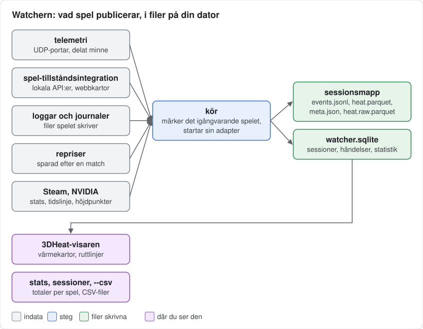

# 3DHeat Watcher {#dheat-watcher}

**Vad är det?** Du spelar ett spel. Det här programmet skriver tyst ner var du var och vad som hände.
Senare kan du titta på det som en färgad karta i 3DHeat-visaren.

**Varför skulle jag använda det?** För att föra din egen logg över varje spelsession - var du körde, flög eller
stred, dina totaler per spel - utan någon webbplats och utan att ändra spelet.

**Exempel:** du kör ett varv i ett racingspel med watchern igång; sedan innehåller en fil i
`sessions\<game>\` linjen du tog, och visaren ritar den.

Mer i detalj: 3DHeat Watcher är ett bakgrundsprogram som spelar in vad spel publicerar om ditt spelande - var du
var, vad som hände var, och siffrorna bakom det - i filer på din egen dator. Filerna är
för din egen statistik och för värmekartorna och rutterna i 3DHeat-visaren.

Det körs tyst, märker vilket spel du startade, och läser det spelets egna utdata: en telemetriport
eller delat minne som spelet publicerar för instrumentpaneler, en spel-tillståndsintegration, journalen eller loggen
spelet skriver, repriset det sparar efter en match, statistiken Steam för, klippen
NVIDIA-appen sparar. Inspelningar stannar på din dator. Programmet kontaktar bara två externa tjänster, och bara i
dessa fall: GitHub, för att leta efter en nyare utgåva (se [Uppdateringar](../updates.md)), och Riots Match-V5 API,
och bara om du anger din egen Riot API-nyckel (se [League of Legends-repriser](../game-lol-replays.md)).



## Vad den spelar in {#what-it-records}

- **Positioner**: bilen, flygplanet, hjälten eller spelaren, flera gånger per sekund där spelet publicerar dem,
  med fart, riktning och allt annat spelet skickar med dem.
- **Händelser**: uppkomster, dödsfall, dödanden, varv, etapper, ronder, mål, uppdrag, start och landningar, zonbyten,
  prestationer, höjdpunkter. Varje händelse sparas med sin tid, och med sin plats när spelet ger en.
- **Statistik per session**: dödanden, dödsfall, varv, bästa varv, sträcka, högsta fart, speltid, och spelets egen
  statistik där den förs.

Vad varje spel ger, och varifrån, står på dess egen sida under [Spel](../games.md). En källa kan inte
spela in allt: multiplayerspel spelas bara in genom vad de publicerar, och watchern läser aldrig deras minne
(se [Källor och regler](../sources-and-rules.md)).

## Installation {#install}

Har du aldrig använt kommandoraden förut? Läs [Innan du börjar](before-you-start.md) först.

Watchern är ett Python-program för Windows (Python 3.10 eller senare). Många av dess källor finns bara på Windows: delat
minne, registret, Windows-notiser.

```bash
git clone https://github.com/Holdi601/3DHeat-Watcher.git
cd 3DHeat-Watcher
pip install -r requirements.txt
```

En nedladdad utgivningsarkiv fungerar likadant: packa upp den, kör sedan `pip install -r requirements.txt`
i mappen. Detaljerna, och de tillägg vissa spel behöver, finns i
[Installera och köra](../installing-and-running.md).

## Snabbstart {#quick-start}

```bash
python -m heat3d_watch games            # vad varje spel ger, och varifrån
python -m heat3d_watch setup all        # vad som skulle behöva slås på (inget ändras)
python -m heat3d_watch setup f1-25 --apply   # slå på ett spels utdata (originalfilen säkerhetskopieras)
python -m heat3d_watch run              # titta; låt det köra medan du spelar
python -m heat3d_watch stats            # totaler per spel
python -m heat3d_watch stats --csv out  # sessioner, händelser och statistik som CSV-filer
```

Du bör se: efter `games` en tabell med en rad per spel; `run` fortsätter tills du trycker på Ctrl+C eller stänger fönstret.

Allt skrivs till `%LOCALAPPDATA%\3DHeat\Watcher`. För att använda en annan mapp, ange
miljövariabeln `HEAT3D_WATCH_HOME` eller kör `python -m heat3d_watch config --set data=D:\somewhere`.

- `sessions\<game>\<date>_<adapter>\` - en mapp per session, med `events.jsonl` (varje händelse
  när den sker), `heat.parquet` (raderna med en position, redo för 3DHeat-visaren) och
  `meta.json` (spel, källa, axlar, antal, statistik)
- `watcher.sqlite` - statistiken för varje session, i tre enkla tabeller
- `watcher.log` - vad watchern gjorde

Visaren öppnar en sessions `heat.parquet` direkt, utan att du behöver ställa in något (dess axlar och enheter finns i
filen). Konverterade repriser skrivs som tabeller och matchdokument bredvid den; visarens egna
format med en fil per match beskrivs på dess sida [`.3dheat`-behållaren](https://holdi601.github.io/3DHeat/container.html),
och varje tabells kolumner i [Datan](../the-data.md).

## Dokumentationen {#the-documentation}

| Sida | Vad den täcker |
|---|---|
| [Innan du börjar](before-you-start.md) | Python, en terminal, platshållare, hur lyckat och de vanliga felen ser ut |
| [Installera och köra](../installing-and-running.md) | krav, körning i bakgrunden, start med Windows, låsfilen, loggen, alla inställningar och miljövariabler |
| [Spel](../games.md) | en sida per spel: vad som spelas in, varifrån, hur man slår på det, hur det fungerar, axlar, statistik, vad som verifierats |
| [Datan](../the-data.md) | sessionsmappar, `events.jsonl`, `heat.parquet` och dess sidfot, `meta.json`, `watcher.sqlite`, återställning efter krasch, CSV-export, öppna en session i 3DHeat-visaren |
| [Kommandon](../commands.md) | varje kommando och alternativ i `python -m heat3d_watch` |
| [Källor och regler](../sources-and-rules.md) | de sex sorternas källor, reglerna för multiplayer, vilka spel som utelämnas och varför |
| [NVIDIA Highlights](../nvidia-highlights.md) | vad NVIDIA Highlights kan och inte kan leverera, och hur en höjdpunkt får en position |
| [Server-inspelningsmoder](../server-mods.md) | Arma 3- och Arma Reforger-servermoderna som spelar in hela uppdrag för visaren |
| [Läsa minne](../memory-reading.md) | enspelarprofiler för minne: formatet, kontrollerna, hur man skriver och verifierar en |
| [Uppdateringar](../updates.md) | hur watchern söker efter nya utgåvor och uppdaterar sig själv |
| [Utveckling](../development.md) | att skriva en adapter: API:et, tester, en ärlig `verified`, att generera spelsidorna på nytt |
| [Alla spel i en tabell](../watcher.md) | varje spel i en tabell, som `games --markdown` skriver ut, plus spelen som undersökts men ännu inte byggts |
| [Kommandoreferens](../cli-reference.md) | varje kommandos `--help`, genererat från koden |
| [Underhålla](../maintaining.md) | utgivningschecklistan för de här sidorna |

## En del av 3DHeat {#part-of-3dheat}

3DHeat Watcher är ett av de fria verktygen runt 3DHeat-visaren (watchern använder 3DHeat CS2
för att konvertera CS2-demos). Vart och ett är ett eget projekt, med egna utgåvor och egen licens:

| Verktyg | Vad det gör | Dokumentation |
|---|---|---|
| [3DHeat](https://github.com/Holdi601/3DHeat) | visaren: värmekartor, Racinganalys och matchgenomgång i 3D | [webbplats](https://holdi601.github.io/3DHeat/) |
| [GameFiles](https://github.com/Holdi601/3DHeat-GameFiles) | banor och nivåer ur de filer spel levererar, som 3D-modeller | [webbplats](https://holdi601.github.io/3DHeat-GameFiles/) |
| [GameCapture](https://github.com/Holdi601/3DHeat-GameCapture) | varvtelemetri från racingspel; nivåer återskapade från spelvideo | [webbplats](https://holdi601.github.io/3DHeat-GameCapture/) |
| [Unreal Exporter](https://github.com/Holdi601/3DHeat-UnrealExporter) | ett Unreal Editor-tillägg som exporterar en nivå som en 3D-modell | [webbplats](https://holdi601.github.io/3DHeat-UnrealExporter/) |
| [CS2](https://github.com/Holdi601/3DHeat-CS2) | Counter-Strike 2-demos till tabeller och matchdokument; kartor till 3D-modeller | [webbplats](https://holdi601.github.io/3DHeat-CS2/) |
| [Watcher](https://github.com/Holdi601/3DHeat-Watcher) | spelar in vad spel publicerar om ditt spelande, i bakgrunden | [webbplats](https://holdi601.github.io/3DHeat-Watcher/) |
| [Ext-WarThunder](https://github.com/Holdi601/3DHeat-Ext-WarThunder) | War Thunder-repriser till tabeller och matchdokument | [webbplats](https://holdi601.github.io/3DHeat-Ext-WarThunder/) |
| [Ext-WoT](https://github.com/Holdi601/3DHeat-Ext-WoT) | World of Tanks-repriser till tabeller och matchdokument | [webbplats](https://holdi601.github.io/3DHeat-Ext-WoT/) |
| [Ext-WoWs](https://github.com/Holdi601/3DHeat-Ext-WoWs) | World of Warships-repriser till tabeller och matchdokument | [webbplats](https://holdi601.github.io/3DHeat-Ext-WoWs/) |
| [Ext-Squad](https://github.com/Holdi601/3DHeat-Ext-Squad) | Squad-serverdemos till tabeller och matchdokument | [webbplats](https://holdi601.github.io/3DHeat-Ext-Squad/) |
| [Ext-DCS](https://github.com/Holdi601/3DHeat-Ext-DCS) | DCS World-kartor till 3D-modeller | [webbplats](https://holdi601.github.io/3DHeat-Ext-DCS/) |
| [Ext-IL2](https://github.com/Holdi601/3DHeat-Ext-IL2) | IL-2 Sturmovik-kartor till 3D-modeller | [webbplats](https://holdi601.github.io/3DHeat-Ext-IL2/) |

Licens: MIT ([LICENSE](https://github.com/Holdi601/3DHeat-Watcher/blob/main/LICENSE)). Licenserna
för tredjepartspaketen den använder, och vad spelen den läser kräver, finns i
[LICENSES.md](https://github.com/Holdi601/3DHeat-Watcher/blob/main/LICENSES.md).
