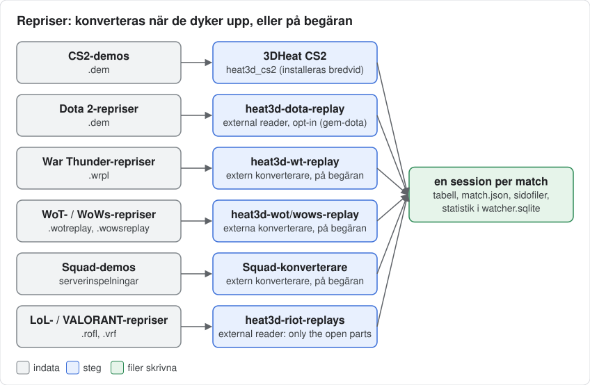

# Installera och köra {#installing-and-running}

## Krav {#requirements}

- **Windows.** Watchern är skriven för Windows, och de flesta av dess källor finns bara där: delat minne som spel skapar (`Local\...`-mappningar), registret (där Steam finns), Windows-notiser, processlistan med sökvägar till körbara filer. På ett annat system startar programmet, men de källorna hittar inget, notiser bara loggas, och minnesläsning vägrar ("only implemented on Windows").
- **Python 3.10 eller senare**, från <https://www.python.org/downloads/>: bocka i **Add python.exe to PATH** i installationsprogrammet, och kontrollera med `python --version` i en ny terminal. Ny i det här? Läs [Innan du börjar](before-you-start.md) först.
- **Paket** (`requirements.txt`): `psutil>=6.0` (vilka spel som körs, vilket program som håller en port, ett spels anslutningar; en äldre psutil fungerar fortfarande, via dess äldre namn för en processs anslutningar), `pyarrow>=15` (skriver `heat.parquet`), `numpy>=1.24` och `pytest>=8.0` för testerna. `requirements-optional.txt` listar för närvarande inga paket.

Utan `pyarrow` spelas sessioner fortfarande in: `events.jsonl` är inspelningen, och tabellen kan byggas senare med [`table`](commands.md#table).

### Tillägg vissa spel behöver {#extras-some-games-need}

| Spel | Vad det behöver |
|---|---|
| Counter-Strike 2-demon | [3DHeat CS2](https://github.com/Holdi601/3DHeat-CS2) och dess beroenden (`demoparser2`). Watchern letar efter det i `HEAT3D_CS2`, sedan i en mapp `3DHeat-CS2` eller `cs2` bredvid watcherns egen mapp, sedan var som helst Python kan importera `heat3d_cs2` från. Utan det listar `games` adaptern som otillgänglig. |
| Microsoft Flight Simulator 2020 / 2024 | `SimConnect.dll` – levereras inte. MSFS 2020 har en i sin installationsmapp; för MSFS 2024, installera MSFS 2024-SDK:t. `MSFS_SDK` / `MSFS2024_SDK` pekar på SDK-mappen. |
| Euro Truck Simulator 2, American Truck Simulator | RenCloud-pluginen `scs-telemetry.dll` (revision 12) i `<game>\bin\win_x64\plugins` |
| BeamNG.drive | protokollmodden `heat3d`, installerad av `python -m heat3d_watch setup beamng --apply` |
| League of Legends (live) | valfritt: Riots rotcertifikat som `<data>\riotgames.pem`, så att den lokala anslutningen verifieras |
| Minecraft | en mapp `%APPDATA%\.minecraft` (Java Edition) |

Varje spels sida under [Spel](games.md) säger vad som måste slås på i själva spelet. `python -m heat3d_watch games` markerar en adapter med `[unavailable: ...]` när något den behöver saknas på datorn.

## Installera {#installing}

Ny i kommandoraden? Läs [Innan du börjar](before-you-start.md) först. Om `pip` inte hittas, använd `python -m pip install -r requirements.txt` i stället.

Från en klon:

```bash
git clone https://github.com/Holdi601/3DHeat-Watcher.git
cd 3DHeat-Watcher
pip install -r requirements.txt
```

Från en utgåva: ladda ner arkivet från förrådets utgåvor, packa upp det och kör sedan `pip install -r requirements.txt` i mappen. Båda sorters kopior uppdaterar sig själva (se [Uppdateringar](updates.md)).

Kör varje kommando från förrådsmappen: `python -m heat3d_watch` importerar paketet därifrån, och uppdateraren (`heat3d_update`) ligger bredvid det.

## Köra {#running}

```bash
python -m heat3d_watch run        # watch until stopped
python -m heat3d_watch run -v     # the same, with debug lines in the log
python -m heat3d_watch run --once # one look at the games running now, then stop and exit
```

Vid start gör `run` följande:

1. skriver [låsfilen](#the-lock-file);
2. avslutar de sessioner en tidigare körning lämnade öppna, till exempel efter en krasch (se [Återställning](the-data.md#recovery-after-a-crash));
3. var `scan_seconds` (2 s) läser den processlistan (bara namn och sökvägar, ingen process öppnas) och startar en adapter, i en egen tråd, för varje spel den hittar. När ett spels process är borta stoppas dess adapter och de sessioner den hade öppna stängs, vilket skriver deras tabell och deras rad i statistiken. Adaptrar som inte väntar på ett spel (Steams statistik, Steam Timeline, NVIDIA-höjdpunkter, replaymapparna) körs hela tiden;
4. medan inget spel körs letar den efter en nyare utgåva högst en gång i timmen (själva svaret cachas i sex timmar) och, med `auto_update` påslagen, installerar den och startar om sig själv (se [Uppdateringar](updates.md)).

En adapter som misslyckas loggas, och stoppar inte de andra. Om en adapters avläsning misslyckas 20 gånger i rad, eller dess start misslyckas, stoppas adaptern och startas inte om förrän spelet startas igen (ett nytt process-id).

Stoppa watchern med Ctrl+C. Adaptrarna stänger sina sessioner innan den avslutas. Om watchern i stället dödas (Aktivitetshanteraren, en krasch, ett strömavbrott) går inget som redan skrivits förlorat: nästa `run` avslutar de sessionerna.

`--once` tar en enda kontroll: den startar adaptrarna för de spel som körs i det ögonblicket (och de alltid påslagna), låter var och en läsa en gång – och väntar högst 10 sekunder på det – och stoppar dem sedan på samma sätt som när ett spel avslutas, så att de sessioner de öppnat stängs, deras tabeller skrivs och deras rader räknas i statistiken innan den avslutas. Använd den för att kontrollera att ett spel upptäcks, inte för att spela in.

### Replayer som redan finns på disken {#replays-already-on-disk}


Första gången en replayadapter ser en av sina mappar, noterar den bara de replayer som redan finns i den: en spelare med år av demon skulle annars få watchern upptagen med konvertering i ett dygn. Från då konverteras varje ny replay en gång, när spelet har skrivit klart den. De gamla konverteras på begäran med [`replays`](commands.md#replays):

```bash
python -m heat3d_watch replays cs2-demos              # every demo in CS2's folders and replay_folders
python -m heat3d_watch replays lol-replays D:\Old     # the replays in one folder
```

### Köra i bakgrunden {#running-in-the-background}

Watchern har inget eget fönster; den är ett konsolprogram som körs tills den stoppas. Den skriver allt till `watcher.log`, så den behöver inte en synlig konsol. Så här håller du den ur vägen:

- starta den i en konsol och minimera konsolen: `start "" /min python -m heat3d_watch run` från `cmd`, i förrådsmappen;
- starta den utan konsol: `pythonw -m heat3d_watch run`. Konsolutdata försvinner, men `watcher.log` skrivs fortfarande. För att stoppa den, avsluta processen `pythonw.exe`; nästa start avslutar då de sessioner den lämnade öppna. Projektet har inte testat det här sättet att köra på.

### Starta med Windows (en idé) {#starting-with-windows-an-idea}

Watchern installerar sig inte själv för att starta med Windows. För att starta den automatiskt:

- **Aktivitetsschemaläggaren**: skapa en uppgift med utlösaren *At log on* och åtgärden *Start a program*, program `pythonw.exe` (eller `python.exe`), argument `-m heat3d_watch run`, *Start in* satt till förrådsmappen;
- **Startmappen**: lägg en genväg i `shell:startup` med samma program, argument och mappen *Start in*.

Varken det är en del av watchern eller testat av den. [Låsfilen](#the-lock-file) ser till att en andra kopia som startas av misstag avslutas direkt.

## Låsfilen {#the-lock-file}

`<data>\watcher.lock` håller process-id:t för den körande watchern. När `run` startar och låsfilen anger en process som fortfarande finns och vars namn innehåller `python`, skriver den

```text
A watcher is already running (process 12345) for C:\Users\...\3DHeat\Watcher.
```

och avslutar med kod 1. Två watchers på samma datamapp skulle spela in varje spel två gånger, och den andra skulle behandla den första watcherns öppna sessioner som rester från en krasch. En låsfil vars process är borta, eller tillhör ett annat program, skrivs över. När `run` slutar tar den bort låsfilen om filen fortfarande anger dess egen process.

## Loggen {#the-log}

`<data>\watcher.log` skrivs bara av `run`; de andra kommandona skriver till konsolen. Varje rad har tiden, nivån och ett meddelande:

```text
2026-05-01 20:15:01,123 INFO watching; data in C:\Users\...\AppData\Local\3DHeat\Watcher
2026-05-01 20:15:03,456 INFO f1-25: starting (EA SPORTS F1 25)
2026-05-01 21:02:11,789 INFO f1-25: stopping
```

Adaptrar loggar vad de inte kan göra och varför: "UDP 20777 is in use by ...; not taking it from that program", "not reading memory: the game is played online", "could not start", "poll failed (3)" med spårningen. `run -v` lägger till felsökningsrader. Filen läggs till i slutet och roteras eller töms aldrig av watchern; ta bort den när du vill. Samma rader går också till konsolen.

## Var allt finns {#where-everything-is}

Hemmappen är `%LOCALAPPDATA%\3DHeat\Watcher`, eller `HEAT3D_WATCH_HOME` när den är satt (utan `LOCALAPPDATA`, till exempel på ett annat system, `~/.local/share/3DHeat/Watcher`). `settings.json` ligger alltid i hemmappen. Allt annat går till datamappen, som är hemmappen om inte inställningen `data` anger en annan:

| Sökväg | Vad det är |
|---|---|
| `<home>\settings.json` | inställningarna |
| `<data>\sessions\` | inspelningarna, en mapp per sittning ([Datan](the-data.md)) |
| `<data>\watcher.sqlite` | statistikdatabasen |
| `<data>\watcher.log` | loggen för `run` |
| `<data>\watcher.lock` | låsfilen, medan `run` körs |
| `<data>\state\` | vad de alltid påslagna och replayadaptrarna redan har sett (`steam-stats.json`, `replays-cs2-demos.json`, ...), så att en omstart inte spelar in något två gånger |
| `<data>\profiles\*.json` | minnesprofiler du skrivit ([Läsa minne](memory-reading.md)) |
| `<data>\riotgames.pem` | valfritt, Riots rotcertifikat för liveadaptern till League of Legends |
| `%LOCALAPPDATA%\3DHeat\update-check-3DHeat-Watcher.json` | det cachade svaret från den senaste utgåvekontrollen |

Watchern raderar ingenting i dessa mappar, förutom en sessionsmapp där inget spelades in (ett spel som stod kvar i sina menyer).

## Inställningar {#settings}


`python -m heat3d_watch config` visar inställningarna; `config --set key=value ...` ändrar dem och sparar `settings.json` (se [config](commands.md#config)). Filen är vanlig JSON och kan också redigeras för hand när watchern inte kör. Okända nycklar i den ignoreras. Inställningarna läses när ett kommando startar, så starta om `run` efter att du ändrat dem.

| Inställning | Standard | Vad den gör |
|---|---|---|
| `data` | `""` | Datamappen. Tom: hemmappen. |
| `disabled` | `[]` | Adapter-id:n som aldrig körs, till exempel `config --set disabled=steam-stats,nvidia-highlights`. Alla andra adaptrar körs när de hittar sitt spel. |
| `auto_update` | `true` | Medan inget spel körs, installera en nyare utgåva och starta om (se [Uppdateringar](updates.md)). `false`: bara en notis i loggen. |
| `scan_seconds` | `2.0` | Sekunder mellan kontrollerna av processlistan. |
| `memory` | `false` | Tillåt minnesadaptrar (enspelarspel med en profil du skrivit) att köra. Av som standard; se [Läsa minne](memory-reading.md). |
| `replays` | `true` | Kör replayadaptrarna: alla (se `python -m heat3d_watch replays` och [Spel](games.md)) – CS2-demon, Dota 2, War Thunder, World of Tanks, World of Warships, Squad, League of Legends- och VALORANT-replayer, IL-2 Tacview-inspelningar. |
| `replay_folders` | `{}` | Extra mappar per adapter-id, till exempel `{"cs2-demos": ["D:\\Demos"]}`. Replayadaptrar bevakar dem utöver spelets egna mappar; `il2-tacview` accepterar också installationsmappar (den tittar då i deras `data\Tracks`); för `elite` ersätter den första mappen journalmappen. Sätt ett adapters mappar med `config --set replay_folders.cs2-demos=D:\Demos,E:\More`, eller hela ordboken som JSON. |
| `riot_id` | `""` | Ditt Riot-ID (`Name#TAG`), så att din egen rad i en League of Legends-replay blir din statistik. Tom: varje spelares rad behålls, ingen markeras som din. |
| `riot_api_key` | `""` | Din egen Riot-utvecklarnyckel för API, för att hämta varje replayad League-matchs officiella tidslinje (positioner varje minut, dödsfall där de skedde). Tom: inget hämtas. |
| `riot_platform` | `"EUW1"` | Ditt League-servers plattformsid (`EUW1`, `EUN1`, `NA1`, `KR`, ...), som används för att hitta den regionala Match-V5-värden. |
| `player_names` | `{}` | Ditt namn i spel vars gränssnitt namnger varje spelare men inte säger vilken som är du, per adapter-id: `warthunder-webmap` (killfeedens rader om dig blir dina kills och dödsfall) och `rocketleague-stats` (dina rader blir `me`; utan den, spelaren spelets kamera följer). Sätt med `config --set player_names.warthunder-webmap=Name`. |

En `settings.json` med alla standardvärden:

```json
{
  "data": "",
  "disabled": [],
  "auto_update": true,
  "scan_seconds": 2.0,
  "memory": false,
  "replays": true,
  "replay_folders": {},
  "riot_id": "",
  "riot_api_key": "",
  "riot_platform": "EUW1",
  "player_names": {}
}
```

## Miljövariabler {#environment-variables}

| Variabel | Effekt |
|---|---|
| `HEAT3D_WATCH_HOME` | hemmappen (inställningarna, och datan om `data` inte säger något annat) |
| `HEAT3D_NO_UPDATE` | ett värde som inte är tomt, `0`, `false` eller `no` stänger av utgåvekontrollen och den automatiska uppdateringen |
| `HEAT3D_NO_TOAST` | ett icke-tomt värde: inga Windows-notiser, bara loggrader |
| `HEAT3D_CS2` | mappen för 3DHeat CS2, för CS2-demon |
| `HEAT3D_CS2_GSI_PORT` | CS2:s port för spelstatus (standard 3311); cfg-filen som `setup` skriver använder den |
| `HEAT3D_DOTA_GSI_PORT` | Dota 2:s port för spelstatus (standard 3312) |
| `MSFS_SDK`, `MSFS2024_SDK` | MSFS-SDK-mapparna, där `SimConnect SDK\lib\SimConnect.dll` letas efter |

Windows-notiser används bara för uppdateringar: "Updating to 1.2.0", eller "1.2.0 is out; not updated: ..." när uppdateringen inte gick att tillämpa. De visas via PowerShells egna notis-API, så ingenting behöver installeras. Rubriken och texten skickas till PowerShell som miljövariabler, aldrig som en del av skriptet.
