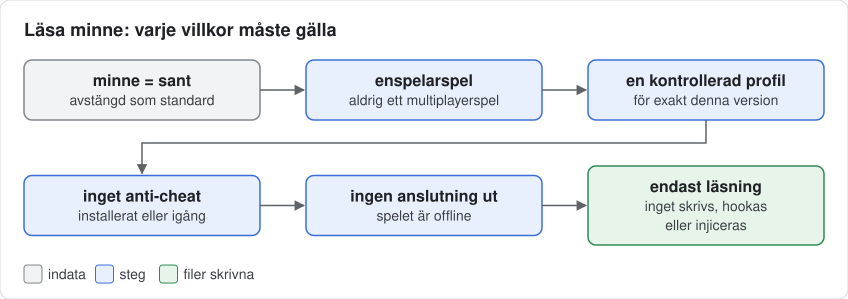

# Läsa minne {#reading-memory}

Vissa enspelarspel berättar inget för andra program. För dem kan watchern – om du slår på det och skriver en profil själv – slå upp var du är i spelets minne, bara läsande.

För enspelarspel som inte publicerar något kan watchern läsa positioner och värden från spelets minne, genom en **profil** som du skriver för din egen version av spelet. Av alla källor är det den enda som spelet inte räckte ut, så den är inhägnad mer än de andra:

- den är **av som standard** (`python -m heat3d_watch config --set memory=true` slår på den);
- den läser, och har inget sätt att skriva;
- **inga profiler levereras med verktygen.**

Profiler levereras inte, eftersom en offset bara stämmer för den version den hittades på. Efter en patch läser en profil som stämde tidigare skräp, och skräp ser precis ut som siffror. En profil måste kontrolleras på den version en spelare har, av den spelaren.

## Kontrollerna, i ordning {#the-checks-in-order}


Varje kontroll nedan måste godkännas. De fyra första görs **innan** spelet öppnas, eftersom det att öppna ett skyddat spel för läsning i sig är något ett anti-cheat märker, och en vägran efteråt skulle komma för sent.

1. **Inställningen**: `memory` är sann. Annars startas aldrig minnesadaptrar.
2. **En profil för spelet**, vars `exe` anger den körande processen. En profil anger om spelet kan spelas online alls (`"online"`); en som utelämnar det avvisas.
3. **Inget anti-cheat i närheten**:
   - ingen anti-cheat-fil i spelets mapp eller upp till tre mappar ovanför den (stoppar vid ett Steam-biblioteks mapp `common`, eller vid en mapp med `steamapps` i sig, eftersom andra spel ligger ovanför den): `EasyAntiCheat`, `EasyAntiCheat_EOS_Setup.exe`, `start_protected_game.exe`, `BattlEye`, `BEClient_x64.dll`, `BEService_x64.exe`, `EAAntiCheat.GameServiceLauncher.exe`, `AntiCheatExpert`, `SGuard64.exe`, `GameGuard`, `GameMon.des`, `XIGNCODE`, `xhunter1.sys`, `Vanguard`, `FACEIT` (jämförs med gemener, också som början på ett namn). Om spelets mapp är okänd vägras spelet;
   - ingen anti-cheat-drivrutin eller -tjänst körs på datorn alls, enligt vad `sc query type= driver state= active` och `sc query type= service state= active` listar: EasyAntiCheat, EasyAntiCheat_EOS, BEService, BEDaisy, vgk, vgc, ACE-BASE, ACE-GAME, xhunter1, FACEIT, FACEITService, EAAntiCheatService, Denuvo Anti-Cheat, npggsvc, Ricochet. Ett kärn-anti-cheat installerat för ett annat spel bevakar fortfarande varje process. Om tjänsterna inte kan listas vägras spelet;
4. **Inte online**: ett spel vars profil säger `"online": true` läses bara medan det inte har någon anslutning till något annat än den här datorn (alla fjärradresser utom `127.x`, `::1`). Om dess anslutningar inte kan läsas vägras det.
5. Sedan, när adaptern startar:
   - **exakt version**: executable-filens storlek, eller dess SHA-256, måste stämma med en version profilen anger. En okänd version läses inte;
   - **modulerna en gång till**: spelets inlästa moduler listas (en Toolhelp-ögonblicksbild, som inte begär några åtkomsträttigheter av sig självt) och kontrolleras för en anti-cheat-klient (`BEClient_x64.dll`, `BEClient.dll`, `EasyAntiCheat_x64.dll`, `EasyAntiCheat.dll`, `EOSAntiCheat...`). En skyddad process vägrar ögonblicksbilden, vilket också är en vägran;
   - först då öppnas processen, med `PROCESS_VM_READ | PROCESS_QUERY_LIMITED_INFORMATION` och ingenting mer.

Kontrollerna 1 till 4 upprepas vid varje skanning (var 2 s) medan spelet kör. Om en av dem börjar fallera (spelet ansluter till en server, en anti-cheat-tjänst startar), stoppas adaptern vid nästa skanning. En vägran loggas: `mem-<id>: not reading memory: <reason>`. Ett fel vid start (okänd version, en anti-cheat-modul, ett mönster som inte hittas) loggas som `mem-<id>: could not start`, och adaptern försöks inte igen förrän spelet startas igen.

Det finns ingen skrivning, ingen allokering i den andra processen, ingen tråd startad i den, inget bibliotek laddat i den, inget felsökningsprivilegium och ingen höjning av rättigheter. Ett test (`test_memory_reading_cannot_write` i `tests/test_core.py`) fallerar om något anrop som skriver till, allokerar i eller kör kod i en annan process – `WriteProcessMemory`, `VirtualAllocEx`, `CreateRemoteThread`, `PROCESS_VM_WRITE`, `SeDebugPrivilege`, `LoadLibrary`, ... – finns någonstans i paketet.

Läs aldrig, oavsett vad en profil säger: spel som spelas online, och enspelarlägen som körs under ett anti-cheat, som GTA V, eller Elden Ring startat via dess startprogram. Kontrollerna ovan vägrar dem ändå.

## Profilformatet {#the-profile-format}

En profil är en JSON-fil i `<data>\profiles\` (`<data>` är datamappen, se [Installera och köra](installing-and-running.md#where-everything-is)), en per spel, med vilket filnamn som helst som slutar med `.json`. Ett syntetiskt exempel:

```json
{
  "schema": "heat3d.memprofile/1",
  "id": "mygame",
  "game": "My Game",
  "exe": "MyGame.exe",
  "online": false,
  "versions": [ { "label": "1.06", "size": 123456789 } ],
  "anchors": {
    "World": { "aob": "48 8B 05 ?? ?? ?? ?? 48 85 C0", "rip": [3, 7] }
  },
  "values": {
    "pos": { "type": "vec3f", "base": "World", "chain": ["0x10", "0x68", "0x70"] },
    "hp":  { "type": "i32",   "base": "World", "chain": ["0x10", "0x138"] },
    "map": { "type": "u32",   "base": "World", "chain": ["0x10", "0x1C0"] }
  },
  "events": [
    { "event": "death", "value": "hp",  "when": "to_zero" },
    { "event": "zone",  "value": "map", "when": "change" }
  ],
  "axes": { "up": "y", "units": "metres" },
  "rate": 10,
  "provenance": [ { "source": "https://example.com/my-notes", "verified_on": "1.06" } ]
}
```

| Nyckel | Krävs | Vad den är |
|---|---|---|
| `schema` | ja | exakt `heat3d.memprofile/1` |
| `id` | ja | kort och stabilt; adaptern kallas `mem-<id>` |
| `game` | ja | spelets namn, som sessionsmappen namnges efter |
| `exe` | ja | det körbara filnamnet, som också säger att spelet körs |
| `online` | ja | `true` om spelet alls kan spelas online; det läses då bara medan det är offline |
| `versions` | ja | de versioner profilen kontrollerats på: var och en med en `label`, och en `size` (den körbara filens storlek i byte) och/eller en `sha256`. När båda anges måste båda stämma. En post med ingetdera matchar ingenting. |
| `anchors` | ja | namngivna adresser i huvudmodulen. `aob`: ett bytemönster, hexbyte separerade med mellanslag, `?` eller `??` för vilken byte som helst; det måste förekomma **exakt en gång** i modulens avbildning (flera träffar räknas som ett fel, precis som ingen). `rip: [d, n]`: mönstret pekar på en instruktion med ett 32-bitars RIP-relativt förskjutningsvärde vid byte `d` och längd `n`; ankaret blir adressen den instruktionen refererar till. `offset`: läggs till efteråt (hex eller decimal text). I stället för `aob` ger `module_offset` en fast offset från modulens bas. |
| `values` | ja | vad som läses vid varje avläsning: `type` (`i32`, `u32`, `i64`, `u64`, `u8`, `f32`, `f64`, `vec3f`, `vec3d`), `base` (ett ankares namn), `chain` (offset som hex eller decimal text) |
| `events` | nej | regler som gör ändringar till händelser: `when` `change` (värdet skiljer sig från förra avläsningen) eller `to_zero` (ett tal faller från över 0 till 0 eller under) |
| `axes` | nej | `up` (standard `y`), `units` (standard `game units`), `scale` (visarens enhetsskala, som multiplicerar varje position; standard 1, spelets egna enheter) |
| `rate` | nej | avläsningar per sekund, 1 till 60 (standard 10) |
| `provenance` | nej | var offseten kommer från och på vilken version du kontrollerade dem; den kopieras till varje sessions `meta.json` |

**Så läses ett värde.** Ankarets adress är utgångspunkten. Om `chain` är tom läses värdet direkt där. Annars läses först pekaren som lagras vid ankaret. Sedan, för varje offset utom den sista, läses pekaren vid `address + offset`. Den sista offseten adderas för att ge värdets adress. En nullpekare på vägen (spelet är mellan nivåer eller i en meny) lämnar värdet tomt för den avläsningen.

**Vad som spelas in.** Ett värde med namnet `pos` (en `vec3f` eller `vec3d`) blir en `position`-rad för spelare `me` vid varje avläsning. Varje händelseregel skriver sin `event`-rad, med det nya värdet och, där `pos` är känd, positionen, och lägger till 1 på en statistik med samma namn. Modulens avbildning läses en gång vid start för att hitta ankaren, i block om 64 KiB; block som inte kan läsas räknas som nollor. Sessionens `meta.json` anger profilen, versionsetiketten och provenansen.

En profil som inte kan användas (felaktig JSON, fel `schema`, en obligatorisk nyckel saknas) hoppas över och loggas som `profile <file> not used: <reason>`. Profiler läses in när watchern startar, så starta om `run` efter att du lagt till eller ändrat en.

## Skriva och kontrollera en profil {#writing-and-verifying-a-profile}

1. **Bara för ett enspelarspel utan anti-cheat.** Om spelet har ett anti-cheat, eller du spelar det online, sluta här: watchern vägrar det, och det ska den.
2. **Hitta värdena på din egen version.** Arbeta offline. Använd egna felsökningsverktyg, eller publicerade anteckningar om spelet, för att hitta spelarens position och de värden du bryr dig om, och en pekarväg till var och en från en statisk plats i den körbara filen. Föredra ett bytemönster (`aob`) framför en fast `module_offset`: ett mönster hittar sin plats även när koden flyttar sig lite.
3. **Gör mönstret unikt.** Det måste matcha exakt en gång i modulen. Ersätt med jokertecken de byte som ändras (adresser, förskjutningar) och behåll tillräckligt många fasta byte runt dem.
4. **Lås versionen.** Lägg in den körbara filens exakta storlek i `versions`; PowerShell `(Get-Item .\MyGame.exe).Length` ger den, och `Get-FileHash .\MyGame.exe -Algorithm SHA256` ger hashen. Efter en patch slutar profilen helt enkelt att användas tills du kontrollerat den igen och lagt till den nya versionen.
5. **Säg om spelet går online** (`online`), ärligt.
6. **Prova det**: slå på läsningen (`config --set memory=true`), lägg filen i `<data>\profiles\`, och kontrollera att `python -m heat3d_watch games` listar `mem-<id>`. Starta spelet och kör `python -m heat3d_watch run -v`. I `watcher.log`, leta efter `mem-<id>: starting`, eller efter skälet till att den vägrades eller inte kunde starta.
7. **Kontrollera siffrorna mot spelet.** Gå till en känd plats och titta på `position`-raderna i sessionens `events.jsonl`. Rör de sig när du rör dig, med rätt mängd, längs rätt axlar? Öppna `heat.parquet` i visaren och kontrollera att rutten stämmer med var du gick. Utlös varje händelse (förlora all hälsa, byt zon) och kontrollera att den dyker upp en gång. Skräp ser ut som siffror, och bara den här jämförelsen skiljer dem åt.
8. **Skriv ner vad du kontrollerade** i `provenance`: källan till offseterna och versionen du kontrollerade dem på.

En minnesadapters `verified`-text, så som `games` skriver ut den, är alltid "by the profile's author, for the builds it lists". Watchern kan inte veta mer än så.
