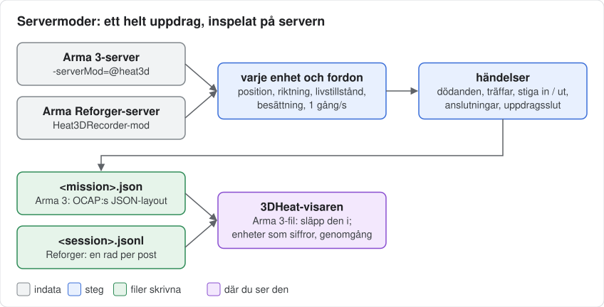

# Serverinspelningsmoddar (Arma 3, Arma Reforger) {#server-recorder-mods-arma-3-arma-reforger}

De flesta spel spelas in av watchern på spelarens egen dator. Arma är annorlunda: en server kan spela in
ett helt uppdrag – varje enhet och alla fordon, inte bara ditt eget – med en mod som körs på servern.
Spelarna behöver inte göra något: Arma 3-moden är bara för servern, och Reforger laddar ner en servers
moddar till spelarna av sig självt när de ansluter (moden gör ingenting på deras datorer). Förrådet
innehåller två sådana moddar, i [`mods/arma3`](https://github.com/Holdi601/3DHeat-Watcher/tree/main/mods/arma3)
och [`mods/reforger`](https://github.com/Holdi601/3DHeat-Watcher/tree/main/mods/reforger).
Deras README-filer är den fullständiga dokumentationen; den här sidan är översikten.

**Status: båda är otestade i spelet.** Arma 3-tillägget byggdes och kördes på det sätt Arma anropar
tillägg på, och dess utdata lästes av 3DHeat; dess SQF-skript har inte körts i Arma 3 än. Reforger-moden
skrevs utifrån Bohemias publicerade skript-API och har aldrig kompilerats. Lägg inte någon av dem på en
publik server innan teststegen i dess README har gåtts igenom.

## Arma 3 {#arma-3}

1. Bygg tillägget en gång per plattform (`mods/arma3/extension`). Detta kräver en C-kompilator: Visual
   Studio Build Tools på Windows, gcc på Linux; om du aldrig kompilerat något, fråga din serverleverantör.
   - Windows, i en "x64 Native Tools Command Prompt for VS":
     `cl /nologo /O2 /LD heat3d.c /Fe:heat3d_x64.dll`
   - Linux: `gcc -O2 -shared -fPIC -o heat3d_x64.so heat3d.c -ldl`
2. Bygg moden: `python mods/arma3/build.py` skriver `mods/arma3/@heat3d/` (ingen Arma 3 Tools behövs).
3. Kopiera `@heat3d` till serverns mapp och starta servern med `-serverMod=@heat3d`.
4. Serverns `.rpt`-logg säger `Heat3D recorder 0.1.0: recording <file> every 1 s`.

| Inställning | Standard | Vad den gör |
|---|---|---|
| `captureDelay` | 1 | sekunder mellan bildrutor |
| `recordHits` | 1 | 0 stänger av träffhändelser |
| `recordShots` | 1 | 0 stänger av räkningen av skott |
| `minPlayers` | 0 | spela bara in när så många spelare är inne |

Ett uppdrag åsidosätter en inställning i sin `init.sqf` (`heat3d_captureDelay = 0.5;`).
Inspelningar läggs i `recordings/` inuti `@heat3d`, eller i `HEAT3D_DIR`.

**Utdata:** en fil per uppdrag i OCAPs JSON-layout (OCAP2-inspelarens format), namngiven
`<date>__<time>_<mission>.json`. Under uppdraget är den en journal (`.heat3d.part`), tömd vid varje
skrivning; ett kraschat uppdrags journal färdigställs nästa gång ett uppdrag startar.

## Arma Reforger {#arma-reforger}

Moden (`Heat3DRecorder.gproj`) öppnas och byggs i Bohemias Workbench (Arma Reforger Tools), testad på en
lokal dedikerad server, publicerad från Workbench (olistad under testning) och tillagd i serverns
`config.json`-lista `mods` – steg för steg i dess README. Varje sekund skriver den varje karaktärs
position, riktning, livstillstånd, fordon och spelar-id, och varje fordons position, riktning, tillstånd
och besättning; samt kills (dråpare, vapen, avstånd), träffar, på- och avstigning, spelare som ansluter
och lämnar, och uppdragets slut.

**Utdata:** ett JSON-objekt per rad, `$profile:heat3d/<UTC date>_<UTC time>_<world>.jsonl`: en `header`-rad
(format `heat3d-reforger`, axlar x öst, y upp, z norr), sedan `entity`-, `frame`- och `event`-rader allt
eftersom de sker, och en `end`-rad. Enhetsrader är `[id, x, y, z, dir, alive, vehicleId, playerId]`,
fordonsrader `[id, x, y, z, dir, alive, [crew ids]]`; händelser följer OCAP2:s händelselayout.

## I visaren {#in-the-viewer}

Släpp en Arma 3-inspelning på [3DHeat-visaren](https://holdi601.github.io/3DHeat/): ett uppdrag är en
session, enheter blir soldater, fordon sin typ, och kills och träffar hamnar i debriefinglistan. OCAP2:s
webbspelare spelar också upp den. Reforger-filen är modens egna radformat, med OCAP2:s händelselayout.
