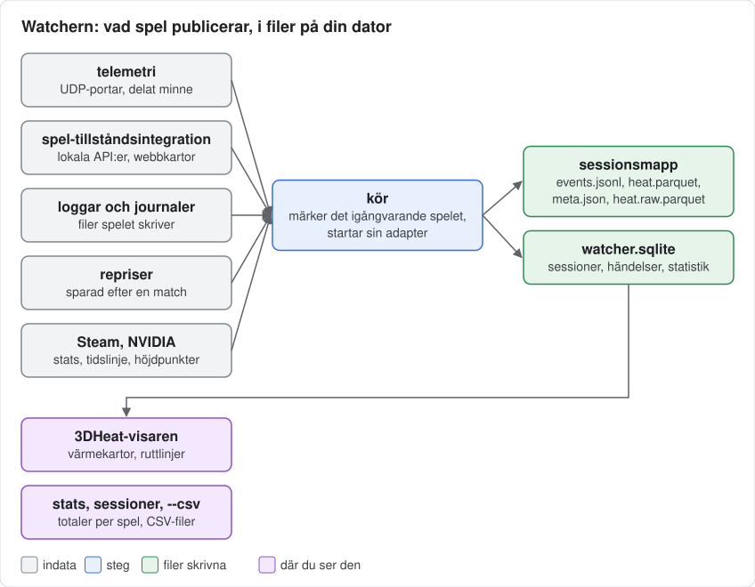

# Källor och regler {#sources-and-rules}

Watchern spelar bara in det som spel och plattformar lämnar ut till spelaren. Den här sidan förklarar
vilka källor det gäller, vad watchern får göra med var och en, och vilka spel eller delar av spel den
lämnar utanför med avsikt.

## De sex typerna av källa {#the-six-kinds-of-source}

Varje adapter har en `kind`, och den avgör vad adaptern får göra:

| Typ | Vad det är | Flerspelarspel |
|---|---|---|
| `telemetry` | en UDP-port eller delat minne som spelet publicerar för instrumentpaneler, rörelseriggar och ratt (Forza Data Out, F1 UDP, Kunos och iRacing delat minne, SimConnect, X-Plane:s UDP-gränssnitt, SCS SDK-pluginet) | ja – det är spelets egen utdata |
| `gsi` | ett spelstatusintegrationsgränssnitt eller ett lokalt webb-API som spelet serverar till spelarens egen dator (Valve GSI, League:s Live Client Data API, Rocket League:s Stats API, War Thunders webbkarta) | ja, inom vad API:et visar spelaren |
| `log` | filer spelet skriver medan det körs: journaler, loggar, statistik, sparfiler (Elite Dangerous, Minecraft, Path of Exile, Hearthstone, Star Citizen, EVE Online) | ja |
| `replay` | demos och repriser som spelet sparar för sina spelare, omvandlade efter matchen (CS2, Dota 2, War Thunder, World of Tanks, World of Warships, Squad, League of Legends, VALORANT, IL-2 Tacview) | ja, om de inte är krypterade, och bara de delar som ligger öppet |
| `platform` | det Steam och grafikdrivrutinen behåller: statistik, prestationer, tidslinjer, klipp och höjdpunkter | ja |
| `memory` | spelets minne, bara läsning, av en profil du skrev | **aldrig** – bara enspelarspel |

Bara `memory` öppnar en annan process, och bara för läsning. De fem andra typerna läser det som spelet,
Steam eller NVIDIA-appen redan har skrivit ut eller skickar.

## Hur källorna läses {#how-the-sources-are-read}

- **Inget injiceras, hookas eller ändras i ett spel.** Ingen kod laddas in i ett spel, inget fönster eller
  ingen inmatning hookas, ingen spelfil lappas. De enda filer watchern skriver utanför sin datamapp är de
  som [`setup --apply`](commands.md#setup) skriver när du ber om det: ett spels egen inställningsfil (med
  originalet sparat som `<file>.heat3d-backup`), en cfg-fil för spelstatus, DCS-hookskriptet, BeamNG-protokollmoden.
- **Delat minne öppnas skrivskyddat och skapas aldrig.** Det vanliga Python-sättet att öppna en namngiven
  mappning skapar en om den inte finns än. Ett spel som startas efteråt skulle då hitta watchens tomma,
  skrivskyddade mappning i stället för att skapa sin egen, och dess telemetri skulle vara död. Watchern
  öppnar mappningar bara med `OpenFileMappingW` (som bara hittar en befintlig), mappar dem med
  `FILE_MAP_READ`, och försöker igen senare om spelet ännu inte skapat dem.
- **Portar lånas, tas aldrig över.** En UDP-telemetriport som ett annat program redan lyssnar på (FH
  Companion, SimHub, en instrumentpanelsapp) lämnas åt det programmet. Om ett annat program börjar lyssna
  på en port watchern håller, släpper watchern den inom några sekunder. Forza-adaptrar väntar 15 s efter
  att spelet startat innan de tar port 5300, och skickar varje paket oförändrat vidare till 127.0.0.1:5301,
  så att en andra Data Out-app fortfarande kan spela in.
- **Bara lokalt.** Spelstatusservrarna som watchern kör (CS2, Dota 2) lyssnar på 127.0.0.1 och ingen
  annanstans. När spelets cfg-fil har en token (den `setup` skriver gör det) måste varje post bära den;
  poster utan den räknas som `bad_auth` och kastas. Utan en cfg-fil med token accepteras varje lokal post,
  och loggen säger det. De lokala API:er den frågar (League på port 2999, War Thunder på 8111, Rocket League
  på 49123, X-Plane på 49000) ligger på 127.0.0.1.
- **Loggfiler delas, låses aldrig.** Varje läsning öppnar filen med alla delningsflaggor Windows har och
  stänger den igen, så spelet kan fortsätta skriva, byta namn på eller ersätta sin logg.
- **Två externa tjänster, och bara i dessa fall.** Utgivningskontrollen frågar GitHub (`api.github.com`)
  högst var sjätte timme och kan stängas av (se [Uppdateringar](updates.md)). League-reprisadaptern frågar
  Riots Match-V5-API bara när du angett din egen `riot_api_key`. Inget annat skickas någonstans.
- **Att slå på en källa är ditt beslut.** `setup` utan `--apply` säger bara vad den skulle ändra.

## Flerspelarregler {#multiplayer-rules}

- Ett spel som spelas online spelas bara in genom det det publicerar: telemetri, spelstatus-API:er, loggar,
  repriser, plattformsfiler. Inom dem spelar watchern in det spelet visar spelaren, och inget som beräknats
  utöver det:
  - **CS2:s spelstatusintegration** skickar den spelare som bevakas (dig själv medan du lever, en lagkamrat
    efter död). Andra spelares positioner (`allplayers_*`) skickas bara till åskådare och GOTV, så watchern
    begär dem inte.
  - **League of Legends Live Client Data API** har inga positioner. Riots policy tillåter verktyg att visa
    det spelaren kan veta från spelet självt, och inget beräknat utöver det (inga fiendetimers). Watchern
    spelar in kill-flödet och scoreboarden som spelaren ser, och spelarens egna siffror.
  - **Rocket League:s Stats API** har inga bilpositioner (bilens tillstånd skickas bara till åskådare). Det
    som får en plats är bollen, var den träffades, gjorde mål eller träffade ribban.
  - **War Thunders webbkarta** visar det minikartan visar, utan namn eller id.
  - **F1 23/24/25** lägger varje bils position i sitt Motion-paket, även online. Spelet lämnar ut dem själv,
    och håller bara tillbaka data från spelare vars "Your Telemetry" är begränsad.
  - **DCS World**: en flerspelarserver kan förbjuda export av den egna flygplansdatan; sessionen har då
    händelser men inga positioner, och säger det.
- **Minne läses aldrig i ett flerspelarspel.** En minnesadapter för ett spel markerat som spelat online
  nekas, och en profil måste ange om dess spel alls kan spelas online. Ett enspelarspel som också har ett
  onlineläge läses bara medan det inte har någon anslutning till något annat än den här datorn. Spel vars
  enspelarläge körs under ett fuskskydd läses heller aldrig. Se [Läsa minne](memory-reading.md).
- Flaggan `multiplayer` på en adapter (visas som "Online play" av `games --markdown`) avgör bara
  minnesläsning. Den stoppar inte de andra typerna från att spela in onlinespel.

## Vad som lämnas utanför, och varför {#what-is-declined-and-why}

Vissa spel, och vissa delar av spel, spelas inte in eftersom det enda sättet att få dem skulle bryta ett
skydd eller ett spels villkor:

| Spel | Vad som lämnas utanför | Varför |
|---|---|---|
| VALORANT | positioner, namn, poäng i repriser; klientens lockfile-endpoints | Repriserns spelström är förvrängd med värden tagna från varje builds körbara fil. Att återskapa dem innebär reverse engineering av spelet, vilket Riots användarvillkor förbjuder (avsnitt 3.1 och 7.1), och spelet körs under Vanguard. Riot-klientens lockfile-endpoints är inget publicerat API. **Läses:** det repriserna bär öppet – karta, match-id, agenter, serverns kill- och rondtidslinje. |
| League of Legends | den minut-för-minut-delen av `.rofl`-repriser; klientens lockfile-endpoints | Förvrängd mot fusk, olika varje patch; att avkoda den innebär att ta isär spelet, vilket Riots villkor förbjuder. **Läses:** poängtavlan i slutet av matchen som varje repris bär som vanlig JSON, Live Client Data API under en match, och – med din egen utvecklarnyckel – den officiella Match-V5-tidslinjen (positioner en gång i minuten, kills där de skedde). |
| Fortnite | repriser | Krypterade, och Epics villkor förbjuder reverse engineering av dem. |
| World of Tanks, World of Warships | repriser, i watchern | Chifferade, med en nyckel som spelet bär och som communityverktyg publicerat i flera år. Watchern läser dem inte; separata omvandlare utanför den gör det (`exporters/ext/wot-replay`, `exporters/ext/wows-replay`), så att ett problem med Wargamings villkor – licensen förbjuder reverse engineering (5.3 b) och obehörig programvara som interagerar med deras produkter (12.1 k) – bara berör dem. **Läses, med en omvandlare installerad:** varje fordons eller fartygs position medan inspelningsklienten kände till det, och kills. |
| Gran Turismo 7 | telemetri | Bara konsol, och dess telemetri är krypterad med en nyckel som återskapats ur spelet. |
| Apex Legends | allt | Dess LiveAPI skickar fullständiga händelser bara i privata och anpassade lobbyer; annars finns inget lokalt. |
| Overwatch 2, Call of Duty, Battlefield 6, Hunt: Showdown 1896 | livedata | Ingen lokal repris, logg eller spelstatusutdata att läsa. Deras statistik kommer in där Steam behåller den ([Steam-statistik](game-steam-stats.md), [Steam Timeline](game-steam-timeline.md)), och deras klipp som [NVIDIA-höjdpunkter](nvidia-highlights.md). |
| Star Citizen | allt utöver `Game.log` | Kör Easy Anti-Cheat; watchern läser bara loggfilen spelet skriver och går aldrig nära spelets process. |
| osu! | repriser | Utanför omfånget: ett 2D-spel, med inget att placera på en karta. |
| Vilket flerspelarspel som helst | minne | Aldrig. Enspelarspel vars enspelarläge körs under ett fuskskydd (GTA V, Elden Ring genom dess launcher) läses heller inte. |

Krypterade repriser öppnas inte: VALORANT-läsaren kontrollerar repriens krypteringsflagga och avböjer en
krypterad fil ("this replay is encrypted; it is not read").

Spel som undersökts men ännu inte byggts (Deadlock-repriser, Rocket League `.replay`-filer, StarCraft II,
Team Fortress 2, Rainbow Six Siege, Beat Saber, Trackmania, flera racingsimmar) listas med sina källor i
[Alla spel i en tabell](watcher.md#researched-not-yet-built). Var och en behöver exempelfiler att kontrolleras
mot innan den levereras.
