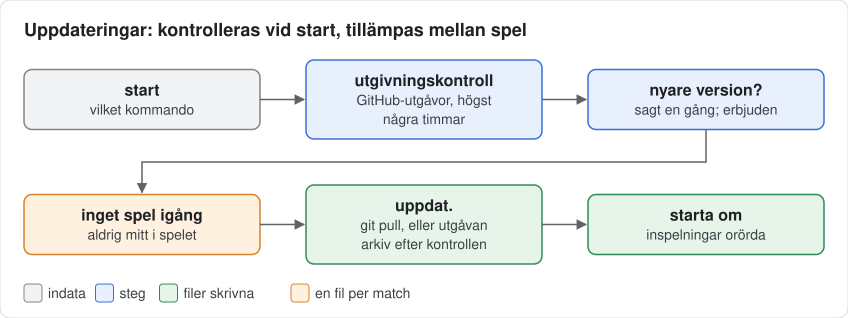

# Uppdateringar {#updates}

Watchern håller sig själv aktuell med utgåvorna från
[Holdi601/3DHeat-Watcher](https://github.com/Holdi601/3DHeat-Watcher/releases). Uppdateraren är paketet
`heat3d_update` bredvid `heat3d_watch` i förrådet.

## Kontrollen {#the-check}

- **När**: varje kommando utom `update` kontrollerar när det startar. `run` kontrollerar också medan det
  körs, högst en gång i timmen och bara medan inget spel körs.
- **Hur**: en HTTPS-förfrågan till `https://api.github.com/repos/Holdi601/3DHeat-Watcher/releases/latest`,
  med en timeout på 5 sekunder. Svaret cachas i sex timmar i
  `%LOCALAPPDATA%\3DHeat\update-check-3DHeat-Watcher.json`, så de flesta starter frågar ingenting.
  "Ingen utgåva ännu" (HTTP 404) cachas som ett svar. Offline, vid hastighetsbegränsning eller bakom en
  proxy misslyckas kontrollen tyst och kommandot fortsätter med den version det har.
- **Versioner**: den installerade versionen är filen `VERSION` i förrådsmappen. En utgåvas tagg
  (`v1.2.0` eller `1.2.0`) jämförs som tal, del för del; allt efter ett `-` eller `+` ignoreras.
- **Av**: `HEAT3D_NO_UPDATE=1` (vilket värde som helst utom tomt, `0`, `false` eller `no`) stänger av både
  kontrollen och den automatiska uppdateringen. Varje 3DHeat-verktyg har sin egen cachefil, så ett
  verktygs svar gäller aldrig för ett annat.

## Vad som händer när en nyare utgåva finns {#what-happens-when-a-newer-release-is-out}

- **`run`** skriver ut en notis när det startar och fortsätter köra:
  `[heat3d_watch] 3DHeat Watcher 1.2.0 is out (this is 1.0.2). <release page>`. Medan den körs, med
  `auto_update` på (standard) och inget spel igång, uppdaterar den sig själv: loggraden
  `3DHeat Watcher 1.2.0 is out (this is 1.0.2); updating`, en Windows-notis "Updating to 1.2.0", själva
  uppdateringen, varje adapter stoppas och dess sessioner stängs, och samma kommando startas om på den nya
  koden. Watchern uppdaterar aldrig mitt i ett spel. Om uppdateringen inte kan tillämpas säger notisen det
  ("1.2.0 is out; not updated: ..."), och watchern fortsätter köra den gamla versionen. Med `auto_update`
  av finns bara notisen.
- **Andra kommandon** frågar `Update now? [Y/n]` när de körs i en terminal. Enter, `y`, `yes`, `j` eller
  `ja` uppdaterar och kör sedan samma kommando igen på den nya versionen. Utan terminal (en schemalagd
  körning, en pipe) skriver de ut hur man uppdaterar och fortsätter.
- **På begäran**: `python -m heat3d_watch update` (eller `python -m heat3d_update`) frågar GitHub utan
  cachen och uppdaterar. `--check` säger bara om en nyare utgåva finns. Detta fungerar även med
  `HEAT3D_NO_UPDATE` satt.

## Så tillämpas en uppdatering {#how-an-update-is-applied}

Det beror på hur kopian installerades:

- **En git-klon** (mappen har `.git` och `git` finns på PATH): `git pull --ff-only`. Detta vägras medan
  klonen har ändringar i spårade filer (`git status --porcelain --untracked-files=no` är inte tom): de
  ändringarna är någons arbete, och en uppdatering bestämmer inte vad som händer med dem. Committa eller
  stasha dem, och dra sedan.
- **En nedladdad kopia**: utgåvans källarkiv laddas ner och packas upp i en tillfällig mapp. Poster som
  skulle hamna utanför den hoppas över. Arkivets `VERSION` måste vara den version utgåvan säger, annars
  kopieras inget. Sedan kopieras dess filer över förrådsmappen. Filer som inte ingår i en utgåva –
  inspelningar, inställningar, virtuella miljöer, exporter, allt du gjort – rörs inte. En Python-modul som
  en äldre utgåva hade och den nya tagit bort tas bort ur utgåvans egna paket (`heat3d_watch`,
  `heat3d_update`), så att ingen gammal adaptermodul laddas efter uppdateringen; inget utanför de paketen
  tas bort.

Inspelningar och inställningar ligger normalt utanför förrådsmappen ändå (`%LOCALAPPDATA%\3DHeat\Watcher`),
så en uppdatering kommer aldrig nära dem.

Efter en uppdatering startas samma kommando om. På Windows startar watchern den nya processen, väntar på
den och skickar vidare dess avslutningskod, så att konsolen beter sig som om den första processen gjort
arbetet.
