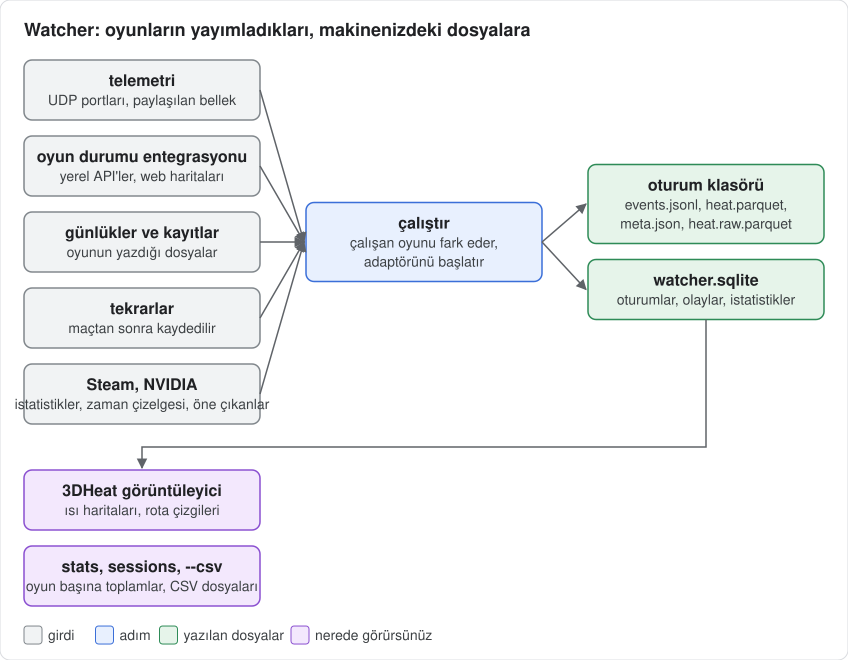
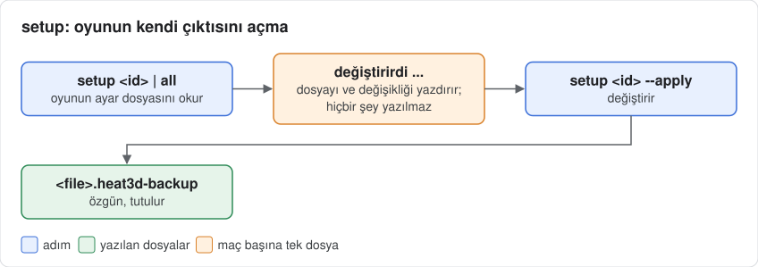
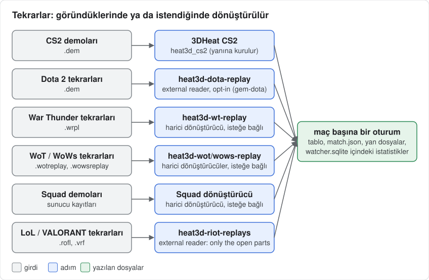
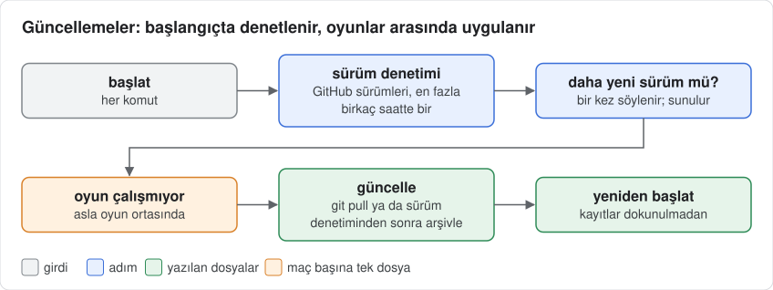

# Komutlar {#commands}

Komut satırında yeni misiniz? Önce [Başlamadan önce](before-you-start.md) sayfasını okuyun. Her komut, açtığınız ya da klonladığınız klasörde açılan bir terminale yazılır (Dosya Gezgini'nde adres çubuğuna `powershell` yazarak açabilirsiniz), şöyle:

```bash
python -m heat3d_watch <command> [options]
```


| Komut | Ne yapar |
|---|---|
| [`run`](#run) | arka planda izler ve çalışan her oyunu kaydeder |
| [`games`](#games) | her oyunun ne verdiği ve bunun nereden geldiği |
| [`setup`](#setup) | bir oyunun kendi çıktısını açar |
| [`status`](#status) | şu anda hangi oyunlar çalışıyor ve hangi adaptörler çalışırdı |
| [`sessions`](#sessions) | şimdiye kadarki kayıtlar |
| [`stats`](#stats) | oyun başına toplamlar ya da tablolar CSV olarak |
| [`table`](#table) | bir oturumun `heat.parquet` dosyasını `events.jsonl` dosyasından yeniden oluşturur |
| [`replays`](#replays) | diskte zaten duran replay'leri dönüştürür |
| [`dota-replay`](#dota-replay) | herkese açık bir Dota 2 maçının replay'ini kimliğiyle indirir |
| [`dota-map`](#dota-map) | kurulu Dota 2'nin haritasını, ayrı 3DHeat Dota aracıyla 3B seviye olarak üretir |
| [`update`](#update) | en yeni sürüme günceller |
| [`config`](#config) | ayarları gösterir ya da değiştirir |

Her komutta geçerli seçenekler: `-h` / `--help` yardımı gösterir, `python -m heat3d_watch --version` ise sürümü yazar (`VERSION` dosyası).

Bu sayfadaki resimler, gerçek kayıtlar değil, örnek oturumlar (`Example Racer`, `Example Arena`) üzerinde alınmış çıktılardır.

`update` dışındaki her komut önce daha yeni bir sürüm olup olmadığına bakar (en fazla altı saatte bir; `HEAT3D_NO_UPDATE=1` ile atlanır, bkz. [Güncellemeler](updates.md)). `run` yalnızca bir bilgi notu yazar. Öbür komutlar bir terminalde çalıştığında `Update now? [Y/n]` diye sorar; terminalde değilse güncellemenin nasıl yapılacağını yazar. Çıktı UTF-8'dir; oyun adları her dildeki konsolda doğru yazılır.

## run {#run}

```bash
python -m heat3d_watch run [--once] [-v]
```



Durdurulana kadar izler (Ctrl+C): her `scan_seconds` aralıkla çalışan işlemlerin listesini okur ve bulduğu her oyun için bir adaptör, ayrıca her zaman açık olan adaptörleri çalıştırır. İlk bakıştan önce, önceki bir çalıştırmanın açık bıraktığı oturumları tamamlar. Hiçbir oyun çalışmıyorken ve `auto_update` açıksa kendini güncelleyebilir. Ayrıntılar [Kurulum ve çalıştırma](installing-and-running.md#running) sayfasında.

| Seçenek | Etkisi |
|---|---|
| `--once` | çalışan oyunlara bir kez bakar, sonra çıkar. Şu anda çalışan oyunların adaptörleri (ve her zaman açık olanlar) başlatılır, her biri bir kez yoklanır (en fazla 10 saniye beklenir), sonra hepsi bir oyun kapandığında olduğu gibi durdurulur: açık oturumları kapanır, yazılır ve sayılır. Algılamayı denemek içindir, kayıt için değil. |
| `-v`, `--verbose` | `watcher.log` dosyasında ve konsolda hata ayıklama satırları |

`run`, `<data>\watcher.lock` dosyasını yazar ve aynı veri klasörü için ikinci kez başlamayı reddeder (çıkış kodu 1); bkz. [Kilit dosyası](installing-and-running.md#the-lock-file).

## games {#games}

```bash
python -m heat3d_watch games [--markdown]
```


Her adaptörü oyuna göre sıralı listeler: adı, kimliği ve türü, nereden okuduğu, neyi kaydettiği ve nasıl açılacağı. Bu bilgisayarda çalışamayan bir adaptör `[unavailable: <neden>]` ile işaretlenir: SimConnect.dll bulunamadı, Minecraft klasörü yok, 3DHeat CS2 kurulu değil, Steam ya da NVIDIA App bulunamadı. Modülü yüklenemeyen bir adaptör, hatasıyla birlikte en sonda adlandırılır.

```text
EA SPORTS F1 25  (f1-25, telemetry)
    from: UDP telemetry 127.0.0.1:20777 (Documents\My Games\F1 25\hardwaresettings\hardware_settings_config.xml)
    - every car's position (world XYZ, m) at 10 Hz, by driver name, team, own car marked, ...
    switch on: In the game: Settings > Telemetry Settings > UDP Telemetry On, IP 127.0.0.1, port 20777 - ...
```

`--markdown` aynı bilgiyi tek bir Markdown tablosu olarak yazar (oyun, neyin kaydedildiği, nereden, nasıl açılacağı, çevrimiçi oyun, denetlendi). [Tek tabloda tüm oyunlar](watcher.md) sayfasındaki tablo bu çıktıdır. Hücreler Markdown için kaçışlıdır: kod işaretleri içindeki metin kod olarak kalır, dışarıda kalan `<`, `>`, `&`, `*`, `|` ve noktalama işaretinden önceki ters eğik çizgi, yazıldığı gibi görünsün diye ayrılır (`<CS2>` yoksa kramdown'da bir HTML etiketi sanılıp kaybolurdu). Tek HTML parçası, "What is recorded" (Neyin kaydedildiği) bölümündeki öğeler arasındaki `<br>`'dir.

## setup {#setup}

```bash
python -m heat3d_watch setup <adapter id | all> [--apply]
```




Oyunun kendi çıktısını, oyunun bir dosyada değişiklik istediği yerlerde açar. `--apply` olmadan hiçbir şey değişmez: her satır neyin değişeceğini söyler ve değişecek bir şey varsa son satır `Nothing was changed. Run again with --apply to make these changes.` der. Değişecek bir şey yoksa `<id>: nothing to change` yazar (`all` için `Nothing to change.`). `--apply` ile değişiklikler yapılır; bir dosya ilk kez değiştirilmeden önce, özgün hali `<file>.heat3d-backup` adıyla saklanır. Var olan bir yedek asla üzerine yazılmaz; böylece yedek, watcher'ın dosyaya ilk dokunmasından önceki hali her zaman tutar.

```text
f1-25: would change: hardware_settings_config.xml <udp>: enabled="false" -> "true"
Nothing was changed. Run again with --apply to make these changes.
```

`all`, ayarı olan her adaptörün kurulumunu çalıştırır. Kendi adıyla verilip ayarı olmayan bir adaptör, `<id>: nothing for setup to change; ` ve ardından oyunun nasıl açıldığını yazar (`enable` metni ya da hiçbir şey gerekmediği). Bilinmeyen bir kimlik `no adapter '<id>'; games lists them` yazar ve çıkış kodu 2 ile çıkar. Kurulumu olan adaptörler:

| Adaptör | `--apply` neyi değiştirir |
|---|---|
| `beamng` | `heat3d` protokol modunu BeamNG'nin kullanıcı `mods` klasörüne kurar (yalnızca yoksa); sonra oyunda Options > Other > Protocols > "others" seçeneğini açın |
| `cs2-gsi` | `<CS2>\game\csgo\cfg\gamestate_integration_heat3d.cfg` dosyasını yazar: oyun durumunu `http://127.0.0.1:3311/` adresine, watcher'ın istediği rastgele bir belirteçle gönderir (dosyada zaten bir belirteç varsa korunur); CS2 bunu başlarken okur |
| `dota2-gsi` | Dota 2 için aynısı: `<Dota>\game\dota\cfg\gamestate_integration\gamestate_integration_heat3d.cfg`, port 3312 |
| `dcs` | her `%USERPROFILE%\Saved Games\DCS*` klasörüne `Scripts\Hooks\heat3d-watch.lua` dosyasını ekler. Kendi eski kopyası güncellenir; watcher'ın yazmadığı, bu adda bir dosya olduğu gibi bırakılır. DCS'yi yeniden başlatın. |
| `dirt-rally-2` | `hardware_settings_config.xml`: `<udp enabled="true" extradata="3" ip="127.0.0.1" port="20777">`; dosya var olsun diye oyunu önce bir kez başlatın |
| `ea-wrc` | `Documents\My Games\WRC\telemetry\config.json`: `wrc` yapısının `session_update` paketi, bu bilgisayara açık |
| `f1-23`, `f1-24`, `f1-25` | `hardware_settings_config.xml`: `<udp enabled="true" ip="127.0.0.1" port="20777">`; oyun kapalı olmalı |
| `hearthstone` | `%LOCALAPPDATA%\Blizzard\Hearthstone\log.config` dosyasına bir `[Power]` bölümü ekler (`LogLevel=1`, `FilePrinting=true`); oyunu yeniden başlatın |
| `il2` | `<game>\data\startup.cfg`, `[KEY = telemetrydevice]`: bir hedef daha `addrN = "127.0.0.1:41995"` ve `enable = true` (bölüm yoksa eklenir, 10 Hz); IL-2'yi yeniden başlatın |
| `il2-tacview` | `<game>\data\startup.cfg`, `[KEY = track_record]`: `tacviewrecord = 1` |
| `rocketleague-stats` | `<RL>\TAGame\Config` içinde `TAStatsAPI.ini` (yoksa `DefaultStatsAPI.ini`): API kapalıysa `PacketSendRate=30`, ayarlı bir `Port` yoksa `Port`; Rocket League açılırken okunur |

`richard-burns-rally` için kurulum yoktur: telemetrisi RSF/NGP eklentisinindir ve `RichardBurnsRally.ini` içinde elle açılır (bkz. [oyunun sayfası](game-richard-burns-rally.md)); `setup richard-burns-rally` bunu söyler. Öbür her oyun ya bir şey istemez ya da oyunda açılır; her oyunun sayfası nasıl açılacağını anlatır.

## status {#status}

```bash
python -m heat3d_watch status
```

```text
3DHeat Watcher 1.0.2; data in C:\Users\...\AppData\Local\3DHeat\Watcher
Games running: EA SPORTS F1 25 (f1-25)
Always on: il2-tacview, steam-stats, steam-timeline, nvidia-highlights, cs2-demos, osu-replays, lol-replays, valorant-replays
```

Bir `run` komutunun şu anda hangi adaptörleri başlatacağını aynı kurallarla söyler: oyunun işlemi çalışıyor, adaptör `disabled` listesinde değil, ihtiyaç duyduğu hiçbir şey eksik değil, replay adaptörleri yalnızca `replays` açıkken, bellek adaptörleri yalnızca `memory` açıkken ve her bellek denetimi geçmişse. Hiçbir şey başlatmaz.

## sessions {#sessions}

```bash
python -m heat3d_watch sessions [--game NAME] [--limit N]
```


`watcher.sqlite` dosyasındaki en yeni oturumlar, her biri bir satırda: başlangıç (yerel saat), oyun, dakika, olaylar, konumlar, klasör.

| Seçenek | Etkisi |
|---|---|
| `--game NAME` | yalnızca bu oyun, listedeki tam adıyla (`"EA SPORTS F1 25"`) |
| `--limit N` | en fazla N oturum (varsayılan 40) |

## stats {#stats}

```bash
python -m heat3d_watch stats [--game NAME] [--csv DIR]
```


Seçeneksiz: her oyunun bir tablosu (oturumlar, saatler, olaylar, konumlar, en son oynanma), en çok oynananlar önce; sonra her oyun için en sık görülen 25 olay ve sayısal her istatistik, bu değeri olan oturum sayısıyla, toplamı, en iyi değeri (`best`) ve ortalamasıyla. `best`, hangi yönün daha iyi olduğunu bilir: en iyi süre olarak tutulan süreler için (`best_lap`, `best_stage` ve `best_` ile başlayan her öbür anahtar) ve sıralamalar için (`race_position`, `grid_position`, `_position` ile biten her anahtar) en küçük değer; öbür her şey için (öldürmeler, mesafe, en yüksek hız, oyunun kendi sayaçları) en büyük değer.

| Seçenek | Etkisi |
|---|---|
| `--game NAME` | yalnızca bu oyunun olayları ve istatistikleri, genel özet olmadan |
| `--csv DIR` | bunun yerine `DIR` klasörüne `sessions.csv`, `events.csv` ve `stats.csv` yazar (üç tablonun her satırı); `--game` dışa aktarmayı daraltmaz |

## table {#table}

```bash
python -m heat3d_watch table <session folder>
```


Bir oturum klasöründeki `heat.parquet` dosyasını, `meta.json` içindeki eksenlerle birlikte `events.jsonl` dosyasından yeniden oluşturur. Tablonun yolunu ya da `no positions in this session` yazar. `pyarrow` eksikken kaydedilmiş bir oturum için ya da `events.jsonl` dosyasını elle düzenledikten sonra kullanın.

## replays {#replays}

```bash
python -m heat3d_watch replays <adapter id> [folder] [-v]
```



Diskte zaten duran replay'leri, şimdi, birer birer dönüştürür; her biri, izleme komutunun yapacağı gibi bir oturum olur. Watcher bir replay klasörünü ilk kez gördüğünde yalnızca içinde ne olduğunu not eder (bkz. [Kurulum ve çalıştırma](installing-and-running.md#replays-already-on-disk)); bunlar istek üzerine böyle dönüştürülür. `folder` verilmezse adaptörün kendi klasörleri okunur (oyunun klasörü, artı `replay_folders`); verilirse yalnızca o klasördeki replay'ler. Dönüştürülen her replay görüldü olarak not edilir, böylece çalışan watcher onu bir daha dönüştürmez. Dönüştürülemeyen bir replay günlüğe yazılır ve atlanır.

| Adaptör | Replay'ler |
|---|---|
| `cs2-demos` | Counter-Strike 2 demoları (`*.dem`), 3DHeat CS2 üzerinden |
| `lol-replays` | League of Legends replay'leri (`*.rofl`) |
| `osu-replays` | osu! replay'leri (`*.osr`) |
| `valorant-replays` | VALORANT replay'leri (`*.vrf`) |
| `warthunder-replays` | War Thunder replay'leri (`*.wrpl`), dış dönüştürücü `heat3d-wt-replay` ile (exporters/ext/warthunder-replay) |
| `wot-replays` | World of Tanks replay'leri (`*.wotreplay`), dış dönüştürücü `heat3d-wot-replay` ile (exporters/ext/wot-replay) |
| `wows-replays` | World of Warships replay'leri (`*.wowsreplay`), dış dönüştürücü `heat3d-wows-replay` ile (exporters/ext/wows-replay) |
| `dota-replays` | Dota 2 replay'leri (`*.dem`), gem ile (`pip install gem-dota`) |

```text
osu-replays: converted 12 replay(s); `sessions --game` lists them
```

Bu listedeki olmayan bir kimlik `no replay adapter '<id>'` ve listeyi yazar, çıkış kodu 2 ile çıkar; var olmayan bir `folder` da öyle. Burada çalışamayan bir adaptör (3DHeat CS2 kurulu değil) nedenini yazar ve çıkış kodu 1 ile çıkar. IL-2'nin Tacview izleri listede yoktur: bu adaptör bulduğu her bitmiş izi kendisi dönüştürür.

## dota-replay {#dota-replay}

```bash
python -m heat3d_watch dota-replay <match id> [<match id> ...] [-o FOLDER] [--convert] [-v]
```

Herkese açık bir Dota 2 maçının replay'ini Valve'in replay sunucularından indirir. İnternet bağlantısı gerekir. Maç kimliği, Dota istemcisinde maçın sayfasındaki (maç ayrıntıları) ya da OpenDota'nın sitesindeki numaradır. Valve replay'i birkaç hafta saklar; ondan sonra indirme başarısız olur. Sunucu ve replay'in tuzu (salt), OpenDota'nın maç kaydından alınır (`api.opendota.com/api/matches/<id>`, anahtar gerekmez); dosya `replay<cluster>.valve.net/570/<id>_<salt>.dem.bz2` adresinden gelir; geldiği gibi açılır (Valve bu adla hem bzip2 hem Zstandard sunar) ve `<match id>.dem` olarak kaydedilir. `-o` yoksa, Dota 2 kuruluysa Dota'nın kendi replay klasörüne gider (çalışan bir watcher burayı dönüştürür), değilse `<data>/replays/dota` klasörüne. Orada zaten bir dosya varsa korunur. `--convert`, indirilen replay'leri hemen dönüştürür (`replays dota-replays` gibi) ve görüldü olarak not eder.

```text
match 9000000000: C:\Program Files (x86)\Steam\steamapps\common\dota 2 beta\game\dota\replays\9000000000.dem
```

Valve replay'leri birkaç hafta tutar; daha eski bir maç `Valve no longer has the replay of match <id>` yazar ve çıkış kodu 1 ile çıkar. OpenDota'nın henüz görmediği bir maçın tuzu yoktur: ileti OpenDota'dan bunu istemenizi söyler (`curl -X POST https://api.opendota.com/api/request/<id>`) ve birkaç dakika sonra yeniden denemenizi. Özel lobiler ve profili gizli maçlar replay sunucularında hiç yoktur.

## dota-map {#dota-map}

```bash
python -m heat3d_watch dota-map [<map>] -o <file.glb> [--game FOLDER] [--source2viewer EXE] [--detail UNITS]
```

Dota 2 haritasını (zemin, uçurumlar, su, ağaçlar ve binalar) kendi Dota 2 kurulumunuzdan, Dota replay tablolarının çizildiği koordinat sisteminde ve birimlerde bir `.glb` seviyesi olarak yazar. Watcher oyunun dosyalarını kendisi okumaz: ayrı araç **3DHeat Dota**'yı (`heat3d-dota-maps level`, [3DHeat-Ext-Dota](https://github.com/Holdi601/3DHeat-Ext-Dota)) bu seçeneklerle çalıştırır ve çıktısını ile çıkış durumunu olduğu gibi geçirir. `<map>` varsayılan olarak `dota`'dır; `--game`, Dota 2 klasörüdür (Steam kütüphanesinde değilse); `--source2viewer`, aracın ihtiyaç duyduğu Source2Viewer'ın CLI yolu; `--detail`, binalar için birim cinsinden köşe kümeleme hücresidir (varsayılan 8, 0 her üçgeni tutar). Araç kurulu değilse `dota-map: the Dota 2 map converter is not installed: ...` yazar, nereden alınacağını söyler ve çıkış kodu 2 ile çıkar. Ayrıntılar: [Dota 2 haritası](dota-map.md).

## update {#update}

```bash
python -m heat3d_watch update [--check]
```



GitHub'dan en yeni sürümü, önbellekteki yanıtı yok sayarak sorar; daha yeniyse bu kopyayı günceller (bkz. [Güncellemeler](updates.md)). `--check` yalnızca daha yeni bir sürüm çıkıp çıkmadığını söyler. Bu komut `HEAT3D_NO_UPDATE` ayarlıyken de çalışır: isteyen sizsiniz. `python -m heat3d_update [--check]` aynısını yapar.

## config {#config}

```bash
python -m heat3d_watch config [--set KEY=VALUE ...]
```


Her ayarı `key = value` olarak yazar. `--set` ile önce verilenler değiştirilir ve `settings.json` kaydedilir (`saved <path>`). Değerler ayarın türüne göre okunur:

- doğru/yanlış ayarlar: `1`, `true`, `yes`, `on` ya da `ja` doğrudur; `0`, `false`, `no`, `off`, `nein` ya da hiçbir şey yanlıştır;
- sayılar: ondalıklı bir sayı (`scan_seconds=5`);
- listeler: virgülle ayrılmış ya da JSON listesi (`disabled=steam-stats,steam-timeline`; boş değer listeyi temizler);
- sözlükler (`replay_folders`, `player_names`): bütün sözlük JSON olarak ya da tek bir girdi `KEY.ID=VALUE` biçiminde - `replay_folders.cs2-demos=D:\Demos,E:\More Demos` o adaptörün klasörlerini ayarlar (virgülle ayrılmış), `player_names.warthunder-webmap=Name` o adaptörün adını; boş değer girdiyi kaldırır;
- metin: verildiği gibi (`data=D:\Heat`, `riot_id=Name#TAG`).

```bash
python -m heat3d_watch config --set memory=true scan_seconds=5
python -m heat3d_watch config --set riot_id=Name#TAG riot_platform=EUW1
python -m heat3d_watch config --set replay_folders.cs2-demos=D:\Demos player_names.rocketleague-stats=Name
```

Bilinmeyen bir anahtar `no setting '<key>'` yazar; ayarın türüne uymayan bir değer (`memory=perhaps`, `scan_seconds=often`, JSON olmayan bir sözlük) `not saved: ...` yazar; ikisi de hiçbir şey kaydetmeden çıkış kodu 2 ile çıkar. Elle düzenlenmiş bir `settings.json` de aynı biçimde okunur: ayarın sayı, doğru/yanlış ya da sözlük olduğu yerde metin olarak verilen değer yazıldığı gibi okunur, okunamayan bir değer varsayılanında kalır. Her ayar [Kurulum ve çalıştırma](installing-and-running.md#settings) sayfasında anlatılır.
