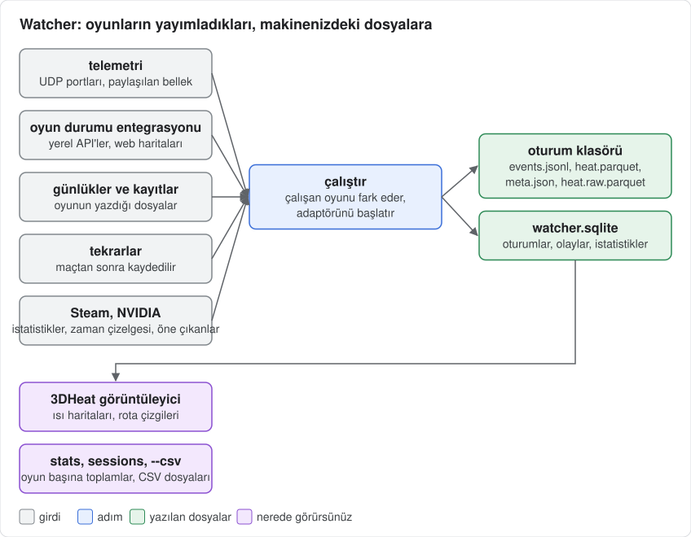

# 3DHeat Watcher {#dheat-watcher}

**Nedir?** Bir oyun oynarsınız. Bu program sessizce nereye gittiğinizi ve neler olduğunu yazar. Daha sonra bunu 3DHeat görüntüleyicisinde renkli bir harita olarak inceleyebilirsiniz.

**Neden kullanmalıyım?** Her oturumun kendi kaydını tutmak için: nereyi sürdünüz, uçtunuz ya da savaştınız, oyun başına toplamlarınız; hiçbir web sitesi olmadan ve oyunu değiştirmeden.

**Örnek:** Watcher çalışırken bir yarış oyununda bir tur sürersiniz; sonra `sessions\<game>\` içindeki bir dosya izlediğiniz çizgiyi tutar ve görüntüleyici onu çizer.

Daha ayrıntılı olarak: 3DHeat Watcher, oyunların oynamanız hakkında yayımladıklarını (nereye gittiğiniz, nerede neler olduğu ve bunların arkasındaki sayılar) makinenizdeki dosyalara kaydeden bir arka plan programıdır. Dosyalar kendi istatistikleriniz içindir; 3DHeat görüntüleyicisinin ısı haritaları ve rota çizgileri içindir.

Sessizce çalışır, hangi oyunu başlattığınızı fark eder ve o oyunun kendi çıktılarını okur: gösterge tabloları için yayımlanan bir telemetri portu ya da paylaşılan bellek, bir oyun durumu entegrasyonu, oyunun yazdığı günlük ya da kayıt, bir maçtan sonra kaydedilen tekrar, Steam'in tuttuğu istatistikler, NVIDIA App'in kaydettiği klipler. Kayıtlar makinenizde kalır. Program yalnızca iki dış servise bağlanır ve yalnızca şu durumlarda: yeni bir sürüm aramak için GitHub ([Güncellemeler](../updates.md)) ve yalnızca kendi Riot API anahtarınızı girdiğinizde Riot'un Match-V5 API'si ([League of Legends tekrarları](../game-lol-replays.md)).



## Ne kaydeder {#what-it-records}

- **Konumlar**: araba, uçak, kahraman ya da oyuncu; oyunun yayımladığı yerlerde saniyede birkaç kez, hız, yön ve oyunun yanında gönderdiği diğer her şeyle.
- **Olaylar**: doğuşlar, ölümler, öldürmeler, turlar, etaplar, raundlar, goller, görevler, kalkışlar ve inişler, bölge değişiklikleri, başarımlar, öne çıkanlar. Her olay zamanıyla birlikte saklanır; oyun bir yer verdiğinde yerleriyle birlikte.
- **Oturum başına istatistikler**: öldürmeler, ölümler, turlar, en iyi tur, mesafe, en yüksek hız, oynama süresi ve oyunun tuttuğu kendi istatistikleri.

Her oyunun ne verdiği ve nereden geldiği kendi sayfasında, [Oyunlar](../games.md) altında yazılıdır. Tek bir kaynak her şeyi kaydedemez: çok oyunculu oyunlar yalnızca yayımladıkları şeylerle kaydedilir ve watcher onların belleğini asla okumaz ([Kaynaklar ve kurallar](../sources-and-rules.md)).

## Kurulum {#install}

Komut satırında yeni misiniz? Önce [Başlamadan önce](before-you-start.md) sayfasını okuyun.

Watcher, Windows için bir Python programıdır (Python 3.10 veya daha yeni). Kaynaklarının birçoğu yalnızca Windows'ta vardır: paylaşılan bellek, kayıt defteri, Windows bildirimleri.

```bash
git clone https://github.com/Holdi601/3DHeat-Watcher.git
cd 3DHeat-Watcher
pip install -r requirements.txt
```

İndirilmiş bir sürüm arşivi aynı şekilde çalışır: açın, sonra klasörün içinde `pip install -r requirements.txt` çalıştırın. Ayrıntılar ve bazı oyunların ihtiyaç duyduğu ek bileşenler [Kurulum ve çalıştırma](../installing-and-running.md) sayfasındadır.

## Hızlı başlangıç {#quick-start}

```bash
python -m heat3d_watch games            # what each game gives, and from where
python -m heat3d_watch setup all        # what would have to be switched on (nothing is changed)
python -m heat3d_watch setup f1-25 --apply   # switch one game's output on (the original file is backed up)
python -m heat3d_watch run              # watch; leave it running while you play
python -m heat3d_watch stats            # totals per game
python -m heat3d_watch stats --csv out  # sessions, events and stats as CSV files
```

Şunu görmelisiniz: `games` komutundan sonra, oyun başına bir satırlık bir tablo; `run` komutu, Ctrl+C'ye basana ya da pencereyi kapatana kadar çalışmaya devam eder.

Her şey `%LOCALAPPDATA%\3DHeat\Watcher` klasörüne yazılır. Başka bir klasör kullanmak için `HEAT3D_WATCH_HOME` ortam değişkenini ayarlayın ya da `python -m heat3d_watch config --set data=D:\somewhere` çalıştırın.

- `sessions\<game>\<date>_<adapter>\`: oturum başına bir klasör; `events.jsonl` (her olay olduğu anda), `heat.parquet` (konumu olan satırlar, 3DHeat görüntüleyicisi için hazır) ve `meta.json` (oyun, kaynak, eksenler, sayımlar, istatistikler) tutar
- `watcher.sqlite`: her oturumun istatistikleri, üç düz tabloda
- `watcher.log`: watcher'ın ne yaptığı

Görüntüleyici bir oturumun `heat.parquet` dosyasını hiçbir ayar gerektirmeden doğrudan açar (eksenleri ve birimleri dosyanın içindedir). Dönüştürülmüş tekrarlar yanına tablo ve maç belgeleri olarak yazılır; görüntüleyicinin kendi maç başına tek dosya biçimi [`.3dheat` kapsayıcısı](https://holdi601.github.io/3DHeat/container.html) sayfasında anlatılır, her tablonun sütunları ise [Veriler](../the-data.md) sayfasındadır.

## Belgeler {#the-documentation}

| Sayfa | Neyi anlatır |
|---|---|
| [Başlamadan önce](before-you-start.md) | Python, bir terminal, yer tutucular, başarının ve sık hataların nasıl göründüğü |
| [Kurulum ve çalıştırma](../installing-and-running.md) | gereksinimler, arka planda çalıştırma, Windows ile başlatma, kilit dosyası, günlük, her ayar ve ortam değişkeni |
| [Oyunlar](../games.md) | oyun başına bir sayfa: ne kaydedilir, nereden, nasıl açılır, nasıl çalışır, eksenler, istatistikler, neyin doğrulandığı |
| [Veriler](../the-data.md) | oturum klasörleri, `events.jsonl`, `heat.parquet` ve altbilgisi, `meta.json`, `watcher.sqlite`, çökmeden sonra kurtarma, CSV dışa aktarımı, bir oturumu 3DHeat görüntüleyicisinde açma |
| [Komutlar](../commands.md) | `python -m heat3d_watch` komutunun her komutu ve seçeneği |
| [Kaynaklar ve kurallar](../sources-and-rules.md) | altı kaynak türü, çok oyunculu kurallar, hangi oyunların ve neden dışarıda bırakıldığı |
| [NVIDIA Highlights](../nvidia-highlights.md) | NVIDIA Highlights neyi sağlayabilir ve neyi sağlayamaz, bir öne çıkanın konumu nasıl alır |
| [Sunucu kayıt modları](../server-mods.md) | görüntüleyici için bütün görevleri kaydeden Arma 3 ve Arma Reforger sunucu modları |
| [Bellek okuma](../memory-reading.md) | tek oyunculu oyunlar için bellek profilleri: biçim, denetimler, bir tanesini nasıl yazıp doğrulayacağınız |
| [Güncellemeler](../updates.md) | watcher'ın yeni sürümleri nasıl aradığı ve kendini nasıl güncellediği |
| [Geliştirme](../development.md) | bir adaptör yazmak: API, testler, dürüst bir `verified`, oyun sayfalarını yeniden üretmek |
| [Tüm oyunlar tek tabloda](../watcher.md) | her oyun tek bir tabloda, `games --markdown`'ın yazdığı gibi; ama henüz yapılmamış, araştırılmış oyunlar dahil |
| [Komut başvurusu](../cli-reference.md) | her komutun `--help` çıktısı, koddan üretilmiş |
| [Bakım](../maintaining.md) | Bu sayfalar için sürüm kontrol listesi |

## 3DHeat'in parçası {#part-of-3dheat}

3DHeat Watcher, 3DHeat görüntüleyicisinin etrafındaki ücretsiz araçlardan biridir (watcher, CS2 demolarını dönüştürmek için 3DHeat CS2'yi kullanır). Her biri kendi projesi, sürümleri ve lisansıyla ayrı bir araçtır:

| Araç | Ne yapar | Belgeler |
|---|---|---|
| [3DHeat](https://github.com/Holdi601/3DHeat) | görüntüleyici: 3B olarak ısı haritaları, yarış analizi ve maç incelemesi | [site](https://holdi601.github.io/3DHeat/) |
| [GameFiles](https://github.com/Holdi601/3DHeat-GameFiles) | oyunların gönderdiği dosyalardan kurslar ve seviyeler, 3B modeller olarak | [site](https://holdi601.github.io/3DHeat-GameFiles/) |
| [GameCapture](https://github.com/Holdi601/3DHeat-GameCapture) | yarış oyunlarından tur telemetrisi; oynanış videosundan yeniden kurulan seviyeler | [site](https://holdi601.github.io/3DHeat-GameCapture/) |
| [Unreal Exporter](https://github.com/Holdi601/3DHeat-UnrealExporter) | bir seviyeyi tek bir 3B model olarak dışa aktaran bir Unreal Editor eklentisi | [site](https://holdi601.github.io/3DHeat-UnrealExporter/) |
| [CS2](https://github.com/Holdi601/3DHeat-CS2) | Counter-Strike 2 demolarını tablolara ve maç belgelerine; haritaları 3B modellere | [site](https://holdi601.github.io/3DHeat-CS2/) |
| [Watcher](https://github.com/Holdi601/3DHeat-Watcher) | oyunların oynamanız hakkında yayımladıklarını arka planda kaydeder | [site](https://holdi601.github.io/3DHeat-Watcher/) |
| [Ext-WarThunder](https://github.com/Holdi601/3DHeat-Ext-WarThunder) | War Thunder tekrarlarını tablolara ve maç belgelerine | [site](https://holdi601.github.io/3DHeat-Ext-WarThunder/) |
| [Ext-WoT](https://github.com/Holdi601/3DHeat-Ext-WoT) | World of Tanks tekrarlarını tablolara ve maç belgelerine | [site](https://holdi601.github.io/3DHeat-Ext-WoT/) |
| [Ext-WoWs](https://github.com/Holdi601/3DHeat-Ext-WoWs) | World of Warships tekrarlarını tablolara ve maç belgelerine | [site](https://holdi601.github.io/3DHeat-Ext-WoWs/) |
| [Ext-Squad](https://github.com/Holdi601/3DHeat-Ext-Squad) | Squad sunucu demolarını tablolara ve maç belgelerine | [site](https://holdi601.github.io/3DHeat-Ext-Squad/) |
| [Ext-DCS](https://github.com/Holdi601/3DHeat-Ext-DCS) | DCS World haritalarını 3B modellere | [site](https://holdi601.github.io/3DHeat-Ext-DCS/) |
| [Ext-IL2](https://github.com/Holdi601/3DHeat-Ext-IL2) | IL-2 Sturmovik haritalarını 3B modellere | [site](https://holdi601.github.io/3DHeat-Ext-IL2/) |

Lisans: MIT ([LICENSE](https://github.com/Holdi601/3DHeat-Watcher/blob/main/LICENSE)). Kullandığı üçüncü taraf paketlerin lisansları ve okuduğu oyunların gerektirdikleri, [LICENSES.md](https://github.com/Holdi601/3DHeat-Watcher/blob/main/LICENSES.md) dosyasında listelenir.
