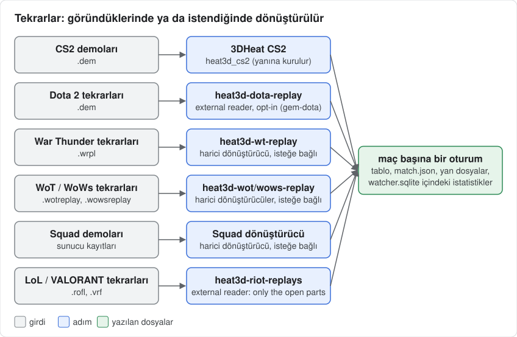

# Kurulum ve çalıştırma {#installing-and-running}

## Gereksinimler {#requirements}

- **Windows.** Watcher Windows için yazılmıştır ve kaynaklarının çoğu yalnızca orada var: oyunların oluşturduğu paylaşımlı bellek (`Local\...` eşlemeleri), kayıt defteri (Steam'in nerede olduğu), Windows bildirimleri, çalıştırılabilir yollarıyla işlem listesi. Başka bir sistemde program başlar, ama bu kaynaklar hiçbir şey bulmaz, bildirimler yalnızca günlüğe yazılır ve bellek okuma reddeder ("only implemented on Windows").
- **Python 3.10 veya daha yeni**, <https://www.python.org/downloads/> adresinden: kurulum programında **Add python.exe to PATH** kutusunu işaretleyin, sonra yeni bir terminalde `python --version` ile denetleyin. Bunlara yeni misiniz? Önce [Başlamadan önce](before-you-start.md) sayfasını okuyun.
- **Paketler** (`requirements.txt`): `psutil>=6.0` (hangi oyunların çalıştığı, bir bağlantı noktasını hangi programın tuttuğu, bir oyunun bağlantıları; eski bir psutil de çalışır, bir işlemin bağlantıları için eski adıyla), `pyarrow>=15` (`heat.parquet` yazımı), `numpy>=1.24` ve testler için `pytest>=8.0`. `requirements-optional.txt` şu anda hiçbir paket listelemez.

`pyarrow` olmadan oturumlar yine kaydedilir: `events.jsonl` kayıttır ve tablo sonra [`table`](commands.md#table) ile oluşturulabilir.

### Bazı oyunların ihtiyaç duyduğu ek şeyler {#extras-some-games-need}

| Oyun | İhtiyaç duyduğu şey |
|---|---|
| Counter-Strike 2 demoları | [3DHeat CS2](https://github.com/Holdi601/3DHeat-CS2) ve gereksinimleri (`demoparser2`). Watcher bunu sırasıyla `HEAT3D_CS2` ortam değişkeninde, watcher'ın kendi klasörünün yanındaki `3DHeat-CS2` ya da `cs2` klasöründe, ve Python'un `heat3d_cs2` modülünü içe aktarabildiği her yerde arar. Bu olmadan `games` adaptörü kullanılamaz olarak listeler. |
| Microsoft Flight Simulator 2020 / 2024 | `SimConnect.dll` - dahil değildir. MSFS 2020'nin kurulum klasöründe bir tane vardır; MSFS 2024 için MSFS 2024 SDK'sını kurun. `MSFS_SDK` / `MSFS2024_SDK` SDK klasörünü gösterir. |
| Euro Truck Simulator 2, American Truck Simulator | RenCloud `scs-telemetry.dll` eklentisi (revizyon 12), `<game>\bin\win_x64\plugins` klasöründe |
| BeamNG.drive | `heat3d` protokol modu, `python -m heat3d_watch setup beamng --apply` ile kurulur |
| League of Legends (canlı) | isteğe bağlı: Riot'un kök sertifikası `<data>\riotgames.pem` olarak, böylece yerel bağlantı doğrulanır |
| Minecraft | bir `%APPDATA%\.minecraft` klasörü (Java Edition) |

Her oyunun [Oyunlar](games.md) altındaki sayfası, oyunun içinde neyin açılması gerektiğini söyler. `python -m heat3d_watch games`, bu bilgisayarda ihtiyaç duyduğu bir şey eksikse bir adaptörü `[unavailable: ...]` ile işaretler.

## Kurulum {#installing}

Komut satırında yeni misiniz? Önce [Başlamadan önce](before-you-start.md) sayfasını okuyun. `pip` bulunamazsa, bunun yerine `python -m pip install -r requirements.txt` kullanın.

Bir klondan:

```bash
git clone https://github.com/Holdi601/3DHeat-Watcher.git
cd 3DHeat-Watcher
pip install -r requirements.txt
```

Bir sürümden: deponun sürümler sayfasından arşivi indirin, açın, sonra klasörün içinde `pip install -r requirements.txt` çalıştırın. İki tür kopya da kendini günceller (bkz. [Güncellemeler](updates.md)).

Her komutu depo klasöründen çalıştırın: `python -m heat3d_watch` paketi oradan içe aktarır ve güncelleyici (`heat3d_update`) onun yanında durur.

## Çalıştırma {#running}

```bash
python -m heat3d_watch run        # watch until stopped
python -m heat3d_watch run -v     # the same, with debug lines in the log
python -m heat3d_watch run --once # one look at the games running now, then stop and exit
```

Başlarken `run`:

1. [kilit dosyasını](#the-lock-file) yazar;
2. önceki bir çalıştırmanın açık bıraktığı oturumları tamamlar, örneğin bir çökmeden sonra (bkz. [Çökmeden sonra kurtarma](the-data.md#recovery-after-a-crash));
3. her `scan_seconds` (2 sn) işlem listesini okur (yalnızca adlar ve yollar, hiçbir işlem açılmaz) ve bulduğu her oyun için kendi iş parçacığında bir adaptör başlatır. Bir oyunun işlemi gittiğinde, adaptörü durdurulur ve açtığı oturumlar kapanır; böylece tabloları yazılır ve istatistik satırları eklenir. Bir oyunu beklemeyen adaptörler (Steam istatistikleri, Steam Timeline, NVIDIA highlights, replay klasörleri) sürekli çalışır;
4. hiçbir oyun çalışmıyorken, en fazla saatte bir yeni bir sürüm arar (yanıtın kendisi altı saat önbelleklenir) ve `auto_update` açıksa kurar ve kendini yeniden başlatır (bkz. [Güncellemeler](updates.md)).

Bir adaptör başarısız olursa günlüğe yazılır ve öbürlerini durdurmaz. Bir adaptörün yoklaması art arda 20 kez başarısız olursa ya da başlatması başarısız olursa, adaptör durdurulur ve oyun yeniden başlatılana kadar (yeni bir işlem kimliğiyle) yeniden başlatılmaz.

Watcher'ı Ctrl+C ile durdurun. Adaptörler çıkmadan önce oturumlarını kapatır. Watcher öldürülürse (Görev Yöneticisi, bir çökme, bir elektrik kesintisi), zaten yazılmış hiçbir şey kaybolmaz: bir sonraki `run` bu oturumları tamamlar.

`--once` tek bir bakış yapar: o anda çalışan oyunlar için (ve her zaman açık olanlar için) adaptörleri başlatır, her birinin bir kez yoklamasına izin verir - bunun için en fazla 10 saniye beklenir - ve sonra bir oyunun bitmesi gibi durdurur: açtıkları oturumlar kapanır, tabloları yazılır ve istatistik satırları sayılır, sonra çıkar. Bir oyunun algılandığını denetlemek için kullanın, kayıt için değil.

### Diskte zaten duran replay'ler {#replays-already-on-disk}



Bir replay adaptörü klasörlerinden birini ilk kez gördüğünde, içindeki replay'leri yalnızca not eder: yıllardır demo biriktirmiş bir oyuncu, aksi halde watcher'ın bir gün boyunca dönüştürmesiyle uğraşırdı. Bundan sonra her yeni replay, oyun onu yazmayı bitirdikten sonra bir kez dönüştürülür. Eski olanlar [`replays`](commands.md#replays) ile istek üzerine dönüştürülür:

```bash
python -m heat3d_watch replays cs2-demos              # every demo in CS2's folders and replay_folders
python -m heat3d_watch replays osu-replays D:\Old     # the replays in one folder
```

### Arka planda çalıştırma {#running-in-the-background}

Watcher'ın kendi penceresi yoktur; durdurulana kadar çalışan bir konsol programıdır. Her şeyi `watcher.log` dosyasına yazar, bu yüzden görünür bir konsola ihtiyacı yoktur. Onu yolun dışında tutmanın yolları:

- bir konsolda başlatın ve konsolu simge durumuna küçültün: `cmd`'de, depo klasöründe `start "" /min python -m heat3d_watch run`;
- konsolsuz başlatın: `pythonw -m heat3d_watch run`. Konsol çıktısı kaybolur, ama `watcher.log` yine yazılır. Durdurmak için `pythonw.exe` işlemini sonlandırın; bir sonraki başlatma, bıraktığı oturumları tamamlar. Proje bu çalıştırma biçimini test etmedi.

### Windows ile başlatma (bir fikir) {#starting-with-windows-an-idea}

Watcher kendini Windows ile başlayacak şekilde kurmaz. Otomatik başlatmak için:

- **Görev Zamanlayıcı**: tetikleyicisi *At log on* (Oturum açıldığında) ve eylemi *Start a program* (Program başlat) olan bir görev oluşturun; program `pythonw.exe` (ya da `python.exe`), bağımsız değişkenler `-m heat3d_watch run`, *Start in* (Başlangıç klasörü) depo klasörü;
- **Başlangıç klasörü**: `shell:startup` içine aynı program, bağımsız değişkenler ve *Start in* klasörüyle bir kısayol koyun.

İkisi de watcher'ın parçası değildir ve o tarafından test edilmez. [Kilit dosyası](#the-lock-file), yanlışlıkla başlatılan ikinci bir kopyanın hemen çıkmasını sağlar.

## Kilit dosyası {#the-lock-file}

`<data>\watcher.lock`, çalışan watcher'ın işlem kimliğini tutar. `run` başladığında ve kilit dosyası hâlâ var olan ve adında `python` geçen bir işlemi gösteriyorsa, şunu yazar:

```text
A watcher is already running (process 12345) for C:\Users\...\3DHeat\Watcher.
```

ve çıkış kodu 1 ile çıkar. Aynı veri klasörü üzerinde iki watcher her oyunu iki kez kaydederdi ve ikincisi, birincinin açık oturumlarını bir çökmeden kalma sanardı. İşlemi artık olmayan ya da başka bir programa ait olan bir kilit dosyasının üzerine yazılır. `run` bittiğinde, dosya hâlâ kendi işlemini gösteriyorsa kilit dosyasını siler.

## Günlük {#the-log}

`<data>\watcher.log` yalnızca `run` tarafından yazılır; öbür komutlar konsola yazar. Her satırda zaman, düzey ve bir ileti vardır:

```text
2026-05-01 20:15:01,123 INFO watching; data in C:\Users\...\AppData\Local\3DHeat\Watcher
2026-05-01 20:15:03,456 INFO f1-25: starting (EA SPORTS F1 25)
2026-05-01 21:02:11,789 INFO f1-25: stopping
```

Adaptörler yapamadıklarını ve nedenini günlüğe yazar: "UDP 20777 is in use by ...; not taking it from that program", "not reading memory: the game is played online", "could not start", "poll failed (3)" ve izlemesiyle birlikte. `run -v` hata ayıklama satırları ekler. Dosyaya eklenir; watcher onu asla döndürmez ya da boşaltmaz; istediğiniz zaman silebilirsiniz. Aynı satırlar konsola da gider.

## Her şey nerede {#where-everything-is}

Ana klasör `%LOCALAPPDATA%\3DHeat\Watcher`'dır; ya da ayarlıysa `HEAT3D_WATCH_HOME` (`LOCALAPPDATA` yoksa, örneğin başka bir sistemde, `~/.local/share/3DHeat/Watcher`). `settings.json` her zaman ana klasördedir. Geri kalan her şey veri klasörüne gider; veri klasörü, `data` ayarı başka bir klasörü göstermediği sürece ana klasördür:

| Yol | Ne demek |
|---|---|
| `<home>\settings.json` | ayarlar |
| `<data>\sessions\` | kayıtlar, oturum başına bir klasör ([Veriler](the-data.md)) |
| `<data>\watcher.sqlite` | istatistik veritabanı |
| `<data>\watcher.log` | `run`'ın günlüğü |
| `<data>\watcher.lock` | kilit dosyası, `run` çalışırken |
| `<data>\state\` | her zaman açık ve replay adaptörlerinin ne gördüğü (`steam-stats.json`, `replays-cs2-demos.json`, ...), böylece yeniden başlatma hiçbir şeyi iki kez kaydetmez |
| `<data>\profiles\*.json` | sizin yazdığınız bellek profilleri ([Bellek okuma](memory-reading.md)) |
| `<data>\riotgames.pem` | isteğe bağlı, League of Legends canlı adaptörü için Riot'un kök sertifikası |
| `%LOCALAPPDATA%\3DHeat\update-check-3DHeat-Watcher.json` | son sürüm denetiminin önbellekteki yanıtı |

Watcher bu klasörlerde hiçbir şeyi silmez; tek istisna, hiçbir şeyin kaydedilmediği bir oturum klasörüdür (menülerinde kalmış bir oyun).

## Ayarlar {#settings}


`python -m heat3d_watch config` ayarları gösterir; `config --set key=value ...` bunları değiştirir ve `settings.json` dosyasını kaydeder (bkz. [config](commands.md#config)). Dosya düz bir JSON'dur ve watcher çalışmıyorken elle de düzenlenebilir. İçindeki bilinmeyen anahtarlar yok sayılır. Ayarlar bir komut başladığında okunur; bu yüzden bir ayarı değiştirdikten sonra `run`'ı yeniden başlatın.

| Ayar | Varsayılan | Ne yapar |
|---|---|---|
| `data` | `""` | Veri klasörü. Boşsa: ana klasör. |
| `disabled` | `[]` | Hiç çalışmayacak adaptör kimlikleri, örneğin `config --set disabled=steam-stats,nvidia-highlights`. Öbür her adaptör, oyununu bulduğunda çalışır. |
| `auto_update` | `true` | Hiçbir oyun çalışmıyorken yeni bir sürümü kurar ve yeniden başlatır (bkz. [Güncellemeler](updates.md)). `false`: yalnızca günlükte bir bildirim. |
| `scan_seconds` | `2.0` | İşlem listesine bakmalar arasındaki saniye. |
| `memory` | `false` | Bellek adaptörlerinin (sizin yazdığınız bir profili olan tek oyunculu oyunlar) çalışmasına izin verir. Varsayılan olarak kapalı; bkz. [Bellek okuma](memory-reading.md). |
| `replays` | `true` | `replay` adaptörlerini çalıştırır: hepsi (bkz. `python -m heat3d_watch replays` ve [Oyunlar](games.md)) - CS2 demoları, Dota 2, osu!, War Thunder, World of Tanks, World of Warships, Squad, League of Legends ve VALORANT replay'leri, IL-2 Tacview kayıtları. |
| `replay_folders` | `{}` | Adaptör kimliğine göre ek klasörler, örneğin `{"cs2-demos": ["D:\\Demos"]}`. Replay adaptörleri bunları oyunun kendi klasörlerine ek olarak izler; `il2-tacview` kurulum klasörlerini de kabul eder (o zaman onların `data\Tracks` klasörüne bakar); `elite` için ilk klasör, journal klasörünün yerini alır. Bir adaptörün klasörlerini `config --set replay_folders.cs2-demos=D:\Demos,E:\More` ile, ya da tüm sözlüğü JSON olarak ayarlayın. |
| `riot_id` | `""` | Riot ID'niz (`Name#TAG`), böylece bir League of Legends replay'indeki kendi satırınız istatistiklerinize dönüşür. Boşsa: her oyuncunun satırı tutulur, hiçbiri sizinki olarak işaretlenmez. |
| `riot_api_key` | `""` | Replay'i yapılan League maçlarının resmi zaman çizelgesini (her dakika konumlar, ölümlerin yaşandığı yerler) almak için kendi Riot geliştirici API anahtarınız. Boşsa: hiçbir şey alınmaz. |
| `riot_platform` | `"EUW1"` | League sunucunuzun platform kimliği (`EUW1`, `EUN1`, `NA1`, `KR`, ...), bölgesel Match-V5 sunucusunu bulmak için kullanılır. |
| `player_names` | `{}` | Arayüzü her oyuncuyu adlandıran ama hangisinin siz olduğunu söylemeyen oyunlarda adınız, adaptör kimliğine göre: `warthunder-webmap` (öldürme akışındaki sizinle ilgili satırlar sizin öldürmelerinizi ve ölümlerinizi olur) ve `rocketleague-stats` (satırlarınız `me` olur; bu olmadan, oyunun kamerasının takip ettiği oyuncu). `config --set player_names.warthunder-webmap=Name` ile ayarlanır. |

Her varsayılanı içeren bir `settings.json`:

```json
{
  "data": "",
  "disabled": [],
  "auto_update": true,
  "scan_seconds": 2.0,
  "memory": false,
  "replays": true,
  "replay_folders": {},
  "riot_id": "",
  "riot_api_key": "",
  "riot_platform": "EUW1",
  "player_names": {}
}
```

## Ortam değişkenleri {#environment-variables}

| Değişken | Etkisi |
|---|---|
| `HEAT3D_WATCH_HOME` | ana klasör (ayarlar ve `data` başka bir şey söylemediği sürece veri) |
| `HEAT3D_NO_UPDATE` | boş, `0`, `false` ya da `no` dışında her değer, sürüm denetimini ve otomatik güncellemeyi kapatır |
| `HEAT3D_NO_TOAST` | boş olmayan her değer: Windows bildirimi yok, yalnızca günlük satırları |
| `HEAT3D_CS2` | 3DHeat CS2 klasörü, CS2 demoları için |
| `HEAT3D_CS2_GSI_PORT` | CS2 oyun durumu bağlantı noktası (varsayılan 3311); `setup`'ın yazdığı cfg dosyası bunu kullanır |
| `HEAT3D_DOTA_GSI_PORT` | Dota 2 oyun durumu bağlantı noktası (varsayılan 3312) |
| `MSFS_SDK`, `MSFS2024_SDK` | MSFS SDK klasörleri; `SimConnect SDK\lib\SimConnect.dll` burada aranır |

Windows bildirimleri yalnızca güncellemeler için kullanılır: "Updating to 1.2.0", ya da güncelleme uygulanamadığında "1.2.0 is out; not updated: ...". PowerShell'in kendi bildirim API'si üzerinden gösterilirler; bu yüzden hiçbir şey kurulmak zorunda değildir. Başlık ve metin PowerShell'e ortam değişkenleri olarak geçirilir, betiğin parçası olarak asla.
