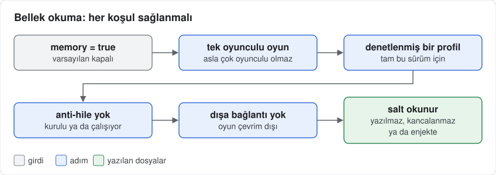

# Bellek okuma {#reading-memory}

Bazı tek oyunculu oyunlar diğer programlara hiçbir şey söylemez. Bunlar için watcher, siz açarsanız ve kendiniz bir profil yazarsanız, oyunun belleğinde nerede olduğunuza bakabilir - yalnızca okuyarak.

Yayımlamayan tek oyunculu oyunlar için watcher, kendi derlediğiniz oyun sürümü için yazdığınız bir **profil** aracılığıyla konumları ve değerleri oyunun belleğinden okuyabilir. Bütün kaynaklar arasında bu, oyunun dışarı vermediği tek kaynaktır; bu yüzden diğerlerinden daha sıkı sınırlandırılmıştır:

- **varsayılan olarak kapalıdır** (`python -m heat3d_watch config --set memory=true` ile açılır);
- okur, yazma yolu yoktur;
- **araçlarla birlikte hiçbir profil gelmez.**

Profiller gelmez, çünkü bir adres yalnızca bulunduğu oyun sürümü için doğrudur. Bir yamadan sonra, daha önce doğru olan bir profil çöp okur ve çöp, sayılar gibi görünür. Bir profil, oyuncunun sahip olduğu sürümde, o oyuncu tarafından denetlenmelidir.

## Denetimler, sırayla {#the-checks-in-order}



Aşağıdaki her denetim geçmelidir. İlk dördü oyun **açılmadan önce** yapılır, çünkü korunan bir oyunu okumak için açmak zaten bir anti-hile programının fark ettiği şeydir ve reddetmek sonradan olsa çok geç kalınmış olurdu.

1. **Ayar**: `memory` doğru olmalı. Aksi halde bellek adaptörleri hiç başlatılmaz.
2. **Oyun için bir profil**, `exe` alanı çalışan işlemin adını vermeli. Bir profil, oyunun çevrimiçi oynanıp oynanamayacağını belirtir (`"online"`); bunu atlayan bir profil reddedilir.
3. **Yakınında hiçbir anti-hile olmamalı**:
   - oyunun klasöründe ya da üç klasör yukarısına kadar hiçbir anti-hile dosyası yok (bir Steam kütüphanesinin `common` klasöründe ya da içinde `steamapps` olan bir klasörde durarak, çünkü onun üstünde başka oyunlar vardır): `EasyAntiCheat`, `EasyAntiCheat_EOS_Setup.exe`, `start_protected_game.exe`, `BattlEye`, `BEClient_x64.dll`, `BEService_x64.exe`, `EAAntiCheat.GameServiceLauncher.exe`, `AntiCheatExpert`, `SGuard64.exe`, `GameGuard`, `GameMon.des`, `XIGNCODE`, `xhunter1.sys`, `Vanguard`, `FACEIT` (küçük harfle karşılaştırılır, bir adın başıyla da). Oyunun klasörü bilinmiyorsa oyun reddedilir;
   - makinede çalışan hiçbir anti-hile sürücüsü ya da hizmeti yok; `sc query type= driver state= active` ve `sc query type= service state= active` komutlarının listelediği gibi: EasyAntiCheat, EasyAntiCheat_EOS, BEService, BEDaisy, vgk, vgc, ACE-BASE, ACE-GAME, xhunter1, FACEIT, FACEITService, EAAntiCheatService, Denuvo Anti-Cheat, npggsvc, Ricochet. Başka bir oyun için kurulmuş bir çekirdek anti-hile, her işlemi yine izler. Hizmetler listelenemezse oyun reddedilir.
4. **Çevrimiçi değil**: `"online": true` diyen bir oyun, yalnızca bu makineden başka hiçbir şeyle bağlantısı yokken okunur (`127.x`, `::1` dışında herhangi bir uzak adres). Bağlantıları okunamıyorsa reddedilir.
5. Sonra, adaptör başlarken:
   - **tam sürüm**: çalıştırılabilir dosyanın dosya boyutu ya da SHA-256'sı, profilin listelediği bir sürümle eşleşmelidir. Bilinmeyen bir sürüm okunmaz;
   - **modüller bir kez daha**: oyunun yüklediği modüller listelenir (bir Toolhelp anlık görüntüsü, kendi erişim haklarını istemez) ve bir anti-hile istemcisi için denetlenir (`BEClient_x64.dll`, `BEClient.dll`, `EasyAntiCheat_x64.dll`, `EasyAntiCheat.dll`, `EOSAntiCheat...`). Korunan bir işlem anlık görüntüyü reddeder, bu da bir reddetmedir;
   - ancak o zaman işlem açılır, `PROCESS_VM_READ | PROCESS_QUERY_LIMITED_INFORMATION` ile ve başka hiçbir şey olmadan.

Denetimler 1 ila 4, oyun çalışırken her taramada (her 2 saniyede) yinelenir. Biri başarısız olmaya başlarsa (oyun bir sunucuya bağlanır, bir anti-hile hizmeti başlar), adaptör bir sonraki taramada durdurulur. Bir reddetme günlüğe yazılır: `mem-<id>: not reading memory: <reason>`. Başlarken bir hata (bilinmeyen sürüm, bir anti-hile modülü, bulunamayan bir kalıp) `mem-<id>: could not start` olarak günlüğe yazılır ve oyun yeniden başlatılana kadar adaptör bir daha denenmez.

Başka bir işleme yazma, orada bellek ayırma, orada bir iş parçacığı başlatma, ona bir kütüphane yükleme, hata ayıklama ayrıcalığı ya da yükseltme yoktur. Paketin herhangi bir yerinde, başka bir işleme yazan, orada bellek ayıran ya da kod çalıştıran herhangi bir çağrı - `WriteProcessMemory`, `VirtualAllocEx`, `CreateRemoteThread`, `PROCESS_VM_WRITE`, `SeDebugPrivilege`, `LoadLibrary`, ... - görünürse, `tests/test_core.py` içindeki `test_memory_reading_cannot_write` testi başarısız olur.

Profil ne derse desin, asla okunmaz: çevrimiçi oynanan oyunlar ve tek oyunculu modu bir anti-hile altında çalışan oyunlar, örneğin GTA V ya da başlatıcısından açılan Elden Ring. Yukarıdaki denetimler bunları yine de reddeder.

## Profil biçimi {#the-profile-format}

Profil, `<data>\profiles\` içinde bir JSON dosyasıdır (`<data>` veri klasörüdür, bkz. [Kurulum ve çalıştırma](installing-and-running.md#where-everything-is)), oyun başına bir tane, adı `.json` ile biten herhangi bir dosya. Uydurma bir örnek:

```json
{
  "schema": "heat3d.memprofile/1",
  "id": "mygame",
  "game": "My Game",
  "exe": "MyGame.exe",
  "online": false,
  "versions": [ { "label": "1.06", "size": 123456789 } ],
  "anchors": {
    "World": { "aob": "48 8B 05 ?? ?? ?? ?? 48 85 C0", "rip": [3, 7] }
  },
  "values": {
    "pos": { "type": "vec3f", "base": "World", "chain": ["0x10", "0x68", "0x70"] },
    "hp":  { "type": "i32",   "base": "World", "chain": ["0x10", "0x138"] },
    "map": { "type": "u32",   "base": "World", "chain": ["0x10", "0x1C0"] }
  },
  "events": [
    { "event": "death", "value": "hp",  "when": "to_zero" },
    { "event": "zone",  "value": "map", "when": "change" }
  ],
  "axes": { "up": "y", "units": "metres" },
  "rate": 10,
  "provenance": [ { "source": "https://example.com/my-notes", "verified_on": "1.06" } ]
}
```

| Anahtar | Zorunlu | Ne demek |
|---|---|---|
| `schema` | evet | tam olarak `heat3d.memprofile/1` |
| `id` | evet | kısa ve sabit; adaptör `mem-<id>` olarak adlandırılır |
| `game` | evet | oyunun adı; oturum klasörü bunun adını alır |
| `exe` | evet | çalıştırılabilir dosyanın adı; oyunun çalıştığını da söyler |
| `online` | evet | oyun hiç çevrimiçi oynanabiliyorsa `true`; o zaman yalnızca çevrimdışıyken okunur |
| `versions` | evet | profilin denetlendiği sürümler: her biri bir `label` ile, bir `size` (çalıştırılabilir dosyanın bayt cinsinden boyutu) ve/veya bir `sha256` ile. İkisi de verilirse ikisinin de eşleşmesi gerekir. Hiçbiri verilmemiş bir girdi hiçbir şeyle eşleşmez. |
| `anchors` | evet | ana modüldeki adlandırılmış adresler. `aob`: bir bayt kalıbı, boşlukla ayrılmış onaltılık baytlar, herhangi bir bayt için `?` ya da `??`; modül görüntüsünde **tam olarak bir kez** geçmelidir (birden çok eşleşme, hiç olmaması gibi bir başarısızlıktır). `rip: [d, n]`: kalıp, `d` baytında ve `n` uzunluğunda 32 bitlik bir RIP'e göre göreli yer değiştirmeli bir komutu gösterir; adres, o komutun işaret ettiği adres olur. `offset`: sonradan eklenir (onaltılık ya da ondalık metin). `aob` yerine `module_offset`, modülün tabanından sabit bir ofset verir. |
| `values` | evet | her yoklamada okunan şeyler: `type` (`i32`, `u32`, `i64`, `u64`, `u8`, `f32`, `f64`, `vec3f`, `vec3d`), `base` (bir adresin adı), `chain` (ofsetler, onaltılık ya da ondalık metin olarak) |
| `events` | hayır | değişiklikleri olaylara çeviren kurallar: `when` `change` (değer son yoklamadan farklıysa) ya da `to_zero` (bir sayı 0'ın üstünden 0'a ya da altına düşerse) |
| `axes` | hayır | `up` (varsayılan `y`), `units` (varsayılan `game units`), `scale` (görüntüleyicinin birim ölçeği, her konumu çarpar; varsayılan 1, oyunun kendi birimleri) |
| `rate` | hayır | saniyedeki yoklama sayısı, 1 ile 60 arası (varsayılan 10) |
| `provenance` | hayır | ofsetlerin nereden geldiği ve onları hangi sürümde doğrulamış olduğunuz; her oturumun `meta.json` dosyasına kopyalanır |

**Bir değer nasıl okunur.** Adresin adresi başlangıçtır. `chain` boşsa, değer hemen oradan okunur. Aksi halde önce adreste saklanan gösterici okunur. Sonra, sondan önceki her ofset için `adres + ofset` adresindeki gösterici okunur. Son ofset, değerin adresini vermek için eklenir. Yolda boş bir gösterici (oyun bölümler arasında ya da bir menüde) o yoklama için değeri boş bırakır.

**Ne kaydedilir.** `pos` adında bir değer (bir `vec3f` ya da `vec3d`), her yoklamada oyuncu `me`'nin bir `position` satırı olur. Her olay kuralı kendi `event` satırını yazar, yeni değeriyle ve `pos` biliniyorsa konumuyla, ve aynı adlı bir istatistiğe 1 ekler. Modül görüntüsü, başlangıçta adresleri bulmak için bir kez, 64 KiB'lik bloklar halinde okunur; okunamayan bloklar sıfır sayılır. Oturumun `meta.json` dosyası profili, sürüm etiketini ve kaynağı adlandırır.

Kullanılamayan bir profil (bozuk JSON, yanlış `schema`, eksik zorunlu bir anahtar) atlanır ve `profile <file> not used: <reason>` olarak günlüğe yazılır. Profiller watcher başladığında yüklenir; bu yüzden bir tane eklediğinizde ya da değiştirdiğinizde `run`'ı yeniden başlatın.

## Bir profili yazmak ve denetlemek {#writing-and-verifying-a-profile}

1. **Yalnızca anti-hilesi olmayan tek oyunculu bir oyun için.** Oyunda bir anti-hile varsa ya da onu çevrimiçi oynuyorsanız, burada durun: watcher onu reddeder ve reddetmesi doğrudur.
2. **Değerleri kendi sürümünüzde bulun.** Çevrimdışı çalışın. Kendi hata ayıklama araçlarınızı ya da oyun hakkında yayımlanmış notları kullanarak oyuncunun konumunu ve ilgilendiğiniz değerleri, her birine çalıştırılabilir dosyadaki sabit bir yerden bir gösterici yolunu bulun. Sabit bir `module_offset` yerine bir bayt kalıbını (`aob`) tercih edin: bir kalıp, kod biraz hareket ettiğinde de yerini bulur.
3. **Kalıbı tek yapın.** Modülde tam olarak bir kez eşleşmelidir. Değişen baytları (adresler, yer değiştirmeler) joker yapın ve etrafında yeterince sabit bayt bırakın.
4. **Sürümü sabitleyin.** `versions` içine çalıştırılabilir dosyanın tam boyutunu koyun; PowerShell `(Get-Item .\MyGame.exe).Length` ile verir, `Get-FileHash .\MyGame.exe -Algorithm SHA256` ise karmasını verir. Bir yamadan sonra profil, siz yeniden denetleyip yeni sürümü ekleyene kadar basitçe kullanılmaz.
5. **Oyunun çevrimiçi olup olmadığını belirtin** (`online`), dürüstçe.
6. **Deneyin**: okumayı açın (`config --set memory=true`), dosyayı `<data>\profiles\` içine koyun ve `python -m heat3d_watch games` komutunun `mem-<id>`'yi listelediğini denetleyin. Oyunu başlatın ve `python -m heat3d_watch run -v` çalıştırın. `watcher.log` içinde `mem-<id>: starting` arayın ya da reddedildiğinin ya da başlayamadığının nedenini.
7. **Sayıları oyunla karşılaştırın.** Bilinen bir yere yürüyün ve oturumun `events.jsonl` dosyasındaki `position` satırlarına bakın. Siz hareket ettikçe hareket ediyorlar mı, doğru miktarda, doğru eksenlerde? Görüntüleyicide `heat.parquet` dosyasını açın ve rotanın gittiğiniz yerle eşleştiğini denetleyin. Her olayı tetikleyin (tüm canı kaybedin, bölge değiştirin) ve her birinin bir kez göründüğünü denetleyin. Çöp sayılar gibi görünür ve yalnızca bu karşılaştırma ikisini ayırt eder.
8. **Denetlediğinizi yazın**: `provenance` içinde: ofsetlerin kaynağı ve onları denetlediğiniz sürüm.

Bir bellek adaptörünün `games`'in gösterdiği `verified` metni her zaman "by the profile's author, for the builds it lists" (profilin yazarı tarafından, listelediği sürümler için) şeklindedir. Watcher bundan fazlasını bilemez.
