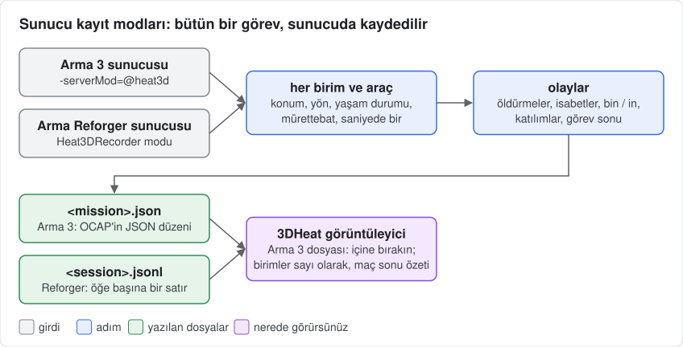

# Sunucu kayıt modları (Arma 3, Arma Reforger) {#server-recorder-mods-arma-3-arma-reforger}

Çoğu oyunu watcher, oyuncunun kendi bilgisayarında kaydeder. Arma farklıdır: bir sunucu, sunucuda çalışan bir modla bütün bir görevi kaydedebilir — yalnızca sizinkini değil, her birimi ve aracı. Oyuncular hiçbir şey kurmaz: Arma 3 modu yalnızca sunucuda çalışır, Reforger ise bir sunucunun modlarını katıldıklarında kendisi indirir (mod oyuncuların bilgisayarında hiçbir şey yapmaz). Depo bu tür iki mod içerir:
[`mods/arma3`](https://github.com/Holdi601/3DHeat-Watcher/tree/main/mods/arma3)
ve [`mods/reforger`](https://github.com/Holdi601/3DHeat-Watcher/tree/main/mods/reforger).
Tam belgeleri README dosyalarıdır; bu sayfa genel bakıştır.

**Durum: ikisi de oyunda henüz denenmedi.** Arma 3 eklentisi derlendi ve Arma'nın eklentileri çağırma biçimiyle sürüldü; çıktısı 3DHeat tarafından okundu. Onun SQF betikleri Arma 3'te henüz çalışmadı. Reforger modu Bohemia'nın yayımladığı betik API'sinden yazıldı ve hiç derlenmedi. Herkese açık bir sunucuya, README'deki test adımları geçmeden koymayın.

## Arma 3 {#arma-3}

1. Eklentiyi platform başına bir kez derleyin (`mods/arma3/extension`). Bunun için bir C derleyicisi gerekir: Windows'ta Visual Studio Build Tools, Linux'ta gcc; daha önce hiç derleme yapmadıysanız sunucu sağlayıcınıza sorun.
   - Windows, "x64 Native Tools Command Prompt for VS" içinde:
     `cl /nologo /O2 /LD heat3d.c /Fe:heat3d_x64.dll`
   - Linux: `gcc -O2 -shared -fPIC -o heat3d_x64.so heat3d.c -ldl`
2. Modu derleyin: `python mods/arma3/build.py` `mods/arma3/@heat3d/` klasörünü yazar (Arma 3 Tools gerekmez).
3. `@heat3d` klasörünü sunucunun klasörüne kopyalayın ve sunucuyu `-serverMod=@heat3d` ile başlatın.
4. Sunucunun `.rpt` günlüğü şunu yazar: `Heat3D recorder 0.1.0: recording <file> every 1 s`.

| Ayar | Varsayılan | Ne yapar |
|---|---|---|
| `captureDelay` | 1 | kareler arası saniye |
| `recordHits` | 1 | 0 yaparsanız isabet olayları kapanır |
| `recordShots` | 1 | 0 yaparsanız atış sayımı kapanır |
| `minPlayers` | 0 | yalnızca bu kadar oyuncu bağlıyken kaydeder |

Bir görev, `init.sqf` dosyasında bunların birini geçersiz kılabilir (`heat3d_captureDelay = 0.5;`).
Kayıtlar `@heat3d` içindeki `recordings/` klasörüne ya da `HEAT3D_DIR` klasörüne yazılır.

**Çıktı:** her görev için bir dosya, OCAP'ın JSON düzeninde (OCAP2 kaydedicisinin biçimi), adı `<date>__<time>_<mission>.json`. Görev sırasında bu bir günlüktür (`.heat3d.part`), her yazmada boşaltılır; çöken bir görevin günlüğü bir sonraki görev başladığında tamamlanır.

## Arma Reforger {#arma-reforger}

Mod (`Heat3DRecorder.gproj`), Bohemia'nın Workbench aracında (Arma Reforger Tools) açılıp derlenir, yerel bir özel sunucuda denenir, Workbench'ten yayımlanır (denerken listelenmeyecek şekilde) ve sunucunun `config.json` dosyasındaki `mods` listesine eklenir — adım adım README'de. Her saniye her karakterin konumunu, yönünü, yaşam durumunu, aracını ve oyuncu kimliğini; her aracın konumunu, yönünü, durumunu ve mürettebatını yazar; ayrıca öldürmeleri (katil, silah, mesafe), isabetleri, binme ve inme olaylarını, oyuncuların girip çıkmasını ve görevin bitişini.

**Çıktı:** satır başına bir JSON nesnesi, `$profile:heat3d/<UTC date>_<UTC time>_<world>.jsonl`: bir `header` satırı (biçim `heat3d-reforger`, eksenler x doğu, y yukarı, z kuzey), sonra olaylar gerçekleştikçe `entity`, `frame` ve `event` satırları ve bir `end` satırı. Birim satırları `[id, x, y, z, dir, alive, vehicleId, playerId]`, araç satırları `[id, x, y, z, dir, alive, [crew ids]]` biçimindedir; olaylar OCAP2'nin olay düzenini izler.

## Görüntüleyicide {#in-the-viewer}

Bir Arma 3 kaydını [3DHeat görüntüleyicisine](https://holdi601.github.io/3DHeat/) bırakın: bir görev bir oturumdur, birimler askere, araçlar kendi türüne dönüşür; öldürmeler ve isabetler brifing listesine girer. OCAP2'nin web oynatıcısı da onu oynatır. Reforger dosyası, modun kendi satır biçimindedir ve OCAP2'nin olay düzenini kullanır.
