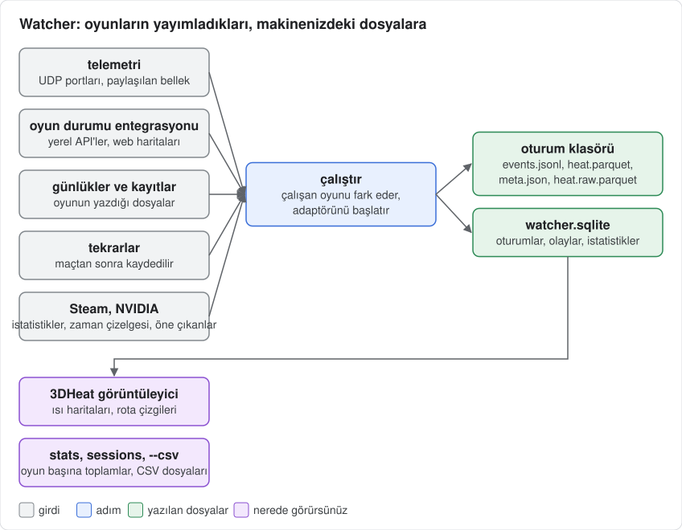

# Kaynaklar ve kurallar {#sources-and-rules}

İzleyici yalnızca oyunların ve platformların oyuncuya verdiklerini kaydeder. Bu sayfa hangi kaynakların bu kapsama girdiğini, izleyicinin her biriyle ne yapabileceğini ve hangi oyunları ya da oyun bölümlerini bilerek dışarıda bıraktığını açıklar.

## Kaynağın altı türü {#the-six-kinds-of-source}

Her adaptörün bir `kind` (tür) değeri vardır ve tür, adaptörün neler yapabileceğini belirler:

| Tür | Nedir | Çok oyunculu oyunlar |
|---|---|---|
| `telemetry` | oyunun gösterge panelleri, hareket platformları ve direksiyon sistemleri için yayımladığı bir UDP portu ya da paylaşılan bellek (Forza Data Out, F1 UDP, Kunos ve iRacing paylaşılan belleği, SimConnect, X-Plane'in UDP arayüzü, SCS SDK eklentisi) | evet - oyunun kendi çıktısıdır |
| `gsi` | oyunun oyuncunun kendi makinesine sunduğu bir oyun durumu entegrasyonu ya da yerel web API'si (Valve GSI, League'in Canlı İstemci Verisi API'si, Rocket League'in İstatistik API'si, War Thunder'ın web haritası) | evet, API'nin oyuncuya gösterdiği kadarıyla |
| `log` | oyunun çalışırken yazdığı dosyalar: günlükler, istatistikler, kayıtlar, kayıt dosyaları (Elite Dangerous, Minecraft, Path of Exile, Hearthstone, Star Citizen, EVE Online) | evet |
| `replay` | oyunun oyuncuları için kaydettiği demolar ve tekrarlar, maç bittikten sonra dönüştürülür (CS2, Dota 2, War Thunder, World of Tanks, World of Warships, Squad, League of Legends, VALORANT, IL-2 Tacview) | evet, şifrelenmemişse ve yalnızca açık kısımlar |
| `platform` | Steam'in ve grafik sürücüsünün tuttukları: istatistikler, başarımlar, zaman çizelgeleri, klipler ve öne çıkanlar | evet |
| `memory` | oyunun belleği, yalnızca okunur, sizin yazdığınız bir profille | **asla** - yalnızca tek oyunculu |

Yalnızca `memory` bir başka süreci açar, ve yalnızca okumak için. Diğer beş tür, oyunun, Steam'in ya da NVIDIA Uygulaması'nın zaten yazdığını ya da gönderdiğini okur.

## Kaynaklar nasıl okunur {#how-the-sources-are-read}

- **Bir oyuna hiçbir şey enjekte edilmez, kancalanmaz ya da değiştirilmez.** Oyuna hiçbir kod yüklenmez, hiçbir pencere ya da girdi kancalanmaz, hiçbir oyun dosyası yamanmaz. İzleyici veri klasörünün dışında yalnızca, siz istediğinizde [`setup --apply`](commands.md#setup) komutunun yazdığı dosyaları yazar: bir oyunun kendi ayar dosyasını (özgün dosya `<file>.heat3d-backup` olarak saklanır), bir oyun durumu cfg dosyasını, DCS kanca betiğini, BeamNG protokol modunu.
- **Paylaşılan bellek yalnızca okunur ve asla oluşturulmaz.** Adlandırılmış bir eşlemeyi açmanın yaygın Python yolu, o yoksa onu oluşturur. Daha sonra başlayan bir oyun, izleyicinin boş, salt okunur eşlemesini bulur, kendi eşlemesini yapamaz ve telemetrisi ölür. İzleyici eşlemeleri yalnızca `OpenFileMappingW` ile açar (yalnızca var olanı bulur), `FILE_MAP_READ` ile eşler ve oyun henüz yapmamışsa daha sonra tekrar dener.
- **Portlar ödünç alınır, asla ele geçirilmez.** Bir UDP telemetri portunu zaten başka bir program dinliyorsa (FH Companion, SimHub, bir gösterge uygulaması), o programa bırakılır. Başka bir program izleyicinin tuttuğu bir portu dinlemeye başlarsa, izleyici birkaç saniye içinde portu bırakır. Forza adaptörleri, oyun başladıktan sonra 5300 portunu almadan önce 15 s bekler ve her paketi değiştirmeden 127.0.0.1:5301 adresine aktarır; böylece ikinci bir Data Out uygulaması yine kaydedebilir.
- **Yalnızca yerel.** İzleyicinin çalıştırdığı oyun durumu sunucuları (CS2, Dota 2) yalnızca 127.0.0.1'de dinler, başka hiçbir yerde değil. Oyunun cfg dosyası bir belirteç içerdiğinde (`setup`'ın yazdığı bu olur), her gönderinin onu taşıması gerekir; taşımayan gönderiler `bad_auth` olarak sayılır ve atılır. Belirteçli bir cfg dosyası olmadan, her yerel gönderi kabul edilir ve günlük bunu söyler. İzleyicinin istediği yerel API'ler (League 2999 portunda, War Thunder 8111'de, Rocket League 49123'te, X-Plane 49000'de) 127.0.0.1 üzerindedir.
- **Günlük dosyaları paylaşılır, asla kilitlenmez.** Her okuma, dosyayı Windows'un sahip olduğu her paylaşım bayrağıyla açar ve tekrar kapatır; böylece oyun yazmaya devam edebilir, dosyasını yeniden adlandırabilir ya da değiştirebilir.
- **Yalnızca iki dış servis, ve yalnızca bu durumlarda.** Sürüm denetimi, en fazla altı saatte bir GitHub'a (`api.github.com`) sorar ve kapatılabilir (bkz. [Güncellemeler](updates.md)). League tekrar adaptörü, yalnızca kendi `riot_api_key` değerinizi girdiğinizde Riot'un Match-V5 API'sine sorar. Başka hiçbir yere hiçbir şey gönderilmez.
- **Bir kaynağı açmak sizin kararınızdır.** `--apply` olmadan `setup` yalnızca neyi değiştireceğini söyler.

## Çok oyunculu kurallar {#multiplayer-rules}

- Çevrimiçi oynanan bir oyun yalnızca yayımladığı şeyler üzerinden kaydedilir: telemetri, oyun durumu API'leri, günlükler, tekrarlar, platform dosyaları. Bunların içinde izleyici, oyunun oyuncuya gösterdiğini kaydeder ve bunun ötesinde hesaplanan hiçbir şeyi kaydetmez:
  - **CS2 oyun durumu entegrasyonu**, izlenen oyuncuyu gönderir (hayattayken kendiniz, ölünce bir takım arkadaşınız). Diğer oyuncuların konumları (`allplayers_*`) yalnızca izleyicilere ve GOTV'ye gönderilir, bu yüzden izleyici bunları istemez.
  - **League of Legends'ın Canlı İstemci Verisi API'sinde konum yoktur.** Riot'un politikası, araçların oyunun kendisinden oyuncunun bilebileceklerini göstermesine izin verir; bunun ötesinde hesaplanan hiçbir şeye izin vermez (düşman zamanlayıcıları yok). İzleyici, oyuncunun gördüğü öldürme akışını ve skor tablosunu, bir de oyuncunun kendi sayılarını kaydeder.
  - **Rocket League'in İstatistik API'sinde araba konumu yoktur** (araba durumu yalnızca izleyicilere gönderilir). Konumu olan şey topun, vurulduğu, gol olduğu ya da direğe çarptığı yerdir.
  - **War Thunder'ın web haritası**, minimapin gösterdiğini gösterir; isim ya da kimlik olmadan.
  - **F1 23/24/25** her arabanın konumunu Motion paketlerinde koyar; çevrimiçi de. Oyun bunları kendisi verir ve yalnızca "Your Telemetry" kısıtlı olan oyuncuların verisini saklar.
  - **DCS World**: çok oyunculu bir sunucu, kendi uçağının verisinin dışa aktarılmasını yasaklayabilir; oturumda o zaman olaylar olur ama konum olmaz ve oturum bunu söyler.
- **Çok oyunculu bir oyunun belleği asla okunmaz.** Çevrimiçi oynanan olarak işaretli bir oyun için bir bellek adaptörü reddedilir ve bir profil, oyununun çevrimiçi oynanıp oynanamayacağını açıkça belirtmek zorundadır. Tek oyunculu modu bir anti-hile altında çalışan oyunlar da asla okunmaz. Tek oyunculu modu bu makine dışında hiçbir şeye bağlı olmadığında, çevrimiçi modu da olan tek oyunculu bir oyun yalnızca o zaman okunur. Bkz. [Bellek okuma](memory-reading.md).
- Bir adaptördeki `multiplayer` bayrağı (`games --markdown` komutunda "Online play" olarak gösterilir) yalnızca bellek okumayı belirler. Diğer türlerin çevrimiçi oyunu kaydetmesini durdurmaz.

## Reddedilenler ve nedenleri {#what-is-declined-and-why}

Bazı oyunlar ve oyun bölümleri kaydedilmez: verileri korumalıdır, yayımlanmaz ya da oyuncunun makinesinde hiç bulunmaz:

| Oyun | Neler dışarıda bırakılır | Neden |
|---|---|---|
| VALORANT | tekrarlarda konumlar, adlar, skorlar; istemcinin lockfile uç noktaları | Tekrarın oyun akışı, her derlemenin çalıştırılabilir dosyasından alınan değerlerle karartılmıştır. Oyun Vanguard altında çalışır. Riot istemcisinin lockfile uç noktaları yayımlanmış bir API değildir. **Okunan:** tekrarın açıkta taşıdığı şeyler - harita, maç kimliği, ajanlar, sunucunun öldürme ve tur zaman çizelgesi. |
| League of Legends | `.rofl` tekrarlarının an be an kısmı; istemcinin lockfile uç noktaları | Her yamada farklı biçimde hileye karşı karartılmış ve çözülmez. **Okunan:** her tekrarın düz JSON olarak taşıdığı maç sonu kutusu, bir maç sırasında Canlı İstemci Verisi API'si ve - kendi geliştirici anahtarınızla - resmi Match-V5 zaman çizelgesi (dakikada bir konumlar, öldürmeler olduğu yerde). |
| Fortnite | tekrarlar | Şifreli. |
| World of Tanks, World of Warships | tekrarlar, izleyicinin içinde | Şifreli. İzleyici bunları okumaz; ayrı dönüştürücüler dışarıda okur (`exporters/ext/wot-replay`, `exporters/ext/wows-replay`), her biri kendi başına bir proje. **Okunan, bir dönüştürücü kuruluyken:** kaydetme istemcisinin bildiği her araç ya da geminin konumu ve öldürmeler. |
| Gran Turismo 7 | telemetri | Yalnızca konsolda ve telemetrisi oyundan kurtarılan bir anahtarla şifreli. |
| Apex Legends | her şey | LiveAPI'si tam olayları yalnızca özel ve kişisel lobilerde gönderir; aksi halde yerelde hiçbir şey yoktur. |
| Overwatch 2, Call of Duty, Battlefield 6, Hunt: Showdown 1896 | canlı veri | Okunacak yerel tekrar, günlük ya da oyun durumu çıktısı yok. İstatistikleri Steam'in tuttuğu yere gelir ([Steam istatistikleri](game-steam-stats.md), [Steam Timeline](game-steam-timeline.md)), klipleri ise [NVIDIA highlights](nvidia-highlights.md) olarak. |
| Star Citizen | `Game.log` dışında her şey | Easy Anti-Cheat çalıştırır; izleyici oyunun yazdığı günlük dosyasını okur ve oyunun sürecine asla yaklaşmaz. |
| osu! | tekrarlar | Kapsam dışı: 2B bir oyun, haritaya koyacak bir şey yok. |
| Herhangi bir çok oyunculu oyun | bellek | Asla. Tek oyunculu modu bir anti-hile altında çalışan oyunlar (GTA V, Elden Ring başlatıcısı üzerinden) da okunmaz. |

Şifreli tekrarlar açılmaz: VALORANT okuyucusu tekrarın şifreleme bayrağını denetler ve şifreli bir dosyayı reddeder ("this replay is encrypted; it is not read").

Henüz yapılmamış, araştırılmış oyunlar (Deadlock tekrarları, Rocket League `.replay` dosyaları, StarCraft II, Team Fortress 2, Rainbow Six Siege, Beat Saber, Trackmania, birkaç yarış simülatörü), kaynaklarıyla birlikte [Tüm oyunlar tek tabloda](watcher.md#researched-not-yet-built) sayfasında listelenir. Her biri, teslim edilmeden önce kontrol edilmek için örnek dosyalara ihtiyaç duyar.
