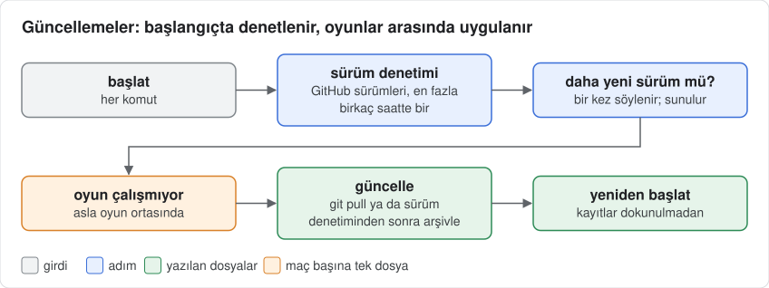

# Güncellemeler {#updates}

Watcher, kendini [Holdi601/3DHeat-Watcher](https://github.com/Holdi601/3DHeat-Watcher/releases) sürümlerinden güncel tutar. Güncelleyici, depodaki `heat3d_watch` paketinin yanındaki `heat3d_update` paketidir.

## Denetleme {#the-check}

- **Ne zaman**: `update` dışındaki her komut başlarken denetler. `run` ayrıca çalışırken denetler: en fazla saatte bir ve yalnızca hiçbir oyun çalışmıyorken.
- **Nasıl**: `https://api.github.com/repos/Holdi601/3DHeat-Watcher/releases/latest` adresine bir HTTPS isteği, 5 saniyelik zaman aşımıyla. Yanıt `%LOCALAPPDATA%\3DHeat\update-check-3DHeat-Watcher.json` içinde altı saat önbelleğe alınır, bu yüzden çoğu başlangıç hiçbir şey sormaz. "Henüz sürüm yok" (HTTP 404) da bir yanıt gibi önbelleğe alınır. Çevrimdışıysanız, istek sınırına takıldıysanız ya da bir vekil sunucunun arkasındaysanız denetleme sessizce başarısız olur ve komut sahip olduğu sürümle devam eder.
- **Sürümler**: kurulu sürüm, depo klasöründeki `VERSION` dosyasıdır. Bir sürümün etiketi (`v1.2.0` ya da `1.2.0`) parça parça sayı olarak karşılaştırılır; `-` ya da `+` işaretinden sonrası yok sayılır.
- **Kapatma**: `HEAT3D_NO_UPDATE=1` (boş, `0`, `false` ya da `no` dışındaki her değer) hem denetlemeyi hem de otomatik güncellemeyi kapatır. Her 3DHeat aracı kendi önbellek dosyasını tutar; bir aracın yanıtı başka bir araç yerine geçmez.

## Yeni bir sürüm çıktığında {#what-happens-when-a-newer-release-is-out}

- **`run`** başlarken bir bildirim yazdırır ve çalışmaya devam eder:
  `[heat3d_watch] 3DHeat Watcher 1.2.0 is out (this is 1.0.2). <release page>`. Çalışırken, `auto_update` açıksa (varsayılan) ve oyun çalışmıyorsa, kendini günceller: günlük satırı `3DHeat Watcher 1.2.0 is out (this is 1.0.2); updating`, bir Windows bildirimi "Updating to 1.2.0", güncelleme, her bağdaştırıcının durdurulması ve oturumlarının kapatılması, ardından aynı komutun yeni kodla yeniden başlatılması. Watcher bir oyunun ortasında asla güncellenmez. Güncelleme uygulanamazsa bildirim bunu söyler ("1.2.0 is out; not updated: ..."), watcher eski sürümle çalışmaya devam eder. `auto_update` kapalıysa yalnızca bildirim olur.
- **Diğer komutlar**, bir terminalde çalıştıklarında `Update now? [Y/n]` diye sorar. Enter, `y`, `yes`, `j` ya da `ja` güncellemeyi yapar ve aynı komutu yeni sürümde yeniden çalıştırır. Terminal yoksa (zamanlanmış bir çalıştırma, bir boru hattı), nasıl güncelleneceğini yazdırır ve devam eder.
- **İsteğe bağlı**: `python -m heat3d_watch update` (ya da `python -m heat3d_update`) önbellek olmadan GitHub'a sorar ve günceller. `--check` yalnızca yeni bir sürüm çıkıp çıkmadığını söyler. `HEAT3D_NO_UPDATE` ayarlıyken bile çalışır.

## Güncelleme nasıl uygulanır {#how-an-update-is-applied}

Kopyanın nasıl kurulduğuna bağlıdır:

- **Bir git klonu** (klasörde `.git` var ve `git` PATH üzerinde): `git pull --ff-only`. Klonun izlenen dosyalarında değişiklik varsa reddedilir (`git status --porcelain --untracked-files=no` boş değilse): bu değişiklikler birinin emeğidir ve güncelleme onların ne olacağına karar vermez. Bunları kaydedin ya da saklayın, sonra çekin.
- **İndirilmiş bir kopya**: sürümün kaynak arşivi indirilir ve geçici bir klasöre açılır. Dışarı çıkacak girdiler atlanır. Arşivin `VERSION` dosyası, sürümün iddia ettiği sürüm olmalıdır; değilse hiçbir şey kopyalanmaz. Sonra dosyaları depo klasörünün üzerine kopyalanır. Bir sürümün parçası olmayan dosyalara — kayıtlar, ayarlar, sanal ortamlar, dışa aktarımlar, sizin yaptığınız her şey — dokunulmaz. Eski bir sürümde olup yenisinde bulunmayan bir Python modülü, sürümün kendi paketlerinden (`heat3d_watch`, `heat3d_update`) kaldırılır; böylece güncellemeden sonra eski bir bağdaştırıcı modülü yüklenmez. Bu paketlerin dışında hiçbir şey silinmez.

Kayıtlar ve ayarlar zaten çoğunlukla depo klasörünün dışında yaşar (`%LOCALAPPDATA%\3DHeat\Watcher`), bu yüzden bir güncelleme onlara hiç yaklaşmaz.

Bir güncellemeden sonra aynı komut yeniden başlatılır. Windows'ta watcher yeni süreci başlatır, onu bekler ve çıkış kodunu iletir; böylece konsol, işi ilk süreç yapmış gibi davranır.
