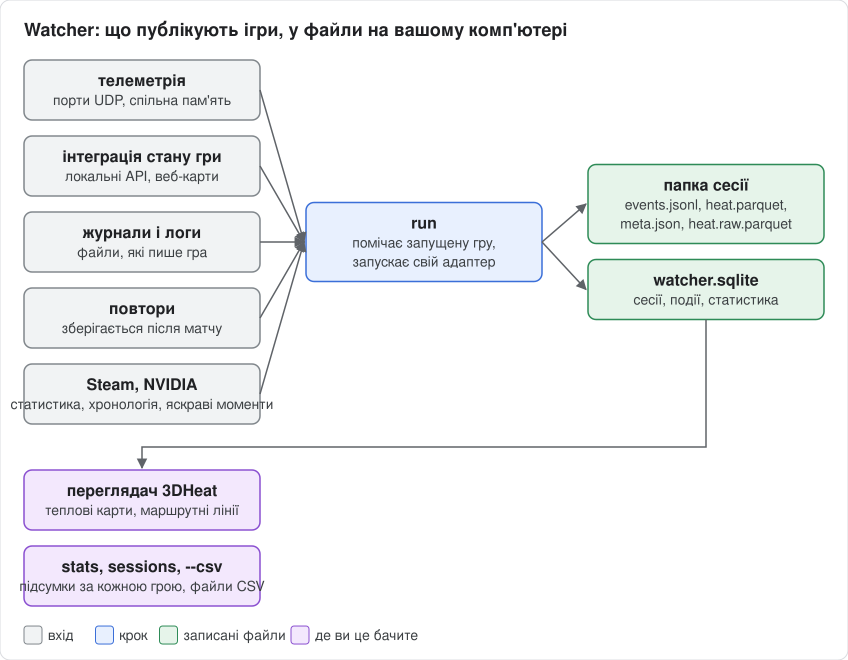

# 3DHeat Watcher {#dheat-watcher}

**Що це?** Ви граєте в гру. Ця програма тихо записує, де ви були і що відбувалося.
Пізніше ви можете переглянути це як кольорову карту в переглядачі 3DHeat.

**Навіщо це потрібно?** Щоб вести власний облік кожної сесії — де ви їздили, літали чи воювали,
ваші підсумки за кожною грою — без жодного сайту і без зміни самої гри.

**Приклад:** ви проїжджаєте коло в гоночній грі, а Watcher працює; потім у файлі в
`sessions\<game>\` зберігається лінія, якою ви їхали, і переглядач її малює.

Докладніше: 3DHeat Watcher — це фонова програма, яка записує те, що ігри публікують про вашу гру:
де ви були, що відбувалося в кожному місці і цифри, що за цим стоять, — у файли на вашому
комп'ютері. Файли призначено для вашої власної статистики, а також для теплових карт і
маршрутних ліній переглядача 3DHeat.

Вона працює тихо, помічає, яку гру ви запустили, і читає вихідні дані цієї гри: порт
телеметрії або спільну пам'ять, які гра публікує для панелей, інтеграцію стану гри, журнал або
лог, який пише гра, повтор, який вона зберігає після матчу, статистику, яку веде Steam, і кліпи,
які зберігає NVIDIA App. Записи лишаються на вашому комп'ютері. Програма звертається лише до двох
зовнішніх служб і лише в таких випадках: GitHub — щоб перевірити наявність новішого випуску (див.
[Оновлення](../updates.md)), і API Match-V5 від Riot — лише якщо ви вводите власний ключ API Riot
(див. [Повтори League of Legends](../game-lol-replays.md)).



## Що вона записує {#what-it-records}

- **Позиції**: автомобіль, літак, герой або гравець, кілька разів на секунду там, де гра їх публікує,
  із швидкістю, курсом і всім іншим, що гра надсилає разом із ними.
- **Події**: появи, смерті, вбивства, кола, етапи, раунди, голи, завдання, зльоти і посадки, зміни
  зон, досягнення, яскраві моменти. Кожна подія зберігається з її часом і з її місцем, коли гра його
  дає.
- **Статистика за сесію**: вбивства, смерті, кола, найкраще коло, відстань, найвища швидкість, час
  гри і власна статистика гри там, де вона її веде.

Що дає кожна гра і звідки, описано на її власній сторінці в розділі [Ігри](../games.md). Одне джерело
не може записати все: багатокористувацькі ігри записуються лише через те, що вони публікують, і
Watcher ніколи не читає їхню пам'ять (див. [Джерела і правила](../sources-and-rules.md)).

## Встановлення {#install}

Ви лише починаєте працювати з командним рядком? Спершу прочитайте [Перш ніж почати](before-you-start.md).

Watcher — це програма на Python для Windows (Python 3.10 або новіший). Багато її джерел існують лише
в Windows: спільна пам'ять, реєстр, сповіщення Windows.

```bash
git clone https://github.com/Holdi601/3DHeat-Watcher.git
cd 3DHeat-Watcher
pip install -r requirements.txt
```

Завантажений архів випуску працює так само: розпакуйте його, потім виконайте `pip install -r requirements.txt`
у папці. Подробиці і супутні компоненти, які потрібні деяким іграм, — у
[Встановлення і запуск](../installing-and-running.md).

## Швидкий старт {#quick-start}

```bash
python -m heat3d_watch games            # що дає кожна гра і звідки
python -m heat3d_watch setup all        # що треба буде ввімкнути (нічого не змінюється)
python -m heat3d_watch setup f1-25 --apply   # увімкнути вихід однієї гри (оригінальний файл зберігається як резервна копія)
python -m heat3d_watch run              # стежити; лишайте працювати, поки граєте
python -m heat3d_watch stats            # підсумки за кожною грою
python -m heat3d_watch stats --csv out  # сесії, події і статистика у вигляді файлів CSV
```

Ви маєте побачити: після `games` таблицю з одним рядком на кожну гру; `run` працює, доки ви не натиснете
Ctrl+C або не закриєте вікно.

Усе записується в `%LOCALAPPDATA%\3DHeat\Watcher`. Щоб використати іншу папку, задайте
змінну середовища `HEAT3D_WATCH_HOME` або виконайте `python -m heat3d_watch config --set data=D:\somewhere`.

- `sessions\<game>\<date>_<adapter>\` — по одній папці на сесію, у ній лежать `events.jsonl` (кожна
  подія в момент, коли вона сталася), `heat.parquet` (рядки з позицією, готові для переглядача 3DHeat) і
  `meta.json` (гра, джерело, осі, кількості, статистика)
- `watcher.sqlite` — статистика кожної сесії в трьох простих таблицях
- `watcher.log` — що робив Watcher

Переглядач відкриває `heat.parquet` сесії напряму, без жодних налаштувань (її осі й одиниці — у самому
файлі). Перетворені повтори записуються як таблиці й документи матчів поруч; власний формат переглядача
один файл на матч описано на його сторінці
[контейнер `.3dheat`](https://holdi601.github.io/3DHeat/container.html), а колонки кожної таблиці — у
[Дані](../the-data.md).

## Документація {#the-documentation}

| Сторінка | Що в ній |
|---|---|
| [Перш ніж почати](before-you-start.md) | Python, термінал, заповнювачі, як виглядають успіх і поширені помилки |
| [Встановлення і запуск](../installing-and-running.md) | вимоги, запуск у фоновому режимі, автозапуск із Windows, файл блокування, журнал, кожне налаштування і змінна середовища |
| [Ігри](../games.md) | окрема сторінка для кожної гри: що записується, звідки, як увімкнути, як це працює, осі, статистика, що перевірено |
| [Дані](../the-data.md) | папки сесій, `events.jsonl`, `heat.parquet` і його підвал, `meta.json`, `watcher.sqlite`, відновлення після збою, експорт CSV, відкриття сесії в переглядачі 3DHeat |
| [Команди](../commands.md) | кожна команда і параметр `python -m heat3d_watch` |
| [Джерела і правила](../sources-and-rules.md) | шість видів джерел, правила для багатокористувацьких ігор, які ігри виключено і чому |
| [NVIDIA Highlights](../nvidia-highlights.md) | що NVIDIA Highlights може і чого не може доставити, і як яскравий момент отримує позицію |
| [Серверні модулі-записувачі](../server-mods.md) | модулі сервера Arma 3 і Arma Reforger, які записують цілі місії для переглядача |
| [Читання пам'яті](../memory-reading.md) | профілі пам'яті для одиночної гри: формат, перевірки, як написати і перевірити один |
| [Оновлення](../updates.md) | як Watcher шукає нові випуски і оновлює себе |
| [Розробка](../development.md) | написання адаптера: API, тести, чесне `verified`, регенерація сторінок ігор |
| [Усі ігри в одній таблиці](../watcher.md) | кожна гра в одній таблиці, як її виводить `games --markdown`, плюс ігри, досліджені, але ще не створені |
| [Довідка з команд](../cli-reference.md) | `--help` кожної команди, створений з коду |
| [Підтримка](../maintaining.md) | контрольний список випуску для цих сторінок |

## Частина 3DHeat {#part-of-3dheat}

3DHeat Watcher — один з безкоштовних інструментів навколо переглядача 3DHeat (Watcher використовує
3DHeat CS2 для перетворення демо CS2). Кожен має власний проєкт, випуски та ліцензію:

| Інструмент | Що робить | Документація |
|---|---|---|
| [3DHeat](https://github.com/Holdi601/3DHeat) | переглядач: теплові карти, аналіз заїздів і огляд матчів у 3D | [сайт](https://holdi601.github.io/3DHeat/) |
| [GameFiles](https://github.com/Holdi601/3DHeat-GameFiles) | траси і рівні з файлів, які постачають ігри, як 3D-моделі | [сайт](https://holdi601.github.io/3DHeat-GameFiles/) |
| [GameCapture](https://github.com/Holdi601/3DHeat-GameCapture) | телеметрія кіл з гоночних ігор; рівні, відтворені з відео ігрового процесу | [сайт](https://holdi601.github.io/3DHeat-GameCapture/) |
| [Unreal Exporter](https://github.com/Holdi601/3DHeat-UnrealExporter) | плагін для Unreal Editor, який експортує рівень як одну 3D-модель | [сайт](https://holdi601.github.io/3DHeat-UnrealExporter/) |
| [CS2](https://github.com/Holdi601/3DHeat-CS2) | демо Counter-Strike 2 у таблиці та документи матчів; карти в 3D-моделі | [сайт](https://holdi601.github.io/3DHeat-CS2/) |
| [Watcher](https://github.com/Holdi601/3DHeat-Watcher) | записує те, що ігри публікують про вашу гру, у фоновому режимі | [сайт](https://holdi601.github.io/3DHeat-Watcher/) |
| [Ext-WarThunder](https://github.com/Holdi601/3DHeat-Ext-WarThunder) | повтори War Thunder у таблиці та документи матчів | [сайт](https://holdi601.github.io/3DHeat-Ext-WarThunder/) |
| [Ext-WoT](https://github.com/Holdi601/3DHeat-Ext-WoT) | повтори World of Tanks у таблиці та документи матчів | [сайт](https://holdi601.github.io/3DHeat-Ext-WoT/) |
| [Ext-WoWs](https://github.com/Holdi601/3DHeat-Ext-WoWs) | повтори World of Warships у таблиці та документи матчів | [сайт](https://holdi601.github.io/3DHeat-Ext-WoWs/) |
| [Ext-Squad](https://github.com/Holdi601/3DHeat-Ext-Squad) | демо серверів Squad у таблиці та документи матчів | [сайт](https://holdi601.github.io/3DHeat-Ext-Squad/) |
| [Ext-DCS](https://github.com/Holdi601/3DHeat-Ext-DCS) | карти DCS World у 3D-моделі | [сайт](https://holdi601.github.io/3DHeat-Ext-DCS/) |
| [Ext-IL2](https://github.com/Holdi601/3DHeat-Ext-IL2) | карти IL-2 Sturmovik у 3D-моделі | [сайт](https://holdi601.github.io/3DHeat-Ext-IL2/) |

Ліцензія: MIT ([LICENSE](https://github.com/Holdi601/3DHeat-Watcher/blob/main/LICENSE)). Ліцензії
сторонніх пакетів, які він використовує, і те, чого вимагають ігри, які він читає, перелічено в
[LICENSES.md](https://github.com/Holdi601/3DHeat-Watcher/blob/main/LICENSES.md).
