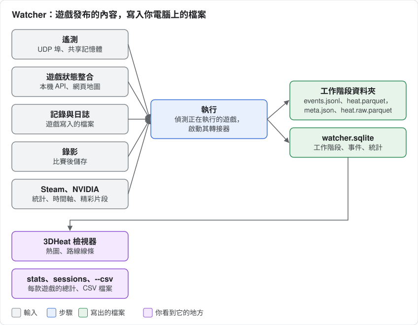

# 3DHeat Watcher {#dheat-watcher}

**這是什麼？** 你玩遊戲，這個程式會悄悄記下你去了哪裡、發生了什麼事。
之後你可以在 3DHeat 檢視器中，把它當作彩色地圖來查看。

**為什麼要用它？** 為了保留你自己每一次遊玩的紀錄——你在哪裡開車、飛行或作戰，以及每款遊戲的總計——不需要任何網站，也不需要改動遊戲。

**範例：** 你在賽車遊戲中開一圈，並執行 Watcher；之後 `sessions\<game>\` 中的一個檔案會保存你走過的路線，而檢視器會把它畫出來。

更詳細地說：3DHeat Watcher 是一個背景程式，會把遊戲所發布的關於你遊玩的內容——你去過哪裡、各處發生了什麼事，以及背後的數字——記錄到你自己電腦上的檔案中。這些檔案用於你自己的統計，以及 3DHeat 檢視器的熱圖與路線線條。

它會安靜地執行，偵測你啟動了哪一款遊戲，並讀取該遊戲自己的輸出：遊戲為儀表板而發布的遙測埠或共享記憶體、遊戲狀態整合、遊戲寫入的日誌或記錄檔、比賽後儲存的錄影、Steam 保存的統計資料，以及 NVIDIA App 儲存的剪輯。錄製內容只留在你的電腦上。程式只會連線到兩個外部服務，且僅限以下情況：GitHub，用於檢查較新的發行版本（見[更新](../updates.md)）；以及 Riot 的 Match-V5 API，且僅在你輸入自己的 Riot API 金鑰時（見[英雄聯盟錄影](../game-lol-replays.md)）。



## 它記錄什麼 {#what-it-records}

- **位置**：車輛、飛機、英雄或玩家，在遊戲發布位置時每秒數次，並附上速度、方向，以及遊戲一併送出的其他資料。
- **事件**：生成、死亡、擊殺、圈數、賽段、回合、進球、任務、起飛與降落、區域變更、成就、精彩片段。每個事件都會連同其時間儲存，並在遊戲提供時附上其位置。
- **每次工作階段的統計**：擊殺、死亡、圈數、最佳圈速、距離、最高速度、遊玩時間，以及遊戲自己保存的統計資料（若有）。

每款遊戲能提供什麼、來自何處，都列在 [遊戲](../games.md) 下各自的頁面中。單一來源無法記錄一切：多人遊戲只能透過它們所發布的內容來記錄，而 watcher 從不讀取它們的記憶體（見[來源與規則](../sources-and-rules.md)）。

## 安裝 {#install}

第一次使用命令列？請先閱讀[開始之前](before-you-start.md)。

Watcher 是一個適用於 Windows 的 Python 程式（Python 3.10 或更新版本）。它的許多來源只存在於 Windows 上：共享記憶體、登錄檔、Windows 通知。

```bash
git clone https://github.com/Holdi601/3DHeat-Watcher.git
cd 3DHeat-Watcher
pip install -r requirements.txt
```

下載的發行封存檔的作法相同：解壓縮後，在該資料夾中執行 `pip install -r requirements.txt`。細節，以及某些遊戲所需的額外項目，請見
[安裝與執行](../installing-and-running.md)。

## 快速開始 {#quick-start}

```bash
python -m heat3d_watch games            # what each game gives, and from where
python -m heat3d_watch setup all        # what would have to be switched on (nothing is changed)
python -m heat3d_watch setup f1-25 --apply   # switch one game's output on (the original file is backed up)
python -m heat3d_watch run              # watch; leave it running while you play
python -m heat3d_watch stats            # totals per game
python -m heat3d_watch stats --csv out  # sessions, events and stats as CSV files
```

你應該會看到：執行 `games` 後，出現一個表格，每個遊戲一行；`run` 會持續執行，直到你按下 Ctrl+C 或關閉視窗。

所有內容都寫入 `%LOCALAPPDATA%\3DHeat\Watcher`。若要使用其他資料夾，請設定
`HEAT3D_WATCH_HOME` 環境變數，或執行 `python -m heat3d_watch config --set data=D:\somewhere`。

- `sessions\<game>\<date>_<adapter>\`：每次遊玩一個資料夾，內含 `events.jsonl`（每個發生的事件）、`heat.parquet`（含位置的列，可直接用於 3DHeat 檢視器），以及 `meta.json`（遊戲、來源、座標軸、計數、統計資料）
- `watcher.sqlite`：每次工作階段的統計資料，分為三個簡單的表格
- `watcher.log`：watcher 做過的事

檢視器可以直接開啟工作階段的 `heat.parquet`，無需任何設定（座標軸與單位記錄在檔案中）。轉換後的對戰錄影會以表格與對戰文件的形式寫在它旁邊；檢視器自己每場比賽一個檔案的格式，記載於其 [`.3dheat` 容器](https://holdi601.github.io/3DHeat/container.html)頁面，而每個表格的欄位則見[資料](../the-data.md)。

## 文件 {#the-documentation}

| 頁面 | 內容 |
|---|---|
| [開始之前](before-you-start.md) | Python、終端機、佔位符，以及成功與常見錯誤的樣子 |
| [安裝與執行](../installing-and-running.md) | 需求、在背景執行、隨 Windows 啟動、鎖定檔、記錄、每個設定與環境變數 |
| [遊戲](../games.md) | 每款遊戲一頁：記錄什麼、來源為何、如何開啟、運作方式、座標軸、統計、已驗證的內容 |
| [資料](../the-data.md) | 工作階段資料夾、`events.jsonl`、`heat.parquet` 及其 footer、`meta.json`、`watcher.sqlite`、當機後的復原、CSV 匯出、在 3DHeat 檢視器中開啟工作階段 |
| [指令](../commands.md) | `python -m heat3d_watch` 的每個指令與選項 |
| [來源與規則](../sources-and-rules.md) | 六種來源、多人遊戲的規則，以及哪些遊戲被排除在外及其原因 |
| [NVIDIA Highlights](../nvidia-highlights.md) | NVIDIA Highlights 能與不能提供什麼，以及一個精彩片段如何取得位置 |
| [伺服器錄製模組](../server-mods.md) | 為檢視器錄製完整任務的 Arma 3 與 Arma Reforger 伺服器模組 |
| [讀取記憶體](../memory-reading.md) | 單人遊戲的記憶體設定檔：格式、檢查、如何撰寫與驗證 |
| [更新](../updates.md) | watcher 如何檢查新版本並自行更新 |
| [開發](../development.md) | 撰寫轉接器：API、測試、誠實的 `verified`、重新產生遊戲頁面 |
| [所有遊戲一覽](../watcher.md) | 所有遊戲的一張表，即 `games --markdown` 的輸出，以及已研究但尚未建構的遊戲 |
| [指令參考](../cli-reference.md) | 每個指令的 `--help`，由程式碼產生 |
| [維護](../maintaining.md) | 這些頁面的發行檢查清單 |

## 屬於 3DHeat 的一部分 {#part-of-3dheat}

3DHeat Watcher 是圍繞 3DHeat 檢視器的免費工具之一（watcher 使用 3DHeat CS2 來轉換 CS2 對戰錄影）。每一個都是獨立的專案，有自己的發行版本與授權：

| 工具 | 功能 | 文件 |
|---|---|---|
| [3DHeat](https://github.com/Holdi601/3DHeat) | 檢視器：在瀏覽器中呈現熱圖、賽車分析與對戰回顧 | [網站](https://holdi601.github.io/3DHeat/) |
| [GameFiles](https://github.com/Holdi601/3DHeat-GameFiles) | 從遊戲所出貨的檔案中取得賽道與關卡，輸出為 3D 模型 | [網站](https://holdi601.github.io/3DHeat-GameFiles/) |
| [GameCapture](https://github.com/Holdi601/3DHeat-GameCapture) | 賽車遊戲的圈速遙測；從遊戲影片重建關卡 | [網站](https://holdi601.github.io/3DHeat-GameCapture/) |
| [Unreal Exporter](https://github.com/Holdi601/3DHeat-UnrealExporter) | Unreal Editor 外掛，將關卡匯出為單一 3D 模型 | [網站](https://holdi601.github.io/3DHeat-UnrealExporter/) |
| [CS2](https://github.com/Holdi601/3DHeat-CS2) | 將 Counter-Strike 2 對戰錄影轉為表格與對戰文件；將地圖轉為 3D 模型 | [網站](https://holdi601.github.io/3DHeat-CS2/) |
| [Watcher](https://github.com/Holdi601/3DHeat-Watcher) | 在背景中記錄遊戲所發布的關於你遊玩的內容 | [網站](https://holdi601.github.io/3DHeat-Watcher/) |
| [Ext-WarThunder](https://github.com/Holdi601/3DHeat-Ext-WarThunder) | 將 War Thunder 錄影轉為表格與對戰文件 | [網站](https://holdi601.github.io/3DHeat-Ext-WarThunder/) |
| [Ext-WoT](https://github.com/Holdi601/3DHeat-Ext-WoT) | 將 World of Tanks 錄影轉為表格與對戰文件 | [網站](https://holdi601.github.io/3DHeat-Ext-WoT/) |
| [Ext-WoWs](https://github.com/Holdi601/3DHeat-Ext-WoWs) | 將 World of Warships 錄影轉為表格與對戰文件 | [網站](https://holdi601.github.io/3DHeat-Ext-WoWs/) |
| [Ext-Squad](https://github.com/Holdi601/3DHeat-Ext-Squad) | 將 Squad 伺服器對戰轉為表格與對戰文件 | [網站](https://holdi601.github.io/3DHeat-Ext-Squad/) |
| [Ext-DCS](https://github.com/Holdi601/3DHeat-Ext-DCS) | 將 DCS World 地圖轉為 3D 模型 | [網站](https://holdi601.github.io/3DHeat-Ext-DCS/) |
| [Ext-IL2](https://github.com/Holdi601/3DHeat-Ext-IL2) | 將 IL-2 Sturmovik 地圖轉為 3D 模型 | [網站](https://holdi601.github.io/3DHeat-Ext-IL2/) |

授權：MIT（[LICENSE](https://github.com/Holdi601/3DHeat-Watcher/blob/main/LICENSE)）。它所使用的第三方套件的授權，以及它所讀取的遊戲所需遵守的規定，列於
[LICENSES.md](https://github.com/Holdi601/3DHeat-Watcher/blob/main/LICENSES.md)。
