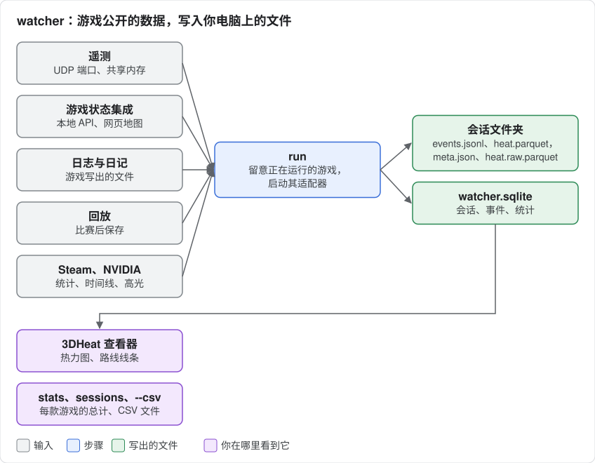

# 3DHeat Watcher {#dheat-watcher}

**这是什么？** 你玩游戏，这个程序会悄悄记录你去过哪里、发生了什么。之后你可以在 3DHeat 查看器中以彩色地图的形式查看它。

**我为什么要用它？** 为了保留你自己的每次游玩记录：你在哪里驾驶、飞行或战斗，以及每款游戏的总计数据，而无需任何网站，也无需改动游戏。

**示例：** 你在赛车游戏中开着 watcher 驾驶一圈；之后，`sessions\<game>\` 中的一个文件会保存你行驶的路线，查看器会把它画出来。

更详细地说：3DHeat Watcher 是一个后台程序，它把游戏公开的关于你游玩的数据记录到你自己电脑上的文件中：你去过哪里、在哪里发生了什么，以及背后的数字。这些文件用于你自己的统计，也用于 3DHeat 查看器的热力图和路线线条。

它安静地运行，留意你启动了哪款游戏，并读取该游戏自己输出的数据：为仪表盘公开的遥测端口或共享内存、游戏状态集成、游戏写出的日志或日记、比赛后保存的回放、Steam 保存的统计数据，以及 NVIDIA App 保存的剪辑。录制内容保存在你自己的电脑上。本程序只与两个外部服务通信，而且仅在以下情况下：GitHub，用于检查是否有更新的版本（参见 [更新](../updates.md)）；以及 Riot 的 Match-V5 API，且仅当你输入了自己的 Riot API 密钥时（参见 [英雄联盟回放](../game-lol-replays.md)）。



## 它记录什么 {#what-it-records}

- **位置**：汽车、飞机、英雄或玩家的位置，在游戏公开位置的地方每秒记录数次，并附有速度、朝向，以及游戏一同发送的其他任何数据。
- **事件**：出生、死亡、击杀、圈、赛段、回合、进球、任务、起飞和降落、区域变化、成就、高光时刻。每个事件都保存了其时间，以及游戏提供位置时的地点。
- **每场游戏的统计**：击杀、死亡、圈数、最佳圈速、距离、最高速度、游玩时长，以及游戏自己保存的统计数据（如果有的话）。

每款游戏能提供什么、数据来自何处，都记录在 [游戏](../games.md) 下各自的页面中。没有任何一个数据源能记录所有内容：多人游戏只能通过它们公开发布的内容来记录，watcher 从不读取它们的内存（参见 [数据源与规则](../sources-and-rules.md)）。

## 安装 {#install}

第一次使用命令行？请先阅读 [开始之前](before-you-start.md)。

Watcher 是一个用于 Windows 的 Python 程序（需要 Python 3.10 或更高版本）。它的许多数据源只存在于 Windows 上：共享内存、注册表、Windows 通知。

```bash
git clone https://github.com/Holdi601/3DHeat-Watcher.git
cd 3DHeat-Watcher
pip install -r requirements.txt
```

下载的发布压缩包使用方式相同：解压后，在该文件夹中运行 `pip install -r requirements.txt`。详细说明，以及某些游戏所需的额外组件，参见 [安装与运行](../installing-and-running.md)。

## 快速开始 {#quick-start}

```bash
python -m heat3d_watch games            # 每款游戏能提供什么，以及来自何处
python -m heat3d_watch setup all        # 需要开启哪些设置（不会改动任何东西）
python -m heat3d_watch setup f1-25 --apply   # 开启某一款游戏的输出（原始文件会被备份）
python -m heat3d_watch run              # 开始监视；游玩时保持其运行
python -m heat3d_watch stats            # 每款游戏的总计
python -m heat3d_watch stats --csv out  # 会话、事件和统计数据，写成 CSV 文件
```

你应该会看到：运行 `games` 后，出现一个表格，每款游戏一行；`run` 会一直运行，直到你按下 Ctrl+C 或关闭窗口。

所有内容都写入 `%LOCALAPPDATA%\3DHeat\Watcher`。若要使用其他文件夹，请设置环境变量 `HEAT3D_WATCH_HOME`，或者运行 `python -m heat3d_watch config --set data=D:\somewhere`。

- `sessions\<game>\<date>_<adapter>\`：每次游玩一个文件夹，内含 `events.jsonl`（每个事件发生时的记录）、`heat.parquet`（带有位置的各行，可直接用于 3DHeat 查看器）以及 `meta.json`（游戏、数据源、坐标轴、计数、统计数据）
- `watcher.sqlite`：每个会话的统计数据，分为三张普通的表
- `watcher.log`：watcher 做过的事情

查看器可以直接打开会话的 `heat.parquet`，无需任何设置（其坐标轴和单位都保存在文件中）。转换后的回放会以表格和对局文档的形式写在它旁边；查看器自己的一场对局一个文件的格式，参见其 [`.3dheat` 容器](https://holdi601.github.io/3DHeat/container.html) 页面；每个表格的列，参见 [数据](../the-data.md)。

## 文档 {#the-documentation}

| 页面 | 内容 |
|---|---|
| [开始之前](before-you-start.md) | Python、终端、占位符，以及成功和常见错误是什么样子 |
| [安装与运行](../installing-and-running.md) | 系统要求、后台运行、随 Windows 启动、锁文件、日志、每个设置和环境变量 |
| [游戏](../games.md) | 每款游戏一页：记录什么、来自何处、如何开启、工作原理、坐标轴、统计数据、已验证的内容 |
| [数据](../the-data.md) | 会话文件夹、`events.jsonl`、`heat.parquet` 及其页脚、`meta.json`、`watcher.sqlite`、崩溃后的恢复、CSV 导出，以及在 3DHeat 查看器中打开会话 |
| [命令](../commands.md) | `python -m heat3d_watch` 的每条命令和每个选项 |
| [数据源与规则](../sources-and-rules.md) | 六类数据源、多人游戏规则、哪些游戏被排除在外以及原因 |
| [NVIDIA Highlights](../nvidia-highlights.md) | NVIDIA Highlights 能提供什么、不能提供什么，以及一个高光时刻如何获得位置 |
| [服务器录制模组](../server-mods.md) | 为查看器录制整场任务的 Arma 3 和 Arma Reforger 服务器模组 |
| [读取内存](../memory-reading.md) | 单人游戏的内存配置：格式、检查、如何编写和验证一个配置 |
| [更新](../updates.md) | watcher 如何检查新版本并自行更新 |
| [开发](../development.md) | 编写数据源适配器：API、测试、诚实的 `verified`、重新生成游戏页面 |
| [所有游戏一览](../watcher.md) | 所有游戏的一览表，即 `games --markdown` 打印的内容，外加已研究但尚未实现的游戏 |
| [命令参考](../cli-reference.md) | 每条命令的 `--help`，由代码生成 |
| [维护](../maintaining.md) | 这些页面的发布检查清单 |

## 属于 3DHeat 的一部分 {#part-of-3dheat}

3DHeat Watcher 是 3DHeat 查看器周围的免费工具之一（watcher 使用 3DHeat CS2 来转换 CS2 录像）。每个工具都是独立的项目，有自己的发布版本和许可证：

| 工具 | 作用 | 文档 |
|---|---|---|
| [3DHeat](https://github.com/Holdi601/3DHeat) | 查看器：在 3D 中显示热力图、赛车分析和对局回顾 | [站点](https://holdi601.github.io/3DHeat/) |
| [GameFiles](https://github.com/Holdi601/3DHeat-GameFiles) | 从游戏附带的文件中提取赛道和关卡，输出为 3D 模型 | [站点](https://holdi601.github.io/3DHeat-GameFiles/) |
| [GameCapture](https://github.com/Holdi601/3DHeat-GameCapture) | 赛车游戏的圈速遥测；从游戏视频重建的关卡 | [站点](https://holdi601.github.io/3DHeat-GameCapture/) |
| [Unreal Exporter](https://github.com/Holdi601/3DHeat-UnrealExporter) | 一个 Unreal 编辑器插件，将关卡导出为一个 3D 模型 | [站点](https://holdi601.github.io/3DHeat-UnrealExporter/) |
| [CS2](https://github.com/Holdi601/3DHeat-CS2) | 将反恐精英 2 录像转为表格和对局文档；将地图转为 3D 模型 | [站点](https://holdi601.github.io/3DHeat-CS2/) |
| [Watcher](https://github.com/Holdi601/3DHeat-Watcher) | 在后台根据游戏公开的数据记录你的游戏过程 | [站点](https://holdi601.github.io/3DHeat-Watcher/) |
| [Ext-WarThunder](https://github.com/Holdi601/3DHeat-Ext-WarThunder) | 将战争雷霆的录像转为表格和对局文档 | [站点](https://holdi601.github.io/3DHeat-Ext-WarThunder/) |
| [Ext-WoT](https://github.com/Holdi601/3DHeat-Ext-WoT) | 将坦克世界的录像转为表格和对局文档 | [站点](https://holdi601.github.io/3DHeat-Ext-WoT/) |
| [Ext-WoWs](https://github.com/Holdi601/3DHeat-Ext-WoWs) | 将战舰世界的录像转为表格和对局文档 | [站点](https://holdi601.github.io/3DHeat-Ext-WoWs/) |
| [Ext-Squad](https://github.com/Holdi601/3DHeat-Ext-Squad) | 将 Squad 服务器录像转为表格和对局文档 | [站点](https://holdi601.github.io/3DHeat-Ext-Squad/) |
| [Ext-DCS](https://github.com/Holdi601/3DHeat-Ext-DCS) | 将 DCS World 地图转为 3D 模型 | [站点](https://holdi601.github.io/3DHeat-Ext-DCS/) |
| [Ext-IL2](https://github.com/Holdi601/3DHeat-Ext-IL2) | 将 IL-2 Sturmovik 地图转为 3D 模型 | [站点](https://holdi601.github.io/3DHeat-Ext-IL2/) |

许可证：MIT（[LICENSE](https://github.com/Holdi601/3DHeat-Watcher/blob/main/LICENSE)）。它所使用的第三方软件包的许可证，以及它所读取的游戏的要求，列在
[LICENSES.md](https://github.com/Holdi601/3DHeat-Watcher/blob/main/LICENSES.md) 中。
